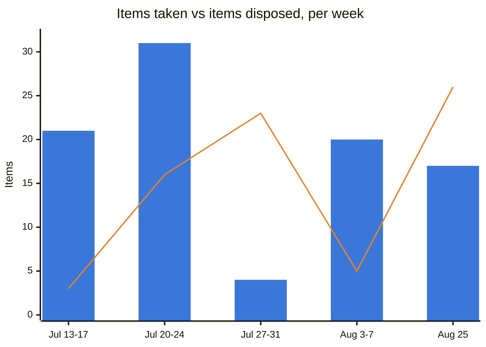

# Weekly Briefing — 2026-08-25

*Window: 2026-08-18 to 2026-08-25. Eight sections, not nineteen (agreed 08-25). Dropped: People Requiring Engagement, Blind Spots, Delegation Opportunities, Chief of Staff Advice, This Week's Objectives, Communication Opportunities — all six restated material already carried in the priorities or the registers. Say if any earns its way back.*

## 1. Evidence Coverage

Email: Available. Calendar: Available. Teams chats: Available. Meeting transcripts: Partial — four transcripts retrieved complete (464/464, 187/187, 566/566, plus two ADM connects with no numeric total exposed). Documents: Partial. Known gaps: Planner and To Do returned no retrieval tool at all; a bounded Sent Items query completed but surfaced no sent-folder records, so sent-mail coverage is unverified rather than confirmed empty.

**Not transcribed at source, not a retrieval failure:** entroCIM Leadership Collaboration (08-24), Ascent/Navigator AOP and Financial KPIs (08-24), entroCIM/WAM/Safety & Ascent (08-21), both Ford internal alignment meetings (08-18, 08-24), Woolly AI Slide Sync (08-19). Six forums, all yours, all with transcription switched off.

**Two packages were run over this window and returned largely disjoint sources.** Treat this as a sample, not a census. Filters reported: 17 items excluded as sprint-level engineering tasks, 22 excluded as out of portfolio scope.

## 2. Executive Summary

- **WAM's data foundation has a named defect and no owner.** DDP/EUDM passes truncated manufacturer part numbers; ADM holds full ones; exact matching fails and orders are missed. Open "quite some days," no response to follow-up, no work item. This sits underneath every completeness claim WAM makes.
- **entroCIM AI crossed from experiment to product without crossing a governance gate.** Woolly is now framed as embedded product development and described as present in the version being prepared for release, while AI Tech Review, C2P, sponsor approval and cybersecurity review are all still open.
- **The AOP is probably done and nothing proves it.** P&Ls uploaded, CDA confirmed complete, submission itself unevidenced against an 08-21 date. First closure question this week.
- **Two fixed customer dates land Thursday** with single-person dependencies behind both: TCCC PaaS-03W/04W validation and Disney training, the latter blocked on server access only Shawn Clark appears to hold, while he was on PTO.
- **You absorbed 17 commitments this week and closed none.** No register closure of any kind since 08-07.

## 3. Top 3 Leadership Priorities

**1. Force ownership of the truncated part number defect.**
Business impact: WAM/ADM misses orders outright, which corrupts install-base, license and renewal completeness — the exact benefits story that was rebuilt after the July Engel and Hasting reset. Why you personally: the fix sits with Daniel Totino's team and the EUDM team, outside your org, and two prior follow-ups produced no owner. This is an escalation problem, not a backlog problem. Risk if delayed: every week of truncated ingestion adds unmatched records that will need remediation later, and the 09-01 ADM release will land on a foundation that still can't match. Next step: Akansh's email lands (B53); if it names no owner, you escalate (A29). Expected outcome: a named owner and a work item, this week.

**2. Get the entroCIM AI architecture question answered before the approval question.**
Business impact: whether Woolly can run against Wesco Azure AI Foundry or a local endpoint decides whether entroCIM AI is sellable into Federal Reserve and the whole walled-off and on-premises base. That is a segmentation question, not a security one, and it is worth more than the approval timing. Why you personally: you set the commercial model in the 08-19 session (customer-supplied LLM keys, Wesco supplies platform and skills, AI carries incremental pricing), and that model only holds if the endpoint question resolves in a way secure customers can accept. Risk if delayed: the governance track completes around an architecture that excludes a material part of the installed base. Next step: put the endpoint question to Ron Snyder and Keith Bishop as a decision with a date, ahead of the AI Tech Review submission. Expected outcome: a stated position on Foundry versus local endpoint before the one-pager goes in.

**3. Close the AOP loop and then clear Register A.**
Business impact: the register is at 22 against a cap of 15, with twelve items overdue and ten of those carrying dates Claude proposed rather than dates you set. The register has stopped measuring anything. Why you personally: disposal requires your answers; nothing else can produce it. Risk if delayed: this is the third occurrence of the symptom that triggered both prior restructures. Next step: confirm the AOP submission completed, then answer the thirteen-item sweep in `Deliverables/EOS_Meta/2026-08-19_EOS_Open_Decisions.md`. Expected outcome: Register A at or under 15.

## 4. Key Product Due Dates

| Initiative | Next milestone | Due | Owner | Status |
|---|---|---|---|---|
| WAM / ADM | Pending-activation fix, default end-user, bulk edit, cancelled-order handling | **2026-09-01** | Akansh Gangil | On track, but lands on the unresolved part number defect |
| entroCIM / TCCC | PaaS-03W and PaaS-04W migration, then validation | **2026-08-27** | Matthew Heid (test), Chad Steger (customer comms) | Dry runs passed; maintenance-window email owed 08-25/26 |
| entroCIM / Disney | Training session; users must exist at server level | **2026-08-27** | Shawn Clark, coordinated by Chad Steger | **At risk** — single-person access dependency, Shawn on PTO |
| entroCIM / Ford | UDAC coverage extension while renewal scope is prepared | **2026-10-01** | Adam Lazare | Continuity secured; scope document owed |
| entroCIM | Live customer webinar after next release | **2026-10-05** | David Blondel | Stated target |
| entroCIM AI | AI Tech Review intake, then C2P | Not yet scheduled | Sourav Pradhan (route), Ron Snyder (content) | One-pager not started |
| FY27 AOP | Submission | **2026-08-21, passed** | Darryl / John Erickson | **Unconfirmed** — see closure checks |
| CDA | AOP input | Complete | John Erickson | Confirmed "GTG, nothing needed" |

## 5. Meeting Preparation

**Wesco & Ford re-alignment, 2026-08-26.** The pre-read covers renewal SOW, support process, training, audit concept, remote access and future meter integration. Go in with the support model settled in your own mind: bucketed SME hours are being replaced by maintenance under an SLA, and the scope document (C35) is owed by Adam Lazare, not by you. The thing to protect is that UDAC continuity to 10-01 is an interim accommodation, not the new baseline.

**Connect with Senthil, ADM team, 2026-08-27.** This is where the truncated part number defect should land with a named owner. Bring the specific failure — DDP/EUDM selects truncated values, ADM matches on full ones, orders are missed — and the leaf-node dependency awaiting Jen Turnage for two weeks (C32). Ask for an owner and a work item, not an explanation.

**WAM Backlog Refinement, 2026-08-31.** Immediately before the 09-01 release. Confirm the release gate, the pending-activation defect, duplicate prevention where historical rows lack line numbers, and whether the part number issue changes what "done" means for this release.

**entroCIM Leadership Collaboration, 2026-08-31.** Its 08-24 occurrence produced no record because transcription is off. Pre-align AI approval, Federal Reserve enablement, the Ford and TCCC commitments, the Dell security response, and the access concentration behind Disney and the migrations.

## 6. Weekly Analytics

**Commitment load and aging — the number that matters this week.** Register A went 21 to 22. Other-Owned went 70 to 86. Seventeen absorbed, zero closed. **The last register closure of any kind was 2026-08-07, eighteen days ago**, and the only two closure events in the system's history were 07-27 and 08-07, both forced. The end-of-day check was restored 08-19 and has had four working days to fire; it has produced no recorded dispositions yet. Twelve Register A items are overdue, ten on dates Claude proposed rather than dates you set.

**Watch-list trend and calibration.** 20 Active, of which **19 are High**. That is not a risk profile, it is a scale that has stopped discriminating. Five moved up this week (Dell alarm reliability, WAM/ADM data integrity, ServiceNow, Louvre, TCCC), two came off Active (FY27 AOP scope, now a closure question; Freshdesk, absent from both packages), two came on (Dell alarm reliability, Dell SOC 2). Per the Analytics Standard, risk inflation is a failure mode in its own right, and this qualifies. Recommend a severity re-grade at the monthly pass rather than another row-by-row argument.

**Recurring theme, and it is the sharpest finding this cycle.** Upstream data ownership has now appeared three separate times without a decision-log entry or a named owner: manufacturer part number truncation (08-25), software catalogue leaf nodes awaiting Jen Turnage two weeks (08-25), and the older supplier and global attribute thread (DDPTRK-6346, running since July). Same shape each time — a WAM/ADM dependency sitting in someone else's data domain, chased by email, never owned. **Three occurrences without a decision is the definition the standard uses for "discussed repeatedly, decided never."** Proposed forum: Connect with Senthil, 08-27. Proposed outcome: one accountable owner for upstream data quality into ADM, not three separate chases.

**Impact capture.** Three wins added: PaaS-05 migrated and PaaS-06 SAML restored, roughly 5,000 ADM records inserted with Exact data at 90 to 95 percent, and CDA's AOP input confirmed complete. Ledger at 44 entries. Zero communicated to Sean; the fortnightly update falls due 2026-09-02.

**Decision velocity.** Two decisions recorded this week. Radar 26 against a cap of 20, Backlog 29. The entroCIM AI decision returned to the Radar after supplying the forum and owner it was missing on 08-19. Radar is six over cap, and closing that gap needs a priority judgment I have deliberately left to you rather than making silently.

## 6a. Register Health

*New this cycle. One table, one chart, two sentences. If it does not change a decision within three cycles, it gets cut.*

| Register | Now | Cap | Δ this cycle | Taken | Closed |
|---|---|---|---|---|---|
| Register A — Mine | **15** | 15 | −7 | 1 | 8 |
| Other-Owned | **68** | — | −18 | 16 | 34 |
| — of which Critical | **19** | ~15 | −17 | — | — |
| Watch List Active | **20** | 20 | 0 | 2 | 2 |
| Decision Radar | **26** | 20 | +1 | 1 | 0 |
| Decision Backlog | 30 | — | +1 | — | — |

**Blue bars are items taken on. The orange line is items disposed of.** No data was captured between 08-07 and 08-24; the series resumes at 08-25 and the gap is not interpolated.

The shape is the finding: **disposal only ever spikes when something forces it.** The two tall orange peaks are the 07-27 restructure and today; every other week the line sits far below the bars. Across the 14 captured days from 07-13 to 08-06, 76 items were taken and 20 closed, and 12 of those 20 closures happened on a single day, the 07-21 sweep you ran yourself. **On nine of those fourteen days nothing closed at all.** Today is the third forced event, and the question the next few cycles answer is whether the restored end-of-day check and the corrected aging rule make the orange line stay up on its own, or whether this remains a system that needs surgery every three weeks.

## 7. Watch List and Decision Radar Delta

**New Active:** Dell alarm reliability (High, ↑) — alarm-database corruption stops alarming, no root cause, preventive fix not until the October release, only a manual live-reset in the meantime. The 10:00 test alarms passing is not reassurance: the failure is intermittent, so a passing test proves nothing about the next occurrence, and alarming is the core value proposition for a customer like Dell. Dell SOC 2 / security-evidence request (Medium, New) — SkyFoundry cannot supply a SOC 2 for a service it does not operate; requester, artifact and gating impact all unknown. **The risk here is over-answering an unscoped question.**

**Updated in place** rather than added as new rows, under single-home-per-fact: WAM/ADM data integrity now carries the truncation root cause; AI adoption governance is restated as a product-governance risk with the endpoint question named as the gating unknown; Disney SSO now carries the second access failure of the same shape.

**Demoted to Passive:** FY27 AOP submission scope (date passed, now a closure question), Freshdesk mailbox (improving, absent from both packages for 18 days). Both reversible in one line.

## 8. Closure Checks — answered 2026-08-25

*All seven answered same day, plus one volunteered. Dispositions recorded in the registers; this section is the record of what was asked and what came back.*

| # | Question | Darryl's answer | Recorded as |
|---|---|---|---|
| 1 | Did the FY27 AOP submission complete on 08-21? | "AOP is complete from Digital Products as of today." | **A19, A21 closed.** Also closes the gap the evidence left — it showed the uploads but never the submission |
| 2 | "Yep, it'll be Shawn" — Sean McCloskey or Shawn Clark? | **Sean McCloskey** | Resolved in `03` and `06`; **C36 created** (Awaited, Critical), gated behind Ron Snyder's one-pager |
| 3 | A10, Dell Service Management cadence — still open? | Now owned by Syed Zaidi and Chad Steger as ongoing work, not a single action | **A10 closed as not completed but correctly reclassified.** It had no completion state, so it was never a valid Register A item. Ownership recorded in `07` and on the Dell support row in `04` |
| 4 | A8, AI Council date and prep materials — still open? | "Ron is prepping material for submission of entroCIM AI." | **A8 closed, overtaken.** The 08-19 session happened; prep now sits with Ron as B58 |
| 5 | A14, Rob Cook meeting day — done or dropped? | "Resolved, and the meeting happened." | **A14 closed.** Carried 22 days for a task of minutes |
| 6 | A26, reply to Jeff Verdun — done? | Done | **A26 closed** |
| 7 | Run the Other-Owned aging sweep? | Yes | **Run. 12 aged out, 3 closed as resolved by evidence.** The sweep exposed a defect in the rule itself — see below |
| + | *Volunteered:* A27, i3 Section 8 edits to Legal | "Completed a couple of weeks ago" | **A27 closed.** Three consequences below |

**Three things came out of these answers that are worth more than the closures.**

**The i3 win was already banked and the record said otherwise.** A27 was done around 08-11 and carried as open for two weeks. That means the Impact Ledger's i3 entry was wrong to read "pending send" — the redline, memo and rationale have been with Legal all along — and, more usefully, **C-i3-1 and C-i3-2 were never blocked by you.** They are two weeks of silence from Legal, which is a chaseable problem where the record showed an unchaseable one.

**The aging rule could not fire, and its zero throughput was arithmetic rather than evidence.** It ages from an item's "gate or date," and almost no Other-Owned item has either — of roughly 50 non-Critical items, five carried a real date and none was yet 14 days past it. Clock corrected to run from last referencing evidence. Two carve-outs were added from running it: never age out an item whose *theme* is live even when the item is quiet, and file genuinely-completed items as closed rather than as presumed-by-silence.

**Ten of the twelve items overdue this morning carried dates I proposed, not dates you set.** Four of the six closures were items that had resolved themselves and simply never got asked about. The dating rule was being satisfied in form without producing commitments, which is why the overdue count had stopped measuring anything.

**Register A finished the day at 15, inside its cap for the first time**, down from 22 this morning and 39 in July.
