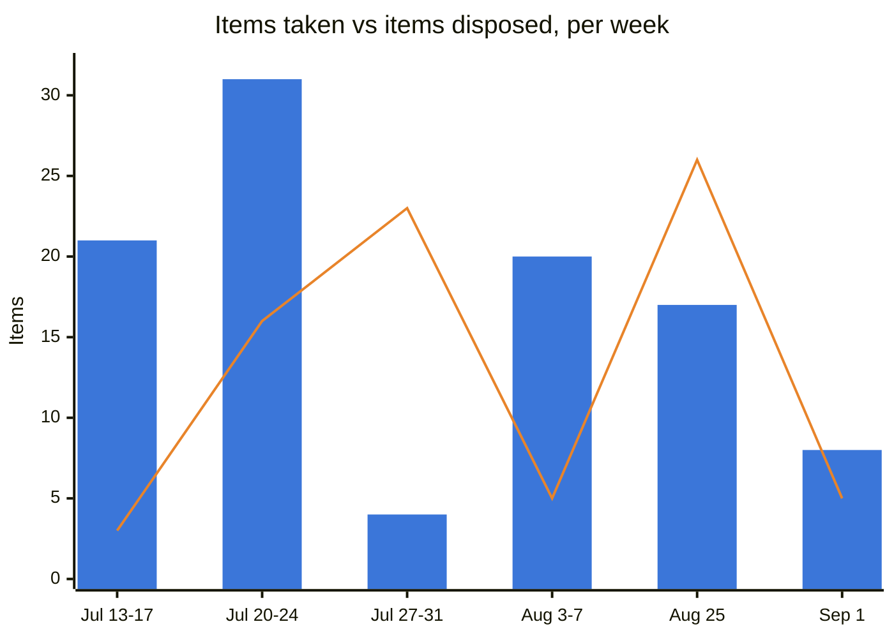

# Weekly Briefing — 2026-09-01

*Window: 2026-08-24 to 2026-08-31 (8-day Copilot lookback). Eight sections, per the reduced format agreed 2026-08-25 (Evidence Coverage, Executive Summary, Top 3 Priorities, Key Product Due Dates, Meeting Preparation, Weekly Analytics, Register Health, Watch List/Decision Radar Delta, Closure Checks). Note: `CLAUDE.md`'s Default Executive Briefing Format section still describes the full 19-section weekly and has not been updated to reflect this reduction — flagged for Darryl, not silently reconciled.*

## 1. Evidence Coverage

Email: Available (ranked results; 225 emails reported, only the ranked subset returned). Calendar: Not separately queried this cycle. Teams chats/channels: Available (ranked; 87 meetings reported, only ranked subset returned). Meeting transcripts: Partial — verbatim retrieved for *entroCIM Backlog Deep Dive* and the Ford Re-Alignment call; AI notes/recaps only for *ADM connect with Natalie*, *Daily Stand Up*, and *Digital Products / Agile Staff Meeting*. Documents: Partial — a 30,237-file tenant-wide sweep returned mostly unrelated results; ranked portfolio-relevant files were limited. Known gaps: Planner/To Do succeeded with five standard tasks, none modified in-window; premium-plan tasks unsupported. Sent Items succeeded, 29 matches.

**Not transcribed at source (9 meetings, all Darryl's own forums):** Wesco Asset Manager Product Leadership Sync, entroCIM Leadership Collaboration, FRB Architecture Finalization, Ascent/Navigator AOP and Support/Financial KPIs (all 08-24); 2026 Deployment Daily Scrum, Darryl/Nate Weekly 1:1, Darryl-Ron 1:1, iQ360 Data Collection, Monthly Dell EMS Program Meeting (all 08-25).

**Sprint-task exclusions:** 8 items from *Daily Stand Up*; 2 from *ADM connect with Natalie*; 0 from *entroCIM Backlog Deep Dive*.

## 2. Executive Summary

- **TCCC's Quest-to-Azure migration completed 08-27, ahead of the 09-01 target** — closes a customer-hosting migration risk and is the fourth confirmed instance of the migration playbook holding this cycle. Closes `05` C6, B50, B51.
- **The JCI markup is out the door.** Darryl confirmed sending the final legal markup to JCI on 08-31, resolving a stall open since 07-31 on an 8+ month negotiation. JCI's response is now the open question, not Wesco's internal process.
- **WAM/ADM's data-completeness problem got worse before it got owned.** A second, distinct defect surfaced this week — sample orders confirmed absent from EUDM outright, requiring NetSuite hydration — stacking on the truncated-part-number issue that still has no named fix owner eight days after escalation began.
- **The Federal Reserve release is still held from the customer, and it's now direct evidence rather than an inference.** Chad Steger, via Sarah Monteleone: a bug is blocking dev-to-prod promotion; no customer communication has gone out. Escalated back to Active.
- **CDA crossed from internal packaging to customer validation** — Chris Mooney and Bill Muczko both engaged, with Bill Muczko's own account base supplying the sharpest external validation CDA has had ("roughly 85% ... using spreadsheets"). The gate is now named: pilot accounts, not more internal work.
- **Underestimated item: Decision Radar is at 28 against its 20 cap**, more than 08-19's 41-to-20 overage in proportional terms once you account for the last re-rank. See Register Health.

## 3. Top 3 Leadership Priorities

**1. Force ownership of the WAM/ADM data-completeness defects before the September release absorbs them.**
Business impact: two compounding defects — truncated manufacturer part numbers and a NetSuite/EUDM hydration gap — sit underneath every order-matching and completeness claim WAM/ADM makes, on the same data foundation rebuilt after the July Engel/Hasting reset. Why you personally: A29 is explicitly yours to escalate once Akansh's follow-up produces no named owner, and it has now been open eight days without one. Risk if delayed: the 09-01 WAM/ADM release (default end-user assignment, bulk edit, cancelled-order handling, pending-activation fix) lands on a data foundation that still can't match orders correctly, and roughly 13,000-13,500 legacy records remain undisposed pending it. Next step: confirm with Akansh whether his documented escalation to the DDP/UDM team named an owner; if not, escalate per A29 this week. Expected outcome: a named fix owner and a work item for both defects, not just the one already flagged.

**2. Decide whether CDA earns its 2027 build, and put a date on the pilot-account search.**
Business impact: an eight-month build commitment is the thing at stake, and the strongest validation so far (Bill Muczko's 85% estimate) is directional, not measured. Why you personally: you set the test yourself in the 08-28 outreach — worth building, and two or three pilot accounts — and A37 (setting up the Betterton/Muczko sessions) is still unanswered as of 08-28. Risk if delayed: build priority gets set without market evidence, or the 2027 window slips while validation drags; every week without a scheduled session is a week the eight-month clock effectively doesn't move. Next step: if Chris Mooney and Bill Muczko haven't responded by 09-02 (A37's due date), send the nudge rather than wait further. Expected outcome: both validation sessions on the calendar with a date.

**3. Get the Federal Reserve release communicated, or explain why it's still being held.**
Business impact: this is now a customer-trust question layered on a technical one — the bug blocking 3.1.12.13's promotion to production has been open long enough that FRB has not been told a release exists, at a marquee account with a live commercial opportunity (the 09-08/09 Cash Services Center presentation) already in motion. Why you personally: B24 sits in your weekly 1:1 with Ron, and the risk was already escalated once (08-27) on the same "holding pattern" evidence — this week's package shows no closure, only reconfirmation. Risk if delayed: FRB discovers the hold on its own rather than hearing it from Wesco, adding a trust cost on top of the technical delay, right before a shortlisted new-business presentation at the same account. Next step: get a bug-closure date from Adam Slingerland/Ron Snyder this week, and separately confirm a customer-communication date with Sarah Monteleone regardless of the fix timeline. Expected outcome: either the release reaches FRB, or FRB hears about the hold from Wesco before hearing about it another way.

## 4. Key Product Due Dates

| Initiative | Next milestone | Due | Owner | Status |
|---|---|---|---|---|
| entroCIM / TCCC | Quest-to-Azure migration | Completed | Chad Steger | **Done, 08-27**, ahead of target |
| entroCIM / FRB | 3.1.12.13 release, dev-to-prod promotion | Not stated | Adam Slingerland, Ron Snyder (fix); Chad Steger, Babu Papanna (promotion) | **Stalled, customer not told** — escalated to Active |
| entroCIM | Next release / customer presentation | **2026-10-05 / 2026-10-09** | Ron Snyder | Reconfirmed this cycle |
| JCI MSP agreement | Final markup sent; awaiting JCI response | Sent 2026-08-31 | Darryl / Brian Miller (sent); JCI counsel (response, not dated) | **Milestone hit** — response now the open item |
| CDA | Validation sessions with Betterton's team and Muczko's org | **2026-09-02** | Darryl (A37) | No reply logged yet as of 08-28 |
| Navigator/entroCIM | Combined deck (current/interim/end-state/roadmap) | **2026-09-03** | Darryl, DJ Vaughn | In review, shared workspace created 08-27 |
| WAM/ADM | September release (default end-user, bulk edit, cancelled-order handling, pending-activation fix) | **2026-09-01** | Akansh Gangil | On track, but lands on two unresolved data-completeness defects |
| entroCIM AI (Woolly) | AI Tech Review intake, then C2P | Not yet scheduled | Sourav Pradhan (route), Ron Snyder (content) | No change this cycle |

## 5. Meeting Preparation

**Turner/FRB Cash Services Descoping Review, 2026-09-01 (today).** Sarah Monteleone asked the response team directly to read the technical submission first. This is customer-facing RFP descoping, separate from the 09-08/09 presentation — do not conflate the two FRB threads. Same-day; flagged in chat.

**Requirements definition and WAM Product discussion, both 2026-09-01 (today), both conflicting with each other and with Daily Stand Up.** Both concern WAM requirements and data path. Pre-align coverage or delegate one; bring the complex-build architecture questions and the EUDM/NetSuite defect status to whichever you attend.

**FW: Centremis RFI working session, 2026-09-02.** This is the decision forum for the WAM complex-build data path — bring Daniel Totino's roadmap input (he offered a same-week working session this cycle) and get a specific decision on mandatory fields and system ownership rather than another round of problem definition.

**entroCIM Customer Training Catalog & Process, and Managed Services & MSI, both 2026-09-02.** The training-catalog session should resolve the release-notes/webinar/SME-hours/Freshdesk ambiguity flagged in `03` this week (standard commercial support/SLA structure). The Managed Services session is the right forum to bring the CDA proposition and the entroCIM managed-service boundary together, given both surfaced independently this cycle.

**ADM connect with Natalie, 2026-09-03.** First review after the 09-01 pending-activation fix — validate production behavior, quantify remaining legacy records (~13,000-13,500), and press for the named owner on the truncated-part-number escalation.

## 6. Weekly Analytics

**Commitment load.** Register A: 12 (10 dated, 2 triggered) after today's closures, verified by direct count — corrects a one-item drift in the running narrative total. Comfortably inside the 10-15 target and the 15 ceiling; no disposal action required. Other-Owned: 75 items, of which 28 are tagged Critical (37%) — up from the 27% the 08-25 audit reached, worth a light re-check at the next Critical-tag pass rather than an immediate re-audit.

**Watch-list.** Active tier brought back under its 20 cap this cycle: two items demoted on the objective test (Dell/Wesco support process gap — ownership settled 08-25, no decision needed today; Release compliance/DCOE evidence gap — governance discipline with no date or external exposure), one new item added (Federal Reserve release 3.1.12.13, escalated back from Passive on direct evidence of continued stall), one new Passive item (Dell EcoStruxure connector, on hold pending Dell's decision). Net: Active 21 to 19.

**Decision Radar is over its cap, materially.** Direct count: **28 against the 20 ceiling**, with Decision Backlog at 36. This was not visible in the narrative log, which had not been re-verified by count since the 08-19 re-rank. Recommend the same two-pass objective test used then (no named/live forum → Backlog; forum date passed with no decision and no forward date → Backlog) at the next available session — flagging here rather than performing an unrequested 28-entry re-audit inside this briefing.

**Impact capture.** Three wins added this cycle: TCCC Quest-to-Azure migration completed (08-27), JCI final markup sent (08-31), CDA sales-leadership engagement secured with a named validation gate (08-28). Ledger now carries these plus the 08-25 entries, all "Communicated: not yet." **The fortnightly Sean update is due 2026-09-02 (tomorrow), not today** — not generated in this cycle; flag for the next session.

**Recurring theme, still live.** Upstream data ownership (manufacturer part-number truncation, now joined by the NetSuite/EUDM hydration gap) is now a fourth occurrence without a named owner or a decision-log entry, following the pattern flagged 08-25. Same shape: a WAM/ADM dependency in someone else's data domain, chased by email, not owned.

## 6a. Register Health

| Register | Now | Cap | Δ this cycle | Taken | Closed |
|---|---|---|---|---|---|
| Register A — Mine | **12** | 15 | −1 | 0 | 1 (A35) |
| Other-Owned | **75** | — | +1 | 5 | 4 (C1, C6, B50, B51) |
| — of which Critical | **28** | ~15 | — | — | — |
| Watch List Active | **19** | 20 | −1 | 1 | 2 |
| Decision Radar | **28** | 20 | not tracked this cycle | 0 | 0 |
| Decision Backlog | **36** | — | +2 | 2 | 0 |

**Blue bars are items taken on. The orange line is items disposed of.** No data captured between 08-25 and 09-01 beyond what this briefing itself produced; the series is not interpolated across that gap.

This cycle disposed of 5 (4 in Other-Owned, 1 in Register A) against 8 taken on — the first week since the 08-25 sweep where disposal ran close to intake without a forced event driving it. Decision Radar's overage was not caught by a weekly count until this cycle verified it directly, which is itself a small instance of the pattern this block exists to catch: a register can drift for weeks before anyone counts it.

## 7. Watch List and Decision Radar Delta

**New Active:** Federal Reserve (FRBNY) release 3.1.12.13 — held, customer not told (High, ↑) — escalated back from Passive on direct evidence (Sarah Monteleone quoting Chad Steger) that the stall continued rather than closed.

**Demoted to Passive (to hold the 20-item cap, both on the objective test, both reversible):** Dell/Wesco support process gap (ownership settled 08-25, no decision needed today); Release compliance/DCOE evidence gap (governance discipline, no date, no external exposure).

**Updated in place, not restated:** WAM/ADM data integrity now carries the NetSuite/EUDM hydration gap alongside the truncated-part-number defect; the JCI MSP agreement row now reflects the markup being sent and JCI's response as the open item (trend improved to ↓).

**New Passive:** Dell EcoStruxure connector — on hold pending Dell's own decision (potentially OPC); no action on Wesco's side until Dell decides.

**New Decision Backlog (no forum/date yet):** CDA 2027 build/pilot validation decision (Chris Mooney, Bill Muczko, Darryl); standard commercial support/SLA structure for entroCIM renewals and managed services (Darryl, Nathan Kehr — broader than, but related to, the Ford UDAC platform-trust gap).

**Decision Radar count (28 against cap 20) not re-ranked this cycle** — see Register Health for the recommendation.

## 8. Closure Checks

*Oldest open items, asked as one-line yes/no questions. Record answers immediately.*

| # | Question |
|---|---|
| 1 | A1 (open since 07-17) — Daniel Totino offered a same-week working session this cycle. Did it happen, and if not, can we get a specific date now rather than another "next week"? |
| 2 | A6 (trigger since 07-30) — the JCI technical-data trigger for the WAB submission has not fired in over a month. Still valid, re-date with a reason, or kill? |
| 3 | C5 (open since 07-24, undated) — UWM customer sign-off enabling decommission. Still open, or has UWM signed off? |
| 4 | B1 (open since 07-15) — supplier attribute requirements to Jarod Booth's org, escalation-only per your own scope. Still needed as tracked, or has this resolved quietly? |

---

*Routing this cycle: `Products/entroCIM/entroCIM.md`, `Products/WAM/WAM.md`, `Products/Navigator/Navigator.md`, `Products/JCI_Partnership.md` updated with this week's Durable rows. `Products/CDA/CDA.md` created new — CDA had phase-file detail but no root durable-knowledge file, which is the exact "Durable row with no product file" gap CLAUDE.md's routing rule calls out; noted rather than silently patched. `06_Stakeholder_Map.md` updated with People Signal reconfirmations (Ron Snyder, Chad Steger, Akansh Gangil, DJ Vaughn) — no new people this cycle. `03`, `04`, `05` updated per the sections above. `09_Impact_Ledger.md` gained three entries. Raw package saved to `Evidence/M365_Evidence_Weekly_2026-08-31.md`.*
