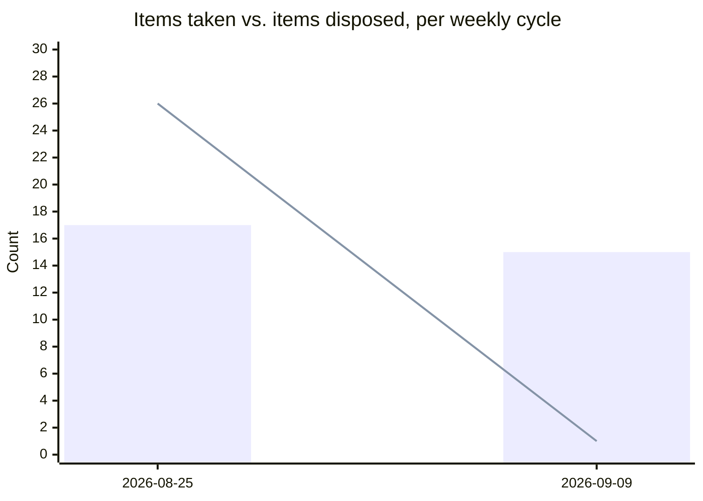

# Weekly Executive Briefing — 2026-09-09

Evidence window: 2026-09-02 to 2026-09-09 (Darryl traveling; Copilot pull run on return, timeframe extended in anticipation of a longer gap but landed as a normal contiguous week following the 2026-09-01 weekly).

## 1. Evidence Coverage

| Source | Status |
|---|---|
| Email | Partial — a bounded Sent Items query for this window returned only older, out-of-window matches; no in-window sent mail verified |
| Calendar | Not searched |
| Teams chats | Available |
| Meeting transcripts | Available — 7 verbatim transcripts retrieved complete (Requirements definition; WAM Product discussion; IDP/WAM Use Case Discussion; entroCIM Customer Training Catalog & Process; Daily Stand Up 09-08; WAM Product Backlog Refinement 09-03; entroCIM Backlog Deep Dive 09-08) |
| Documents | Available — Ford SOW email thread retrieved complete (0 to 76 of 76, 0 to 381 of 381) |
| Known gaps | ADM connect with Natalie and Digital Products/Agile Staff Meeting available only as AI notes/meeting chat, not verbatim. Four meetings not transcribed at source (Centremis RFI thread, entroCIM/WAM/Safety & Ascent 09-04, WAM Dev team/CDA Update 09-02, Agile Staff 09-08). Planner premium-plan tasks not fully visible. Sprint-task exclusion count this cycle: **48** (11 + 18 + 9 + 10 across four sources) |

This was a stronger evidence week than most on transcript completeness — most of what follows rests on Direct, verbatim evidence rather than AI notes or inference.

## 2. Executive Summary

- **Ford: scope ambiguity decreased, but a new urgent gap opened.** The Premier Support SOW was reframed this week (optimization services out, on-prem admin to Ford, secure remote access made a dependency), reducing Wesco's exposure. Same account, same week: Ford asked for confirmation of Windows Server 2019 compatibility ahead of a **2026-09-13** development-server upgrade, and no owner is named. That needs one today.
- **IDP/ADM integration cleared its architecture gate and immediately stalled on resourcing.** The proof of concept and integration path received WAB approval, but Ankit Chadha would not commit engineering capacity, citing an October Oracle deadline. An approved path with no one to build it is a different problem than an unapproved one.
- **Quest-to-Azure migration is effectively done.** Seven of eight environments complete; only dev-01 remains. This closes out a multi-month customer-hosting migration risk entirely.
- **WAM complex-build tooling direction refined.** Daniel Totino's long-promised working session appears to have produced a decision (WMX for standard serial collection, VAS for project-specific requests), very likely closing Register A1 after eight weeks open. Confirm with Akansh Gangil before treating it as closed.
- **Decision Radar has grown to 33 against its 20-item cap**, up from 25 immediately after the 08-19 enforcement pass, with no disposal pass in between. This briefing adds two well-evidenced entries rather than compounding the problem further, but the cap needs a dedicated review, not more additions.

## 3. Top 3 Leadership Priorities

**1. Unified-platform capability boundary, ahead of the Brad Stevens / Lisa Orton meeting this week.**
Business impact: Brad intends to pitch entroCIM, WAM, and Navigator as one integrated service on live deals; no production data flows between any two of these platforms today, and the governing Navigator roadmap doesn't deliver entroCIM integration until Q4 2027. Why Darryl personally: he is the only person positioned to state the current-versus-planned boundary across all four products. Risk if delayed: a deal closes this year on integrated capability that lands as unfunded custom work, or a swivel-chair the customer was never told about. Next step: finalize the written capability-boundary memo (`Products/Unified_Platform/Unified_Platform.md`) before the meeting. Expected outcome: Brad's pitch is scoped to what is actually sellable today, with planned capability clearly dated.

**2. Ford: name an owner for the Windows Server 2019 question today, and land the SOW.**
Business impact: this is the same account where the material finding is a platform-trust gap, and the pattern of open threads with no owner is exactly what's driving that distrust. Why Darryl personally: nobody has claimed this yet, and Ford's own deadline (09-13) is close enough that a missed response compounds the trust problem. Risk if delayed: another unaccountable thread on an account already flagged for a confidence audit. Next step: assign the Windows Server question to Chad Steger or Scott Dunn in today's SOW finalization meeting. Expected outcome: Ford gets a scope-bounded SOW and a same-week technical answer, not a second silence.

**3. IDP/ADM resourcing: check in on Ankit Chadha's capacity investigation.**
Business impact: WAM's data-foundation program (already carrying two active data-completeness defects) gets no near-term relief from an integration that is architecturally approved but unstaffed. Why Darryl personally: Ankit Chadha's team sits outside Darryl's org, and cross-team resourcing questions stall without executive weight behind them. Risk if delayed: the WAB approval becomes another shelved decision, and the register absorbs one more open item nobody is accountable for closing. Next step: check in around 2026-09-16, the outer edge of Ankit's own one-to-two-week window. Expected outcome: a named resource, or an honest no that lets the item close rather than age silently.

## 4. Risks Requiring Action Today

| Risk | Severity | Evidence | Business impact | Recommended action |
|---|---|---|---|---|
| Ford Windows Server 2019 compatibility, no owner named | High | Direct (RE: SLA Verbiage email thread) | Ford's 09-13 upgrade date is fixed; missed response compounds an existing trust problem on this account | Assign an owner in today's Ford SOW meeting |
| A28 — RITM1053579 approval | — | Register A, due today | entroCIM AD-assignment reassignment stalls if this sits unapproved | Approve or explicitly decline today |
| A32 — CrowdStrike Azure VM ingress-rule remediation | High | Register A, 13+ days overdue | Cybersecurity GRC is tracking this by name; no remediation plan exists to report | Respond with status, timeline, or a corrected owner today |

## 5. My Actions

Register A holds 12 items (10 dated, 2 triggered). Selection rule: due within 14 days, on a Key Product Due Dates critical path, or aging 14+ days with no movement. Seven surfaced:

1. **A28** — RITM1053579 approval (entroCIM AD reassignment). Due today, 2026-09-09.
2. **A38** — Prepare position for the Brad Stevens/Lisa Orton unified-platform meeting. Due this week; the meeting is imminent.
3. **A32** — CrowdStrike GRC remediation status. 13+ days overdue.
4. **A33** — FY2027 non-DDP travel/training spreadsheet. Overdue since 08-31.
5. **A34** — Confirm FRB Cash Services Center presentation coverage plan. Due date passed; the presentation itself ran 09-08 to 09-09.
6. **A31** — Circulate product pitches/soft-metrics deck. Overdue since 09-04.
7. **A1** — WMX complex-build follow-up. Very likely answered by this week's WMX/VAS decision; marked Potentially closed, confirm with Akansh Gangil at this week's closure check rather than treating as open action.

Not surfaced but on the register: A39, A40 (both due 09-19 or tied to the same Brad/Lisa meeting as A38 — folded into priority 1 above), A6, A7 (triggered, no change this cycle).

## 6. Suppressed

None this cycle. No disposed item recurred as an echo in this week's evidence.

## 7. Key Product Due Dates

| Initiative | Next Milestone | Due Date | Owner | Status |
|---|---|---|---|---|
| entroCIM 3.1.12.14 | Release | 2026-10-05 | David Blondel / Ron Snyder | On track — testing and QA underway, sprint capacity shifted to hold the date |
| Quest-to-Azure migration | Final environment (dev-01) | TBD | Chad Steger / Babu Papanna | Nearly complete — 7 of 8 environments done |
| Ford Premier Support SOW | Finalize scope, pricing, guardrails | 2026-09-09 (today) | Adam Lazare, Nathan Kehr, Leanne Gordon | In progress |
| Ford Windows Server 2019 confirmation | Respond ahead of dev-server upgrade | 2026-09-13 | Unassigned | **Needs an owner today** |
| Navigator NavWork MVP | UAT begins | December 2026 | DJ Vaughn | On DJ's published roadmap, unchanged |
| CDA FY27 readiness metrics | First report | 2Q27 | Ron Snyder / Darryl | Pre-service; no pilot accounts secured yet |
| AOP/Device Lifecycle Assurance (CDA) | Pilot account validation | TBD | Chris Mooney, Bill Muczko, Darryl | Open — no accounts named in evidence yet |

## 8. Other-Owned Register (condensed)

New this week, all tied to the Ford renewal or the two stalled/approved integration threads:

- **B68** (Critical) — Finalize Ford SOW scope/access/guardrails, Adam Lazare, due today.
- **B69** (Critical) — Validate delivery can support the Ford SOW scope, Chad Steger.
- **B71** (Critical) — Confirm Ford Windows Server 2019 compatibility, owner unconfirmed, needs one today.
- **B74** — Investigate IDP engineering capacity, Ankit Chadha, 1–2 week window from 09-02.
- **B72** — Share entroCIM 3.1.12.14 release deck and sales messaging, David Blondel, before 10-05.
- **B73** — Identify managed-services resources/headcount, Brad Stevens and Nathan Kehr.
- **C43/C44** — Ford pricing language (Leanne Gordon); WAM/Strev enhancement ticket numbers (Violet Moyer).

Closed this week: **B8** (IDP extraction capability), answered by the WAB approval, not performed as a discrete action.

Nothing else in the Other-Owned register crossed its 14-day aging window this cycle based on available evidence.

## 9. People Requiring Engagement

- **Ankit Chadha** — direct: needs a check-in on IDP capacity investigation, ~09-16.
- **Ford triad (Adam Lazare, Nathan Kehr, Leanne Gordon)** — direct, today: SOW finalization meeting.
- **Sridhar Loke** — new relationship, 09-03. Confirm what Darryl actually agreed to share before treating it as done (see confirmation question, `05`).
- **Akansh Gangil** — confirm whether the 09-01 Daniel Totino decision closes Register A1.
- **Brad Stevens / Lisa Orton** — meeting this week; capability-boundary memo is the preparation.

## 10. Meeting Preparation

- **Ford SOW finalization, today (2026-09-09).** Bring: the Windows Server 2019 owner decision, confirmation the delivery team can support the finalized scope (B69).
- **Brad Stevens / Lisa Orton unified-platform meeting, week of 09-08.** Bring: the capability-boundary memo (A38); the CX Connect and internal-use-funding framing questions (A39, A40).
- **entroCIM Leadership Collaboration, 2026-09-14.** Bring: 3.1.12.14 release status, Ford server-upgrade resolution, Quest dev-01 status, managed-services staffing question.
- **DCOE & entroCIM Weekly, 2026-09-14** conflicts directly with the above — pre-align or delegate.
- **Level 4/5 Services Support Assessment, 2026-09-18** (Brad Stevens, Amy Aguirre, Daniel Totino, Ramesh Konidala, Manny Tracey). Bring: WAM/ADM, VAS/WMX, Strev, and managed-services boundary positions; this is the forum most likely to force the managed-services staffing question to a decision.

## 11. Blind Spots

- **The Disney/Coda "closed out" signal may be a different Disney thread than the SSO onboarding issue tracked Active in `04`.** Evidence attributes closure to Chad Steger without specifying which Disney project. Do not let this quietly close the SSO watch item without confirming which thread it refers to.
- **Decision Radar has sat 60%+ over its cap since 08-19 with no disposal pass**, while new well-evidenced items keep arriving (2 more this week). The cap is being treated as advisory rather than enforced.
- **Other-Owned's Critical tag has not been re-verified since the 08-25 audit**, despite roughly 16 net additions since then. The tag may again be drifting toward "important" rather than "expensive to be wrong about."

## 12. Delegation Opportunities

- **Ford Windows Server 2019 response** — this is a technical confirmation, not a strategic question. Assign to Chad Steger or Scott Dunn rather than answering personally.
- **IDP capacity check-in (09-16)** — can be a calendar note for Darryl to confirm Ankit Chadha followed through, not a task requiring Darryl's own investigation.
- **Managed-services staffing identification** — already correctly delegated to Brad Stevens and Nathan Kehr; no action needed from Darryl beyond the 09-18 forum.

## 13. Chief of Staff Advice

If I were your Chief of Staff, I would challenge you on two things this week. First, the Decision Radar cap has been breached for three weeks and growing — the mechanism that was supposed to keep your attention on 20 live decisions is quietly tracking 33, and every week it goes unaddressed makes the eventual pass harder, not easier. Second, you now have two fortnightly Sean updates in hand (08-19 and today's) and neither has been sent. If the cadence keeps generating drafts that don't reach him, the problem isn't the drafting mechanism, it's the sending one — worth deciding directly whether you want to send this one, or whether the fortnightly draft should become an on-demand one again.

## 14. This Week's Objectives

- Land the Ford SOW and name an owner for the Windows Server 2019 question, both today.
- Finalize the capability-boundary memo ahead of the Brad Stevens/Lisa Orton meeting.
- Confirm with Akansh Gangil whether Register A1 is genuinely closed.
- Run a Decision Radar demotion pass using the same two-pass objective test from 08-19 (no forum/unrouted, then passed forum-date-with-no-decision).

## 15. Executive Watch List Delta

Active tier: 22 → 20 (cap held). Two additions: IDP/ADM production integration — approved but unstaffed (High, new); managed-services staffing readiness (Medium, new). Four demotions to Passive on the objective silence test (4+ weeks with no referencing evidence, all reopen on signal): FRB Maiden Lane capacity, Dell Non-DC HQ dashboard, Dell FTE assessment reliability, TCCC/AOC connectivity. Ford entroCIM (UDAC) renewal trend improved (↑ to ↓) on this week's scope-narrowing decision, though a new urgent item (Windows Server 2019) sits inside the same row. WAM/ADM data integrity: incremental relief noted (license activation resolved, several UI items in production) but the row's core defects (truncated part numbers, EUDM completeness) are unchanged; trend held at worsening.

## 16. Decision Radar

Two additions this cycle, both passing the entry test on a named forum with a live or recurring date:

- **Ford support/SLA commercial model** — forum: today's Ford SOW finalization meeting.
- **WAM complex-build final data model** — forum: WAM Data Challenges (weekly, Darryl-owned).

**Radar now holds 33 against the 20-item cap**, up from 25 after the 08-19 pass. This is flagged, not resolved, this cycle — a full demotion pass needs dedicated time this month.

Two new Decision Backlog entries (unforumed): managed-services operating model and staffing (Brad Stevens/Nathan Kehr); IDP-to-ADM production resourcing (Ankit Chadha).

## 17. Executive Communication Opportunities

- **Sean update, drafted, not sent.** `Deliverables/Exec_Briefs/2026-09-09_Sean_Update.md` — leads with the unified-platform positioning risk and the still-unresolved entroCIM FY27 economics. Sending is Darryl's call.
- **Ford**, same-day: the Windows Server 2019 confirmation is a customer-facing response with a hard deadline (09-13) — once an owner is named, this should go out within the week.

## 18. Weekly Analytics Block

1. **Decision velocity.** 5 decisions made this week (WMX/VAS split, WAM enrichment MVP scope, asset-upload deprioritization, entroCIM 3.1.12.14 target, Ford SOW scope). Decision Radar 33 open (was 25 post-08-19), Backlog 39. Oldest open items on the Radar/Backlog run back to mid-July (Mapbox token rotation, Dell Service Management handoff detail). **WAM Data Challenges (Darryl-owned, weekly) still has not produced this cycle's complex-build decision itself** — that came out of a separate "Requirements definition" session with Daniel Totino, not the standing forum. The "sessions since last decision" pattern on that forum continues.
2. **Commitment load and aging.** Register A: 0 taken, 0 confirmed closed this week (a rare zero-intake week, plausibly tied to Darryl traveling). Other-Owned: 9 taken, 1 closed. This is an intake-heavy week on Other-Owned with disposal not keeping pace, consistent with the Radar pattern above.
3. **Watch-list trend.** 2 up (both new), 1 down (Ford), 4 demoted on silence (not resolution). Evidence-basis mix this week skews unusually strong toward Direct/verbatim, given 7 complete transcripts.
4. **Recurring-theme detection.** WAM complex-build ingestion (5+ packages, now with an owner and forum); Ford support model (recurring since 08-26, narrowing but not closed); unified platform strategy (recurring since 09-02, forum set this week); managed-services capacity (recurring, now a Backlog entry with owners named).
5. **Time-at-role check.** Not meaningfully assessable this cycle — Darryl was traveling, so By-exception attendance data isn't representative.
6. **Impact capture.** 3 entries added to `09_Impact_Ledger.md` this week (Quest migration near-complete, IDP/ADM POC approval, entroCIM customer education formalized) — a stronger realized-wins week than the recent average.

### 18a. Register Health

| Register | Now | Cap | Δ | Taken | Closed |
|---|---|---|---|---|---|
| Register A | 12 | 15 | 0 | 0 | 0 |
| Other-Owned | 84 | — | +8 net | 9 | 1 |
| of which Critical | not re-audited | ~15 | — | — | — |
| Watch Active | 20 | 20 | -2 net (2 added, 4 demoted) | 2 | 0 |
| Decision Radar | 33 | 20 | +7 | 2 | 0 |

Bars: items taken (entered a register). Line: items disposed (closed or aged out). **No 2026-09-01 register-health snapshot was captured, so this chart skips a cycle — do not read the two points as adjacent weeks.**

Disposal did not keep pace with intake this cycle: 15 items entered against 1 closed, and Decision Radar alone grew by 7 against a cap that was already breached. Register A, the one register that cannot be capped by relocation, stayed flat and inside its ceiling, which is the healthiest signal in an otherwise intake-heavy week.

## 19. Sean Update (fortnightly, generated)

This is the first weekly briefing of the fortnight following the 2026-08-19 cadence install (last draft covered through 08-19; next boundary 09-02). Drafted: `Deliverables/Exec_Briefs/2026-09-09_Sean_Update.md`. Leads with the unified-platform positioning risk as the exception needing attention, keeps the entroCIM FY27 economics as the standing position, and flags the entroCIM AI/Federal segmentation constraint as awareness-only. Not sent; the prior 08-19 draft (v2) was also never sent. Darryl's call on both.

## Closure Checks (weekly, 3–5 oldest open items)

1. **Potentially closed — confirm?** Register A1 (WMX complex-build follow-up, open since 07-17): does the 09-01 Daniel Totino decision (WMX for standard collection, VAS for project-specific requests) close this, or does architecture work continue under it?
2. **Still open:** i3 Alliance Agreement — has Legal (Brandon Thompson, Nikos Minas) responded to the Section 8 redline and the Section 9.2 conflict, open since roughly 08-07 with nothing owed from Darryl's side?
3. **Still open:** the Ascent HQ Airwall POC (B4, open since 2026-07-21, gate 08-15 passed) — is it confirmed running, or still pending?
4. **Still open:** the roughly ten additional JCI contract issues (indemnity, liability carve-outs, unilateral changes, non-cancelable orders, flow-down, competing-offerings restriction) — resolved in the markup sent 08-31, or still outstanding?
5. **Potentially closed — confirm?** TCCC/AOC campus connectivity (demoted to Passive this cycle on 5 weeks of silence) — has this genuinely quieted, or did it simply not surface in this week's retrieval?

## Files Updated This Session

`03_Decision_Log.md` (5 Decisions Made, 2 Radar entries, 2 Backlog entries, cap flag), `04_Executive_Watch_List.md` (2 Active additions, 4 demotions, Ford row updated, WAM/ADM row updated), `05_Commitments.md` (A1 updated, B8 closed, 9 new Other-Owned rows, running-log note), `06_Stakeholder_Map.md` (Chad Steger, Akansh Gangil, David Blondel, Ron Snyder updated; Sridhar Loke, Maggie Becker, Babu Papanna notes added), `09_Impact_Ledger.md` (3 new entries, Sean-update date advanced), `Products/entroCIM/entroCIM.md`, `Products/WAM/WAM.md`, `Products/Navigator/Navigator.md`, `Products/CDA/CDA.md` (weekly evidence blocks added), `Dashboard/snapshots.json` (register-health snapshot appended), `Deliverables/Exec_Briefs/2026-09-09_Sean_Update.md` (new draft).
