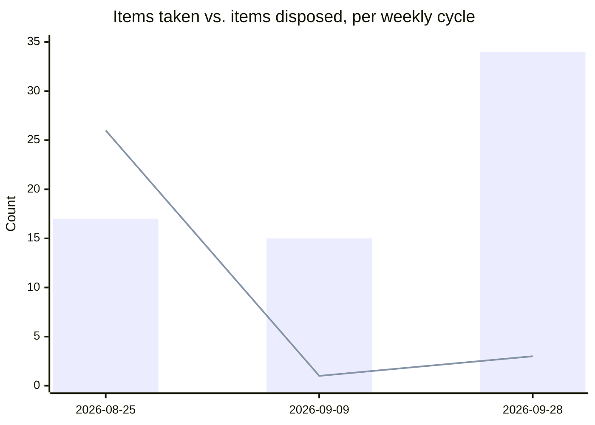

# Weekly Executive Briefing — 2026-09-28

Evidence window: 2026-09-15 through 2026-09-28 (one-time 14-day PTO catch-up, replacing the missed 09-16/09-23 weeklies; Darryl on PTO week of 09-21). Last weekly: 2026-09-09.

> **Same-day correction, 2026-09-28 (Darryl, field note, after this briefing was first issued):** "Outside of my communication channels, the Miller Electric license purchase was approved last Friday by Nate and Brad. Mike Reed and Chad delivered this AM." This closes the Miller Electric item that appears below as today's top priority and as a Risk Requiring Action Today. Registers updated: `04` (row retired), `05` (C56 closed), `03` (Decisions Made, 2026-09-25). The sections below are left in place rather than rewritten, with the resolution noted inline at each point, so this briefing preserves what was flagged and how it closed rather than reading as though it was never an issue.

## 1. Evidence Coverage

| Source | Status |
|---|---|
| Email | Partial — two transcripts opened complete (Dell cluster, FRB release), three single-message snippets; a bounded Sent Items query returned only older, out-of-window messages, so no in-window sent-mail evidence is claimed |
| Calendar | Not searched |
| Teams chats | Available — 6 channels as search snippets (CSS Platforms All Hands, ADM connect with Natalie, Quest Migration, Ford Tiger Team, WAM Product Team, CDA) |
| Meeting transcripts | Available — 2 verbatim, complete (2027 entroCIM Roadmap Discussion, 914 lines; ascent airwall, 289 lines). Most other meetings returned as AI notes / search snippets, not verbatim — treat those facts as Stated, not Confirmed |
| Documents | Available — ADM 2027 AOP deck (7 of 7 slides, complete); CDA exec brief and Sensolus Loop doc as snippets only |
| Known gaps | entroCIM/WAM/Safety & Ascent (2026-09-18) not transcribed at source. Planner premium-plan tasks not visible through this interface. Sprint-task exclusion count this cycle: **4** (3 from WAM Backlog Refinement, 1 from Quest Migration). Portfolio-scope exclusions: 5 items (Connected Safety Weekly Update, Wesco AI Builders Guild) |

This is a wider window than a normal weekly (14 days vs. 7) and correspondingly thinner on verbatim transcript coverage outside the two complete transcripts — most action items and decisions below rest on Explicit quotes even where the surrounding meeting is snippet-only.

## 2. Executive Summary

- **No crisis surfaced in the catch-up window.** Two items needing action were flagged this morning before evidence arrived: the Miller Electric PO and Stanford commissioning-report remediation. **Miller Electric is resolved as of this correction** — approved 09-25 by Nathan Kehr and Brad Stevens outside the evidence record, delivered 09-28 by Mike Reed and Chad Steger (Darryl, field note). Stanford commissioning-report remediation (High, worsening, 11 days with no accountable owner) is unaddressed by this evidence package and still needs Darryl's action today.
- **Quest-to-Azure migration is effectively complete.** dev-01, the last of eight environments, reached practical completion — SAML and cluster reconnection done, only backup enablement and cleanup remain. Closes a cost and schedule risk carried since 07-28.
- **Ford sent its Support Services Agreement on time (09-25), separating baseline Maintenance & Support from a scoped Services agreement.** This very likely closes two Other-Owned items (pricing language, scope document) pending Darryl's confirmation, but it does not close the platform-trust gap this account has carried since August — the UDAC audit (B62) and Chad Steger's delivery-capability confirmation (B69, overdue since 09-19) remain open. Do not let the proposal being sent read as the trust gap being resolved.
- **WAM/ADM's 2027 planning basis needs Sean McCloskey's approval before it locks into the AOP.** David Blondel and Akansh Gangil propose "Run + Complete" (scale the foundation, close targeted gaps, fund "Expand" separately). A Sean update is drafted and ready to send, not sent yet — three consecutive fortnightly drafts now unsent.
- **Both register caps remain breached with no recount.** Watch Active holds 25 against a 20 ceiling (flagged 09-17, not yet run); Decision Radar holds 32 open against 20 (flagged repeatedly since 09-09). This is now overdue for the monthly maintenance pass rather than another flag.

## 3. Top 3 Leadership Priorities

**1. ~~Miller Electric PO pricing decision~~ — RESOLVED same day.** Nathan Kehr and Brad Stevens approved the purchase 2026-09-25 outside the evidence record; Mike Reed and Chad Steger delivered 2026-09-28 (Darryl, field note). No further action. Which of the four options considered formed the actual basis is not stated — worth asking only if it matters for precedent on future sub-threshold Miller Electric orders.

**2. Name an accountable owner for Stanford commissioning-report remediation.**
Business impact: Sarah Monteleone is asking who picked up the project after months of delay; this is now as much an accountability gap as a technical one, and it's a retention risk on the account. Why Darryl personally: eleven days with no owner named is past the point a status update helps. Risk if delayed: the account read moves from "slow fix" to "nobody's driving," which is harder to recover from. Next step: name an owner today rather than waiting for the next evidence cycle. Expected outcome: a dated remediation plan the customer can be shown.

**3. Get the WAM/ADM "Run + Complete" approval in front of Sean before the AOP locks it in as a staffing decision.**
Business impact: without an explicit approval, the AOP either underfunds the operating base or quietly absorbs "Expand" scope that nobody approved the cost of. Why Darryl personally: this is the kind of decision the Sean Update standard exists for, and the draft is sitting ready. Risk if delayed: the recommendation hardens into a submitted staffing number before Sean has actually decided anything. Next step: send the 2026-09-28 Sean update (`Deliverables/Exec_Briefs/2026-09-28_Sean_Update.md`) or get 15 minutes on the calendar. Expected outcome: an explicit yes/no on Run + Complete as the 2027 floor.

## 4. Risks Requiring Action Today

| Risk | Severity | Evidence | Business impact | Recommended action |
|---|---|---|---|---|
| Stanford commissioning-report remediation, no owner | High, worsening | Direct (Sarah Monteleone email, 09-17, no response evidenced since) | Retention risk on a customer account, 11 days unowned | Name an accountable owner today |
| Anti-bribery/anticorruption training | — | Chris Gazdic's ask, due 2026-09-23 | Compliance exposure, now 5 days overdue | Complete or confirm status today |
| A29 trigger has not fired in 34 days | — | `05` Register A trigger backstop (rule: surface after 14 days) | Truncated part-number defect stays unescalated while WAM/ADM data-integrity risk compounds | Re-date, convert to a dated escalation, or drop — no fourth option |

*Miller Electric PO removed from this table same day — resolved (see correction note at top).*

## 5. My Actions

Register A holds **13** items (direct count; corrects the narrative count of 14 carried since the 09-18 disposal sweep), all dated, none triggered. Selection rule: due within 14 days, on a Key Product Due Dates critical path, or aging 14+ days with no movement. Seven surfaced:

1. **A50** — Return feedback to Ron Snyder on the entroCIM Team Quality Standard. Due 2026-09-29.
2. **A43** — Send Revnue/Strev the written entitlement and pricing question list. Due 2026-09-29.
3. **A45** — Retrieve executed Amendment No. 1 and the 2025-08-13 supplier price list into `Products/WAM/`. Due 2026-09-29.
4. **A40** — Confirm the Ascent third-party ALM product and scope with Ben Pesek. Due 2026-09-29.
5. **A48** — Advance the WAM strategy with David Blondel/Akansh Gangil, then route to Chris Gazdic and Govindaswamy. Due 2026-09-29 — **this evidence cycle advanced the underlying strategy (see §2); the routing step itself has not happened.**
6. **A49** — Kick off the white-label agreement amendment for the AI feature set and Virtual Site Survey. Due 2026-09-30.
7. **A1** — WMX complex-build follow-up. Due 2026-09-30; open since 07-17, longest-running item on the register.

Not surfaced but on the register, all due 2026-09-30 or 2026-10-02: A44, A28, A51, A46, A31. A29 (trigger) is not a dated action and is covered in §4 and the closure checks instead.

## 6. Suppressed

None this cycle. No disposed item recurred as an echo in this window's evidence.

## 7. Key Product Due Dates

| Initiative | Next Milestone | Due Date | Owner | Status |
|---|---|---|---|---|
| entroCIM 3.1.12.14 | Release | 2026-10-05 | David Blondel / Ron Snyder | On track, unconfirmed this cycle — no contradicting evidence |
| Quest-to-Azure migration | Backup enablement + cleanup on dev-01 | Not dated | Babu Papanna / Shawn Clark | **Effectively complete** — last environment's migration itself is done |
| Ford Support Services Agreement | Sent, awaiting Ford response | Sent 2026-09-25 | Adam Lazare / Leanne Gordon | Sent on time; platform-trust audit (B62) still open |
| WAM/ADM 2027 "Run + Complete" | Sean's approval | Not dated | Sean McCloskey | Recommendation ready; Sean update drafted, not sent |
| Ascent/entroCIM JACE connection | Chris Askew to provide IP + read-only credentials | Not dated | Chris Askew | In progress — Airwall online, JACE is the pacing item |
| Navigator NavWork MVP | UAT begins | December 2026 | DJ Vaughn | On DJ's published roadmap, unchanged |
| CDA FY27 readiness metrics | First report | 2Q27 | Ron Snyder / Darryl | Pre-service; no pilot accounts secured yet |
| entroCIM Team Quality Standard | Darryl's feedback to Ron Snyder | 2026-09-29 | Darryl (A50) | Due tomorrow |

## 8. Other-Owned Register (condensed)

**114 items, 43 tagged Critical (38%)** — up from 27% at the last audit (08-25) and not re-verified since; recommend a Critical-tag re-audit alongside the overdue Watch Active recount (§14).

New this window, all substantive:
- **B87** — David Blondel to interview the EES team on asset-tracking requirements before development begins. Feeds the Sensolus/CAT decision.
- **B88** — Akansh Gangil to finalize WAM/ADM resource and skill requirements under the new data strategy.
- **B89** — Adam Lazare and named platform leads to prepare Dell executive-summit content. Due end of October.

Closed or very likely closed this window:
- **B68, B71** already closed 09-14 (Ford SOW scope, Windows Server confirmation).
- **C35, C43** — very likely satisfied by the 09-25 Ford Services proposal; Potentially closed, awaiting Darryl's one-line confirmation (closure checks, §19).

Nearing or past their gate, Critical, no movement this cycle:
- **B62** (Critical) — UDAC platform audit, not dated, still the gating item on Ford platform trust.
- **B69** (Critical) — Chad Steger's delivery-capability confirmation, due 09-19, now 9 days overdue.
- **C49** (Critical) — replacement Strev/Revnue entitlement document, requested 09-15 and 09-17, no vendor date.
- ~~C56 — Miller Electric pricing decision~~ **closed same day** (see correction note at top). **C57** (Critical, new 09-18) — FRB Dell server pricing, unaddressed this cycle.

## 9. People Requiring Engagement

- ~~Nathan Kehr, Chad Steger, Bill Rose, Brad Stevens — convene today on the Miller Electric pricing decision.~~ **Resolved same day; no convening needed.**
- **An owner for Stanford commissioning-report remediation** — name one today; no candidate named in evidence.
- **Sean McCloskey** — the WAM/ADM Run + Complete approval; Sean update drafted and ready.
- **Chris Askew** — pacing the Ascent/entroCIM JACE connection; check in if the IP address hasn't landed by early next week.
- **Ron Snyder** — feedback on the Team Quality Standard, due tomorrow (A50).

## 10. Meeting Preparation

- **entroCIM Support SLA Finality, 2026-09-30.** Bring: the Ford Services Agreement (sent 09-25) as the precedent, current SLA gaps, and B62/B69 as the still-open pieces — do not let the sent proposal read as the audit being done.
- **entroCIM, WAM, Safety & Ascent, 2026-10-02.** Bring: Ascent Airwall status (online, JACE pending), Navigator API/design open questions, WAM data-strategy direction (Wesco-owned data), CDA implications if raised.
- **entroCIM Leadership Collaboration, 2026-10-05.** Bring: 3.1.12.14 release status, right-sized 2027 roadmap and epics conversion, Dell cluster RCA follow-through, Quest migration closeout.
- **Darryl / Ron 1:1 (weekly, standing).** Bring: A50 feedback on the Team Quality Standard, due 09-29 — prepare before, don't draft live.

## 11. Blind Spots

- **Two register caps have now been flagged over three consecutive review cycles (09-09, 09-17/18, and today) with no recount performed.** Watch Active is 25/20, Decision Radar is 32/20. The pattern from 07-27 and 08-19 (two structural fixes that both worked and then regrew) is repeating at the tier level now, not just the whole-system level. Recommend the monthly maintenance pass runs with the next month-start weekly (on or after 2026-10-01) rather than deferring a fourth time.
- **Other-Owned's Critical tag has drifted to 38%, past the 27% level that triggered the 08-25 re-audit.** The same corrective (re-audit against "expensive to be wrong about," not "important") likely applies again.
- **The Ford Services Agreement being sent could easily be read upward as the platform-trust question being resolved.** It is not — B62 (the audit) and B69 (delivery-capability confirmation, 9 days overdue) are both still open. Worth a one-line correction if this surfaces in any account-status conversation this week.
- **Three consecutive fortnightly Sean updates are now unsent** (08-19, 09-09, 09-28). If the pattern continues, the question is whether the fortnightly-generation cadence is the right mechanism, not whether the drafts are good enough — see Chief of Staff Advice.

## 12. Delegation Opportunities

- **JACE connection check-in** — once Chris Askew provides the IP address, the overlay setup itself is Chad Steger's and needs no further executive involvement unless it stalls.
- **Ford B62 audit chase** — this has been open, Critical, and undated since 08-27. Rather than another passive wait, assign Chad Steger a date to report status, even if the audit itself isn't complete.

## 13. Chief of Staff Advice

If I were your Chief of Staff, I'd push back on two things this week. First, you now have three fortnightly Sean updates sitting unsent, and the 09-28 one carries a real decision (Run + Complete) with a real deadline pressure (the AOP). If the mechanism keeps producing drafts nobody sends, the fix isn't a better draft, it's deciding whether written updates on a schedule are actually how you want to reach Sean, or whether it should go back to on-demand. Second, the register caps have been flagged and not acted on for three cycles running. You built the cap mechanism specifically because flagging without disposing didn't work the first two times this system existed (07-27, 08-19) — letting it happen a third time at the tier level, right after fixing it at the whole-system level, is worth naming rather than quietly repeating.

## 14. This Week's Objectives

- ~~Resolve the Miller Electric pricing decision~~ **done, resolved same day.** Name a Stanford commissioning owner today.
- Send or explicitly decide not to send the 09-28 Sean update before the AOP locks WAM/ADM staffing.
- Run the overdue Watch Active recount (25/20) and Decision Radar demotion pass (32/20) — or explicitly schedule them for the 10-01 monthly pass rather than deferring again.
- Confirm C35/C43 closure (Ford pricing/scope) and B69 (Ford delivery-capability) status at this week's closure check.

## 15. Executive Watch List Delta

Active tier: still 25 against the 20 cap — no change from the last known count, no recount performed this cycle. Row-level updates only: Ford entroCIM row updated (Services Agreement sent, B62/B69 still open, severity held Medium/↓); Dell cluster session-loss row updated (Syed Zaidi's fleet-wide cleanup reconfirmed in progress, trend held ↓); WAM/ADM data integrity row updated (truncated part-number gap reconfirmed unresolved, now framed as source-of-truth question, trend held ↑); Stanford commissioning row updated (a second, distinct migration-access disruption noted, do not conflate with the iframe defect). Quest-to-Azure migration (Passive) updated to reflect dev-01's practical completion — recommend retiring this row once B81/B82 (backup/cleanup) confirm complete.

## 16. Decision Radar

**33 headers on file; 1 resolved this session.** Ford support/SLA commercial model (2026-09-09 entry) is resolved by the 09-25 Support Services Agreement — marked Resolved in place, pending removal at the next full Radar pass. Open count: **32 against the 20-item cap**, unchanged in substance from the 33 carried since 09-09 aside from this one resolution. NavWork facility-data-scope entry (08-28) reconfirmed still open with no forum date, now approaching a month.

Two new Decision Backlog entries this session (no forum, hence Backlog not Radar): ADM enrichment implementation approach (Java vs. ADB, owner unclear); approval of "Run + Complete" as the WAM/ADM 2027 planning basis (owner Sean McCloskey/AOP leadership). Backlog now holds **48** entries.

## 17. Executive Communication Opportunities

- **Sean update, drafted, not sent.** `Deliverables/Exec_Briefs/2026-09-28_Sean_Update.md` — leads with the WAM/ADM Run + Complete approval as the decision needed; portfolio position otherwise unchanged. Sending is Darryl's call, per the standard.
- **Ford**, if not already acknowledged: the Services Agreement was sent on time; no evidence yet of Ford's response. Worth a one-line internal note to Adam Lazare/Leanne Gordon confirming receipt was tracked, given the trust-gap history on this account.

## 18. Weekly Analytics Block

1. **Decision velocity.** 3 decisions made this window (Ford Services Agreement/pricing, WAM Wesco-owned-data strategy, Ascent JACE prioritization) — the 09-17 entroCIM roadmap decision was already logged and is not recounted here. Decision Radar 32 open (33 headers, 1 resolved), Backlog 48. Oldest open items on the Radar/Backlog run back to mid-July (Mapbox token rotation, Dell Service Management handoff detail) — unchanged from 09-09. **WAM Data Challenges (Darryl-owned, weekly) again did not produce this cycle's WAM strategy decision** — that came from a separate "WAM - Product Team" session relayed through Akansh Gangil. The "sessions since last decision" pattern on that standing forum continues.
2. **Commitment load and aging.** Register A: 0 taken, 0 closed — flat, consistent with "nothing meets the attribution test this cycle" (every candidate action names a non-Darryl owner). Other-Owned: 32 taken, 2 closed — a heavily intake-weighted window, disposal well behind intake, consistent with the pattern since 09-09.
3. **Watch-list trend.** No adds or removals confirmed this cycle (recount overdue — see §11); four Active rows updated with fresh evidence (Ford held Medium/↓, Dell cluster held ↓, WAM/ADM held ↑, Stanford held ↑ with a second distinct issue noted). One Passive row (Quest-to-Azure migration) moved from "nearly complete" to "practically complete" — candidate for retirement next cycle.
4. **Recurring-theme detection.** WAM/ADM truncated part-number handling (5+ cycles now, still no owner, A29 trigger overdue 34 days); NavWork/Navigator API design question (recurring since 08-28, approaching a month, no forum); Ford platform-trust gap (recurring since August, commercial layer now resolved, audit layer still open).
5. **Time-at-role check.** Not meaningfully assessable this cycle — Darryl was on PTO for part of the window (week of 09-21), so By-exception attendance data isn't representative.
6. **Impact capture.** 4 entries added to `09_Impact_Ledger.md` this window (Ford proposal sent, Quest migration effectively complete, Ascent Airwall online, entroCIM Foundations course delivered) — a strong realized-wins window, all with clear boundaries stated.

### 18a. Register Health

| Register | Now | Cap | Δ | Taken | Closed |
|---|---|---|---|---|---|
| Register A | 13 | 15 | -1 (count correction) | 0 | 0 |
| Other-Owned | 114 | — | +30 | 32 | 2 |
| of which Critical | 43 (38%) | ~15 | — | — | — |
| Watch Active | 25 | 20 | +5 (unconfirmed breakdown) | — | — |
| Decision Radar | 32 | 20 | -1 | 2 (Backlog) | 1 |

Bars: items taken (entered a register). Line: items disposed (closed or resolved). **This chart skips the 09-01, 09-16, 09-17 and 09-18 daily cycles, which did not carry register-health snapshots** — the 09-28 point aggregates roughly three weeks of activity, not one, so its size is not directly comparable to the prior two points.

Disposal continues to lag intake by a wide margin: 34 items entered against 3 disposed this window. Register A, the one register that cannot be capped by relocation, again stayed flat and inside its ceiling — the healthiest single signal in an otherwise intake-heavy period. Watch Active and Decision Radar both remain over cap with no recount in three consecutive cycles; this is the mechanism-not-executed pattern CLAUDE.md itself warns against, now at the tier level.

## 19. Sean Update (fortnightly, generated)

This is the first weekly briefing since 2026-09-09 (last draft), so the fortnightly cadence applies. Drafted: `Deliverables/Exec_Briefs/2026-09-28_Sean_Update.md`. Leads with the WAM/ADM "Run + Complete" approval as the one decision needed this cycle; portfolio position otherwise unchanged since 09-09. Not sent. **Three consecutive fortnightly drafts are now unsent (08-19, 09-09, 09-28)** — see Chief of Staff Advice, §13.

## Closure Checks (weekly, 3–5 oldest open items)

1. **Still open — trigger backstop, not a status question:** `05` A29 (escalate the truncated manufacturer part-number dependency) has had its trigger unfired for 34 days against a 14-day backstop. Re-date it, convert it to a dated escalation action, or drop it — which one?
2. **Still open:** i3 Alliance Agreement — has Legal (Brandon Thompson, Nikos Minas) responded to the Section 8 redline and the Section 9.2 configuration-authority conflict, open since roughly 08-07/08-11 with nothing further owed from Darryl's side?
3. **Still open:** the roughly ten additional JCI contract issues (indemnity, liability carve-outs, unilateral changes, non-cancelable orders, flow-down, competing-offerings restriction) — resolved since the 08-31 markup, or still outstanding?
4. **Potentially closed — confirm?** `05` C35 (Ford support scope document) and C43 (Ford pricing-model language) — does the 09-25 Support Services Agreement close both, or is there a gap the proposal didn't cover?
5. **Confirmation, not a status question:** did Darryl agree to share the entroCIM/WAM/Navigator/CDA integration list with Sridhar Loke (raised 09-03, still unconfirmed)?

## Files Updated This Session

`03_Decision_Log.md` (3 Decisions Made, 1 Radar entry resolved in place, 1 Radar entry reconfirmed, 2 Decision Backlog entries), `04_Executive_Watch_List.md` (Ford, Dell cluster, WAM/ADM, Stanford Active rows updated; Quest-to-Azure Passive row updated), `05_Commitments.md` (B4, A48, C35, C43 updated; B87, B88, B89 new; Register A running-log entry added, A29 trigger-backstop flag), `06_Stakeholder_Map.md` (David Blondel, Ron Snyder, Akansh Gangil, Chad Steger, Maggie Becker, Babu Papanna/Shawn Clark, Chris Askew updated), `09_Impact_Ledger.md` (4 new entries, Sean-update date advanced), `Products/entroCIM/entroCIM.md`, `Products/WAM/WAM.md`, `Products/Navigator/Navigator.md`, `Products/CAT/CAT.md` (evidence blocks added), `Dashboard/snapshots.json` (register-health snapshot appended), `Deliverables/Exec_Briefs/2026-09-28_Sean_Update.md` (new draft). **Same-day correction after first issue:** `03_Decision_Log.md` (Miller Electric Decisions Made entry added), `04_Executive_Watch_List.md` (row retired), `05_Commitments.md` (C56 closed) — Miller Electric PO resolved per Darryl's field note; this briefing corrected in place rather than reissued.
