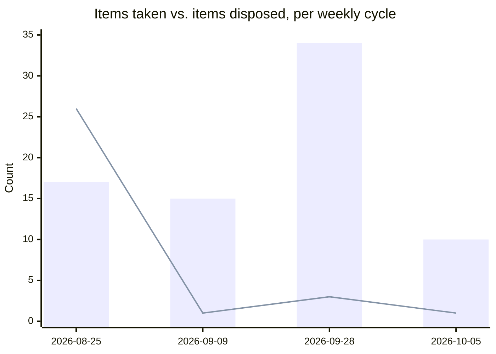

# Weekly Executive Briefing — 2026-10-05

## 1. Evidence Coverage

Email: Available. Calendar: Partial (bounded next-week query returned incomplete coverage; only explicitly-dated 10-07/10-08 events used). Teams chats: Partial (broad sweep returned expired snippets; material threads opened via related artifacts). Meeting transcripts: Partial (12 meetings in the window were not transcribed at source — see list below). Documents: Available. Known gaps: Planner premium-plan tasks unsupported; Sent Items total not separately reported; OneDrive/SharePoint recall returned mostly noise.

Not transcribed at source: WAM External BIR Actuals, WAM Catch-up, DCOE & EntroCIM Weekly, entroCIM Leadership Collaboration (09-28 occurrence), Strev Costs, Review Training Guide re: Pricing, Sridhar-Darryl 1:1, Monthly Dell EMS Ops-to-Sales, Darryl/Nate 1:1, entroCIM Support SLA Finality, VAS-WMX-ADM-ALM (09-30), entroCIM/WAM/Safety & Ascent (10-02).

Raw package saved: `Evidence/M365_Evidence_Weekly_2026-10-05.md`.

## 2. Executive Summary

- **CDA's business sponsor is confirmed (Bill Muczko, 10-02) but commercial viability is not** — an enterprise buyer directly challenged the per-site pricing model this week; enterprise pricing is now a tracked open decision, not a detail to settle later.
- **Two WAM vendor-ownership decisions arrived priced and unresolved in the same week**: Zapier/API ($25,000 year one) and Azure hosting migration. Neither has an IT owner. Darryl is reconvening the reassessment meeting today.
- **A51 (CDA pro forma to Bob Caprise) is cancelled** per Darryl's direct instruction — the 10-02 sponsorship review made the detailed spreadsheet unnecessary. Flagged for the record: this is a different meeting from Sean McCloskey's numbers walkthrough, which was separately scheduled for tomorrow (10-06) and is not confirmed to have happened.
- **Ford now carries two live exposures on the same account**: the existing UDAC renewal/trust gap, plus a new technical gap (entroCIM lacks the SFTP capability Ford's redesigned DPR flow needs) with funding undecided.
- **Register maintenance debt is now explicit and larger than last tracked**: Decision Radar is at 34 against its 20 cap (not 32 as last carried), Watch Active at 23. This is the first weekly briefing of October — Monthly Maintenance is due; a full recount and routing pass is recommended as its own session rather than folded into today's.

## 3. Top 3 Leadership Priorities

**1. CDA commercial model — validate before it goes further.**
Business impact: CDA is Darryl's largest active product bet and the sponsor gate just cleared; an unvalidated pricing model risks launching with economics that don't scale, or missing the FY27 AOP window entirely. Why Darryl personally: he owns the path to Sean's review and the AOP submission; no one else can resolve the pricing-construct question. Risk if delayed: more investment goes into materials built on an unvalidated model. Next step: use Peter Ferrell's and Sridhar Loke's challenges from the 10-02 review to scope the pricing-construct decision (`03` Decision Backlog, CDA enterprise pricing) before the numbers go to Sean. Expected outcome: a defensible pricing construct, or an explicit decision to pilot before pricing is fixed.

**2. WAM vendor-ownership decisions — Zapier and Azure hosting.**
Business impact: both decisions gate WAM's operating-model clarity and have real cost ($25,000/year Zapier; hosting quote not yet disclosed in evidence). Why Darryl personally: he convened today's reassessment meeting himself. Risk if delayed: continued undecided dependency on Strev, and the Zapier quote lapses ~10-23. Next step: today's meeting (A55) should produce either a decision or a named forum and date — not another slip. Expected outcome: a named IT decision owner for both hosting and Zapier, ideally decided together since they're the same underlying "what does Wesco own vs. Strev" question.

**3. Register-system maintenance is overdue and the gap is wider than last reported.**
Business impact: this is the third time (07-27, 08-06/08-19, now) that a structural fix hasn't held — Decision Radar recounted today at 34 against a 20 cap (previously carried at 32), Watch Active at 23. If this isn't addressed as a dedicated pass, the registers stop being a reliable picture of what needs attention, which undercuts the system's core value (sharp knowledge base, minimal-edit first drafts). Why Darryl personally: only he can authorize a dedicated maintenance session or explicitly accept the overage as the current operating reality. Risk if delayed: same failure pattern repeats a fourth time. Next step: schedule a dedicated register-maintenance pass (not today's briefing — this needs focused time). Expected outcome: Decision Radar and Watch Active back under cap with every cut or carry named, consistent with the register caps' own rules.

## 4. Risks Requiring Action Today

- **entroCIM 3.1.12.14 release (today, 2026-10-05).** David Blondel working release information for sales (Valli Poornakumar, Leanne Gordon); Ron Snyder delivering the release package to DCOE today. Not yet confirmed shipped or messaged. No action needed from Darryl unless either workstream stalls — flagging so it's visible today rather than discovered after the fact.
- **WAM Zapier/API reassessment meeting (today).** Rescheduled once already; a second slip extends the vendor-dependency drift and risks letting the Strev quote run closer to its ~10-23 lapse without a decision.

## 5. My Actions

Register A: 14 dated items, under the 15 ceiling. **Selection rule below** (per the register's Focus rule: due within 14 days, on a critical path, or aging 14+ days with no movement) — 7 of 14 shown; the full list is in `05_Commitments.md` for direct review.

| # | Action | Due | Status |
|---|---|---|---|
| A55 | Reconvene the WAM Zapier/API ownership reassessment meeting | **Today, 2026-10-05** | New this week — same-day |
| A53 | Update CDA/Ascent content for the CSS Global Leaders presentation | 2026-10-01/02 (overdue) | Gates CEC meeting 10-07 |
| A54 | Update WAM asset-management/lifecycle content for the same slide | 2026-10-01 EOD (overdue) | Gates CEC meeting 10-07 |
| A1 | WMX/VAS/ADM/ALM complex-build data path — cross-SBU effort | Consolidated use cases due 2026-10-16 | Critical path; ownership of the deliverable not yet confirmed as Darryl's |
| A43 | Written entitlement/pricing question list to Revnue/Strev (14 questions) | 2026-09-29 (6 days overdue) | No movement evidenced |
| A31 | Circulate product pitches/soft-metrics deck to Akansh, David, Ron, Chad | 2026-10-02 (3 days overdue) | Blocks 3 open metric definitions |
| A29 | Truncated part-number escalation | Converted today — tracked via WAM Sprint Review | Confirm next occurrence and status with Akansh |

**Not shown (still open, lower urgency this cycle):** A50, A49, A48, A45, A44, A40, A28 — all due 09-29/09-30, 5-6 days overdue, no new evidence this week. Full list and detail in `05_Commitments.md`, Register A, Dated.

## 6. Suppressed

None this cycle. No evidence this week echoed a previously disposed item (checked Zapier, DCIM, MQTT, Ford DPR, i3 draft, Stanley/glass-door terms against `03`/`04`/`05` disposal records — none found).

## 7. Key Product Due Dates

| Initiative | Next Milestone | Due Date | Owner | Status |
|---|---|---|---|---|
| entroCIM 3.1.12.14 | Release + sales messaging | 2026-10-05 (today) | David Blondel / Ron Snyder | In progress |
| CDA | Enterprise pricing construct decided | TBD | Darryl Benson | Open — new Decision Backlog entry |
| WAM/ADM complex-build | Consolidated use cases (cross-SBU) | 2026-10-16 | Not yet named | On track, owner TBD |
| WAM Zapier/API | Reassessment decision or forum+date | 2026-10-05 (today) / quote lapses ~10-23 | Darryl Benson (convening) | At risk of a second slip |
| CSS Global Leaders presentation content (CDA/Ascent, WAM) | Content to Chris Gazdic | 2026-10-01/02 (overdue) | Darryl Benson | Overdue — gates CEC 10-07 |
| AOP FY27 | WAM 2027 pro forma/KPI leadership sign-off | Outstanding since 2026-10-01 | Leadership team (unnamed) | Overdue, unconfirmed owner |

## 8. Other-Owned Register (condensed)

119 items (77 Delegated, 42 Awaited) — not individually re-audited this cycle; critical-tag share not re-verified since 09-28 (then 38%, up from 27% at the 08-25 audit — recommend re-running the Critical test at the next maintenance pass). New this week: B94 (Chad Steger, Ford DPR scope/LOE, Critical), B95 (David Blondel, entroCIM brochure terminology), C62 (Chad Steger, Dell second-FTE assessment, Critical). Advanced: B74 (Ankit Chadha, IDP capacity — convened as planned), B91 (Sridhar Loke, commercialization deck — attribution upgraded to Explicit), B93 (Babu Papanna, MQTT confirmation — Mosquitto approval located, conditional), B72 (David Blondel, entroCIM release — in progress, not closed), B90 (Akansh Gangil, complex-build call — likely continuation now dated 10-08, not confirmed).

## 9. People Requiring Engagement

- **Sean McCloskey** — numbers walkthrough on CDA scheduled tomorrow (10-06); status unconfirmed given A51's disposition today referenced a different meeting.
- **Amy Aguirre** — pressing for two IT decisions (Zapier, Azure hosting) with no owner responding; a pattern worth a direct check on whether she needs Darryl's weight behind it.
- **Chris Gazdic** — owed CDA/Ascent and WAM content for the CSS Global Leaders deck, both overdue.
- **Peter Ferrell / Sridhar Loke** — both raised substantive, unresolved challenges to CDA's commercial model this week; worth a direct follow-up before the model goes further.
- **Bill Muczko** — CDA sponsor; Walmart connection raised (via Bob Caprise/David Fisher) but explicitly parked as not-yet, per `05` C61.

## 10. Meeting Preparation

- **entroCIM Leadership Collaboration, today (2026-10-05).** Not transcribed at source; weekly evidence suggests focus areas of customer risk, quality, delivery — bring Ford scope, Dell staffing, MQTT production, and release-quality (3.1.12.14) status.
- **CEC meeting, 2026-10-07.** Needs the CDA/Ascent and WAM content (A53/A54) — both overdue; confirm the deck has actually reached Chris Gazdic before the meeting.
- **Commercialization/product-assessment follow-up, ~2026-10-06.** Sridhar Loke asked product owners (Darryl among them, Implied) to review the shared deck within one week of 09-29 — confirm whether Darryl's own review of WAM/entroCIM/Navigator/CDA content is expected by tomorrow.
- **VAS-WMX-ADM-ALM working session, 2026-10-08.** Follow-up to the unresolved complex-build data-capture alignment; bring an end-to-end data-flow view and the system-of-record options.

## 11. Blind Spots

- **Decision Radar recount (34 vs. the 20 cap, previously carried at 32) has been due since 09-17 and has now been skipped across three monthly-maintenance opportunities** (08-19 cycle, 09-01, 09-28). Today is the first weekly of October — this is the fourth opportunity.
- **A51's cancellation and Sean's 10-06 walkthrough are two different threads that could get conflated.** Flagged explicitly in `05` Archive — Dropped; worth Darryl confirming directly rather than this sitting ambiguous.
- **"WAM Leadership Sync" appeared as a new meeting artifact today with no confirmed recurrence** — could be a new cadence forming or a one-off; not yet added to `07` as a standing forum.
- **PC1/JCI large-scale point faults and TCCC Modbus sourcing (both `04` Active, High) have had no new evidence in three weeks**, but were deliberately NOT demoted this cycle given PC1/JCI's emergency-service posture and open Critical linkage (`05` B15). Worth a direct status check rather than letting silence stand in for resolution.

## 12. Delegation Opportunities

- **WAM Data Challenges (Darryl-owned, weekly)** continues to run without decision output — the standing "sessions since last decision" pattern (`07`). No new decision came from this forum again this cycle; the WAM strategy direction this week came from a different session (WAM leadership discussion relayed through Akansh Gangil), consistent with prior weeks.
- **Dell account staffing decision (C62)** is naturally Chad Steger's to assess and bring a recommendation on, rather than Darryl originating the analysis — flagged as Awaited, not entered as a Darryl action.

## 13. Chief of Staff Advice

If I were your Chief of Staff, I'd push back on treating the register-maintenance debt as something that resolves itself through briefings. It hasn't, three times running, and the common thread each time is the same: disposal and recounting need dedicated time, not another pass folded into an already-full weekly cycle. Decision Radar at 34 against 20 is worse than what you were working from (32) — the system was understating its own backlog. I'd also flag the A51/Sean-walkthrough ambiguity as a small thing worth closing cleanly rather than letting two meetings blur into one in the record; it's the kind of gap that's cheap to close now and expensive to untangle later if CDA's numbers get questioned.

## 14. This Week's Objectives

1. Resolve or forum-and-date the WAM Zapier and Azure-hosting decisions (today's meeting is the test).
2. Get CDA's enterprise-pricing construct onto a real forum before more sales material is built on the current per-site model.
3. Close the overdue CSS Global Leaders deck content (A53/A54) ahead of CEC on 10-07.
4. Confirm Sean's 10-06 CDA numbers walkthrough status, separate from the A51 cancellation.
5. Schedule the overdue register-maintenance pass (Decision Radar, Watch Active).

## 15. Executive Watch List Delta (Active tier only; Passive appears only when escalating)

- **Added:** CDA commercial viability (High, new); Dell account staffing (Medium-High, new).
- **Updated:** Ford entroCIM/UDAC (↑, second Ford exposure folded in); WAM/ADM data integrity (ADM ingestion fragility + capacity concentration folded in); i3 Section 8 and i3 IP chain (↓, improving — counsel's draft returned to i3).
- **Demoted to Passive:** Dell SOC 2 (Medium, stale since 08-25, no decision pending); Returnable asset tracking (Medium, stale since 09-16, architecture question not a today-decision).
- **Net:** 23 open against the 20 cap (was 23 last tracked, before today's 2 demotions and 2 additions — net flat). Deliberately not forced to 20; see Blind Spots.

## 16. Decision Radar (from `03` Decision Radar only)

34 entries open against the 20 cap (recounted today; previously carried at 32 — see Blind Spots). Newest/most relevant this cycle: CDA enterprise pricing construct (10-02, unforumed); WAM Zapier app/API (10-01, reassessment meeting today); entroCIM commercial agreement model (10-01). Full list in `03_Decision_Log.md`; a dedicated routing pass against the Radar's own entry test (named forum + live date) is recommended rather than listing all 34 here.

## 17. Executive Communication Opportunities

- **Sean McCloskey** — the CDA enterprise-pricing challenge and the WAM vendor-ownership decisions are both the kind of material Sean would want ahead of, not after, the 10-06 numbers walkthrough. Consider a short heads-up before that meeting rather than waiting for the fortnightly Sean update (not due until ~10-12).
- **IT leadership** — both WAM vendor decisions (Zapier, hosting) need a named decision-maker; if none surfaces from today's meeting, this may need Darryl to escalate directly rather than continue through Amy Aguirre.

## 18. Weekly Analytics Block

1. **Decision velocity.** 4 decisions made this week (2 Explicit: DCIM brochure language, i3 draft returned; 2 Inferred, surfaced for confirmation: CDA commercial model, WAM/ADM priority buckets). Decision Radar recounted at 34 (was carried at 32), Backlog 54. WAM Data Challenges (Darryl-owned) again produced no decision this cycle — now a multi-week pattern.
2. **Commitment load and aging.** Register A: 3 taken, 1 closed — net +2, still under the 15 ceiling (14). Other-Owned: 3 taken, 0 closed.
3. **Watch-list trend.** 2 added, 2 demoted (net flat at 23); 4 rows updated with fresh evidence; 2 improving (i3 rows), 1 worsening (Ford).
4. **Recurring-theme detection.** WAM/Strev ownership boundary (hosting, Zapier, DevOps — recurring, now two Decision Backlog entries); WAM/ADM complex-build data path (recurring since mid-July, cross-SBU track now dated 10-16); CDA commercial-model validation (new this cycle, likely recurring given AOP timing).
5. **Time-at-role check.** Not flagged this cycle — no new by-exception attendance pattern surfaced in evidence.
6. **Impact capture.** 2 entries added to `09_Impact_Ledger.md` this week (MQTT production path cleared, i3 IP position returned) — both conditional/partial, not fully realized.

### 18a. Register Health

| Register | Now | Cap | Δ | Taken | Closed |
|---|---|---|---|---|---|
| Register A | 14 | 15 | +1 | 3 | 1 |
| Other-Owned | 119 | — | +5 | 3 | 0 |
| of which Critical | not re-audited | ~15 | — | — | — |
| Watch Active | 23 | 20 | 0 (net) | 2 | 2 |
| Decision Radar | 34 | 20 | +2 (recount correction, not two new entries) | 0 | 0 |

Bars: items taken (entered a register). Line: items disposed (closed or resolved). **This chart carries the existing 2026-08-07 to 2026-08-24 gap, never interpolated**, and the 09-28 point already represented roughly three weeks of activity, not one.

Disposal continues to lag intake (10 taken vs. 1 disposed this week), though the gap is smaller than 09-28's. Decision Radar's recount is the material finding this cycle: the register was larger than its own narrative carried, which is itself evidence for the standing recommendation — a dedicated maintenance pass, not another briefing-embedded check, is what actually moves these numbers (per CLAUDE.md's own "mechanism is not executed until it has produced observable output" rule).

## 19. Sean Update (fortnightly, generated)

Not due this cycle. Last drafted 2026-09-28 (unsent — `Deliverables/Exec_Briefs/2026-09-28_Sean_Update.md`, now the fourth consecutive fortnightly draft pending a send decision once this one joins it at the next due date). Next due with the first weekly on or after 2026-10-12.

## Closure Checks (weekly, 3–5 oldest open items)

All five share the same oldest due date (2026-09-29) in Register A — Darryl asked where the full list lives (`05_Commitments.md`, Register A, Dated) and said he'd review it directly; these five are offered as the starting point.

1. **Still open?** A50 — feedback to Ron Snyder on the entroCIM Team Quality Standard (light-touch review).
2. **Still open?** A43 — the 14-question written entitlement/pricing list to Revnue/Strev.
3. **Still open?** A45 — retrieving the executed Amendment No. 1 and 2025-08-13 supplier price list from Legal.
4. **Still open?** A40 — confirming the Ascent third-party ALM product and scope with Ben Pesek.
5. **Potentially closed — confirm?** A48 — routing the updated WAM strategy to Chris Gazdic and Govindaswamy. The positioning itself has advanced (per 09-25 evidence, relayed through Akansh Gangil); only the routing step is unconfirmed.

## Files Updated This Session

`Evidence/M365_Evidence_Weekly_2026-10-05.md` (new, raw package). `05_Commitments.md` (A51 dropped to Archive; A29 trigger converted; A53, A54, A55 new; B72, B74, B91, B93 updated; B94, B95, C62 new; stale Triggered-section note corrected; running-log entry added). `03_Decision_Log.md` (4 new Decisions Made; Zapier, CDA enterprise pricing, and Run+Complete Backlog entries updated; 2 new Backlog entries — Ford DPR funding, WAM Azure hosting; A1 cross-SBU note updated with 10-08 date). `04_Executive_Watch_List.md` (Ford, WAM/ADM, both i3 rows updated; CDA commercial viability and Dell account staffing added; Dell SOC 2 and Returnable asset tracking demoted to Passive). `06_Stakeholder_Map.md` (Sridhar Loke, Chad Steger, Akansh Gangil, Amy Aguirre, Bob Caprise, Peter Ferrell, Nathan Kehr — weekly reconfirmation block added). `07_Operating_Cadence.md` (new WAM Leadership Sync artifact noted, unconfirmed). `09_Impact_Ledger.md` (2 new entries — MQTT production path, i3 IP position). `Products/CDA/CDA.md`, `Products/WAM/WAM.md`, `Products/entroCIM/entroCIM.md` (weekly evidence sections added). `Dashboard/snapshots.json` (register-health snapshot appended).
