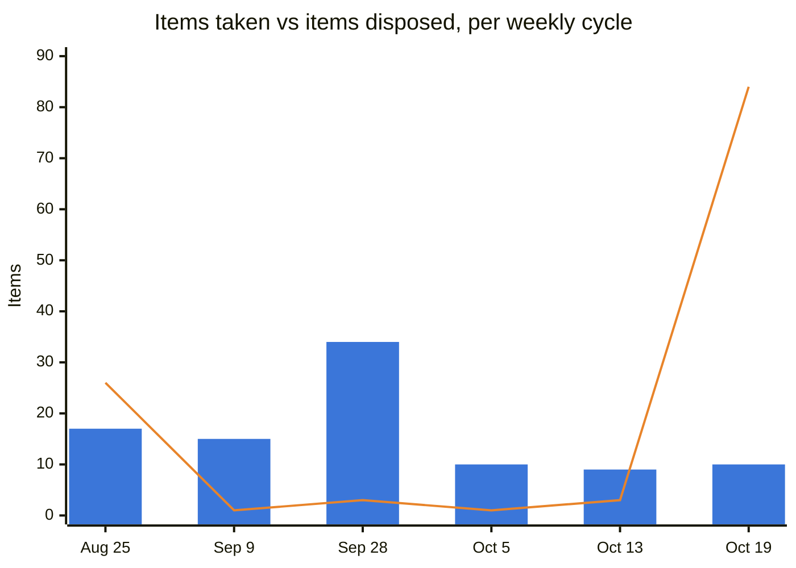

# Weekly Executive Briefing, 2026-10-19

## 1. Evidence Coverage

Email: Partial (Sent Items probe succeeded; one in-window thread opened complete, "Available for Release: entroCIM Version: 3.1.12.14"). Calendar: Partial (next-week query returned recurring events outside the window; only the dated 2026-10-23 Navigator PROD WAB is used). Teams chats and channels: Not found (searched, no in-scope artifact). Meeting transcripts: Available (Connected Device Assurance Service, 2026-10-14, complete; WAM Leadership Sync, 2026-10-19, complete); not transcribed at source: VAS-WMX-ADM-ALM working session 10-15 (invite and chat used), RE: Connected Device Assurance and TS 10-13, entroCIM Leadership Collaboration 10-12. Documents: Available (Digital Products Portfolio Status Update, Ascent Navigator WAB v0.3); Wesco Tier 3 Support Tickets opened but no in-window row changes could be isolated. Known gaps: premium Planner tasks unsupported; **no team-governed forum appears anywhere in this package (0 of 13)**. Sprint-task exclusions: 0. Portfolio-scope exclusions: 12 (8 portfolio deck, 1 meeting, 3 Planner). Raw package saved as `Evidence/M365_Evidence_Weekly_2026-10-19.md`.

Pulse: 8 live, 5 quiet, across 2 forums (Deployment Daily Scrum, entroCIM Daily Stand Up); Dell health 45 out of 100 (at risk; 46 on 10-16, and the one-point move is today's lane re-sort, not a new event); 0 need your call. Because the package heard from none of the 13 forums, nothing in the Pulse was refreshed this week. Treat it as stale, not calm.

**Changes since last brief (2026-10-16, your web-app edits after that morning's brief; nothing since Friday 16:33).** Closed: C-i3-3b, C11, B95, B59. Dropped: B87. Retired: W028. Pulse: P001, P004 and K005 left with the team; K002 and K003 resolved on your notes. W021 next action cleared with nothing in its place (see section 4). W019 next action changed to following up with the team on the closeout problems with Sales. Account pin toggled and returned to Dell. No `needs_triage` items. Correction: the 10-16 brief said W019 was retired; it was retired and reinstated within two minutes on 10-15, and has been Active throughout (stale closed date cleared today).

## 2. Executive Summary

- **All three register caps are inside their ceilings for the first time since September.** Other-Owned fell from 120 to 80, Watch Active is at 20, Decision Radar at 15. Most of the movement came from your web-app closures on 10-15 and 10-16 and from today's aging sweep, the first since 08-25. Thirty-seven items aged out as presumed, not confirmed (detail in 18a).
- **10-23 is a pressure day.** The Ascent Navigator production WAB review and the CDA follow-up with Matt Powers and Cody Remington both land that Thursday. The WAB deck retrieved this week (v0.3, modified 10-16) is mostly blank template, and no owner is named in evidence.
- **The Sean meeting this week is still the spine.** A58, A59, A60, A65 and A61 all converge on it, and A61's numbers (stream Run total of 6 against a run team of 8) were still unreconciled at the last evidence.
- **entroCIM 3.1.12.14 is generally available** (10-16), with documentation, sales guide and deployment communication issued together. That is the first release where the handoff to sales and deployment is evidenced as done at release. It does not by itself settle FRBNY: whether FRB gets 3.1.12.14 in place of the held 3.1.12.13, and whether FRB has been told, is not in evidence.
- **Underestimated risk: the Pulse went blind this week.** The weekly package covered none of the team-governed forums. Dell health reads the same as Friday because nothing was heard, not because nothing happened.

## 3. Top 3 Leadership Priorities

**1. Land the Sean meeting this week with the asks on record.** Business impact: the WAM/ADM capacity reset (A61, Decision Radar D001), the entroCIM data-center positioning (A58), Launch Studio (A65), the vibe-coding concept (A60) and the CDA summary (A59) all depend on 30 minutes with Sean. Why you personally: nobody else can take these to him. Risk if delayed: the capacity reset goes another cycle without Sean's input, and four Register A items slip together. Next step: confirm the meeting date; send the three-line Teams frame the morning of (meeting frame pattern); keep numbers out of the WAM section until the stream Run total and the ordered Complete list are reconciled with Akansh Gangil and David Blondel; close out the same evening. Expected outcome: Sean's decisions recorded in his words the same day, and four or five Register A items closed or re-dated on a real basis.

**2. FRBNY: one conversation for two High items.** Business impact: the Smart Building bid's mandatory scope and quantities are due 2026-10-21 (W026, no named Wesco bid owner in evidence), and release 3.1.12.13 has been held without telling the customer since late August (W021, which now has no next step). Why you personally: it is a marquee account, and you cleared the only next step on W021 on Friday. Risk if delayed: a missed bid deadline, and a customer that learns of the hold from someone else. Next step: today, confirm who owns the 10-21 submission, and settle with Chad Steger and Sarah Monteleone whether FRB moves to 3.1.12.14 and when FRB is told. Expected outcome: a named bid owner and a dated customer communication.

**3. Make 10-23 work: Navigator PROD WAB and the CDA follow-up with Technology Services.** Business impact: Navigator is your product (you are Product Executive; DJ Vaughn's team delivers), and a production review on an incomplete pack can fail or slip. The same day, the CDA follow-up is where Technology Services' operating model either attaches to CDA or does not. Why you personally: you own both outcomes and you are the only common point. Risk if delayed: a WAB deferral that pushes the Navigator production timeline, and a CDA follow-up without a RACI, staffing model or commission position to react to. Next step: today, ask DJ Vaughn who owns and presents the WAB pack and whether the blank sections close by Wednesday (C72). For CDA, bring the site-fee assumptions, startup and operating cost model, staffing assumptions and a proposed RACI; commission treatment is the open question Matt raised. Expected outcome: a complete WAB pack, and a CDA operating-model draft that Technology Services helped shape.

## 4. Risks Requiring Action Today

::: {custom-style="Risk"}
**Risk:** FRBNY Smart Building bid, mandatory scope and quantities due 2026-10-21, two days out, with no Wesco bid owner named in evidence (W026). Severity High, evidence Direct (daily evidence 10-14 to 10-15). Recommended action: confirm the owner and the submission plan today. Nothing in this week's package updates it, which is a retrieval gap rather than a sign that it is handled.
:::

::: {custom-style="Decision Required"}
**Decision required:** W021 (FRBNY 3.1.12.13 held, customer not told) has had no next action since your 10-16 edit. Did the Jeff McCorvey meeting happen, and what is the next step and its owner? Recommended: a dated customer communication owned by Sarah Monteleone, tied to whether FRB receives 3.1.12.14. Today.
:::

- **Ascent Navigator PROD WAB, 2026-10-23 (C72, new, Critical on the gate test).** Severity High per Copilot; evidence is a single draft file, so this is a readiness question, not a finding that the pack is missing. Recommended action: one message to DJ Vaughn today.
- **IDP-to-WAM integration is now "parked" in a portfolio-level document** (W022, trend set to worsening). No resource and no date. Your 10-15 note (get Moe Aminlari's read on the IDP roadmap) is still the open step. Not same-day, but it belongs in the Sean conversation if capacity comes up.

## 5. My Actions (Register A)

**Selection rule:** max 7, chosen by due within 14 days, on a Key Product Due Dates critical path, or aging 14+ days with no movement. Nine items qualify; the seven nearest-dated are shown. A64 (2027 entroCIM roadmap with CDA, due 10-31) is next. A29 is undated and is in the closure checks.

1. **A58**, entroCIM data-center value proposition and positioning briefing for Sean. Due week of 10-19.
2. **A59**, CDA summary for Sean, carried as the CDA section of the condensed deck. Due week of 10-19.
3. **A60**, vibe-coding productization concept (two awareness slides in the Sean deck; decision session with Mike Wassil still to schedule). Due 10-19.
4. **A65**, condensed Launch Studio update for Sean. Due 10-19 (date proposed by Claude, not yet confirmed).
5. **A61**, WAM/ADM reduced-capacity reset plan with Akansh Gangil and David Blondel, then to Sean. Due 10-23. Nitin Pandey's fuller update waits on Shubhayu's return this week.
6. **A67**, get the complex-build system-of-record decision onto a dated forum (successor to A1). Due 10-23. This week's portfolio status names Daniel Totino and Akansh Gangil as owners and records WACT as not pursued; the decision still has no forum or date.
7. **A49**, kick off the white-label amendment for the AI feature set and the Virtual Site Survey. Due 10-23. Strev's Virtual Site Survey pricing (C50) and Wade Bursch's business case (C53) are still outstanding.

## 6. Suppressed

- **"Arrange a CDA follow-up with Matt Powers and Cody Remington"** (Explicit, Darryl). Echo of A66, closed 2026-10-15 in the web app ("Meeting set up for 2026-10-23"). The evidence is the same 10-14 transcript and adds nothing new. Suppressed.
- **Matt Powers' commitment to alert Cody Remington.** Echo of the 10-15 reconfirmation already filed in the CDA product file and the stakeholder map. Suppressed.
- **CDA positioned as an annual managed service, cameras and access control first, then IT/OT.** Echo of the operating model already filed from the same 10-14 transcript. Not suppressed from 03: Copilot lists it as a decision made (Inferred). It is asked as a confirmation in the closure checks, not recorded.

## 7. Key Product Due Dates

| Initiative | Next Milestone | Due Date | Owner | Status |
|---|---|---|---|---|
| FRBNY Smart Building bid | Mandatory scope and quantities | 2026-10-21 | Not named in evidence | At risk (no owner) |
| Ascent Navigator | Production WAB review | 2026-10-23 | Not named in evidence | Pack incomplete in v0.3 |
| CDA | Follow-up with Technology Services (Matt Powers, Cody Remington) | 2026-10-23 | Darryl | Set |
| WAM/ADM | Capacity reset plan to Sean | 2026-10-23 | Darryl, with Akansh Gangil and David Blondel | Numbers unreconciled |
| WAM/ADM | Complex-build system of record onto a dated forum | 2026-10-23 | Darryl (A67); decision with Daniel Totino and Akansh Gangil | No forum |
| WAM/Strev | White-label amendment kickoff | 2026-10-23 | Darryl (A49) | Waiting on C50, C53 |
| entroCIM | Customer and sales walkthrough of 3.1.12.14 | Week of 2026-10-26 | David Blondel | Planned |
| WAM/ADM | Data Enrichment (shipping and pricing) live | 2026-10-30 | Akansh Gangil | On track at last evidence (10-13) |
| entroCIM/CDA | 2027 roadmap reconciled with CDA | 2026-10-31 | Darryl, with Ron Snyder and David Blondel (A64) | In progress |
| entroCIM | entroCIM 4 (SkySpark 4) and entroCIM AI launch | Q1 2027 | Ron Snyder / David Blondel | Targeted |

## 8. Other-Owned Register (condensed)

80 open, 17 Critical (21%). The Critical items at a gate this week are C72 (Navigator WAB, 10-23), B24 (FRBNY QA-1 non-VPN test and map-defect root cause, which sits behind W021) and C57 (Dell budgetary server pricing for FRB Cash Services). B102 (validate the remaining Strev SOW 3 deliverables, Akansh Gangil) passed its 10-15 date with no closure evidence in this package. Today's aging sweep and lane re-sort are in 18a. No other item is within days of its aging window, because the sweep just reset that list.

## 9. People Requiring Engagement

- **Sean McCloskey.** This week's 30 minutes is the gate for five Register A items (Priority 1).
- **DJ Vaughn.** Owner and readiness of the Navigator PROD WAB pack (C72). One message today.
- **Sarah Monteleone and Chad Steger.** FRBNY customer communication and the 3.1.12.13 versus 3.1.12.14 question (W021); the bid owner for 10-21 (W026).
- **Matt Powers and Cody Remington.** 10-23 CDA follow-up. Cody has not yet seen the latest CDA material, so send it ahead of the meeting.
- **Akansh Gangil and Daniel Totino.** Named owners of the complex-build system of record in the portfolio status. A67 needs them on a dated forum.
- **David Blondel.** Credit the 3.1.12.14 release communication; it is the handoff discipline you asked for in July.

## 10. Meeting Preparation

- **Sean 1:1 (date to confirm).** Takeaways slide first, one line per product, the asks marked "from you". Keep WAM to resource types only until the capacity numbers reconcile, per your 10-14 review.
- **John Engel deep dive (date not in the record).** Slide text for entroCIM and WAM was finalized today (`Deliverables/Exec_Briefs/2026-10-19_Engel_Deep_Dive_Slide_Updates.md`). The entroCIM slide says 3.1.12.14 "began customer deployment". The release email supports availability; account-level deployment is not yet evidenced, so confirm before you say it in the room.
- **2026-10-23 Navigator PROD WAB.** The pack needs a solution summary, owners, data classification, risk assessment, IP and code-scan attestations, architecture evidence, licensing cost and DCOE review.
- **2026-10-23 CDA follow-up with Technology Services.** Business case, site-fee assumptions (small $6,900, medium $10,300, large $15,700, illustrative and not approved), cost model, staffing, margin, commission scenarios and a proposed RACI. Matt's open process question: the failed-device cycle (warranty check, replacement, dispatch to the account's integrator).
- **Delivery and development governance sessions (new, Darryl-owned).** Both have been "to be scheduled" since 10-16. Under the trigger rule, scheduling them is the action. Set the first sessions this week so the Pulse has a forum where it gets worked.

## 11. Blind Spots

- **The weekly prompt is not reaching the team-governed forums.** This is the first weekly package since the governed-forum label was added on 10-16, and it returned no rows from any of the 13 forums. It also tagged WAM Leadership Sync as governed, which it is not. One package is weak evidence (Copilot retrieval varies run to run), so the right test is a targeted re-run for the Deployment Daily Scrum and the Daily Stand Up over this window. If that also comes back empty, the label wording is suppressing retrieval and the prompt needs a fix.
- **Decision Radar dates are blank.** None of the 15 remaining Radar items carries a `forum_date`. The Radar's entry test, a named forum with a live date, cannot be checked mechanically until they do. Today's cut used last-touched age as the proxy.
- **"Presumed" disposals are now most of the week's disposal.** 37 of 84 disposals are aged out by silence. That is the rule working as designed, but it is not completion, and 18a reports the two separately.

## 12. Delegation Opportunities

- **FRBNY bid ownership (W026).** It should sit with the account or sales lead, not with you. Name the owner today and step back to a review gate.
- **Navigator WAB pack completion (C72).** It belongs to DJ Vaughn's team. Your role is a pre-read on Wednesday, not writing.
- **Pulse first-pass triage.** Once the two governance sessions exist, Chad Steger and Ron Snyder can pre-sort their tracks' live issues before you walk the agenda.

## 13. Chief of Staff Advice

If I were your Chief of Staff, I would challenge you on W021. Clearing its only next step on Friday, without a replacement, takes the one High item at a marquee account that is explicitly about an unsent customer communication and leaves it with no owner of the next move. If the Jeff McCorvey meeting resolved it, close or re-date it with the reason. If it did not, it needs a dated communication this week. I would also hold the line on keeping WAM numbers out of the Sean meeting until they reconcile. You made that call on 10-14 for good reason, and the pressure to fill the slide will be highest this week.

## 14. This Week's Objectives

1. Sean meeting held, framed and closed out the same day; A58, A59, A60 and A65 closed or re-dated on his answers.
2. FRBNY: bid owner named before 10-21, and a dated customer communication on the release.
3. 10-23: Navigator WAB pack complete; CDA follow-up held with a draft RACI on the table.
4. First delivery and development governance sessions on the calendar.

## 15. Executive Watch List Delta vs. `04`

Active 20 against a ceiling of 20 (22 at the start of the session). Demoted to Passive on the objective silence test: W020 CrowdStrike Azure ingress rule (Medium-High, last evidence 08-27) and W023 managed-services day-two staffing (Medium, last evidence 09-08). No High item was demoted, and both return to Active on any new signal. Updated: W022 IDP/ADM integration trend set to worsening ("parked" in the portfolio status); W021 next step missing; W019 stale closed date corrected. Retired this week (by you and at the 10-16 lane move): W004, W012, W013, W024, W066, W098 to the Pulse; W014, W074, W082, W028. Silence flags (High, no evidence this week): W026 FRBNY bid, W009 Dell alarm reliability, W019 Louvre closeout. With no governed-forum coverage, read these as not heard, not as quiet.

## 16. Decision Radar

15 against a ceiling of 20 (25 at the start of the session). Ten July-era entries with no forum date and no touch since July moved to Backlog with the reason: D020, D021, D022, D027, D029, D030, D031, D032, D034, D035. Each returns when a forum and date exist. Top by time-criticality: **D001, the WAM/ADM capacity reset**. Its forum is Sean, this week. Next is **D004, the complex-build data model**, which A67 is meant to get onto a dated forum by 10-23.

## 17. Executive Communication Opportunities

- **3.1.12.14 release** is a clean, evidenced win for the Engel deep dive and the Sean meeting. Phrase it as available with coordinated release communication. Do not claim customers are upgraded until there is account-level evidence.
- **DDPTRK-6346 delivered** (global warranty, license, delivery and software attributes). A short thank-you to Dan Totino and the MDM team closes a loop you opened on 07-16, and it helps A67, since he now owns the next WAM data question.
- **FRBNY customer communication** (W021). The release gives a natural reason to contact the customer this week.

## 18. Weekly Analytics Block

1. **Decision velocity.** In 03, seven decisions were made 10-14 to 10-15. One more, the 10-16 lane model, was filed today; it had been recorded only in CLAUDE.md. Two new Backlog entries were opened (D036, D037). Open decisions: Radar 15, Backlog 77, 92 in total. Oldest open items are the July Backlog entries moved today. WAM Data Challenges, the Darryl-owned standing test case, still has no recorded decision output.
2. **Commitment load and aging.** Register A took 1 (A67) and closed 7 (A1, A31, A53, A54, A62, A63, A66): 12 down to 9, against a ceiling of 15. Disposal outpaced intake for the second week running. Oldest problem item: A29, undated since the migration.
3. **Watch-list trend.** One item worsened (W022), none improved on evidence. All Active High items rest on Direct evidence. The week's evidence was thin on the accounts that matter most (Dell, FRBNY, Louvre all silent).
4. **Recurring-theme detection.** The WAM complex-build system of record has appeared in every weekly since 09-01 without a decision. It has an owner pair now (Daniel Totino, Akansh Gangil) but no forum, which is what A67 exists to fix. IDP capacity is in its seventh week on the same footing.
5. **Time-at-role check.** No calendar evidence to assess by-exception attendance. Delegation flagged in 3+ cycles: FRBNY account-level follow-through, and the Chad Steger and Syed Zaidi concentration (now visible in the Pulse People view).
6. **Impact capture.** 2 entries added to `09_Impact_Ledger.md` (3.1.12.14 general availability; DDPTRK-6346 delivered).

## 18a. Register Health

| Register | Now | Cap | Δ | Taken | Closed |
|---|---|---|---|---|---|
| Register A | 9 | 15 | -3 | 1 | 7 |
| Other-Owned | 80 | none | -39 vs. 10-05 snapshot (119) | 6 | 67 |
| of which Critical | 17 | ~15 | n/a | n/a | n/a |
| Watch Active | 20 | 20 | -3 vs. 10-13 | 1 | 10 |
| Decision Radar | 15 | 20 | -20 vs. 10-13 | 0 | 18 moved to Backlog |

::: {custom-style="Source Note"}
Counts are the generated counts from `Registers/` at 2026-10-19. The 10-13 figures are that briefing's narrative counts, taken before the 10-15 migration; its Other-Owned figure (83) was an undercount, so the Other-Owned delta is taken against the 10-05 snapshot. Other-Owned closed 67 = 24 closed or dropped by Darryl in the web app (10-15/16) + 6 moved to the Pulse lane (B108 to B110 on 10-16; B23, B81, B84 today) + 37 aged out today, presumed and not confirmed. Seven more are marked potentially closed and three aging candidates are held for Darryl (closure checks).
:::

::: {custom-style="Image Caption"}
Blue bars: items taken on. Orange line: items disposed of. Points are weekly cycles, not adjacent weeks; gaps between them are not interpolated.
:::

::: {custom-style="Source Note"}
Series from `Dashboard/snapshots.json` (10-13 backfilled today from that briefing's table). The 10-19 disposal of 84 includes 12 lane moves into the Pulse and 37 presumed aged-out items. Confirmed completions and drops are about 35.
:::

Intake held at about ten a cycle while disposal finally ran, and it ran through the cheap update path built on 10-15 plus a rule that had sat idle since 08-25. Only about 35 of the 84 are confirmed completions, though, so the honest reading is that disposal can keep pace when the mechanism runs, not that the backlog was resolved. The test is whether next week's disposal stays near intake without another sweep.

## 19. Sean Update

Retired as a default on 2026-10-14. The meeting frame and close-out replace it (Priority 1).

## Routing Record (evidence to living documents)

- **Products, Durable rows:** entroCIM 3.1.12.14 general availability, to `Products/entroCIM/entroCIM.md` (new section 2026-10-19). DDPTRK-6346 complete, WACT recorded as not pursued, complex-build system of record open, IDP parked, to `Products/WAM/WAM.md` (new section 2026-10-19). CDA managed-service model and CDA architecture: already filed from the same 10-14 transcript in `Products/CDA/CDA.md`, no new fact, so no edit. Navigator WAB is Transient, filed as C72, not in the product file.
- **People:** David Blondel (release communication lead, 10-16), Daniel Totino (named GPO owner on the system of record) and Cody Remington (10-23 meeting date) in `06_Stakeholder_Map.md`. Matt Powers: echo, already current.
- **Registers:** new C72; updated W019, W021, W022, A67, B12, B72, D076, P008; new Pulse P012 (from B23) and P013 (from B81); 37 aged out; 10 marked potentially closed or held; W020 and W023 to Passive; 10 Decision Radar items to Backlog.
- **03 Decisions Made:** 2026-10-16 lane model entry added. **09:** two entries. **07:** no cadence change (one all-hands occurrence cancelled; the series is unchanged). **Pulse forums:** no `last_evidence` updates, since no governed forum was in the package.

## Closure Checks

1. **A29**, escalate the truncated manufacturer part number dependency. Undated since the migration. Under the dating rule: give it a date, or drop it?
2. **Potentially closed, confirm:** B72 (3.1.12.14 sales messaging), B12 and D076 (DDPTRK-6346).
3. **Potentially closed by the aging sweep, confirm as a batch:** B10 (MDM attributes, same as DDPTRK-6346), B42 (superseded by A28), B82 (Azure listener, migration complete), C14 (JCI Conductor API design confirmed 08-17), C43 (Ford pricing language in the 09-14 proposal), C59 (sponsor secured, Bill Muczko), C65 (Emily Munk meeting held 10-14).
4. **Held rather than aged out:** did Jeff Verdon's contractor termination notice go (B64, gate 08-31)? Are the FRB SASTEC agreement steps (C40 send, C41 sign) done, moot, or still live?
5. **Is this a decision for 03?** CDA positioned as an annual outcome-based managed service, cameras and access control first, then IT/OT. Copilot rates it Inferred; the substance is already your stated model.

**Dell health calibration (first weekly).** Dell reads 45 out of 100, at risk: 6 live team issues (1 stuck), 3 quiet, and 2 items at your level. Does 45 match your read of the account? If not, which way is it off: too harsh, because issues the team owns cost points, or too soft? It is a friction index from evidence, not customer sentiment.
