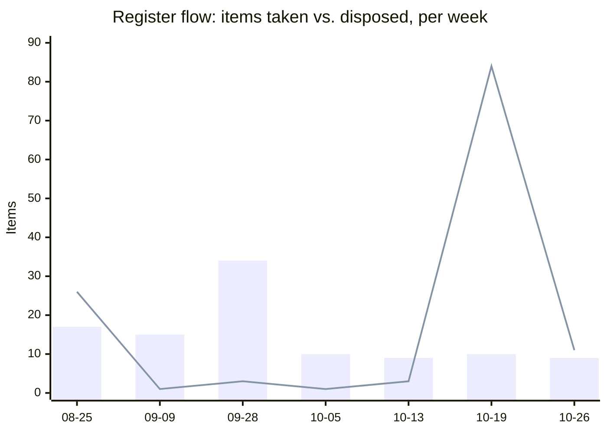

# Weekly Executive Briefing — 2026-10-26

## Evidence Coverage

- Email: Available (Stanford, Ascent, entroCIM release threads; Sent Items incomplete).
- Calendar: Partial (next-week query returned one out-of-range result only).
- Teams chats/channels: Not searched successfully (no results, second consecutive cycle — see Blind Spots).
- Meeting transcripts: Available (Training Pricing Framework, Training Margin Discussion, Weekly Sync, Quest Migration Weekly Check-In, all opened in full).
- Documents: Available (Junction renewal; Digital Products Portfolio status, partial; training sales guide; Tier 3 tickets).
- Known gaps: Sent Items independent result set not established; Digital Products Portfolio WAM slide not reached; Planner premium-plan tasks unavailable; next-week calendar incomplete.

Pulse: 68 live across 9 active forums; Dell health Worsening (+19 load, largest mover this week); 7 need your call: P057, P058, P060, P062, P065, P068, P070.

## Changes Since Last Brief

Two separate threads of change landed since Friday, neither from the web app.

- **A separate working session, earlier today, processed SkyFoundry's 4.0.7 release notes** before this session started. I did not do this work; I'm naming it because it falls inside this reporting window.
- That session updated `D010` (Woolly AI Tech Review decision) and `W015` (AI adoption governance).
- It also opened `D097`: Woolly becomes a paid SkyFoundry add-on from 2027-05-01, price not yet known. Filed in `Products/entroCIM/entroCIM.md` and `Products/SkyFoundry.md`.
- **This session processed the Weekly M365 evidence package and both Pulse sweeps** (delivery and development tracks).
- Register updates: `A49` and `W006` (Strev AI internal review), and six Quest-migration Pulse issues got new sightings (`P013`, `P047`–`P051`).
- Also this session: `C76`/`D096` got an urgent same-day flag (below), two Decisions Made entries were added, two new `Products/entroCIM.md` sections were filed, and `W027` was retired as a duplicate of `P051`.
- No web-app edits and no new T# triage items since Friday.

## Executive Summary

- **Stanford legal-session date conflict is unresolved for a second cycle and may be live today.** `C76`'s due date (your own web edit, 10-21) reads Tuesday 10-27; `D096`'s forum field and the item's own body text read Monday 10-26, 08:30 ET — today. Confirm which is correct, and what came out of it if the call already happened.
- **entroCIM training is now a fully operationalized commercial product**: named courses, $250/learner, $150/learner locked cost, margin-driven pricing, line-level discounting. A real win, logged to `09`, owned end to end by Maggie Becker.
- **Strev AI's $164,000/year/environment exposure is under internal review, not resolved.** New open question: does the fee apply once, or per environment including QA. Amy Aguirre is reviewing ahead of the Brian Miller session; `A49` is 3 days overdue.
- **Quest migration will not complete by 10-31; November cost is accepted.** Five technical blockers remain open in the Pulse; none escalated, all left with the team.
- **SkyFoundry 4.0.7 closes one Woolly governance gap and opens a cost one.** Plan/confirm/auto modes answer the "no guardrails" concern; a paid add-on from 2027-05-01 (`D097`) has no budget line yet.

## Top 3 Leadership Priorities

**1. Resolve the Stanford Commissioning App IP legal session — today.**
- Business impact: Wesco's negotiating position (entitlement, §18.5 exposure, PO-terms comparison) depends on this, and a position is owed to Stanford before the relationship erodes further.
- Why you personally: you re-timed this meeting twice and hold the final call on Wesco's position.
- Risk if delayed: a third slip. Stanford is still waiting on "a response from whomever picked up this project."
- Next step: confirm with Brandon Thompson/Nikos Minas whether the session is today or tomorrow, and whether it already happened.
- Expected outcome: a stated position, logged in `D096`/`C76`, for Sarah Monteleone to carry to Stanford.

**2. Close the Strev AI amendment review before it reaches Brian Miller.**
- Business impact: $164,000/year/environment is confirmed; whether it's charged once or per environment (QA included) changes the number materially before Legal negotiates it.
- Why you personally: `A49` is your own commitment, 3 days overdue, and you directed Amy Aguirre and Brian Miller to reconcile the two review tracks on 10-22.
- Risk if delayed: Legal negotiates against a number that's still wrong.
- Next step: confirm Amy's review landed and the QA/environment question has an answer.
- Expected outcome: one reconciled position goes back to Revnue, not two.

**3. Force a decision, not another re-date, on the WAM/ADM capacity reset (`A61`/`D001`).**
- Business impact: the 19-FTE AOP draft and the team's actual 8-person minimum run model remain unreconciled three weeks after you asked for a plan.
- Why you personally: Sean is waiting on your plan, not the reverse.
- Risk if delayed: WAM Data Challenges keeps running as discussion without decision output — the standing pattern already flagged in `07`.
- Next step: set a hard date this week with Akansh Gangil and David Blondel.
- Expected outcome: a staffing option Sean can act on, replacing a fourth re-date.

## Risks Requiring Action Today

::: {custom-style="Risk"}
**Risk:** the Strev AI amendment ($164,000/year/environment, possibly per environment including QA) could be signed on a number that's still wrong. Amy Aguirre's review must resolve the scope question before the Brian Miller session. (`W006`, `A49`)
:::

- **Stanford legal-session date conflict** (High, customer-visible) — see Priority 1. `C76`, `D096`.
- **FRBNY release 3.1.12.13** (High, customer-visible) — still held, customer not told, no next action on record since 10-16. Babu Papanna is back from PTO 10-28; worth a direct check this week. `W021`.

## My Actions

Register A, 9 open. Selection rule: due within 14 days, on a named critical path, or aging 14+ days with no movement. All 9 pass this test.

Cut to 7 by individual business stakes, holding back `A59` (a verbal CDA summary for Sean) and `A65` (a condensed Launch Studio update) — the two lowest-stakes items in the Sean cluster. See Chief of Staff Advice below on whether that cluster should be four separate deliverables at all.

| # | Action | Due | Status |
|---|---|---|---|
| A49 | Kick off the white-label amendment (AI feature set + Virtual Site Survey) | 2026-10-23 | 3 days overdue; Amy reviewing ahead of Brian Miller |
| A61 | Finalize the WAM/ADM capacity reset plan with Akansh Gangil and David Blondel, then to Sean | 2026-10-23 | 3 days overdue; 4th re-date since 10-05 |
| A67 | Get complex-build capture ownership onto a dated forum | 2026-10-23 | 3 days overdue; next step itself unconfirmed |
| A58 | Build the entroCIM data-center value proposition for Sean | 2026-10-23 | 3 days overdue |
| A60 | Stand up the vibe-coding productization concept | 2026-10-23 | 3 days overdue |
| A29 | Escalate the truncated part-number dependency if Akansh's follow-up produces no named owner | 2026-10-30 | On track |
| A64 | Reconcile the 2027 entroCIM roadmap with CDA, with Ron Snyder and David Blondel | 2026-10-31 | On track |

## Suppressed

Suppressed: none this cycle.

## Key Product Due Dates

| Initiative | Next Milestone | Due Date | Owner | Status |
|---|---|---|---|---|
| Quest-to-Azure | Final cutover (BLOB CLI, MQTT/DNS, conductor) | Slipped past 10-31; November cost accepted | Chad Steger / Shawn Clark | At risk, tracked in the Pulse |
| FRBNY BP43 Smart Building | Bid submission | Submitted ~10-20/21; evaluation date TBD | Sarah Monteleone | Submitted, awaiting customer |
| Strev AI / White-Label Amendment No. 2 | Legal review (Brian Miller) | TBD — pending Amy Aguirre's review | Amy Aguirre / Brian Miller | At risk (`A49`, `W006`) |
| WAM/ADM capacity reset | Staffing decision to Sean | TBD — re-dated 4 times since 10-05 | Darryl / Akansh Gangil / David Blondel | At risk (`A61`, `D001`) |
| Stanford renewal / Commissioning App IP | Legal position stated | TBD — date conflict, see above | Darryl / Nikos Minas | At risk (`C76`, `D096`) |
| entroCIM AI (Woolly) | Launch | Q1 2027, inside the SkyFoundry free window (ends 2027-05-01) | Darryl / Ron Snyder | On track; new cost exposure (`D097`) |
| Junction hosted-service renewal | Term start | 2026-11-01 | Leanne Gordon / Sarah Monteleone | On track, unsigned |

## Other-Owned Register, Condensed

- `C76` Stanford IP legal advice (Nikos Minas) — Critical, date conflict flagged above.
- `C50` Strev Virtual Site Survey pricing — still unpriced, no date from Strev; confirmed absent from Amendment No. 2.
- Quest Pulse items (`P047`–`P051`) — all left with the team 10-22, not escalated; five separate technical/contract blockers, same forum.
- Nothing else in Other-Owned nears its 14-day aging window this cycle beyond what's already carried.

## People Requiring Engagement

- **Sean McCloskey** — four pending deliverables (`A58`–`A60`, `A65`), all 3 days overdue. See Chief of Staff Advice.
- **Amy Aguirre / Brian Miller** — Strev AI amendment review, in progress.
- **Nikos Minas / Brandon Thompson** — Stanford IP legal session, date unresolved.
- **Maggie Becker** — training commercial model fully stood up this week; worth direct recognition.
- **Chad Steger / Shawn Clark** — carrying the bulk of open Quest Pulse issues; Shawn is named on BLOB, MQTT, conductor and Libro.

## Meeting Preparation

- **Stanford legal session (Nikos Minas, Brandon Thompson)** — confirm the date; bring the CODA pre-existing-IP evidence already assembled (`D096`).
- **Brian Miller / Strev AI amendment review** — bring the reconciled comparison once Amy's review lands.
- **Quest Migration Weekly Check-In** — status on five open blockers; decide whether any should escalate given the month-end slip.
- **WAM Data Challenges** — still a decision forum running as discussion. Track sessions since last decision (`07`).

## Blind Spots

- Teams chat/channel retrieval has returned nothing for a second consecutive cycle. Worth a direct technical check on whether the query itself is failing — "no results" from a portfolio this active is itself a signal.
- WAM Sprint Review hasn't been heard from in 13 days (last evidence 10-13). Flagged as not-heard in this week's governance agenda, not confirmed quiet.
- Sent Items independent retrieval incomplete for a second cycle.

## Delegation Opportunities

- The four-item Sean cluster (`A58`–`A60`, `A65`) is four separate artifacts for one audience in one week. One consolidated session would likely serve Sean better and cost less of your time than four individual preparations.
- Training commercial model: Maggie Becker is already running this end to end without your involvement. No change needed — noted as delegation that's working.

## Chief of Staff Advice

If I were your Chief of Staff, I'd challenge whether `A58`–`A60` and `A65` should be four separate items at all.

Each one amounts to updating Sean on something, with no decision attached beyond keeping him informed.

Four overlapping deliverables to the same person in the same week, all slipping together, is a pattern worth naming rather than re-dating a fourth time. Either consolidate into one session, or confirm each genuinely needs its own artifact.

## This Week's Objectives

1. Resolve the Stanford legal-session date conflict and get a stated position.
2. Close the Strev AI amendment review loop before the Brian Miller session.
3. Get a real decision — not a fifth re-date — on the WAM/ADM capacity reset.
4. Decide whether the Sean cluster consolidates to one session.

## Executive Watch List Delta vs. 04

- **New:** `W099` (escalated from Pulse `P007`, JCI/PC1 point faults).
- **Retired:** `W027` (Quest T&M approval) — a duplicate of Pulse `P051`, missed at the 10-16 lane re-sort. Retired this cycle, bringing Active back to the 20 ceiling exactly.
- **Confirmed, trend unchanged:** `W006` Strev AI (↑, new scope question this week); `W021` FRBNY release held (↑, still no next action).
- Active is 20 of a 20 ceiling. No further cap action needed this cycle.

## Decision Radar

14 items on the Radar, against a 20 ceiling — no action needed. Newest: `D097` (SkyFoundry add-on pricing, Backlog, no forum yet). Oldest with no forum movement: `D008`/`D009` (NavWork/WAM scheduling questions, open since 08-28, no forum date).

## Executive Communication Opportunities

- The entroCIM training commercial model (named courses, locked cost, margin control) is a genuine, evidenced win with no Sean update sent in four cycles (`09`). Worth raising at the next Sean meeting frame, even though written updates stay retired as a default.
- SkyFoundry 4.0.7's governance answer (plan mode) is relevant to the AI Tech Review path. Worth flagging to Sourav Pradhan directly rather than waiting for the next formal review.

## Weekly Analytics Block

1. **Decision velocity.** 2 decisions made this week (training cost/margin mechanics; continue Quest through November). Radar 14 of 20; Backlog gained `D097`. Oldest open: `D008`/`D009` (08-28, no forum), `D001` (10-07, WAM capacity, 4th re-date).
2. **Commitment load.** Register A 9 open, unchanged net (2 taken, 2 closed, both Stanford legal re-timing). Other-Owned 79 open (4 taken, 8 closed; 3 of those are Pulse lane moves, not completions). Oldest open: `A49` (since 09-17), `C76` (since 10-20, now date-conflicted), `A61` (since 10-05).
3. **Watch-list trend.** Active 20 of 20 (W099 in, W027 retired as a duplicate). `W006` and `W021` both ↑ this cycle. Silence flag: `W021` has carried no next_action since 10-16.
4. **Recurring-theme detection.** Stanford Commissioning App ownership has appeared in 5+ cycles without a closed decision (`D096`). Strev AI's budget home has appeared in 4+ cycles without a funded line (`W006`).
5. **Time-at-role.** See Delegation Opportunities and Chief of Staff Advice — the Sean cluster is the clearest signal this cycle.
6. **Impact capture.** 2 entries added this week (training commercial model; SkyFoundry governance fix), the first in 7 days; last week logged zero.

## Closure Checks

1. **`D008`** (NavWork facility-data scope, open since 08-28, no forum date) — still open?
2. **`D009`** (WAM/NavWork integration unscheduled, open since 08-28) — still open?
3. **`A49`** (white-label amendment kickoff, open since 09-17) — potentially advancing now that Amy is reviewing — confirm status?
4. **`C76`** (Stanford IP legal advice) — is this resolved as of today, and on what date did the session actually happen?
5. **`W021`** (FRBNY release 3.1.12.13) — potentially closed, confirm: has the release gone out, and has FRB been told?

## Register Health

| Register | Now | Cap | Δ | Taken | Closed |
|---|---|---|---|---|---|
| Register A | 9 | 15 | 0 | 2 | 2 |
| Other-Owned | 79 | — | -1 | 4 | 8 |
| of which Critical | 15 | ~15 | -2 | — | — |
| Watch Active | 20 | 20 | 0 | 1 | 1 |
| Decision Radar | 14 | 20 | -1 | 2 | 0 |

::: {custom-style="Image Caption"}
Register flow by week: bars are items taken, the line is items disposed. The 10-19 spike (84 disposed) is the one-item-per-file migration cleanup, not a normal week. This week's 11 disposed includes 3 Pulse lane moves, not completions.
:::

::: {custom-style="Source Note"}
Dashboard/snapshots.json, weekly_flow series. 2026-08-07 to 2026-08-24 not shown — capture gap, not interpolated.
:::

Disposal is keeping pace with intake most weeks (9 taken vs. 11 disposed this week), but three of those closures are Pulse lane moves, not completions, so the true disposal rate is softer than the headline. Nothing here changes a decision this cycle.

## Sean Update

Retired as a default (`03`, 2026-10-14). Not produced unless you ask. The entroCIM training win above is a candidate for the next meeting frame regardless.
