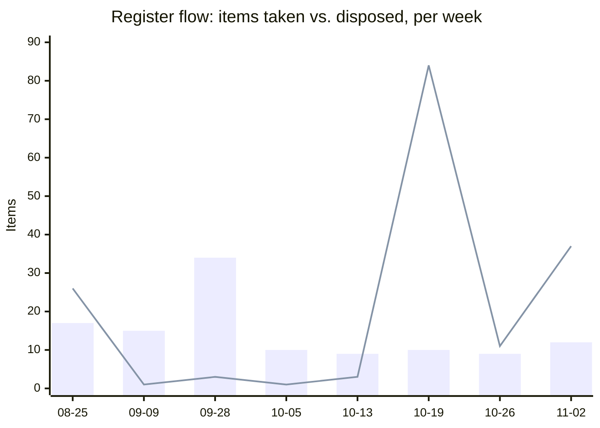

# Weekly Executive Briefing — 2026-11-02

## Evidence Coverage

- Email: Available (Re: Revnue/Strev Contract sent item; entroCIM deployment guide; Merck Rahway renewal thread, complete).
- Calendar: Partial (next week 11-03 to 11-09 returned three relevant events).
- Teams chats/channels: Available (eCIM Leadership, Jarod Booth thread, WAM Product Team, IT Scrum; FRB Cash Services excerpt cut off).
- Meeting transcripts: Available (Weekly Sync 10-30 and Strev Amendment No. 2 review 10-27, both complete; Pulse sweeps: Daily Stand Up 10-27 to 10-29, Deployment Scrum 10-29).
- Documents: Partial (file query returned recordings and noise, not edited portfolio documents).
- Known gaps: AI meeting notes not returned; Planner premium tasks unavailable; `isMeetingTranscribed` not exposed; WAM Product discussion and Product/Platform connect not found; WAM Backlog Refinement 10-27 and 11-02 not swept.
- Exclusions: portfolio scope 14 items; sprint-task rule 0 (weekly), 10 (delivery sweep), uncounted (development sweep).

Pulse: 96 live across 9 active forums; Dell health Worsening (load 187, +51 against seven days ago, 15 High customer-visible live issues); 3 need your call: K010, P123, P124.

The jump from 68 to 96 live is mostly the 10-28 lane reconciliation moving 20 Register B items into the Pulse, plus 40 issues first seen in the last seven days. Dell's rise is the 10-29 Deployment Scrum backlog landing on the day it was raised.

## Changes Since Last Brief

Your web session on Friday 10-30 after the daily brief, and this session's processing.

- **Friday, your web edits (12:30 to 13:45):** six due dates moved from 10-23 to 11-06 (`A58`, `A59`, `A60`, `A65`, `A67`, `B100`). Nine Pulse issues left with the team (`P003`, `P071`, `P115` to `P121`). `P042` escalated to `W100` and retired the same minute. Pinned account back to Dell.
- **Friday, chat session:** `A71` created (Nozomi Guardian MSP intake and BIR, due 11-06, $57,000 2027 expense on the entroCIM budget), drafts ready in `Deliverables/CDA/Nozomi/`.
- **No `T#` triage items pending.** `T1` (executive awareness of entroCIM and channel challenges, follow up with Jarod Booth by 11-06) is already in Register A from your 10-29 entry.
- **This session, registers:** `A72` created (WAM enrichment requirements with Amy, Senthil, Violet, Jeff White; date Claude-proposed 11-09). `C81` created (Sunny's Strev redraft, Critical). `C79` re-pointed at Amy's AI Council submission (due 11-06). Updated: `A49`, `A61`, `A67`, `C68`, `C77`, `D048`, `W003`, `W005`, `W006`.
- **This session, Pulse:** `P123`, `P124` created; `K010` created (Scott Dunn, Penang One BMS access). Sightings on `P031`, `P110`; detail notes on `P088`, `P103`. `B1` and `B98` moved to `P125`, `P126` under the lane model (worklist test 3, no decision needed).
- **This session, living documents:** `03` Decisions Made (Strev QA and $80K), `06` (Amy Aguirre, Jeff White, Akansh Gangil, Valli Poornakumar), `09` (Merck Rahway renewal; deployment guide issued), `Products/WAM/WAM.md` and `Products/entroCIM/entroCIM.md` (dated sections, 11-02).
- **Evidence saved:** `Evidence/M365_Evidence_Weekly_2026-11-02.md`, `M365_Evidence_PulseP1_2026-11-02.md`, `M365_Evidence_PulseP2_2026-11-02.md`; the returned Pulse review copied to `Reviews/returned/`.
- Smoke test: PASS (0 fail, 33 legacy, 0 warn), before and after edits.

## Executive Summary

- **The 2027 capacity cut is now stated to the business.** You told Amy Aguirre on 10-30 that WAM/EDM goes from about 16 to 8 and entroCIM is materially reduced. The reset decisions that give that statement a plan (`A61`, `A64`, `D001`) are overdue or due this week.
- **Strev Amendment No. 2 moved on the commercial side, not the paper.** Amy re-pointed the additional $80K to the site-survey tool and asked Sunny to redraft; you both agreed no Strev AI in QA. `A49` is due tomorrow with two inputs still owed (`C77`, `C81`).
- **Seven Register A items land Friday 11-06**, six of them re-dated from 10-23 on Friday. Three are one Sean conversation (`A58`, `A59`, `A65`). A disposal sweep is more likely than seven completions.
- **Dell load is up 51 points in a week**, driven by the 10-29 closeout scrum (Limerick, Penang One, non-DC scope). You left all of it with the team on Friday; the governance question is whether Chad and Syed have a closeout plan, not any single issue.
- **Two wins to carry:** the entroCIM deployment guide is now an approved Sales & Solutions document, and Merck Rahway renewed with the SkySpark license authorized (CRM closure not yet evidenced).

## Top 3 Leadership Priorities

### 1. Give the 2027 capacity statement a plan before it circulates further

- **Business impact:** The number is out. Without the run/complete/stop/defer plan (`A61`) and the entroCIM/CDA roadmap reconciliation (`A64`), business stakeholders will fill the gap with their own feature lists, as Amy did on 10-30.
- **Why you personally:** You made the statement, you own both reset decisions, and `D001` has been re-dated four times.
- **Risk if delayed:** The WAM Leadership Sync and entroCIM Leadership Collaboration on 11-09 arrive with the cut known and the plan absent; Sean hears it second-hand.
- **Next step:** This week, finish `A61` with Akansh and David (the Databricks gap decision) and `A64` with Ron and David; bring both to the 11-09 forums as decisions, not discussions.
- **Expected outcome:** One stated 2027 scope per product by 11-09, and `A72` requirements gathering fenced by it.

### 2. Close the Strev amendment loop on paper, not just in the Weekly Sync

- **Business impact:** The commercial position moved in your favor ($80K to the site-survey tool, no AI in QA), but nothing is written. Revnue holds the draft; Legal's markup (`C77`) and the redraft (`C81`) are both owed.
- **Why you personally:** `A49` is your commitment, you are the one reconciling the markup, and the token-consumption budget (`W006`) still has no home.
- **Risk if delayed:** Signature on wording that contradicts the 10-30 agreement, or a redraft that re-opens points Brian already marked.
- **Next step:** Tomorrow, ask Brian Miller for a date on the markup and Amy for Sunny's redraft date; re-date `A49` to the later of the two plus two days. Decide whether token consumption goes into Amy's BIR or yours.
- **Expected outcome:** One reconciled markup back to Revnue by mid-November, with the consumption model named.

### 3. Decide the WAM upstream-data ownership question at the 11-03 working session

- **Business impact:** Truncated part numbers (`A29`, 10 weeks without an owner of record) and complex-build system of record (`A67`, `W042`, `D078`) are the same problem: WAM depends on data nobody upstream owns on a date.
- **Why you personally:** `A29` is your escalation call, three days overdue. Tomorrow's "Working Session 2 | VAS-WMX-ADM-ALM" is the first dated forum in weeks that has the right people in the room.
- **Risk if delayed:** Another cycle of "analyzing, no ETA" from the UDM team while 2027 capacity shrinks around the dependency.
- **Next step:** At the 11-03 session, ask for a named owner and date for the EUDM part-number fix, and for the system-of-record decision per data element. If neither is given, escalate `A29` to Nitin Pandey's leadership the same day.
- **Expected outcome:** `A29` converted to a dated owner or escalated; `A67` closed or re-dated against a decision forum.

## Risks Requiring Action Today

::: {custom-style="Decision Required"}
**Decision required, A29:** escalate the EUDM truncated-part-number dependency (to whom), or re-date it to the 11-03 working session with a named owner as the trigger. Due 10-30; three days overdue. Owner: Darryl. Decide today.
:::

::: {custom-style="Risk"}
**Dell closeout load, High.** Load 187, Worsening, +51 in seven days; 15 High customer-visible live issues, 4 stuck. Evidence: 10-29 Deployment Scrum (`P003`, `P115` to `P117`, `P088`, `P103`). Business impact: Limerick and non-DC closeout slips, customer sees it. Action: ask Chad Steger and Syed Zaidi for a dated closeout plan at this week's delivery governance meeting, not issue by issue.
:::

- **Nitin Pandey's contractor end dates (`C80`, Critical, due tomorrow)** gate the WAM/ADM reset. If they are not in by Tuesday, `A61` cannot finish Friday; chase Nitin today.
- **Reviewer name for the Pulse review read-back.** Eight development-track changes came back with no reviewer (below). One name from you and they apply; without it the first read-back files nothing.

## My Actions

Selection rule: due within 14 days, on a named critical path, or aging 14+ days with no movement; cap 7. Register A is 12 open against a ceiling of 15.

| ID | Action | Due | Status |
|---|---|---|---|
| `A29` | Escalate or re-date the truncated part-number dependency | 2026-10-30 | Overdue 3 days; decision above |
| `A64` | Reconcile 2027 entroCIM roadmap with CDA (Ron, David) | 2026-10-31 | Overdue 2 days |
| `A49` | Kick off the white-label amendment; reconcile Brian's markup | 2026-11-03 | Two inputs owed (`C77`, `C81`); re-date |
| `A61` | Finalize the WAM/ADM reset plan, then Sean | 2026-11-06 | Gated by `C80` (tomorrow) |
| `A71` | Submit the Nozomi Guardian intake and BIR | 2026-11-06 | Drafts ready; four unit costs to confirm with Nozomi |
| `A67` | Complex-build ownership onto a dated forum | 2026-11-06 | Forum exists: 11-03 working session |
| `A72` | WAM enrichment requirements with Amy, Senthil, Violet, Jeff | 2026-11-09 | New; date Claude-proposed, confirm |

Not shown, also due Friday 11-06: `A58`, `A59`, `A60`, `A65`, `T1`. Five items plus `A61` and `A71` make seven due on one day.

## Suppressed

- `C51` (dropped 2026-09-17, "Amy's problem"): the $84,000 AI enablement fee resurfaced through the $80K reallocation. Echo: Amy's decision, tracked as context on `W006` and `C81`; not re-added.
- `A8` (closed 2026-08-25, AI Council date and prep): Amy's AI Council submission this week resembles it. Resemblance: distinct, tracked as `C79`.
- `C15` (aged out 2026-10-19, guidance on the WAM AI Council presentation): 10-30 evidence shows Amy owns the submission herself. Contradiction by the rule, but resolved by ownership rather than live again. Recommend no reopen; `C79` carries it.
- The FRB 2D/3D BIM position and the Wesco-Hosted standard both reappeared; echoes of `Products/entroCIM.md` positions dated 10-20 and 10-12, confirmed unchanged.

## Key Product Due Dates

Generated from the registers; unconfirmed dates marked TBD.

| Initiative | Next Milestone | Due Date | Owner | Status |
|---|---|---|---|---|
| WAM/ADM reset | Run/complete/stop/defer plan (`A61`), then Sean | 2026-11-06 | Darryl | Gated by `C80` |
| WAM/ADM reset | Contractor end dates and renewal status (`C80`) | 2026-11-03 | Nitin Pandey | Critical, due tomorrow |
| WAM enrichment | Requirements session with Amy, Senthil, Violet, Jeff (`A72`) | 2026-11-09 | Darryl | Date proposed |
| Strev amendment | Reconciled markup to Revnue (`A49`) | 2026-11-03 | Darryl | Re-date pending `C77`, `C81` |
| Strev AI | AI Council submission (`C79`) | 2026-11-06 | Amy Aguirre | Her commitment, week of 10-30 |
| Complex-build data | Authoritative-system decision onto a forum (`A67`) | 2026-11-06 | Darryl | Forum 11-03 |
| entroCIM roadmap | Reconcile 2027 roadmap with CDA (`A64`) | 2026-10-31 | Darryl | Overdue |
| entroCIM | Data center value proposition for Sean (`A58`) | 2026-11-06 | Darryl | Re-dated from 10-23 |
| CDA / Nozomi | Demand Intake and BIR (`A71`) | 2026-11-06 | Darryl | Drafts ready |
| CDA | Summary for Sean after PTO (`A59`) | 2026-11-06 | Darryl | Re-dated from 10-23 |
| Launch Studio | Condensed update for Sean (`A65`) | 2026-11-06 | Darryl | Re-dated from 10-23 |
| Ascent Navigator | Production WAB evidence pack (`C72`) | 2026-10-23 | Other-Owned | Overdue, no new evidence |
| JCI | Final legal markup to JCI (`C1`) | 2026-10-30 | Other-Owned | Overdue, no new evidence |
| Quest migration | November continuation (`P013`, `P051`) | TBD | Delivery team | Nextcloud to SharePoint underway |
| Woolly add-on | Paid from 2027-05-01 (`D097`) | 2027-05-01 | Darryl | No budget line |

## Other-Owned Register, Condensed

51 open after this week's moves (79 last week); 12 Critical. The 10-28 lane reconciliation dropped 20 B-items into the Pulse and closed 11; `B1` and `B98` followed today.

- At their gates this week: `C80` (11-03, Critical), `C79` (11-06), `B100` (11-06, Critical, MuleSoft architecture and WAM-limitations slide), `B102` (11-05, Critical, Strev SOW 3 deliverables).
- New this week: `C77`, `C78`, `C79`, `C80`, `C81`, all Strev or WAM. Five takes from one product line in one week is the capacity story showing up in the register.
- Nearing the 14-day aging window with no evidence: `C61` (Walmart via Wesco MRO), `C65` (Emily Munk, CDA walkthrough), `C63` (Sean and Akash on WAM development ownership), `C59` (Bob Caprise, CDA sponsorship email).
- Oldest open: `C8` (JCI technical data, due 07-30), `C50` (Strev VSS pricing, 09-17), `C43` (Ford pricing language, 09-19). All three are in the closure checks.

## Weekly Pulse Review, First Read-Back

The returned 10-27 workbook came back with eight changed rows, all development track, all entroCIM, none attributed to a reviewer. The delivery track returned no changes.

- Verdicts: `P081` Resolved (admin-app migration screens); `P040`, `P053`, `P070`, `P078`, `P079`, `P082`, `P083` Not an issue (monorepo and tooling items).
- Needed from you: the reviewer's name (Ron Snyder or David Blondel for entroCIM). I apply the eight changes with that name; the app's preview cannot apply unattributed rows.
- Delivery team: first cycle, no changes. Not a finding yet; the falsification rule is two consecutive silent cycles, then raise it with Chad and Syed.
- `P081` was also sighted "almost done" on 10-27 in the stand-up; the reviewer's Resolved postdates it and outranks it.

## Pulse Reconciliation: Watch Decisions

From the 2026-10-27 worklist. Three tests, in order: your commitment stays in A; escalated on a test stays as a pointer; team-level retires to the Pulse. One line each; reply with the ID and keep, link or retire.

Applied without you (tests 1 and 3, no decision needed): `A29` stays; `B1` to `P125`; `B98` to `P126`; `W009` and `W016` stay as pointers to `P006` and `P021`. `W099` was already retired 10-28.

Active, your call:

- `W005` Stanford remediation and retention risk: keep Active (customer and IP exposure); create a Pulse issue for the deployment-level remediation and link. Recommend keep.
- `W015` AI adoption governance and team assignment: no Pulse counterpart; theme, not an incident. Recommend keep as a theme, no Pulse issue.
- `W019` Louvre Abu Dhabi closeout snag-list stall: create `P###` and link, or retire to the Pulse. Recommend link (customer-visible, stuck).
- `W021` FRBNY release 3.1.12.13 held, customer not told: keep Active until the customer has been told (boundary test). Recommend keep.

Passive, retire to the Pulse unless you say otherwise (one line each, history carried):

- `W023` managed-services day-two staffing readiness. Recommend retire.
- `W031` ServiceNow Field Service dev-environment access. Recommend retire.
- `W035` Dell non-DC HQ dashboard data gap. Recommend retire; overlaps `P115` to `P117`.
- `W039` release compliance and DCOE evidence gap. Recommend retire.
- `W040` Dell EcoStruxure connector on hold. Recommend link to `P025` and retire.
- `W046` entroCIM release communication handoff. Recommend retire; `P042`/`W100` was the last instance.
- `W047` WAM MVP1 notification quality. Recommend retire.
- `W049` vendor part-number trimming. Recommend retire; `P021`/`W016` carry it.
- `W050` entroCIM Sprint 38 PTO concentration. Recommend retire; dated.
- `W053` Mapbox token exposure (security). Recommend keep Passive; security items do not belong in a team Pulse.
- `W062` Quest-to-Azure migration. Recommend link to `P013` and retire.
- `W067` server account management ownership. Recommend retire.
- `W069` Stanford commissioning reports render blank. Recommend link under `W005` and retire.
- `W078` EOS evidence-recording expiration. Recommend retire; process, not a risk.
- `W080` Maggie Becker PTO continuity. Recommend retire; dated.

Also found: `W016` carries a `closed_date` of 10-28 while still tiered Active. I will clear the date unless you meant to retire it.

## People Requiring Engagement

- **Amy Aguirre:** three live threads (`A72`, `C79`, `C81`); she heard the capacity number first. One conversation this week covering requirements intake and the redraft date.
- **Ron Snyder and David Blondel:** `A64` (overdue), the reviewer name, and Savanur waiting on Ron for the legacy connectors (`P031`). Ron was out 10-29.
- **Chad Steger and Syed Zaidi:** the Dell closeout plan (above) and why the delivery review came back empty.
- **Sean McCloskey:** `A58`, `A59`, `A65` are one meeting, not three; and he should hear the 16-to-8 framing from you before it travels.
- **Nitin Pandey:** `C80` tomorrow.
- **Brian Miller:** a date for the `C77` markup.
- **Jeff White (new in `06`):** scoping in front of customers and sales; bring into `A72`.

## Meeting Preparation

- **Tue 11-03, Working Session 2 | VAS-WMX-ADM-ALM (maybe Strev):** carry `A29`, `A67`, `W042`, `D078`. Ask: owner and date for the EUDM part-number fix; system of entry and system of record per data element; the ADM/Strev boundary.
- **This week, delivery and development governance meetings:** Dell closeout plan (delivery); reviewer name and `P123`, `P124` ownership (development).
- **Fri, Weekly Sync with Amy:** `A72` session date; Sunny's redraft date; AI Council submission status (`C79`).
- **Mon 11-09, WAM Leadership Sync and entroCIM Leadership Collaboration:** `D001` and `A64` as decisions; the capacity framing as a single message.

## Blind Spots

- **WAM Product discussion not found for two sweeps** (last 10-22). You confirmed it met on 10-22; is it still meeting under that name, or renamed? Product/Platform connect is also 12 days silent.
- **WAM Backlog Refinement met 10-27 and today** with tracked WAM issues, and neither occurrence was swept. Run the development Pulse prompt tomorrow with that forum included.
- **The 10-26 WAM Leadership Sync recording was excluded as personal.** If anything decision-relevant was said after the salary discussion moved, it is not in the record.
- **No AI meeting notes were returned** for any non-governed meeting; two transcripts carried the whole weekly package.

## Delegation Opportunities

- `A58` entroCIM data center value proposition: first draft to David Blondel or Chad Steger (they hold the SkyPosium and data-center positioning material); you edit and present.
- `A60` vibe coding productization concept: a one-page concept from Shawn Clark or Jason Ganiatsas; your time is better spent on the reset decisions.
- `A65` Launch Studio condensed update: Mike Wassil's 10-13 package is the source; a first cut from Mike.

## Chief of Staff Advice

If I were your Chief of Staff, I would challenge you on Friday. Seven Register A items due 11-06, six of them re-dated from 10-23 on Friday. That is the second re-date for most. Pick the three that will actually happen and dispose of the rest now, not Friday evening.

I would also challenge the `A29` pattern: ten weeks of "no owner, no ETA" is a finding, not a status. Either escalate it tomorrow at the working session or fold it into one consolidated upstream request with the shipping-data and renewal-flag asks, as `Products/WAM/WAM.md` suggested on 10-14.

## This Week's Objectives

1. `A29` decided (escalate or dated owner) at the 11-03 working session; `A67` closed or re-dated against it.
2. `A61` and `A64` finished, ready as decisions for the 11-09 forums.
3. `A49` re-dated against `C77` and `C81` dates obtained from Brian and Amy; consumption budget home decided.
4. Reviewer name given; the eight Pulse review changes applied; Watch reconciliation decisions returned.
5. Friday disposal sweep: the seven 11-06 items reduced to the three that will happen.

## Executive Watch List Delta vs. 04

Active only; 20 of 20.

- `W006` Strev AI consumption: trend ↑ to →. The enablement charge is being re-pointed; the token budget home is still open.
- `W003` entroCIM 2027 capacity: unchanged High; the reduction is now stated to business stakeholders.
- `W005` Stanford: new facet, the customer-funded Commissioning toolset IP position held pending Legal; licenses updated 10-29.
- `W100` in and out the same minute (from `P042`); no net change.
- No Passive item escalated this cycle.

## Decision Radar

17 of 20. `D003` (Ford SOW, forum date 09-09) and `D002` (CLM, forum date 09-28) carry passed forum dates with no forward date; by the entry test they belong in the Backlog unless you re-set the forum. Both are on commercial paths, so I have not moved them. Say re-date or move.

`D001` (WAM reset) and `D004` (complex-build data model) are the two with forums this week and next. `D048` (ADM enrichment Java or ADB, Backlog) is potentially moot now that the EDM/Excel path shipped; confirm.

## Executive Communication Opportunities

- **Sean, before 11-09:** the 2027 capacity framing in your words, with the reset plan attached, before Amy or the team relays it. Fits the Sean standard (something he must defend upward and not be surprised by).
- **Sales & Solutions:** the deployment guide is out; a short note from you endorsing it closes the loop with Valli Poornakumar's distribution.
- **Not yet:** Merck Rahway, until CRM closure is evidenced.

## Weekly Analytics Block

1. **Decision velocity.** 1 decision made this week with you in it (Strev QA scope and $80K reallocation, two decision-makers). Radar 17 of 20; `D097`, `D098`, `D099` entered, `D098` closed. Oldest open: `D008`/`D009` (08-28), `D001` (10-07, fourth re-date).
2. **Commitment load.** Register A 12 open, +3 net (3 taken, 1 closed). Other-Owned 51, −28 (5 taken, 33 disposed; 22 of those lane moves). Oldest open: `C8` (07-30), `A49` (09-17), `A61` (10-05).
3. **Watch-list trend.** Active 20 of 20. `W006` → (from ↑). `W003` and `W005` gained evidence, no severity change. Silence flag: `W021` still carries no next_action since 10-16.
4. **Recurring-theme detection.** Strev AI budget home, 5+ cycles (`W006`). Upstream WAM data ownership, 10 weeks (`A29`, `P021`). Stanford ownership, 6+ cycles (`W005`, `D096`).
5. **Time-at-role.** Three Sean items due the same day; three delegation candidates above. The Watch reconciliation is 19 one-line decisions, which is role-level work done once.
6. **Impact capture.** 2 entries added (Merck Rahway renewal in process; deployment guide issued). 

## Closure Checks

1. `C8` (JCI technical data for the WAB submission, due 07-30, oldest open Other-Owned): still open, or overtaken by the JCI markup (`C1`)?
2. `C50` (Strev VSS pricing, due 09-17): potentially superseded by the $80K reallocation to the site-survey tool. Confirm?
3. `C43` (Ford pricing-model language, due 09-19): still open? If Ford is parked, drop it.
4. `C79` (who takes the Strev feature pack to the AI Council): Amy said she will, this week. Potentially closed as asked; confirm, and the item becomes her submission.
5. `D048` (ADM enrichment Java or ADB): potentially moot after the EDM/Excel path shipped 10-30. Confirm?

Trigger backstop: no open Register A item carries an unfired trigger. "Is this yours?": none parked on an unconfirmed attribution this week.

## Register Health

| Register | Now | Cap | Δ | Taken | Closed |
|---|---|---|---|---|---|
| Register A | 12 | 15 | +3 | 3 | 1 |
| Other-Owned | 51 | — | -28 | 5 | 33 |
| of which Critical | 12 | ~15 | -3 | — | — |
| Watch Active | 20 | 20 | 0 | 1 | 2 |
| Decision Radar | 17 | 20 | +3 | 3 | 1 |

::: {custom-style="Image Caption"}
Register flow by week: bars are items taken, the line is items disposed. The 10-19 spike (84) is the file-per-item migration cleanup. This week's 37 disposed includes 22 Pulse lane moves from the 10-28 reconciliation, not completions.
:::

::: {custom-style="Source Note"}
Dashboard/snapshots.json, weekly_flow series. 2026-08-07 to 2026-08-24 not shown; capture gap, not interpolated. Register A taken: A70, A71, A72; closed: A70.
:::

Disposal outran intake this week only because the lane reconciliation moved 22 items; true completions were 11 against 12 takes, roughly even. This changes one decision: Other-Owned no longer needs a sweep, Register A's Friday pile does.

## Monthly Maintenance

First weekly of the month, staleness pass (60+ days untouched): `Products/CMP.md`, `Products/Connected_Safety.md`, `Products/Spanr.md` are quiet since August; propose confirming they stay on the roster or hiding them in the Products tab. `Reference/EOS_Analytics_Standard.md` and `EOS_Model_Selection_Standard.md` are stable standards, no action. The CDA phase dossiers are archival by design. `01` was touched 10-29.

## Sean Update

Retired as a default (2026-10-14). Produced on request only. The 11-09 capacity conversation above is the candidate meeting frame.
