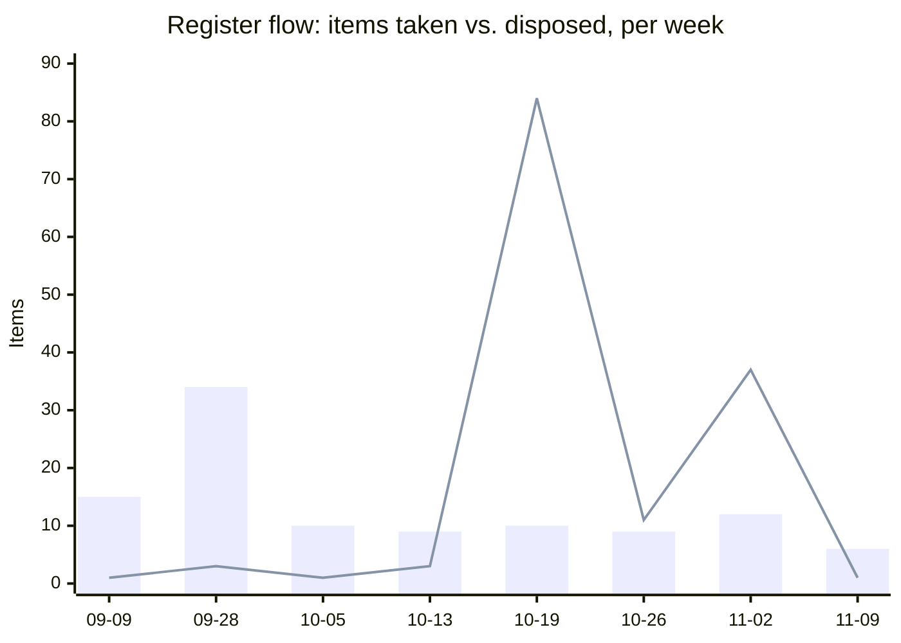

# Weekly Executive Briefing — 2026-11-09

## Evidence Coverage

- Email: Available (Nozomi Guardian MNDA and partner-portal thread; Quest/Nextcloud hosting-contract thread feeding `A73`; FY27 WAM team listing thread carried from last week).
- Calendar: Not separately queried this session; meeting dates below come from transcripts and register history, not a fresh calendar pull.
- Teams chats/channels: Available (WAM Product Team; Digital Products / Agile Staff Meeting, 2026-11-04; Quest Migration Weekly Check-In).
- Meeting transcripts: Available for the items cited below; the Weekly Sync and Strev Amendment No. 2 review from the prior cycle are carried as context, not re-confirmed this session.
- Documents: Available (FY27 WAM team listing PDF; Nozomi MNDA, executed; the 2026-11-06 Data Strategy & Governance announcement).
- Known gaps: Planner premium tasks remain unavailable — the stale "Sean McCloskey / WAM criticality" Planner item below still carries Inferred attribution, unconfirmed. `08_Field_Notes.md` is retired and was not read.
- Exclusions: standard portfolio-scope and sprint-task exclusion rules applied per `CLAUDE.md`.

Pulse: 151 live across the 13 governed forums (delivery and development tracks), up from 96 last week. Dell is the largest single-account concentration at 42 live issues, 22 of them High. 11 Pulse items need your call this week (escalation candidates), against 3 last week — detail in Risks Requiring Action Today.

## Changes Since Last Brief

Darryl's own edits since Friday's daily brief, and this session's processing.

- **Monday 11-03, your web edits:** `A29` re-dated 10-30 → 11-18 (the escalate-or-redate decision from last week's brief — you chose re-date). `A64` re-dated 10-31 → 11-17 and its Critical flag cleared.
- **Wednesday to Friday, Pulse app activity:** pinned account cycled through Wesco Warehouse, Dell, Merck and Federal Reserve as you worked each account's sweep; `P131` left with the team. Three batches of new Pulse issues landed (`P131`–`P141` on 11-04, `P142`–`P155` on 11-05, `P156`–`P158` plus `C83` on 11-06).
- **Wednesday 11-04, chat/session:** `A71` advanced (Nozomi MNDA executed, confidentiality no longer blocks the four placeholder unit costs); `A72`, `C78` touched; `W026` touched; `B3` and `W101` created — Darren Taylor's departure and Sean McCloskey's expanded Data Strategy & Governance role, filed as a new Watch item.
- **Thursday 11-05, chat/session:** `A71` advanced again (partner-portal access confirmed); `A74` created (investor-day presentation in Chris Gazdic's place, due 11-10); `A73` created (Quest hosting-contract holder and Finance review, due 11-10, created 11-03).
- **Friday 11-06:** `A58`, `A59`, `A60`, `A65`, `A67`, `B100` all received a due-date **format** correction only (`2026-11-6` → `2026-11-06`, ISO) — none were actually dispositioned. `W005` (Stanford) retired from Watch Active the same day.
- **This session (today):** three evidence packages ingested and saved to `Evidence/` (Delivery-track Pulse sweep, M365 Weekly package, Development-track Pulse sweep). New Pulse items `P159` (WAM Exact-supplier renewal notifications, High, no-owner gap) and `P160` (Sales asking for DCIM preview screenshots early, Low); new facets on `P148` (Central Texas floor-plan/submeter detail) and `P033` (removal-reason UI exposure undefined); `P146` flagged as an escalation candidate (no-owner gap, cross-site alarm baseline). `A71` and `W016` updated. Three new entries added to Decisions Made in `03_Decision_Log.md` (CDA build order, CDA non-RMM/SOC/MDR positioning, assisted-not-auto onboarding correction) and filed into `Products/CDA/CDA.md`. `06_Stakeholder_Map.md` updated (Ron Snyder, Akansh Gangil, James Haefele — new contact). `Dashboard/snapshots.json` updated with this week's Register Health snapshot.
- No `T#` triage items pending beyond `T1`, already in Register A and now overdue (below).
- Smoke test: PASS (0 fail, 33 legacy, 0 warn, 6 checks), confirmed this session.

## Executive Summary

- **The Friday disposal sweep mostly didn't happen.** Of eight items due 2026-11-06 (plus `B102` due 11-05), only `A29` and `A64` were actually dispositioned — both re-dated by you directly on 11-03, ahead of the deadline. The other six (`A58`, `A59`, `A60`, `A65`, `A67`, `B100`, `T1`) got a date-format fix and nothing else; this is the exact pattern last week's Chief of Staff note flagged.
- **CDA's build approach and positioning are now decided and on paper.** Connect to Nozomi Guardian and refine from observed data rather than finish the design up front; explicitly not RMM, SOC, MDR or a replacement for customer security tooling; onboarding is assisted, not unmanned (corrects a previously filed "auto-onboarding" note). Filed in `Products/CDA/CDA.md` and the Decision Log. The one CDA item still stuck is `A71` (Nozomi intake), now overdue.
- **Sean McCloskey's scope just expanded** — he now leads Data Strategy & Governance (Darren Taylor departed) on top of Digital Products. That is a new data-ownership boundary for WAM/ADM's supplier-attribute work, and it lands in the same week three other items are waiting on a Sean conversation.
- **Pulse volume nearly doubled** (96 to 151 live) and items needing your call went from 3 to 11, mostly Dell boundary questions (redundancy/DR architecture, license-server design, OPC UA pilot scope) that read as the team asking for an internal decision rather than a customer emergency.
- **Two items have no owner at all:** WAM's Exact-supplier renewal notifications (`P159`, blocked on a custom-field enablement) and the cross-site alarm validation baseline (`P146`). Unnoticed notification gaps are the system's worst historical failure mode (`Products/WAM/WAM.md`, the 19-day silent defect).

## Top 3 Leadership Priorities

### 1. Close the Strev Amendment No. 2 loop — it is now overdue and worth $164,000/year/Environment

- **Business impact:** `A49` is 4 business days overdue. Both blocking inputs — Brian Miller's legal markup (`C77`) and Sunny Sharma's commercial redraft (`C81`) — are still owed with no date from either side.
- **Why you personally:** You are the one reconciling the markup against your own notes, and you set the $164,000 figure as the thing you "would have a hard time recommending anybody sign" without a better cost breakdown.
- **Risk if delayed:** signature on wording that contradicts the 10-30 agreement, or a parallel-payment structure Brian already said the amendment must not create.
- **Next step:** this week, ask Brian Miller and Amy Aguirre directly for dates on `C77` and `C81`; re-date `A49` to the later of the two plus two days rather than leaving it open-ended.
- **Expected outcome:** one reconciled markup back to Revnue, with a stated date, by next week's brief.

### 2. Disposition the Friday Sean-bound pile before it becomes a second re-date

- **Business impact:** `A58`, `A59`, `A60`, `A65`, `A67`, `B100` and `T1` are all overdue with nothing behind them but a date-format fix. `A61` (the WAM/ADM reset plan itself) is gated by `B100`.
- **Why you personally:** three of these are material you personally carry to Sean, and his portfolio just expanded — the worst time for this to arrive as six fragments instead of one conversation.
- **Risk if delayed:** a second re-date on the same items reads as a pattern rather than a busy week, right as Sean needs a clean, confident data-center and CDA picture from you.
- **Next step:** this week, finish `A61` and `B100` first (they gate each other); combine `A58`, `A59` and `A65` into one Sean conversation rather than three separate deliverables; close or re-date `A60` and `T1` with a stated reason.
- **Expected outcome:** `A61` brought to Sean as a decision, not a status; one consolidated Sean briefing instead of three.

### 3. Get the Nozomi Guardian intake (`A71`) off "I'll schedule a meeting" and submitted

- **Business impact:** drafts have been ready since 10-30, the MNDA is executed, and partner-portal access is confirmed. The only remaining blocker — four placeholder unit costs — is now unblocked by confidentiality, but the only step taken this week was "I'll schedule a short meeting," with no date attached. The item is overdue.
- **Why you personally:** your own commitment, 10-30: "I'd like to submit it by the end of next week."
- **Risk if delayed:** a fully drafted, fully cleared BIR sits unsubmitted for a reason that no longer applies.
- **Next step:** set the Nozomi meeting date this week; if the unit costs aren't confirmed by Wednesday, submit with the placeholders flagged rather than slip again.
- **Expected outcome:** `A71` submitted, or re-dated against a specific named blocker rather than a general "schedule a meeting."

## Risks Requiring Action Today

::: {custom-style="Risk"}
**No owner, WAM renewal notifications, High.** `P159`: Exact-supplier renewal notifications are not being sent, blocked on a custom-field enablement nobody is named to deliver. This is the same shape as the system's worst historical failure (19-day silent notification gap, `Products/WAM/WAM.md`). Action: ask Akansh Gangil this week what the enablement requires and who can do it.
:::

::: {custom-style="Risk"}
**No owner, cross-site alarm baseline, Medium.** `P146`: the cross-site alarm audit has no agreed validation baseline since the prior environment was decommissioned. Elias Brewer may be the right person (`K007`), but no one has been asked. Action: name an owner or accept the audit proceeds against no baseline.
:::

- **`B102` (Strev SOW 3 deliverable validation, Critical) is 3 business days overdue** (due 11-05), owned by Akansh Gangil — gates a dated vendor/commercial closure.
- **Pulse escalation volume tripled week over week** (3 to 11 items needing your call), concentrated on Dell boundary questions: redundancy/DR architecture and license reuse (`P142`), removing redundant license servers (`P145`), the Central Texas OPC UA pilot scope (`P148`). None read as customer-visible emergencies; all read as internal decisions Chad Steger and Syed Zaidi are waiting on you, or on each other, to make.
- **`A72` is due today** (WAM enrichment requirements session with Amy Aguirre, Senthil Govindaswamy, Violet and Jeff White) — the date was Claude-proposed and never explicitly confirmed by you.

## My Actions

Selection rule: due within 14 days, on a named critical path, or aging 14+ days with no movement; cap 7. Register A is 14 open against a ceiling of 15.

| ID | Action | Due | Status |
|---|---|---|---|
| `A49` | Reconcile the Strev Amendment No. 2 markup (gated by `C77`, `C81`) | 2026-11-03 | Overdue 4 business days |
| `A61` | Finalize the WAM/ADM reset plan (run/complete/stop/defer) | 2026-11-06 | Overdue; gated by `B100` (also overdue) |
| `A71` | Submit the Nozomi Guardian intake and BIR | 2026-11-06 | Overdue; no meeting date set yet |
| `A58` | entroCIM data-center value proposition for Sean | 2026-11-06 | Overdue; recommend combining with `A59`, `A65` |
| `A67` | Complex-build ownership onto a dated forum | 2026-11-06 | Overdue; no forum evidence since 11-03 |
| `A72` | Convene WAM enrichment requirements session | 2026-11-09 | Due today; date was Claude-proposed |
| `A73` | Identify the Quest hosting-contract holder; engage Finance | 2026-11-10 | Quest/Nextcloud retirement window closing |

Not shown: `A59`, `A60`, `A65`, `T1` (all overdue since 11-06, same disposition pass as `A58`/`A67` above); `A74` (investor-day presentation, due 11-10, content not yet scoped with Chris Gazdic); `A64` (11-17) and `A29` (11-18), both re-dated by you on 11-03 and not yet due.

## Suppressed

- Disposed-item checks ran against this week's evidence under the lane model; both new Pulse items (`P159`, `P160`) and the two new facets (`P148`, `P033`) classified cleanly against existing issues, with no echo or contradiction against `03` Decisions Made, `04` Retired or `05` Archive-Closed/Dropped.
- Nothing from this week's evidence matched a previously closed, dropped or retired item closely enough to require a reopen-candidate flag.

## Key Product Due Dates

Generated from the registers; unconfirmed dates marked TBD.

| Initiative | Next Milestone | Due Date | Owner | Status |
|---|---|---|---|---|
| Strev amendment | Reconciled markup to Revnue (`A49`) | 2026-11-03 | Darryl | Overdue 4 business days |
| WAM/ADM reset | Run/complete/stop/defer plan (`A61`) | 2026-11-06 | Darryl | Overdue; gated by `B100` |
| WAM/ADM reset | WAM-limitations slide for Sean (`B100`) | 2026-11-06 | Akansh Gangil | Overdue |
| Strev SOW 3 | Validate remaining deliverables and notification mechanism (`B102`) | 2026-11-05 | Akansh Gangil | Overdue 3 business days |
| CDA / Nozomi | Demand Intake and BIR submission (`A71`) | 2026-11-06 | Darryl | Overdue; drafts ready, no meeting date |
| Complex-build data | Authoritative-system decision onto a forum (`A67`) | 2026-11-06 | Darryl | Overdue; no forum since 11-03 |
| entroCIM | Data-center value proposition for Sean (`A58`) | 2026-11-06 | Darryl | Overdue |
| Strev AI | AI Council submission (`C79`) | 2026-11-06 | Amy Aguirre | Her commitment, week of 10-30; submission not confirmed |
| WAM enrichment | Requirements session with Amy, Senthil, Violet, Jeff (`A72`) | 2026-11-09 | Darryl | Due today |
| Quest migration | Hosting-contract holder identified; Finance review (`A73`) | 2026-11-10 | Darryl | New |
| Investor day | Presentation in Chris Gazdic's place (`A74`) | 2026-11-10 | Darryl | Content not yet scoped |
| entroCIM roadmap | Reconcile 2027 roadmap with CDA (`A64`) | 2026-11-17 | Darryl | Re-dated 11-03; not yet due |
| Upstream data | Escalate or confirm the truncated part-number fix (`A29`) | 2026-11-18 | Darryl | Re-dated 11-03; not yet due |
| Woolly add-on | Paid from 2027-05-01 (`D097`) | 2027-05-01 | Darryl | No budget line |

## Other-Owned Register, Condensed

54 open (51 last week), 12 Critical, unchanged in count but not in composition.

- Overdue now: `B100` (11-06, WAM-limitations slide), `B102` (11-05, Strev SOW 3 validation).
- At their gates this week: `C79` (11-06, AI Council submission, unconfirmed), `C80` (contractor end dates from Rajesh TR still awaited, gates the reset plan's final staffing read).
- New this week: `C83` (created 11-06, detail not yet reviewed in depth this session).
- Oldest open, all three in this week's closure checks: `C8` (JCI technical data, due 07-30), `C50` (Strev VSS pricing, 09-17), `C43` (Ford pricing-model language, 09-19).
- Other Critical items unchanged from last week, none evidenced as moving this week: `B53` (truncated part number follow-up), `C10` (JCI open contract items), `C32` (software catalogue leaf nodes for ADM onboarding), `C35` (Ford support scope document), `C62` (Dell second FTE staffing ask), `C68` ($36,000 Strev QA hosting charge, unexplained).

## People Requiring Engagement

- **Sean McCloskey:** six items now point at one person — `A58`, `A59`, `A65` (one conversation, not three), `A61`/`B100` (the reset plan itself), and his own new Data Strategy & Governance scope (`W101`, `W016`, `B3`). Worth one structured conversation, not six fragments, especially this week.
- **Akansh Gangil:** `P159` (custom-field enablement, no owner named), `P154` (asset/license table design), `B53` (truncated part number), `B100` (overdue), `A72` (today). Heavily loaded across Pulse and registers alike.
- **Amy Aguirre:** `C79` (AI Council submission status, unconfirmed — see closure check below), `C81` (Sunny's redraft, no date), `A72` (today, her reciprocal commitment to forward invites).
- **Brian Miller:** `C77` markup, still no date given since the 10-27 call.
- **Nitin Pandey:** `C80`, contractor end dates still owed from Rajesh TR.
- **Chad Steger and Syed Zaidi:** the Dell boundary questions above (`P142`, `P145`, `P148`) and the delivery-track Pulse volume, which roughly doubled this week.
- **James Haefele (new contact, added to `06` this week):** context not yet established beyond the stakeholder-map note; confirm role and relevance before next week's brief.

## Meeting Preparation

- **Any Sean McCloskey 1:1 this week:** consolidate `A58`, `A59`, `A65`, `A61`/`B100` and the `W101` data-ownership question into one briefing. Ask directly how the Data Strategy & Governance scope changes the WAM/ADM supplier-attribute path and who the working counterpart is after Darren Taylor.
- **WAM/ADM governance or Sprint Review, this week:** `A29` and `A67` need a dated forum with a named owner, not another "analyzing" update.
- **Strev-related calls (Brian Miller, Amy Aguirre):** ask for dates on `C77` and `C81` directly rather than waiting for either to volunteer one.
- **Nozomi meeting, once scheduled:** bring the four placeholder unit costs for confirmation.

## Blind Spots

- **A pattern across this week's outbound asks:** `A49` (Brian, Sunny), `A71` (Nozomi), `C80` (Rajesh via Nitin) all show Darryl's side asking and the counterparty not returning a date. Worth naming as a pattern rather than chasing each one individually.
- **`C79`'s "this week" commitment (week of 10-30) has now passed without confirmation** that Amy actually submitted to the AI Council. Not evidenced as done or not done — see closure check below.
- **Decision Radar's 15 open items carry no `forum_date` in any file this week.** Per `CLAUDE.md`'s own test ("a forum date that has passed with no decision and no forward date fails that test and moves to Backlog"), none of these currently have a date to fail — worth confirming whether the test should also catch items that never had one, which would move most of Radar to Backlog at the next regeneration.

## Delegation Opportunities

- `A58` entroCIM data-center value proposition: first draft from David Blondel or Chad Steger, who hold the data-center positioning material; you edit and present.
- `A65` Launch Studio condensed update: Mike Wassil's existing package is the source; a first cut from Mike rather than from you.
- `A73` Quest hosting-contract holder: this is legwork for Finance's own records, not a decision only you can make; ask Finance to run it down directly.

## Chief of Staff Advice

Last week I flagged seven Register A items landing on one Friday and recommended picking three and disposing of the rest, not letting it ride to the next Friday. Two were actually handled (`A29`, `A64`, both by you directly). Six were not. That is worth naming plainly: the problem is not the items, it is that Friday disposition has no protected time on the calendar, so it defaults to whatever the week leaves over. I would ask you directly: do you want to move these due dates earlier in the week, or block 30 minutes on Thursday afternoons for exactly this pass? Either fixes the pattern; leaving it as is guarantees a third cycle.

I would also push on the Strev amendment. Two outside parties (Brian, Sunny) are both sitting on dateless commitments against a $164,000/year decision. That is not a reason to wait longer; it is the reason to call both this week and ask for a date on the spot.

## This Week's Objectives

1. `A49` re-dated against actual dates obtained from Brian Miller (`C77`) and Amy Aguirre/Sunny Sharma (`C81`).
2. The Sean-bound pile (`A58`, `A59`, `A60`, `A65`, `A67`, `B100`, `T1`) actually dispositioned — closed, re-dated with a stated reason, or consolidated into one Sean conversation.
3. `A71` submitted, or re-dated against a specific named blocker rather than "schedule a meeting."
4. `P159` and `P146` each carry a named owner.
5. `A72` held (today) and `A73`'s Finance contact identified.

## Executive Watch List Delta vs. 04

Active only; 20 of 20.

- `W101` new (Sean McCloskey's expanded Data Strategy & Governance role; Darren Taylor departed). Medium severity, trend New.
- `W005` (Stanford) retired from Active the same day; net change to the tier is zero.
- `W016` (WAM/ADM data integrity) gained a new facet this session: Akansh's explicit escalation ask tied to the Data Hydration/EUDM dependency.
- No other Active-tier severity change identified this week; `W021` (FRBNY release held, customer not told) is carried from last week's silence flag, not reconfirmed this session.

## Decision Radar

15 of 20 (17 last week). The drop is **date-based reclassification, not an edit** — no Decision Radar file changed this week; forum dates passing with no forward date move an item to Backlog automatically at each regeneration. See the Blind Spots note above: none of the 15 remaining Radar items currently carry a `forum_date` at all.

`D001` (WAM/ADM reset) and `D004` (complex-build data model) are the two tied most directly to this week's priorities above. `D048` (ADM enrichment, Java or ADB) is in this week's closure checks, potentially moot since the EDM/Excel path shipped.

## Executive Communication Opportunities

- **Sean McCloskey, this week:** the consolidated conversation above, before any of the six fragments reaches him separately — especially now that his own scope just expanded.
- **Brian Miller and Amy Aguirre:** a direct date-ask this week on `C77`/`C81`, since the current state is two indefinite "owed" items blocking a $164,000/year decision.
- **Not yet:** the Nozomi meeting, until a date is actually on the calendar.

## Weekly Analytics Block

1. **Decision velocity.** 3 decisions made this week (all CDA: build order, non-RMM/SOC/MDR positioning, assisted-not-auto onboarding — one cluster, Darryl as decision-maker). Radar 15 of 20, down 2 on date-based reclassification. Oldest open: `D008`/`D009` (08-28), `D001` (10-07, now re-dated multiple times).
2. **Commitment load.** Register A 14 open, +2 net (2 taken: `A73`, `A74`; 0 closed). Other-Owned 54, +3 net (3 taken, 0 closed). Oldest open: `C8` (07-30), `A49` (now 4 business days overdue), `A61` (10-05).
3. **Watch-list trend.** Active 20 of 20, net zero (`W101` in, `W005` out). Silence flag carried: `W021` still shows no next_action since 10-16 (not reconfirmed this session).
4. **Recurring-theme detection.** Strev AI budget home, 6+ cycles (`W006`). Upstream WAM data ownership, 11 weeks (`A29`/`P021`). New this week: the Friday-disposition pattern itself, now 2 consecutive cycles.
5. **Time-at-role.** The Sean-bound pile is role-level batching that should be pre-triaged, not worked item by item; see Chief of Staff Advice.
6. **Impact capture.** 2 entries added: CDA's build order and positioning now documented and defensible in a sales conversation; the Nozomi Guardian partnership advanced (MNDA executed, portal access confirmed).

## Closure Checks

None of these were answered last week; carried forward unchanged.

1. `C8` (JCI technical data for the WAB submission, due 07-30, oldest open Other-Owned): still open, or overtaken by other JCI contract activity?
2. `C50` (Strev VSS pricing, due 09-17): still potentially superseded by the $80K reallocation to the site-survey tool. Confirm?
3. `C43` (Ford pricing-model language, due 09-19): still open? If Ford is parked, drop it.
4. `C79` (who takes the Strev feature pack to the AI Council): Amy said "this week" on 10-30; two weeks have now passed with no confirmation she submitted. Confirm status, or this becomes an escalation.
5. `D048` (ADM enrichment, Java or ADB): still potentially moot after the EDM/Excel path shipped 10-30. Confirm?

**One-off confirmation, not a register change:** a stale, Inferred-attribution Planner task reads "Work with Sean McCloskey on WAM criticality." No verbatim statement from you supports this as your own commitment, and Planner premium tasks are a known evidence gap. Is this yours, Sean's, or should it simply be dropped from Planner?

Trigger backstop: `A29`'s converted trigger fired and was resolved by your own 11-03 re-date; no open Register A item carries an unfired trigger this week.

## Register Health

| Register | Now | Cap | Δ | Taken | Closed |
|---|---|---|---|---|---|
| Register A | 14 | 15 | +2 | 2 | 0 |
| Other-Owned | 54 | — | +3 | 3 | 0 |
| of which Critical | 12 | ~15 | 0 | — | — |
| Watch Active | 20 | 20 | 0 | 1 | 1 |
| Decision Radar | 15 | 20 | -2 | 0 | 0 |

::: {custom-style="Image Caption"}
Register flow by week: bars are items taken, the line is items disposed. The 10-19 spike (84) was the file-per-item migration cleanup. This week's low disposal count (1) is real: only one Watch Active item (`W005`) left its tier, matched against a near-equally low take count (6).
:::

::: {custom-style="Source Note"}
Dashboard/snapshots.json, weekly_flow series. Decision Radar's -2 this week carries no taken/closed count: it is a date-based reclassification (forum dates passing with no forward date), not a file edit — see Decision Radar above.
:::

Intake and disposal roughly matched this week (6 taken, 1 closed) after three straight weeks of lane-move-driven disposal spikes. That is a return to a normal pace, but it also means nothing meaningfully closed — the Friday pile did not shrink on its own, which is exactly the problem named above.

## Monthly Maintenance

Not applicable this week; the first weekly of the month (2026-11-02) already ran the staleness pass.

## Sean Update

Retired as a default (2026-10-14). Produced on request only.
