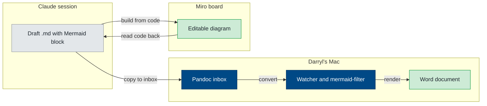
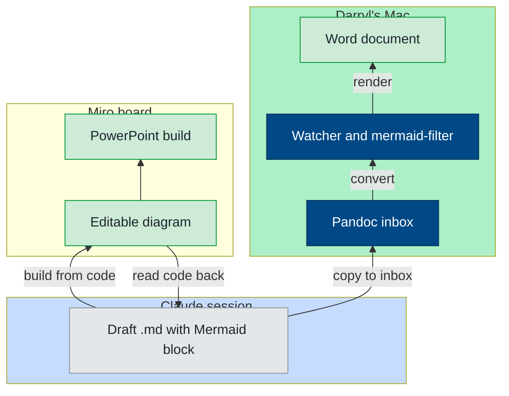

# Mermaid Sync Test

Test of a Mermaid diagram kept in sync between this file and a Miro diagram widget. Version 1 is the code as written by Claude, before any edits in Miro.

<!-- miro: board "Mermaid Sync Test 2026-10-15", widget "EOS diagram pipeline" (3458764687338519290). Source of truth: Mermaid code, synced. -->

::: {custom-style="Image Caption"}
EOS diagram pipeline, version 1 (before Miro edits).
:::

## Version 2: code read back from Miro after Darryl's visual edits

<!-- miro: same widget, read back 2026-10-15 after visual edits. -->

::: {custom-style="Image Caption"}
EOS diagram pipeline, version 2 (after Miro edits: direction, spacing, new node, group colors).
:::
