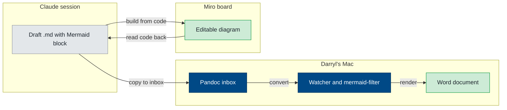

# Miro Export Test

This document tests the full path for a Miro diagram in a Word document: a frame exported from Miro, saved into the EOS, placed in Markdown, and converted by the Pandoc watcher. A synced Mermaid flowchart sits beside it for comparison.

## Figure from a Miro frame export

The image below is option 1A from the Launch Studio layout sketches, framed tightly in Miro and exported as an image.

<!-- miro: board "Launch Studio Sean Deck 2026-10", frame "Slide 1 options: What Launch Studio is" (3458764687098664603). Exported by Darryl. -->

::: {custom-style="Image Caption"}
Launch Studio, option 1A: from business prototype to supported product. Exported from Miro.
:::

## Figure from synced Mermaid code

<!-- miro: board "Mermaid Sync Test 2026-10-15", widget "EOS diagram pipeline" (3458764687338519290). Synced Mermaid; version 1 layout. -->

::: {custom-style="Image Caption"}
EOS diagram pipeline, rendered from Mermaid code by the watcher.
:::
