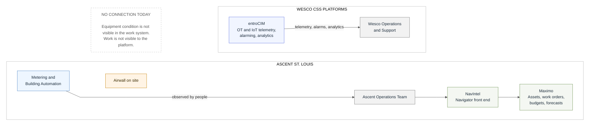
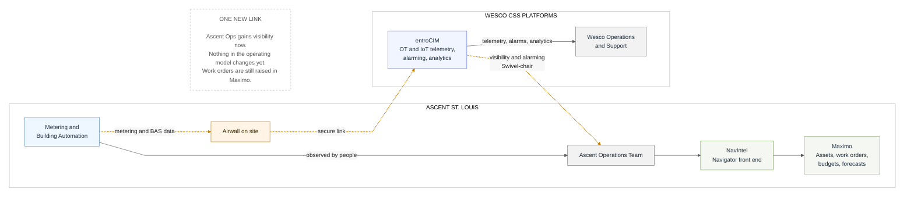
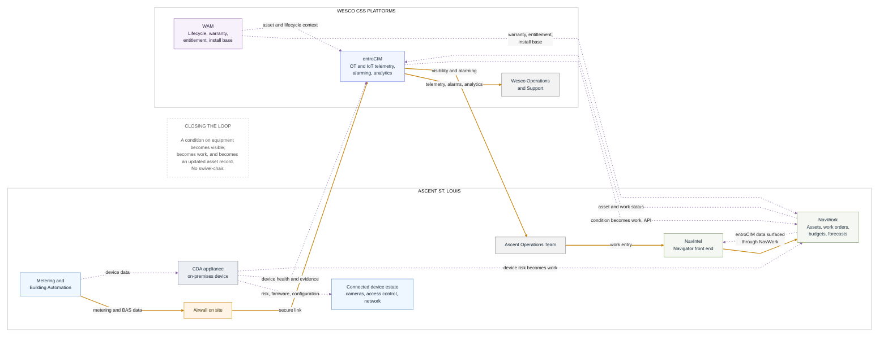

# Round One Content Draft: Navigator and entroCIM Deck

**For Darryl's review, 2026-08-27. Revision 2**, after Darryl's corrections to frames B and C. Content and relationships only. No PowerPoint yet.
Build specification: `2026-08-27_Navigator_entroCIM_Integration_Deck_Build_Prompt.md`.
Rendered frames: `Frame_A_Today.png`, `Frame_B_Before_June_2027.png`, `Frame_C_After_June_2027.png`.

---

## Changes in revision 2

Frame B: the entroCIM to Ascent Ops link is now labelled **visibility and alarming, Swivel-chair**. That second word does more work than anything else on the page and it is dealt with in the speaker notes below.

Frame C, five corrections, all applied:

1. CDA connects back to entroCIM, and both CDA and entroCIM connect to NavWork.
2. WAM connects to both NavWork and entroCIM.
3. **entroCIM reaches NavIntel through NavWork, not directly.** NavWork is the single integration point on the Navigator side.
4. Metering and building automation also feeds CDA.
5. The closing-the-loop caption now ends "No swivel-chair," which ties frame C back to frame B.

---

## How to read this

Judge three things and ignore the rest:

1. **Are the relationships right?** What connects to what, and in which direction.
2. **Are the line-status calls right?** Solid means it runs today. Dashed means committed and in build. Dotted means planned, not designed or not funded.
3. **Does the value page say the right thing?** It is the one text-led page in the deck.

Layout is not up for judgement yet. These are Mermaid drafts and the deck is built in native PowerPoint shapes, for the reason immediately below.

---

## Tooling: the evidence, since you asked me to help decide

I drafted frame A, then added the three interim links to make frame B. Mermaid re-laid out the entire diagram: the panels swapped position, the site panel went from vertical to horizontal, and nothing lined up with frame A.

I then rebuilt frame A with the same edge skeleton as frame B, with the three interim links made invisible. The two now align, which is what you see in the PNGs. **That fix works for a draft and does not survive contact with frame C**, which adds four nodes and six connections.

**Conclusion: Mermaid for drafting, native PowerPoint shapes for the deck.** The three-frames principle needs identical node positions, and Mermaid decides positions for itself. In python-pptx I build frame A once, duplicate the slide, and add connections on top, so constancy is guaranteed by construction rather than coaxed out of a layout engine. Native shapes are also editable by you, DJ and Lisa, and inherit the Wesco template. Geometry follows `Products/CDA/CDA_Exec_Brief.pptx` slide 10.

One thing Mermaid cannot draw at all, which is worth knowing now: **Managed Services and Ascent-led delivery as a layer around the whole picture.** As a node it produced lines crossing the entire diagram, so I removed it from frame C. In the native build it becomes a band across the foot of the page, which is the correct treatment anyway.

---

## Page 1. Overview, the picture in three frames

Layout sketch, no diagram yet.

Three panels across the page at equal width, each a simplified frame with clusters and connections only, no detail labels. One caption beneath each. One takeaway banner across the foot, in the CDA Exec Brief slide 7 style.

| Panel | Caption |
|---|---|
| Today | Two platforms, one operation, no connection. |
| Before June 2027 | One link, and it reaches the Ops team. |
| After June 2027 | One connected portfolio, closing the loop. |

**Takeaway banner:** The sequence is deliberate. Ascent gains operational visibility first, and the integration that follows is designed against how the operation actually runs.

**Each panel must stand on its own.** Test before building: cover the other two, and the remaining panel still says something true and complete.

---

## Page 2. Today

**Headline:** The two platforms serve the same operation from opposite ends, assets and work on one side, equipment and telemetry on the other, and today they do not connect.

**On-slide labels, four:**
- Maximo, on premises, single instance
- NavIntel, the Navigator front end
- entroCIM, on premises and Azure, live OT and IoT connectors
- No connection today

**Frame A**

**Speaker notes.**

Two mature platforms, operated separately, serving the same customer operation from opposite ends. Ascent runs assets, work orders, budgets and forecasts in Maximo, with NavIntel as the Navigator front end. Wesco runs equipment telemetry, alarming and analytics in entroCIM, on premises and hosted in Azure, with live connectors in production including Hanwha and Axis cameras.

The path from a condition on equipment to work getting done runs through people. Someone notices, and someone types it in. That is not a criticism of the operation, it is the starting condition.

Two facts shape everything that follows. Maximo is on a clock: IBM ends on-premises support, the Application Suite points-license model is modelled at roughly ten times the current subscription, and the avoided renewal falls in March or April 2027, worth approximately $3.98 million. And the current single Maximo instance cannot be extended to additional customer tenants without a corresponding Maximo implementation, which is why multi-tenant deployment sits in FY27 scope. The 2027 redesign and the Maximo replacement are the same project, not two workstreams.

On the Wesco side, entroCIM already solves secure site connectivity, through Airwall to hosted instances and through Arcbeam or customer VPN to on-premises deployments. Containerization is the confirmed deployment model going forward.

**Intent:** establish the starting condition, and make the absence of a connection the thing the reader notices.
**Assumptions:** NavIntel sits between the Ops team and the work system. Confirm with DJ.
**Validation items:** Navigator current-state architecture, customer base, and work-order boundaries are not in the record. Everything drawn on the Ascent side needs DJ.
**Exclusions:** WAM, CDA and Managed Services are deliberately absent. They exist, but they are not part of this operation today, and including them would blunt the point of the page. The native build reserves their space so the eye does not jump between frames.

---

## Page 3. Before June 2027

**Headline:** entroCIM connects to Ascent's metering and building automation in St. Louis over the Airwall already on site, so the Ops team gets operational visibility now and the later integration is designed against how the operation actually runs.

**On-slide labels, four:**
- Airwall already on site
- Metering and building automation
- Visibility and alarming to the Ops team, swivel-chair
- Work orders unchanged, still raised in Maximo

**Frame B**

**Speaker notes.**

One connection, and it is deliberately narrow. entroCIM connects to Ascent's metering and building automation in St. Louis over the Airwall that is already on site and will be running shortly. The Ops team gets telemetry, alarming and analytics on their own equipment.

What does not change matters as much as what does. Work orders are still raised in Maximo by the existing process. Nothing in the Ascent operating model moves yet. The new link ends at people, not at a system.

The link is labelled swivel-chair deliberately, and it is worth saying out loud rather than hiding. In the interim state the person is the integration. Someone reads a condition in entroCIM and turns round and enters the work in Maximo. That is a real limitation and it is also exactly the right trade for this phase: it costs nothing to build, it changes no process, and it makes the operational value available immediately. It also sets up the end state precisely, because removing the swivel-chair is the measurable thing the integration does.

This step returns twice. Ascent Ops gets usable operational visibility inside this fiscal year, on equipment that is squarely entroCIM's core competence. And by June 2027 the integration is being designed against the Ascent operation as it actually runs, rather than against assumptions about it. That is the difference between an integration that improves what the team already does and one that arrives as a replacement for something they never adopted.

This runs under current operational funding as a deployment project, with AOP capability next year.

**Intent:** show one narrow link, and show what it deliberately does not touch.
**Assumptions:** the Airwall carries the entroCIM connection without new site infrastructure.
**Validation items:** which metering and building automation systems are in scope, and by make. DJ, with Chris Askew on the connection path.
**Exclusions:** no Maximo connection, by design. The page is wrong if a reader thinks work orders change here.

---

## Page 4. After June 2027

**Headline:** A condition on equipment becomes visible, becomes work, and becomes an updated asset record, across one connected portfolio.

**On-slide labels, four:**
- NavWork replaces Maximo, and is the single integration point
- entroCIM reaches NavIntel through NavWork
- CDA, an on-premises device, covering metering, BAS and connected devices
- WAM behind both. Managed Services operates it, Ascent-led delivery

**Frame C**

**Speaker notes.**

After the Maximo replacement completes, the loop closes and the swivel-chair goes away. entroCIM sees a condition on equipment, that condition becomes work in NavWork over the API, and work and asset status flow back.

NavWork is the single integration point on the Navigator side. NavIntel receives entroCIM data through NavWork rather than directly, so the front end stays a front end and there is one interface to build, govern and support rather than several.

CDA runs as an on-premises device at the site. It takes data from metering and building automation as well as from the connected device estate, keeps firmware and configuration current, and feeds two ways: device health and evidence into entroCIM, and device risk into NavWork as work.

WAM sits behind both, supplying warranty, entitlement and install-base context to NavWork, and asset and lifecycle context to entroCIM.

Managed Services and Ascent-led delivery operate the whole thing.

Two distinctions to hold. The NavWork API is being developed now; the entroCIM integration is not designed and begins after June 2027. Those are different things and the diagram treats them differently. And CDA is not built on entroCIM. It uses the same underlying platform, tools and expertise, and it exists in support of Navigator's redesign integrations, not in competition with them.

None of the connections on this page exist today. That is the honest position and it is what the line treatments say.

**Intent:** trace the flow, not the inventory. A reader should be able to follow one condition all the way round, and should notice that every path into Navigator goes through NavWork.
**Assumptions:** NavIntel persists as the front end after NavWork lands.
**Validation items:** whether NavIntel persists or is itself replaced. What the NavWork API will expose, and when that design is fixed. Both DJ.
**Exclusions:** Managed Services is not drawn as a node. In the native build it is a band across the foot, which is the right treatment for a layer rather than a component.

---

## Page 5. Value

**Headline:** Each package is strong on its own. Connected, they close a loop none of them closes alone.

### Left column, what each package is strongest at

| Package | Strength |
|---|---|
| **NavWork** | Where work is planned, assigned, costed and closed. The system of record for assets, work orders, budgets and forecasts. |
| **NavIntel** | How the operation is seen. The Navigator front end for the Ops team. |
| **entroCIM** | The only one that touches the equipment directly and knows its condition now. Metering, building automation and wider OT and IoT telemetry, alarming and analytics, with secure site connectivity already solved. |
| **WAM** | Knows what the asset is, what it is entitled to, and when that runs out. |
| **CDA** | Keeps the connected devices themselves trustworthy and current, from an on-premises device. |
| **Managed Services, Ascent-led delivery** | Makes someone accountable for the outcome rather than for a tool. |

### Right column, what they produce together

- The swivel-chair goes away. Equipment condition becomes scheduled work without a person reading one screen and typing into another.
- Asset records stay current, because the work that touched the asset and the telemetry coming from it update the same record.
- Refresh and renewal become evidence-based rather than calendar-based, because condition, entitlement and failure history finally sit together.
- The connected device estate stays trustworthy, because firmware and configuration are managed rather than assumed.
- One accountable operating layer, rather than four tools and the people who reconcile them.

### Takeaway banner

Each package is useful on its own. Connected, they close the loop from a condition on a piece of equipment through to work completed, the asset record updated, and the next refresh decision informed. No one of them closes that loop alone.

**Discipline check.** Everything in the right column is a planned outcome. No numbers, no present tense, nothing that reads as a commitment.

---

## Page 6. Navigator roadmap, DJ's page

Mostly blank by design. Frame and NavWork timing only.

**Phase bands across the top**

| Phase 1: MVP | Phase 2: UAT, integration and migration | Phase 3: post-cutover |
|---|---|---|
| through December 2026 | December 2026 to June 2027 | after June 2027 |

**Milestone markers:** MVP complete, December 2026. UAT complete, March 2027. IBM Maximo renewal decision, March or April 2027. Maximo replacement complete, June 2027.

**Lanes and grid**

| Lane | Q4 2026 | Q1 2027 | Q2 2027 | Q3 2027 | Q4 2027 | H1 2028 | H2 2028 |
|---|---|---|---|---|---|---|---|
| NavWork delivery | MVP build, MVP complete Dec | UAT complete Mar, integration and migration begin | Maximo replacement complete Jun | | | | |
| Data and migration | | | | | | | |
| entroCIM connectivity and integration | | | | | | | |
| Ascent Ops adoption | | | | | | | |
| Commercial and portfolio | | | | | | | |

Everything blank is DJ's. Lanes are named so he knows the shape of the answer without inheriting anyone's guesses. Time axis runs quarterly through 2027 and in halves for 2028, because a uniform quarterly grid across two years would read as eight equally firm commitments.

**Priority legend, applied by DJ:** three levels, marked inside the cell as well as by colour, so the page survives printing and colourblind readers.

---

## What I need from you before the build

1. **Relationships and directions on all three frames.** Particularly frame C: is the loop drawn the way you would describe it out loud.
2. **The line-status calls.** Frame B's link is dashed because the Airwall will be running shortly. Frame C's entroCIM to NavWork link is dotted while the NavWork API itself is dashed. Confirm that separation holds.
3. **The value page wording**, especially the takeaway banner, which is the line the page exists to deliver.
4. **Page count.** Seven pages against Lisa's four items. If that is too many, the overview goes, not the value page.
5. **NavIntel.** Now confirmed as the front end reached through NavWork in frame C. Still open: whether it persists in that role after cutover, which is DJ's to answer.
6. **Your second frame B item.** Your note stopped at "2." and I have not guessed at it.
