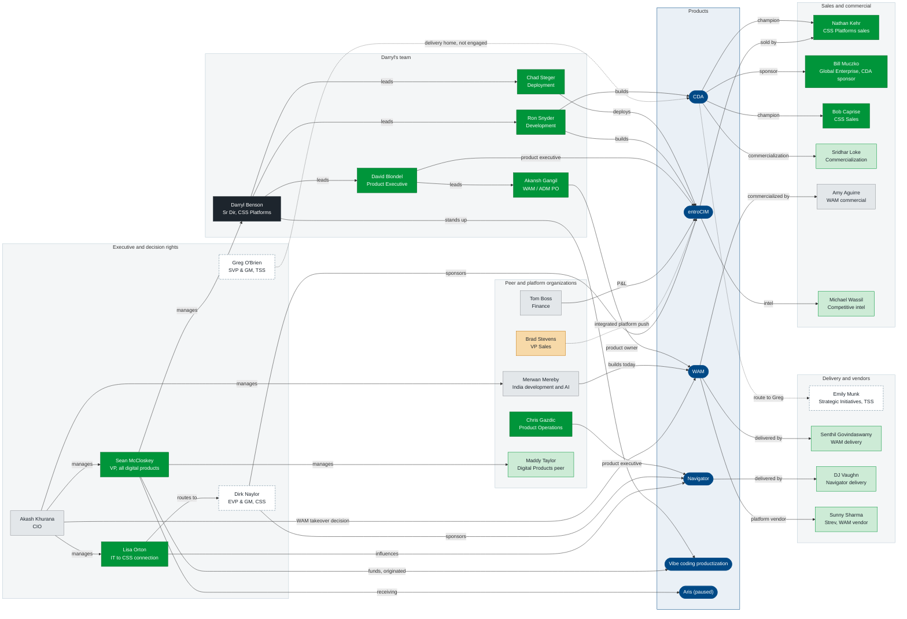

# Stakeholder Decision-Rights Map

Private working file. Who sponsors, decides, builds, delivers and sells each product in Darryl's portfolio, colored by current alignment. Mermaid fallback for the Miro board. Source data: `2026-10-07_Core_Stakeholders_Alignment_Draft.md`.

**Source of truth (Darryl, 2026-10-07): the private Miro board "Stakeholder Map 2026-10" (https://miro.com/app/board/uXjVEdM5q1g=/), in Darryl's personal Miro account.** The alignment draft is its data source; the .mmd is the Mermaid fallback. The .pptx and .png are superseded (`SUPERSEDED_2026-10-07_*`) and are not maintained.

::: {custom-style="Image Caption"}
Decision rights across Darryl's products, 2026-10-07. Fill shows alignment: solid green ally, light green supportive, grey neutral, amber mixed, dashed outline unknown; navy is Darryl, blue ovals are products. Dotted lines are routes not yet established.
:::

## Assumptions

- Alignment corrected by Darryl 2026-10-07 for Sean McCloskey, Lisa Orton and Chris Gazdic (allies), Amy Aguirre (neutral) and Maddy Taylor (supportive); stated earlier for Nathan Kehr, Bill Muczko, Bob Caprise and the route through Emily Munk. The rest is Claude's reading of `06_Stakeholder_Map.md`.
- Reporting lines shown only at the top (Darryl, 2026-10-07): Akash Khurana is CIO, at Dirk Naylor's level; Sean McCloskey, Lisa Orton and Merwan Mereby report to him; the India development and AI groups report to Merwan; Lisa is the direct connection from IT to CSS and has influence and some responsibility on Navigator; Maddy Taylor reports to Sean; Sean is responsible for all digital products.
- Other reporting lines (Greg O'Brien to Brad Stevens and Emily Munk, Darryl to his team) are omitted to keep the map readable.
- Navigator's sales owner is not specific in the record; shown on the slide as CSS Sales.
- Update this file and the alignment draft together when a relationship changes.
