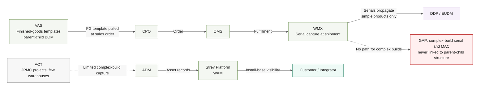
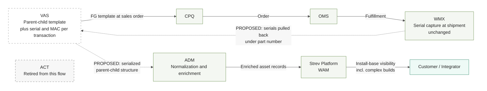

> **SUPERSEDED 2026-08-19 by `2026-08-19_Complex_Build_Asset_Flow_v4.md`.** Retained for the decision trail. Corrected by Darryl on 2026-08-19: the path to ADM runs through DDP/EUDM rather than VAS direct, the capture mechanism is a WMX-triggered VAS workflow rather than a serial pull-back, and ACT is a dotted contingency into ADM rather than a live interim path. The VAS to CPQ template pull recorded here is confirmed and still holds. Diagram 1 below, the current-state gap view, is retired: current state is pre-DDP and not defined, and the work is the target state only.

# Asset Tracking Data Flow — v3.1 (Miro-compatible)
As of 2026-07-14. Source: VAS Roadmap transcript (Akansh Gangil framing, Govardhan Shetty mechanics). Audience: executive/internal alignment. Transcript 7:31–26:06 uncaptured — validate nothing contradicts.

Changes in v3.1: `%%{init}%%` directive replaces YAML frontmatter (Miro's renderer rejects frontmatter config); VAS→DDP sync edge removed from both diagrams for layout (recorded in Assumptions instead), which pulls DDP in tight behind WMX.

## The story in one sentence

Today serials are captured at shipment in WMX but never connected to the parent-child structure VAS already knows — so complex-build assets reach the customer with no serialized identity; the proposal closes that loop through VAS rather than building or scaling a separate capture tool.

**Memory hook:** *VAS knows the family, WMX knows the serials — today they never meet. The fix: introduce them, retire ACT.*

---

## Diagram 1 — Current State: Where the Gap Lives

### Intent
Show today's order-to-customer flow for asset attributes and make visible why complex-build serial/MAC data never reaches WAM at scale. (The disconnected bottom row is deliberate: nothing in the confirmed order chain feeds ADM today.)

### Assumptions
- WMX serial capture is against the order at shipment (Govardhan, to be confirmed in detail).
- VAS part data is fully synced with DDP including price/cost (Govardhan) — edge omitted from the diagram for readability.

### Validation Items
- WMX MAC-address capture: unconfirmed (Steve Leslie / Sid).
- WMX complex-build limitation: no capability, no roadmap until 2028 (Akansh; confirm with GPO).
- ACT scope (JPMC + limited warehouses, not scaling): per Akansh and background sales discussions.

### Exclusions
Protocols, integration mechanics, DDP internals, and the VAS↔DDP sync edge — context, not the point of this view.

---

## Diagram 2 — Future State (Proposed): VAS Closes the Loop

### Intent
Show Govardhan's proposed mechanism: serials pulled back from WMX onto the VAS parent-child template, delivering serialized structures to ADM/WAM; ACT retired. The dashed PROPOSED links are the only new integrations.

### Assumptions
- The order chain (VAS→CPQ→OMS→WMX) is unchanged; the only new integrations are the serial pull-back and the VAS→ADM feed.
- VAS can extend to hold serial/MAC per transaction (Akansh's proposal; Govardhan agreed in principle).
- VAS↔DDP sync continues as today (omitted for readability).

### Validation Items
- WMX serial/MAC availability for complex-build orders — Steve Leslie (GPO) + Sid (WMX solution architect); Akansh engaging.
- Alan's detailed opinion once process is clear.
- GPO roadmap buy-in (Steve Leslie dictates the roadmap); then user validation (Troy Doyle).
- ACT lesson: validate WMX source-data fitness before funding the integration.

### Exclusions
Timing, sequencing, and ownership of the build — premature until validation items close. DDP node omitted (sync unchanged, not part of the proposal).
