# Complex-Build Asset Flow — Target State v4.0

**Date:** 2026-08-19
**Supersedes:** `2026-07-14_Asset_Tracking_Data_Flow.md` (v3.1)
**Audience:** Executive, warehouse team, non-IT
**Scope:** Target state only. Current state is pre-DDP and not defined; it is deliberately out of scope and is not diagrammed.
**Status:** Diagram complete. Verbal story not yet written.

## Confirmed design points

Confirmed by Darryl, 2026-08-19:

1. **VAS and CPQ are integrated in both directions.** VAS supplies the finished-goods parent-child template at sales-order time; CPQ supplies order and configuration context back. Integration detail sits with the dev team; flow definition sits with GPO.
2. **DDP/EUDM is the single source of truth and the only route into ADM.** WMX and VAS deliver into DDP; ADM takes nothing directly from either. ACT is the single exception, and only as a contingency.
   **WMX is not a DDP application** (Darryl, 2026-08-19). The WMX and VAS boundary is labelled Complex Builds, which is a functional grouping, not a platform grouping.
3. **The capture mechanism is a WMX-triggered workflow.** WMX triggers the complex-build workflow in VAS; VAS returns the attributes WMX is able to hold. Trigger ownership is likely WMX, not confirmed.
4. **VAS writes the complete parent-child structure, serial, MAC and attributes, to DDP.**
5. **P360 provides serialization setup to WMX.**
6. **ACT is a contingency into ADM, not a live path.** It sits outside the DDP application set and is not integrated today. Shown dotted and labelled CONTINGENCY.

---

## Target State Diagram

```mermaid
%%{init: {"theme":"base","themeVariables":{"primaryColor":"#f7f7f7","primaryBorderColor":"#9aa0a6","primaryTextColor":"#222222","lineColor":"#555555","clusterBkg":"#ffffff","clusterBorder":"#b8b8b8","tertiaryColor":"#ffffff"},"flowchart":{"diagramPadding":30,"nodeSpacing":55,"rankSpacing":85,"wrappingWidth":150,"curve":"linear"}}}%%
flowchart LR
    subgraph orderLayer["Order and Configuration"]
        direction TB
        cpq["CPQ<br/>Quote and sales order"]:::app
        oms["OMS<br/>Order management"]:::app
        p360["P360<br/>Serialization setup"]:::external
    end

    subgraph complexBuilds["Complex Builds"]
        direction TB
        wmx["WMX<br/>Warehouse fulfillment<br/>and packing"]:::app
        vas["VAS<br/>Complex-build capture<br/>Parent and child serial, MAC, attributes"]:::app
    end

    ddp["DDP / EUDM<br/>Single source of truth<br/>for asset data"]:::data
    act["ACT<br/>Complex-build capture"]:::external

    subgraph wamLayer["Asset Visibility"]
        direction TB
        adm["ADM<br/>Asset data management"]:::app
        strev["Strev Platform<br/>WAM"]:::app
    end

    customer["Customer / Integrator"]:::user

    cpq -->|"Sales order"| oms
    oms -->|"Fulfillment order"| wmx
    p360 -->|"Serialization setup"| wmx
    cpq <-->|"Finished-goods template<br/>and order context"| vas
    wmx -->|"Triggers complex-build<br/>workflow"| vas
    vas -->|"Returns attributes<br/>WMX can hold"| wmx
    wmx -->|"Fulfillment and<br/>shipment data"| ddp
    vas -->|"Complete parent-child structure<br/>serial, MAC, attributes"| ddp
    act -.->|"CONTINGENCY<br/>not integrated today"| adm
    ddp -->|"Only path for<br/>asset data"| adm
    adm -->|"Asset records"| strev
    strev -->|"Install-base visibility<br/>including complex builds"| customer

    classDef app fill:#f4f7f2,stroke:#6a8f4e,stroke-width:1px;
    classDef data fill:#f7f1fb,stroke:#8a63a8,stroke-width:1px;
    classDef external fill:#f7f7f7,stroke:#777,stroke-dasharray: 5 5;
    classDef user fill:#eefaf6,stroke:#3b8f73,stroke-width:1px;
```

---

## Open items

| Ref | Item | Status | Owner |
|---|---|---|---|
| V1 | CPQ and VAS integration detail and flow direction | Integration exists. Detail to dev team, flow to GPO | Dev team / GPO |
| V2 | Owner of the complex-build workflow trigger | Likely WMX. Not confirmed | Open |
| V3 | Which parent attributes WMX can ingest, including WMX 5.7 attribute support | Open | Open |
| — | Mandatory serial and MAC enforcement | Open | Open |
| — | P360 and WMX configuration ownership | Open | Open |
| — | Non-DDP site handling | Open | Open |

**Note on V3.** The v3.1 record (2026-07-14, Akansh) states WMX has no complex-build attribute capability and no roadmap until 2028. The live WMX 5.7 attribute-support question sits in tension with that. Either the 2028 statement refers to full parent-child support rather than parent attributes, or it is out of date. Resolve with Steve Leslie or Sid, because the answer changes how much VAS has to carry.

---

## Title and framing

Recommended, for the warehouse executive audience:

> **Complex Builds: From Order to Customer Install Base**
> Target State
>
> Target design for capturing a complex build's serial, MAC and parent-child data during fulfillment, and delivering the complete record to the customer's install base through DDP.

Panel titles for the two-panel layout:

1. From order to captured build
2. From captured build to customer visibility

Seam line, spoken at the transition between panels: "Everything in the first panel lands in DDP. That is the only route to the customer record."

### Shared version, 2026-08-19

Darryl produced a vector PDF of the stacked two-panel layout for sharing: `2026-08-19_Complex_Builds_Order_to_Install_Base_SHARED.pdf`. It uses the recommended title and replaces "Target design" with "DRAFT design" in the explanation sentence. The "Target State" line is not on the page.

Review points raised on that version, in priority order:

1. **State marker.** "DRAFT" says the document is unfinished; it does not say the capability does not exist yet. Those are different claims, and the second is the one that matters. Recommend "DRAFT target-state design" or restoring the Target State line.
2. **Panel titles absent.** The two panels carry no headings, so the repeated DDP box is unexplained. In a shared PDF the seam cannot be narrated, so it has to be on the page.
3. **Panel scale and alignment differ.** Panel 2 is narrower, left-offset, and its DDP box is larger than Panel 1's. The two read as unrelated pictures rather than one flow.
4. **Bottom third of the page is empty.** Scaling both panels up into that space would fix the small node text.
5. **Minor overlaps** in Panel 1: "Triggers complex-build workflow" collides with the arrow into VAS, and the parent-child structure label runs into the DDP box.

### Alternates

| Title | Use when |
|---|---|
| Serialized Complex Builds: Target Data Flow | The room skews technical and already accepts the problem |
| Making Complex Builds Visible in the Customer Install Base | The job is to justify the work rather than describe the design |

The recommended title leads with the thing the warehouse audience recognises, the build itself, and names the outcome rather than the systems. The two alternates trade that for precision and for advocacy respectively.

---

## Notes on presentation

The single view above is eight ranks left to right, which produces roughly 6.5:1. That works full width on a Miro board. It does not read on a slide.

Width is driven by rank count, not by label length. Shortening every label and merging CPQ with OMS and ADM with Strev only reaches about 4.7:1, and costs real detail. ELK layout, top-to-bottom layout, and a two-row layout using subgraph directions were all tested and are worse: Mermaid ignores subgraph `direction` when edges cross the boundary, so the two-row version collapses back to a single tall column.

**For slides, use the two-panel version** in `Complex_Build_Target_State_Two_Panel_Mermaid.md`. Splitting at DDP/EUDM gives two panels of five and four ranks. Stacked, they occupy about 2.5:1, which fits 16:9 with room for a title.

DDP/EUDM appears at the end of Panel 1 and the start of Panel 2. That repetition is the seam, and it needs one line of narration so the audience reads it as one flow rather than two.
