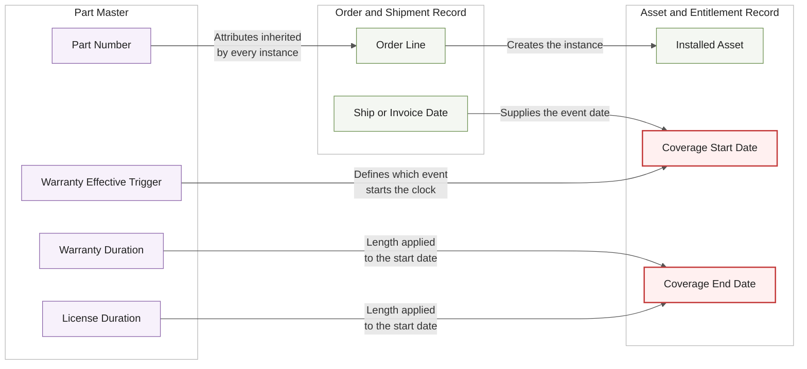
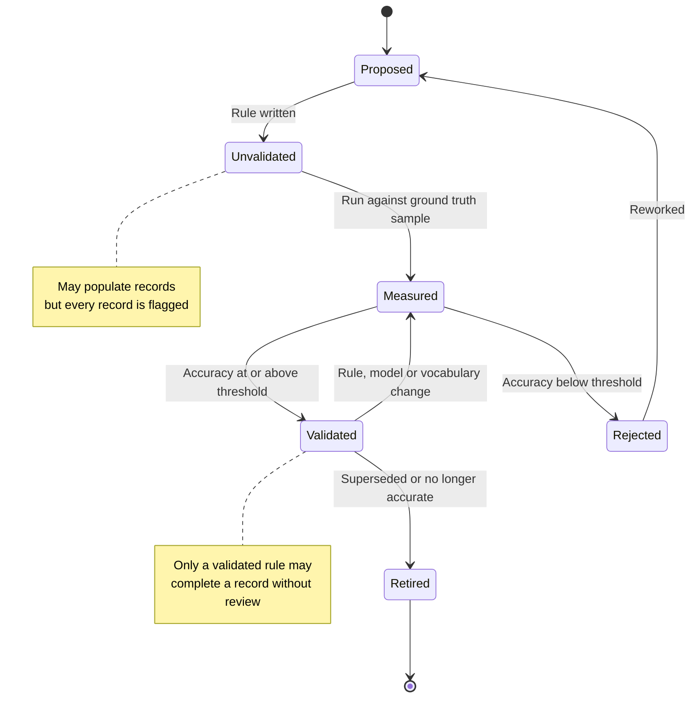

# AI-Assisted Part Data Analysis: Known Conditions and Lessons Learned

Purpose: transferable conditions, failure modes, and principles for any AI-assisted analysis of Wesco part data
Audience: anyone specifying, building, or reviewing this class of work
Date: 2026-08-13
Revision: v1.1, 2026-08-13. Added three specification failure modes, principles 19 to 26, and four effort baselines, following a critical review of the first requirements document produced from this material.

## How to read this

This is not a project history. It is the set of things that turned out to be true about this data and this kind of work, written so they can be used as inputs to a requirements document rather than rediscovered.

Every condition in Part 1 was observed in real Wesco supplier part data. Each should still be confirmed against the current population before it is written into a requirement, because volumes and sources change. The failure modes in Part 2 all occurred, and each one cost either rework or lost work. The principles in Part 3 follow from them and are the part worth carrying forward unchanged.

---

## Part 1: Known conditions in the data

These conditions determine what the analysis has to handle. A requirement written without them will be technically satisfiable and practically useless.

| Condition | Observed detail | Consequence for design |
|---|---|---|
| The source record is minimal | In the supplier sheets, the usable input was two fields: a part number and a vendor string. No category, description, terms, or price. | Every target attribute is derived or researched. Nothing is a lookup within the source record itself. |
| Vendor names are inconsistent | The same brand appeared as multiple distinct strings, with abbreviations, trailing punctuation, and corporate suffixes as noise. Three variants of one brand were common. | Canonical normalization must happen before any grouping, rule selection, or analysis. Grouping on the raw value fragments the population. |
| Vendor names are sometimes wrong | At least one confirmed case where parts attributed to one vendor were actually another manufacturer's products. | The vendor field is unverified input, not a key. A derivation rule selected on the basis of an unconfirmed vendor will be confidently wrong. Vendor confirmation is a step, not an assumption. |
| Part numbers vary in form | Some are structured alphanumeric SKUs, some are purely numeric, some are custom or one-off strings with no resolvable meaning. | Pattern-based derivation covers part of the population, not all of it. The residual is a defined outcome, not a defect. |
| Rows are not parts | Source rows exceeded unique parts by a meaningful margin, and the same part recurred across customer sheets. | The unit of analysis is the unique part. Derive once, map back to every row. Analysing at row grain multiplies both cost and inconsistency. |
| Prior answers compound | Parts already resolved on an earlier population pre-covered a material share of the next one, in the hundreds per sheet. | Reuse is the main cost lever. A design without a reuse pool has flat cost per unit forever. |
| Difficulty is not uniform | After the high-volume vendors were resolved, the residual was dominated by a long tail: one large low-information bucket plus hundreds of clusters of two or three parts. Yield per unit of effort dropped materially in that stretch. | Coverage and accuracy targets stated as a single blended figure will be wrong at both ends. State them by vendor tier. Effort estimates that assume a flat rate will understate the finish. |
| Junk rows exist in the source | Non-product entries and vendor codes appeared in the population. | Pre-screen and quarantine before spending analysis effort. Quarantine is cheaper than research followed by rejection. |
| Some parts are genuinely unresolvable | Custom and one-off part numbers with no public or internal footprint. More analysis does not resolve them. | Unresolvable is a terminal state that routes to a business decision about what to record, not back into the analysis queue. |
| Real values fall outside the target vocabulary | Observed warranty terms included Lifetime, and durations that do not appear in the fixed enum. | The controlled vocabulary will not cover reality on first contact. A path to escalate and extend a vocabulary is required, not just a path to flag against it. |
| A defined category may have no instances | Extended Warranty is a defined category and did not appear once in thousands of classified parts. | Do not size effort or design complexity around categories that the data does not contain. Confirm distribution before building for it. |
| Vendors mislabel their own products | Software, cloud platforms, and licenses are routinely marketed as services, with a term attached. | The category definition must resolve this explicitly before analysis starts, or the same part will be classified differently by different runs and different people. |
| Source layouts differ | Different supplier sheets used different header positions, metadata rows, and column arrangements, including side-by-side column pairs. | Intake needs a defined contract and a rejection path for input that does not meet it. Tolerant parsing of arbitrary layouts is a source of silent error. |

---

## Part 2: Failure modes observed, and what they cost

These are the failures that actually occurred. Each is worth a requirement.

**Weak evidence accepted at scale.** Values were recorded against sources that named a product family or a brand homepage rather than the specific part. By the time the rule was tightened, roughly 119 records on a single population needed re-sourcing, and the review backlog across completed populations reached the low thousands. The cost of accepting weak evidence is not the individual record; it is the remediation pass and the loss of confidence in everything classified before the rule changed. Tighten the evidence rule at intake, not after.

**Correlated quality checking.** A check that shares the analysis model, prompt framing and input signal confirms the original answer rather than testing it. This produces the appearance of verification with none of the substance, and it is the failure mode most likely to be invisible until a downstream consumer finds the errors.

**Mechanical data corruption during write.** Commas inside URLs split columns during a merge, corrupting records in a way that was invisible on inspection and not detectable by any content-level review. Structural integrity checking on the write path is a separate discipline from content quality, and both are required.

**Silent loss of committed work.** Cloud-synced storage reverted saves without error, twice, and real work was lost before write verification was added. A save that returns no error is not proof the data persisted. Verification and recovery belong in the requirements, not in the operator's habits.

**Work lost at the boundary of a long-running operation.** Delegated or long-running work that only returns results at the end lost everything when it hit a limit. Bounded units of work with frequent checkpoints are not an optimization; they are what makes progress survivable.

**Review backlog outgrowing review capacity.** Flagged records accumulate faster than people clear them. Once the backlog is large enough to be uncomfortable, pressure builds to lower the flagging threshold, which quietly converts a quality control into a formality. The permitted flag rate has to be set against actual review capacity from the start.

**State inferred rather than recorded.** Where a status field conflated origin and current state, every query had to re-derive the true state through indirect tests. This is a small design error that compounds into unreliable reporting and disagreement about how much is actually done.

The three failure modes below were observed on 2026-08-13, in a requirements document produced for this class of work rather than in the data itself. They are failures of specification, and they cost more than data errors because they are agreed to before anyone starts building.

**A specification that does not reconcile its own numbers.** A requirements draft stated a population of 100,000 parts, a one-month duration, and a review capacity of four hours per week, and recorded the permitted review flag rate as an open item to be measured during the pilot. Those numbers cannot all hold. Sixteen hours of review across a one-month pilot supports a flag rate of roughly 0.5 to 1.9 percent depending on minutes per record, against observed flag rates of 8 to 33 percent on completed populations. The document was internally consistent as a set of statements and infeasible as a plan. Deferring the reconciliation to measurement does not make the arithmetic work; it moves the discovery to week two, when the only available response is to lower the flagging threshold, which is the failure mode listed above.

**A definition restated from scratch instead of adopted.** The same draft redefined the Software and Service boundary in its own words, producing definitions under which a cloud storage subscription classifies as Service. A team-confirmed rule with ordered tie-breakers already existed and classified it as Software. Restating a definition is not a neutral act: a boundary that took a team discussion to settle will not survive being paraphrased. Where a rule is already in force, it is quoted, not summarized. The draft even named the resulting misclassification in its own risk register and pointed the mitigation at the definitions that caused it.

**Priority that does not discriminate.** The same draft carried 79 requirements, 78 marked Must and one Should. A priority scheme with no variance provides no basis for a tradeoff, which means it provides no guidance at the moment guidance is actually needed, which is when the schedule is under pressure. Must has to mean required for this phase's acceptance. If everything is required, the document has expressed a wish rather than a plan, and the team will do the prioritization itself, unrecorded.

---

## Part 2a: Two models worth internalizing

These two diagrams carry the lessons that are hardest to convey in prose and most expensive to get wrong.

### Where an attribute actually lives

Intent: show which facts belong to the part and which belong to an instance of that part, so start dates are not specified as part-master attributes.

The two red nodes are the ones this analysis does not produce. They are computed downstream from a part-level rule plus a transaction-level event. Any requirement to derive them from the taxonomy is a grain error.

Assumptions: the order or shipment record is the source of the event date. Validation item: confirm which system holds the authoritative event date for each warranty trigger type. Exclusion: renewal and transfer events, which extend this model and are out of scope here.

### How a derivation rule earns the right to be trusted

Intent: show that automatic completion is a status a rule reaches by measurement, not a property it has because it looks correct.

Assumption: a ground truth sample exists and was not used to build or tune the rule. Validation item: the accuracy threshold and the approving role are both decisions, not defaults.

---

## Part 3: Principles that follow

Stated in the form they should carry into any requirements document.

1. Coverage and accuracy are separate targets. Both are stated for every derivation, by tier. High coverage at mediocre accuracy is usually worse than lower coverage at high accuracy with the remainder left blank and flagged.
2. Blank beats a plausible guess. An unverifiable value is left empty and flagged. Blank is queryable as missing and cheap to fix. A wrong value that reads correctly is expensive, because nothing downstream will question it.
3. Blank means blank. Not "N/A", not "unknown", not zero.
4. Never coerce to the nearest allowed value. A value that does not fit the vocabulary is flagged, and where the pattern recurs, the vocabulary is escalated for extension. Coercion is silent and unrecoverable.
5. Distinguish evidence classes per record. A sourced fact and a rule-based inference cannot occupy the same field with no marker between them, or the dataset loses the ability to state how confident it is about anything.
6. Trust is earned by measurement, not by appearance. A derivation rule may not complete records automatically until its accuracy is measured against a human-validated sample that was not used to build or tune it.
7. Quality assurance must be able to disagree. At least one check uses a different frame of reference than the analysis: a different input signal, method, model, or operator. Its output is a disagreement rate, not a second answer.
8. Deterministic checks run on everything. Enum legality, required fields, types, cross-field logic, and structural integrity are code, run on every record, blocking on failure.
9. Sample by strata, not at random. Stratify by vendor tier, attribute, confidence band, and method, and oversample the long tail and the low-confidence band. Random sampling over-represents the easy majority.
10. Respect the grain. Part-level facts describe the part. Transaction-level facts describe an instance of that part on an order or asset. A part number has a warranty duration and an effective trigger. It does not have a warranty start date.
11. Attributes are global, not category-specific. Hardware carrying preloaded software carries both warranty and software attributes. Do not nest license fields under a software branch.
12. Derive once, inherit everywhere. The fact belongs to the unique part. Rows map back to it.
13. State lives in the data. Any run determines what is done and what remains by reading the records. Every stage is safe to re-run without duplicating work or corrupting prior results.
14. Delivered output is immutable and versioned. A batch already handed to a consumer does not change underneath them. Corrections ship as a new version with a changelog.
15. Feed decisions back into the rules. A human decision that is general rather than record-specific becomes a rule or reference entry, so the same question is not asked twice. This is what makes cost fall over time.
16. Version the rules, stamp the records. Every record carries the version of the rules that produced it, so a rule change can be traced to the records it affects and those records re-validated.
17. Definitions are decided by people, before analysis. Category boundaries are business decisions. If they are not settled in advance, the model settles them implicitly and inconsistently.
18. Separate "needs more analysis" from "needs a decision". They route to different places and only one of them is work the system can do.
19. Reconcile the numbers before the document is agreed. Population, duration, expected flag rate, review capacity and demonstrated throughput are one system of equations, not five independent facts. Solve it and report the result, including when the result is that the plan does not close. An infeasibility recorded as an open item is an infeasibility that will be discovered late.
20. Review capacity is a measurement budget, not a queue-clearing budget. It funds validating the ground truth sample and adjudicating disagreements. Flagged records are delivered blank and counted. Sizing capacity to clear the queue is how a pilot at any realistic volume becomes unschedulable.
21. The timeline chooses the method. A rate that requires thousands of parts per day forbids a per-part external lookup in the processing loop. State that constraint explicitly, because otherwise the team designs a method the schedule cannot carry and the failure is attributed to execution.
22. Adopt definitions already in force; do not restate them. Where a governing specification or a team decision exists, quote it. Paraphrasing a settled boundary reopens it silently.
23. State precedence between evidence classes, not only the distinction. Distinguishing a sourced fact from a derived inference is necessary and insufficient. The document must say which one wins when they disagree on the same part, or precedence is set by whichever process happens to run last.
24. Priority must discriminate. Must means required for this phase's acceptance. A document in which nearly every requirement is Must has deferred prioritization to the team, under deadline, without a record.
25. A dependency has an owner and a status. An unanswered question that the team can resolve itself is a task. Filing tasks as dependencies makes the work look externally blocked when it is not, and hides the dependencies that are real.
26. Say what can start now. A requirements document states the end condition. Someone still has to say what is built first, what is measured, and what waits until after the exit gate. Without that, the appendices do the work the body was supposed to do.

---

## Part 4: Effort and economics baselines

Useful only as order-of-magnitude anchors for estimating. Confirm against current tooling and current data before using them in a plan.

| Measure | Observed | Use |
|---|---|---|
| Manual research per part | Roughly three to five minutes for a person to find and record a sourced answer | Establishes the do-nothing baseline and the value of automation |
| Automated batch consumption | A fifty-part batch consumed roughly ninety thousand tokens and around thirty-five external lookups | Basis for cost per thousand parts, and for capacity planning |
| Reuse effect | Hundreds of parts pre-covered on each subsequent population from prior work | The main lever on unit cost over time |
| Yield in the long tail | Materially lower resolution rate and higher flag rate than the high-volume vendors | Prevents an estimate that assumes uniform difficulty |
| Realistic QA outcome | Pass with follow-ups was the common verdict, not a clean pass | Plan for tracked remediation as normal work, not as an exception |
| Review flag rate | 8.0, 18.7, 19.7 and 32.9 percent across four completed populations, measured 2026-08-13 | The starting point for any capacity calculation. Do not plan against a hoped-for rate |
| Classification throughput, research method | Roughly 5,400 unique parts over about six weeks, with a per-part external lookup in the loop | The demonstrated rate. Any target materially above it implies a different method, which must be stated |
| Review capacity conversion | Four hours per week is about 16 hours across a one-month pilot, or 960 minutes | At one minute per flagged record that is 960 records. Convert stated capacity into records before accepting a population size |

Two lines above deserve to be used together. Population size, expected flag rate and review capacity determine each other, and the third is the one usually stated last and reconciled never. Compute the implied maximum flag rate before agreeing a population, and compare it against the measured range in the table.

The Realistic QA outcome line is the one most often missed in planning. A quality process that only ever returns a clean pass is not testing anything. Expect follow-ups, and treat them as tracked work with an owner and a date rather than as notes on a report.
