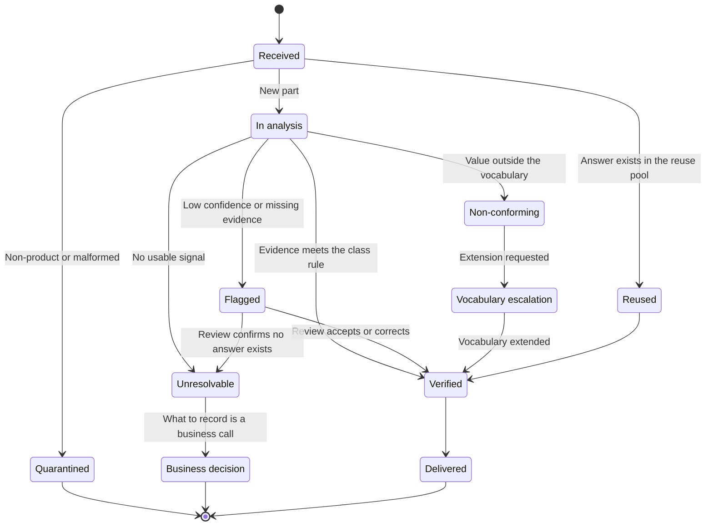
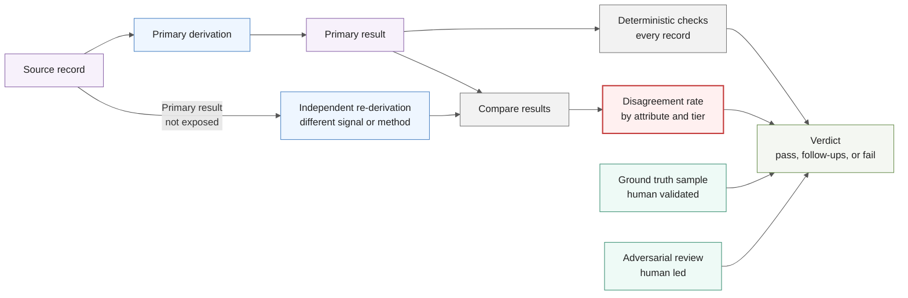

# Framework for the AI Part Taxonomy Requirements Document

Purpose: the structure and standard for a requirements document specifying AI-assisted analysis of Wesco part data and part naming taxonomy
Companion documents: `Part_Data_AI_Lessons_Learned.md` (known conditions and principles), `Part_Taxonomy_AI_Requirements_Prompt.md` (drafting prompt)
Date: 2026-08-13
Revision: v1.1, 2026-08-13. Added the feasibility reconciliation requirement (section 1a), priority discipline, the dependency register test, the adopt-do-not-restate rule for definitions in force, evidence precedence, and a required sequencing section. Changes follow a critical review of the first requirements document produced from this framework.

---

## 1. What this framework is, and how to use it

This is the structure and the standard for the requirements document, not the requirements themselves. Each section below states what the document must contain, the decisions that section forces, and what a complete answer looks like.

The deliverable is a requirements document, which means something specific. It states what must be true for the result to be accepted, in statements that can be independently tested. It does not argue that the work is worthwhile, and it does not describe how an AI tool works. Both of those, if included, dilute the only thing a requirements document is for: making acceptance and rejection objective.

Three standards apply throughout.

The deliverable being specified is a business process, not a prompt. A prompt produces one set of results. A process produces the same quality of result repeatedly, at volume, run by different people, and can demonstrate that it did. Sections 10 through 15 are where that distinction lives, and they are the sections most often skipped.

Requirements are solution-agnostic. They state what the solution must do, not which product does it. This matters here specifically, because naming a platform early anchors the build before anyone has agreed what acceptable output looks like.

Quality assurance must be capable of disagreeing with the analysis. A check that shares the analysis model, prompt framing and input signal produces correlated errors, and confirms rather than tests. Section 11 is the core of the document for that reason.

### Requirement conventions

Every requirement is one atomic statement. It uses "shall" for mandatory and "should" for desirable. It is independently testable. It contains no unverifiable adjectives such as robust, accurate, efficient, or user-friendly unless a number is attached. Compound statements are split.

Identifier scheme: `REQ-<AREA>-<nnn>`, where AREA is one of DAT, FUN, MOD, EVD, PRC, QUA, REV, NFR, INT, GOV.

Priority: Must, Should, Could, Not this phase.

Every requirement carries an acceptance criterion and a verification method, where the method is Test, Demonstration, Inspection, or Analysis.

Present requirements in tables with these columns: ID, Requirement, Priority, Acceptance criterion, Verification method.

### Priority discipline

Must means required for acceptance of the current phase. It does not mean important, correct, or eventually necessary. A requirement that is right but not required for this phase's exit gate is Should, Could, or Not this phase.

Report the priority distribution in section 1. A document in which nearly every requirement is Must has not prioritized; it has deferred prioritization to the delivery team, under deadline, without a record of the choices they make. As a working test, if more than about half the requirements are Must, the phase boundary has not been drawn.

---

## 1a. Feasibility reconciliation

A requirements document is not complete when every statement is individually true. It is complete when the statements can all hold at once. Five figures determine each other and are usually stated in different sections by different people: population size, phase duration, expected review flag rate, human review capacity, and demonstrated throughput.

Reconcile them explicitly and show the arithmetic in the document.

Convert review capacity into records before accepting a population size. Hours per week multiplied by the phase duration gives a minute budget; divided by minutes per flagged record it gives the number of records that can actually be reviewed; divided by the population it gives the maximum flag rate the plan permits. Compare that figure against measured flag rates from prior work. If the permitted rate is materially below anything the work has produced, the plan does not close and the document must say so.

Convert the throughput target into a rate per working day and compare it against the demonstrated rate for the method assumed. Where the target materially exceeds the demonstrated rate, a different method is implied, and the document states that method constraint as a requirement rather than leaving it for the team to infer. A target that requires thousands of parts per day forbids a per-part external lookup in the processing loop; that is a design constraint the timeline has already chosen.

Two framings resolve most capacity gaps and should be stated as a position rather than left open. Review capacity is a measurement budget, funding ground truth validation and disagreement adjudication, not a queue-clearing budget; flagged records are delivered blank and counted. And where the numbers still do not close, the population is reduced or the phase is extended, but the flagging threshold is not the variable that moves.

Recording an infeasibility as an open item to be measured during the phase is not a resolution. It relocates the discovery to the middle of the build, when the only cheap response left is to weaken a quality control.

Complete when: the maximum permitted flag rate is a number, it has been compared against measured rates, the throughput target has been compared against a demonstrated rate, and any gap appears as a stated finding rather than as an open item.

---

## 2. Business context and objectives

Contains no requirements. Its purpose is to give a reader the rationale needed to judge whether the requirements are the right ones.

Must contain: the business outcome in one sentence in business terms; the consuming system or systems and the named owner on the consuming side; the decision or process downstream that changes because this data exists; the cost of the current state stated as effort, cycle time, or a specific business consequence; and whether the output is customer-facing, directly or indirectly.

Decisions forced: who accepts the output, and what accuracy the use of the data actually demands. Data feeding a customer-facing entitlement record has a different bar than data feeding an internal coverage report. The document must say which, because every accuracy target in section 7 inherits from it.

Complete when: a named consumer, a named accepting owner, and a stated required accuracy that follows from the use rather than from ambition.

## 3. Definitions and controlled vocabulary

This section is signed off before the rest of the document is written, because every downstream requirement inherits from it. In this domain the ambiguity is in the words, not in the technology.

Must contain: the definition of every category and attribute value the analysis assigns; the boundary rules where two definitions meet; the unit of analysis; and the ADM controlled value lists with their current sign-off status.

Decisions forced: the boundaries. Where software ends and service begins is the known trap in this data, because vendors market software, cloud platforms and licenses as services with a term attached. If this is not settled in writing before analysis starts, the model settles it implicitly and inconsistently, and two runs of the same data will disagree. The same applies to the boundary between a warranty extension and a support service, and between a license and an entitlement.

Adopt, do not restate. Where a definition is already in force in a governing specification or was settled by a team decision, quote it verbatim and cite where it came from. Do not paraphrase it into this document's own words. A boundary that required a team discussion to settle will not survive being summarized, and the restated version will differ in exactly the cases the discussion was held to resolve. Before writing this section, ask explicitly whether a rule already exists for each boundary. If one does and it is not available, that is an open item, not licence to write a fresh definition.

Also state the permitted value set once, here, and make every other section inherit it. A category that is defined in this section but absent from the permitted values is an inconsistency the derivation requirements will expose.

Complete when: a person unfamiliar with the work could classify a genuinely ambiguous part using only this section, two people doing so would agree, every definition already in force is quoted rather than paraphrased, and the defined categories and the permitted value set are the same list.

## 4. In scope and out of scope

Must contain: the population in scope with real counts, distinct parts, distinct vendors, and the distribution across vendors; the attributes in scope and the attributes deliberately excluded this phase; and what the capability explicitly will not do.

Decisions forced: whether this is a one-time backfill of an existing population, an ongoing pipeline for incoming parts, or both. These are different systems with different requirements, and the document must commit to one.

Complete when: the out-of-scope list is as specific as the in-scope list. A vague exclusion is an invitation to a later argument.

## 5. Assumptions, constraints, and dependencies

Three separate registers, because each has a different consequence when it turns out to be wrong.

Assumptions are things believed true and not verified. Each carries an owner and the impact if false. Constraints are fixed limits the solution must work within: sanctioned tools, data handling rules, budget, storage, review capacity. Dependencies are external items the work waits on, each with an owner and a status.

The dependency test. A dependency has a named owner outside the delivery team and a status. An unanswered question that the delivery team can resolve itself is a task, and it belongs in the plan, not in this register. Profiling the source population is the clearest example: it is a half day of work, and filing it as a dependency makes the effort look externally blocked when nothing is blocking it. Misclassifying tasks as dependencies also crowds out the real dependencies, which then go untracked.

No entry appears in both the dependency register and the open items register. If a gap is genuinely an external dependency, it is a dependency with an owner; if it is an unanswered question, it is an open item. Duplication across the two registers means neither is being maintained.

Known dependencies to record at minimum: the ADM controlled value lists that are not yet signed off, the data-lake restructuring, the ADM consumption and field-mapping specification, and the mechanism by which delivered output reaches ADM and P360, which is not yet decided.

Complete when: every dependency has a named owner and a status, no dependency is a question the team could answer itself, no entry is duplicated in the open items register, and every unsigned vocabulary is listed with a stated rework exposure if it changes. Building against a moving enum without recording that exposure is how a schedule is lost quietly.

## 6. Data requirements (REQ-DAT)

Must specify: the input contract, meaning the required fields and format for a record to be accepted; what happens to input that does not meet it; the required profiling of the source population, including completeness by field; the unit of analysis and how row-level records map to it; normalization requirements for vendor and identifier values; verification requirements for fields that are unreliable rather than merely inconsistent; and pre-screen and quarantine requirements for non-product and junk records.

Decisions forced: how much the source fields are trusted. The vendor field in this data is inconsistent, and in confirmed cases wrong. A requirement that only normalizes it is insufficient, because a derivation rule selected on an unconfirmed vendor will be confidently wrong. This section decides whether vendor confirmation is a required step.

Complete when: the profile is based on the actual data with real counts and completeness rates, not on what the data is supposed to contain, and every unreliable field has either a verification requirement or an explicit decision to accept it as given.

## 7. Functional requirements: derivation and classification (REQ-FUN)

The centre of the document. Converts "use AI to analyze the taxonomy" into specific, testable derivations.

Each derivation is stated as a requirement of this form: from these input fields, the solution shall determine this target attribute, by this method, at this coverage and this measured accuracy, for this defined subset of the population.

Must specify, per derivation: the target attribute from the section 8 model, the exact input signal read, the method, the coverage target, the accuracy target, the behaviour when the derivation cannot resolve, and the known failure cases.

Decisions forced, and each must appear explicitly:

Coverage and accuracy are separate targets and both are required. A method resolving ninety percent of parts at seventy percent accuracy is usually worse than one resolving sixty percent at ninety-eight percent with the remainder left blank and flagged. The document states which it optimizes for and why.

Targets are stated by tier, not blended. Difficulty in this data is not uniform. After the high-volume vendors are resolved, the residual is a long tail in small clusters with materially lower yield. A single blended accuracy figure is wrong at both ends and will produce a delivery that meets the number and fails the purpose.

Extraction and classification are separated. Pulling a value that is literally present is a parsing problem with a testable right answer. Deciding a category is a judgment problem governed by the definitions in section 3. They have different accuracy profiles and different verification methods.

Derivation and verification are separated. A value read from an authoritative source describing that exact part is a fact. A value inferred from a naming pattern is an inference. Both are useful. They cannot share a field with no marker between them.

Unresolvable is a defined outcome. Custom and one-off part numbers with no resolvable footprint exist in this data and more analysis does not fix them. The requirement is a terminal state that routes to a business decision, not back into the analysis queue.

Complete when: every derivation is independently testable, every one has both targets stated by tier, and derivations the document is not attempting are listed as explicitly out of scope.

### Record disposition

Intent: define every state a record can reach, so that "unresolvable" and "non-conforming" are specified outcomes with a route, rather than records that circulate.

Two transitions are the ones most often missing from a specification. Unresolvable routes to a business decision, not back into the analysis queue, because more analysis does not resolve a part with no footprint. Non-conforming routes to vocabulary escalation, so a recurring gap in the controlled list is closed rather than flagged indefinitely.

Validation item: confirm who owns the business decision on unresolvable parts and who approves a vocabulary extension.

## 8. Data model and conformance requirements (REQ-MOD)

The output model is a conformance requirement, not a design exercise. The target is the ADM global attribute set on Anixter P360 and DDP P360 per DDPTRK-6346.

Must specify: the field-by-field output schema mapped to ADM attributes; the controlled value list for each enumerated field; the provenance fields carried on every record; the handling of values that do not map to a vocabulary; and the position on every ADM attribute the solution does not populate.

Three design constraints, each of which should appear as a requirement:

Attributes are global, not category-specific. Warranty and software or licensing attributes attach to any part, so hardware with preloaded software carries both. The model shall not nest license fields under a software branch or make them conditional on category.

Values that do not map are flagged, never coerced. Real values in this data fall outside the fixed enums, including Lifetime and durations the list does not contain. The requirement is twofold: flag the non-conforming value, and provide a defined path to escalate a recurring non-conformance for vocabulary extension. Flagging alone leaves a known gap permanently open.

Part-level and transaction-level facts are different layers. Duration and the warranty effective trigger describe the part. Actual start and end dates describe an instance of that part on an order, at a customer, on a date. A part number does not have a warranty start date. The pipeline delivers duration and the effective trigger; dates are computed downstream from the transaction or asset record. Any requirement to derive start dates from the taxonomy is a model error and should be stated as an explicit boundary.

Provenance fields required on every record: evidence type, source or rule identifier, confidence, review flag, rule or specification version, timestamp, and notes. Unknown is recorded as blank. Not "N/A", not "unknown", not zero, because a placeholder string is indistinguishable from data while a blank is queryable as missing.

Complete when: every output field maps to an ADM attribute or carries a justification, and every enumerated field has its value list and its non-conformance path.

## 9. Evidence, confidence, and trust requirements (REQ-EVD)

Confidence is only useful if it means something specific. Define it as a function of evidence class, not as a subjective rating.

Must specify: the evidence classes the solution can produce, the maximum confidence each class can carry, and whether each class may complete a record without human review.

A defensible starting structure:

| Evidence class | Definition | Maximum confidence | Auto-complete permitted |
|---|---|---|---|
| Direct authoritative source | A source naming the exact part and stating the value | High | Yes |
| Validated rule | A pattern rule with a measured accuracy above the agreed threshold | Set by the measured rate | Yes, only after validation |
| Unvalidated inference | A pattern that appears correct but has not been measured | Low | No |
| Vendor or class default | A brand-level or class-level default applied where part-specific data is absent | Medium | Policy decision, state it |
| Not determined | No usable signal | Blank and flagged | Not applicable |

Decisions forced: the threshold at which a derivation moves from unvalidated to validated, and who approves that move. The rule that makes the structure work is that promotion rests on a measured accuracy rate against a ground truth sample that was not used to build or tune the rule. Nothing is promoted because it looks correct.

Precedence, not only distinction. Marking the evidence class on each record is necessary and insufficient. The document must also state which class wins when two classes produce different values for the same attribute on the same part. The defensible default is that a direct authoritative source outranks a validated rule, which outranks a vendor or class default, which outranks an unvalidated inference, and that a lower class never overwrites a higher one. State the rule and the role that adjudicates exceptions. Left unstated, precedence is set by whichever process happens to run last, which is not a decision anyone made.

Complete when: the threshold is a number, the approver is a named role, precedence between evidence classes is stated as a rule, and the anti-guessing rule is stated as a requirement rather than an intention.

## 10. Process and workflow requirements (REQ-PRC)

Specifies the end-to-end flow as a repeatable operating process. The test is whether a second person could run it, and whether an interrupted run resumes without loss or duplication.

Stages to specify at minimum: intake, normalization, verification, de-duplication and reuse, pre-screen and quarantine, derivation, merge and map-back, validation, quality review, human review, delivery, archive. For each: inputs, outputs, owner, and the state transition it performs.

Four properties, each of which should appear as a requirement:

State lives in the data. Any run determines what is done and what remains by reading the records, not from an operator's knowledge or a side file. This is what allows work to stop, resume, be split across people, and be automated later without redesign.

Every stage is safe to re-run. A run that fails halfway does not corrupt what came before, and re-running does not duplicate work or double-apply changes.

Work proceeds in bounded, checkpointed units. Long-running operations that only commit at the end lose everything when they hit a limit. Bounded units with frequent checkpoints are what make progress survivable and throughput predictable.

Delivered output is immutable and versioned. A batch handed to a consumer does not change underneath them. Corrections ship as a new version with a changelog.

Also specify: the map-back requirement, meaning a fact is derived once against the unique part and inherited by every row referencing it; and write verification, meaning a save that returns no error is not accepted as proof of persistence.

### Process view

Intent: show the stages, their sequence, and who owns each one. Grey is automated and deterministic, blue is AI-performed analysis, green is human-owned.

```mermaid
flowchart LR
    intake["Intake<br/>contract check"]:::auto
    normalize["Normalize and verify<br/>vendor and identifiers"]:::auto
    quarantine["Quarantine<br/>non-product rows"]:::auto
    reuse["De-duplicate and<br/>apply reuse pool"]:::auto
    derive["Derive attributes"]:::ai
    merge["Merge and map back<br/>to source rows"]:::auto
    validate["Deterministic validation"]:::auto
    qa["Quality review"]:::ai
    review["Human review<br/>and decisions"]:::human
    deliver["Deliver and archive<br/>versioned and immutable"]:::auto

    intake -->|Accepted records| normalize
    normalize -->|Non-product rows| quarantine
    normalize -->|Product rows| reuse
    reuse -->|Unresolved parts only| derive
    derive --> merge
    merge --> validate
    validate -->|Pass| qa
    validate -->|Fail| derive
    qa -->|Flagged records| review
    qa -->|Verdict pass| deliver
    review -->|General decisions<br/>become rules| derive

    classDef auto fill:#f2f2f2,stroke:#777777,stroke-width:1px,color:#222222;
    classDef ai fill:#eef6ff,stroke:#4b83c4,stroke-width:1px,color:#222222;
    classDef human fill:#eefaf6,stroke:#3b8f73,stroke-width:1px,color:#222222;
    linkStyle default stroke:#555555
```

Two loops matter more than the forward path. A validation failure returns to derivation rather than proceeding, which is what makes validation a gate. A general human decision returns to the rules rather than only to the record, which is what makes cost fall over time.

Exclusion: error and retry handling within each stage, which belongs in the detailed design rather than in this view.

Complete when: the process can be run by someone who did not design it, and the document says what a run reports when it stops.

## 11. Quality assurance and verification requirements (REQ-QUA)

The section that determines whether anyone should believe the output, and the section that carries the verification methods referenced by section 7.

The governing principle: quality assurance must be capable of disagreeing. If the check shares the model, prompt framing, input signal and assumptions of the derivation, its errors are correlated with the derivation's errors and it will confirm them. Correlated checking feels like verification and produces confidence without evidence. At least one method must differ in frame: a different input signal, method, model, or operator.

### Verification model

Intent: show the four inputs to a quality verdict and, in particular, that the independent re-derivation reads the source record rather than the primary result.

The single most important arrow is the one from the source record to the independent re-derivation. If that path starts from the primary result instead, the check is reviewing an answer rather than producing one, and the errors become correlated. The measured output of that path is the disagreement rate, not a replacement answer.

Validation item: whether the independent path differs by input signal, by method, by model, or by operator is a design decision, and the document should state which and why.

Four lenses to specify. They catch different failure classes and are complementary, not alternatives.

Lens 1, deterministic conformance. Code, not model. Every record, every batch, no sampling. Enumerated values legal, required fields present, types correct, cross-field logic holding, no duplicates, referential integrity intact, no record marked complete without the evidence its class requires. Also structural integrity on the write path, which is a separate discipline from content review and catches corruption that is invisible to a human reading the data. Failure blocks delivery. This is a gate, not a report.

Lens 2, independent re-derivation measured by disagreement. Take a stratified sample and derive the same attributes a second time without exposing the first answer, using a deliberately different frame. The output is a disagreement rate by attribute and by tier, not a second answer to adopt. Disagreements are the findings and each is adjudicated. Specify the sample size and the threshold above which an attribute is withheld from automatic completion.

Lens 3, ground truth measurement. A fixed set of records with human-verified answers, held separate from the derivation logic and never used to tune it. This measures accuracy where lens 2 measures only consistency, since two things can be consistently wrong. It is what permits promotion from unvalidated to validated, and it doubles as the regression set re-run after any change to rules, prompts, model, or code. Specify its size, selection method, validator, and how it is protected from contamination.

Lens 4, adversarial review. Human-led and deliberately hostile. The question is not whether the result looks right but what would make it wrong and whether that has been checked. Targets: legacy naming formats, vendors reusing a prefix, bundles, private label and rebranded parts, custom and one-off numbers, records where the vendor attribution is wrong rather than merely inconsistent, and any rule that is right for the common case and quietly wrong for a subset. This is where the expensive errors are found, because they pass every automated check.

Sampling requirement: stratified by vendor tier, attribute, confidence band, and derivation method, deliberately oversampling the long tail, the low-confidence band, and anything resolved unusually quickly. Random sampling alone over-represents the easy majority and hides exactly where accuracy degrades.

Verdicts and consequences: every cycle produces an explicit verdict with a defined consequence. Pass means deliver. Pass with follow-ups means deliver, with follow-ups recorded as tracked work with an owner and a date rather than as notes. Fail means do not deliver. A process with no available failing verdict is a reporting exercise. Expect pass with follow-ups to be the common outcome and plan remediation as normal work.

Measuring the quality process itself: track the escape rate, meaning defects found downstream after a batch passed. That number says whether the design is working. If it stays high, the checks are looking in the wrong place and adding volume to them will not help.

One caution to state explicitly: a model can perform parts of lenses 2 and 4 effectively and should, because it makes the volume affordable. It cannot be the only gate for promoting a derivation to trusted status. Promotion rests on ground truth and a human decision.

Complete when: at least one lens is structurally independent of the analysis, the disagreement threshold is a number, and the failing verdict has a defined consequence.

## 12. Human review and decision rights requirements (REQ-REV)

Specifies what is never delegated to the system, and how escalated items are resolved and returned.

Must specify: who owns the definitional decisions in section 3; the conditions that route a record to a human; the form and destination of a review item; tracking fields including identifier, assignee, due date, decision, decider, and date; the audit requirement recording every change old value to new value; and the feedback loop by which a general decision becomes a rule or reference entry.

Two decisions forced:

The permitted flag rate must be compatible with actual review capacity. Flagged records accumulate faster than people clear them, and once the backlog is uncomfortable, pressure builds to lower the flagging threshold, which converts a quality control into a formality. State the capacity, and state the flag rate the process is allowed to produce, as a number, computed per section 1a rather than deferred to measurement.

State what the capacity is for. Review hours can fund two different things and they size very differently. Clearing the flagged queue scales with the population and is unaffordable at any realistic volume. Validating the ground truth sample and adjudicating the disagreements found by quality assurance scales with the sample, not the population, and is affordable. Choose the second unless there is a specific reason not to, and say so, because a document that does not choose will be read as having chosen the first. Under that framing flagged records are delivered blank and counted, which is consistent with preferring a blank to a wrong value, and the flagged count becomes a reported output of the phase rather than a backlog it failed to clear.

Separate "needs more analysis" from "needs a business decision". They route to different places, and only one of them is work the system can do. A record that is unresolvable does not belong in a research queue.

Complete when: review is tracked rather than informal, and the feedback loop is a requirement rather than a good intention. Without the loop, cost stays flat and consistency depends on who happens to be reviewing.

## 13. Non-functional requirements (REQ-NFR)

Must specify: throughput, stated as records per unit of work and units per period, with the resulting elapsed time for the full population; cost, stated per thousand records on observed consumption rather than estimate; scalability, meaning what the solution must sustain as volume grows and what is out of scope this phase; security and access, separating who may submit, who may see work in progress, who may see delivered output, and who may change the rules; auditability, meaning the ability to reconstruct how any delivered value was produced; retention, covering what is kept, where, and for how long; and availability and recovery expectations for the working store.

Decisions forced: where the system of record lives as volume grows, and at what point the current mechanism stops being adequate. Also, data handling: whether part identifiers, vendor terms, or customer associations are confidential, what may leave Wesco systems, and what screening applies before anything is sent to an external service.

Throughput is not a wish. State the target as a rate per working day, state the demonstrated rate for the method assumed, and state the ratio between them. Where the target materially exceeds the demonstrated rate, the difference is not effort; it is a different method, and the implied method constraint is written as a requirement here. A requirement to process a population within a period, absent that reconciliation, is a schedule commitment disguised as a requirement, and it will be failed.

Complete when: throughput and cost are anchored to observed figures rather than estimates, the throughput target is reconciled against a demonstrated rate with the implied method constraint stated, and the four access populations are separated rather than treated as one.

## 14. Interface and integration requirements (REQ-INT)

Must specify: the input contract with the upstream source; the output contract with the consumer, including format, schema, and versioning; the delivery mechanism to ADM and P360, which is currently undecided and therefore stated as a requirement to be satisfied rather than an assumption; error and rejection handling at each boundary; and the reconciliation method proving that what was delivered is what was received.

Complete when: both contracts are specified independently of the current tooling, so a change of platform does not invalidate them.

## 15. Governance and change control requirements (REQ-GOV)

The rules will change. The question is whether records produced under earlier rules can be found and re-validated.

Must specify: versioning of the governing definitions with a changelog; the stamping of every record with the version that produced it; the re-validation requirement triggered by a rule change; regression testing against the ground truth set before any change is adopted; and change control over model and prompt changes, which are process changes and go through the same gate as a code change. Undocumented prompt drift is a real and hard-to-detect source of inconsistency.

Complete when: a rule change can be traced to the exact records it affects.

## 16. Acceptance criteria and phase exit conditions

States how the work is accepted, so success is not argued after delivery.

Minimum metric set:

| Metric | Definition |
|---|---|
| Coverage | Share of the population with target attributes populated, by tier |
| Accuracy | Measured against ground truth, by attribute and by evidence class |
| Conformance | Share passing deterministic checks. A gate, so the target is one hundred percent |
| Review rate | Share requiring human review, with the expected trend |
| Escape rate | Defects found downstream after passing quality review |
| Throughput and cost | Records per period, cost per thousand |
| Cycle time | Intake to delivered |

Must also specify: which targets are phase-exit targets and which are production targets; the conditions under which the work is stopped or redirected; and who signs acceptance.

Where the targets are not yet known, do not invent them and do not leave them open indefinitely. Specify a calibration run: a bounded first stage on a sample that measures throughput, accuracy by tier, and actual review minutes per flagged record, after which the targets are set from observed figures and the exit gate is held against them. This converts fifteen open items into one dated activity with an owner, and it is the only honest way to set a number nobody currently has.

Complete when: a reviewer could determine pass or fail from evidence, without a discussion, and every unset target has either a value or a dated activity that will produce one.

## 16a. Sequencing and what can start now

A requirements document states the end condition. It does not tell anyone what to do on Monday, and a delivery team handed one without sequencing will either wait for every open item to close or start wherever seems reasonable. Both are avoidable.

Include a short section, or an appendix, with three lists.

What can start immediately, because it depends on none of the open decisions. Typically the output schema and provenance fields, the deterministic conformance checks, intake and quarantine, vendor normalization, and the state model. This is usually more than people expect and it is on the critical path.

What is blocked, on whom, and what unblocks it. Only genuine dependencies, per the section 5 test, each with an owner and a date.

What waits until after the exit gate. Requirements that are correct but not required for this phase's acceptance. Naming them is what makes the priority scheme real.

Complete when: someone could begin work the day the document is issued, without asking which part to start with.

## 17. Risk register

Each risk stated with its likelihood, impact, the requirement that mitigates it, and the owner. Address these directly rather than through a generic list, because these are the ones that occur.

Plausible but wrong output accepted because it reads well and nothing independent tested it. Rules correct for the dominant vendors and silently wrong for a subset. Silent coercion into the nearest vocabulary value. Correlated quality checking. Grain errors, where a transaction-level fact is stored as a part-level attribute. Vendor attribution accepted as fact when it is unverified input. Building against vocabularies not yet signed off. Mechanical corruption on the write path. Silent loss of committed work in the storage layer. Single-operator dependency. Review backlog outgrowing review capacity.

Check each mitigation points away from the defect, not at it. A risk whose mitigating requirement depends on the same section that creates the risk is not mitigated. The common instance: a risk of category misclassification mitigated by a requirement to apply the category definitions, where the definitions themselves are the weak point. Where a mitigation reduces to "do section 3 correctly," the real mitigation is to fix section 3.

---

## Appendix A: ADM global attribute conformance matrix

For each attribute, the document states whether the solution populates it, by what derivation, at what coverage and accuracy, or states explicitly that it does not.

| ADM global attribute | Controlled values | Status |
|---|---|---|
| Warranty Duration | 1, 2, 3, 5, 10 Years; 18 Months; Lifetime | Fixed enum. Off-enum values flagged and escalated, never coerced |
| Supplier Warranty Effective | Date of Manufacture, Installation, Factory Shipment, Sale or Invoice, End-Customer Delivery | A trigger event, not a date. See section 8 |
| License Duration | 1 Month, 6 Months, 1, 2, 3, 5, 7, 10 Years, Perpetual | Fixed enum |
| Delivery Format | Physical Media, Electronic Download, License Key, Cloud or SaaS Access, Embedded or Preloaded, Email Delivery, Supplier Portal, Certificate or Entitlement | Value list pending final sign-off |
| Software Type | Application, System, Firmware, Embedded, SaaS or Cloud, License or Entitlement, SW Maintenance or Support, SW Subscription, Security, Configuration or Programming | Value list pending final sign-off |
| License Model | Perpetual, Subscription, Term License, Usage-Based, Seat-Based, Device-Based, Site License, Enterprise License, Concurrent User | Value list to be confirmed |

Three lists are not final. Design against them, treat them as versioned inputs, and state the rework exposure if they change.

## Appendix B: Requirement traceability matrix

Every requirement appears once in this matrix.

| Requirement ID | Business objective it serves | Priority | Acceptance criterion | Verification method | Status |
|---|---|---|---|---|---|

A requirement that cannot be traced to a business objective is a preference and should be removed or moved to context.

## Appendix C: Exemplar requirements

These set the target grain. Requirements written at a coarser level than these are not testable.

| ID | Requirement | Priority | Acceptance criterion | Verification |
|---|---|---|---|---|
| REQ-DAT-004 | The solution shall treat the vendor field as unverified input and shall confirm the manufacturer against a part-specific source or validated rule before the vendor is used to select a derivation rule. | Must | In a stratified sample of 200 records, no record has a derivation rule applied on the basis of an unconfirmed vendor value. | Test |
| REQ-FUN-007 | The solution shall state and report a separate coverage target and accuracy target for each derivation, by vendor tier, where tiers are defined by part count per vendor. | Must | The results report shows coverage and measured accuracy by tier. No blended figure is presented as the accuracy of a derivation. | Inspection |
| REQ-MOD-011 | The solution shall record a value that does not map to an ADM controlled value list as blank with a non-conformance flag, and shall not substitute the nearest available value. | Must | Zero records contain an enumerated value outside the published list. Every non-conforming input appears in the non-conformance report with its original value. | Test |
| REQ-QUA-003 | The solution shall re-derive a stratified sample using an input signal or method different from the primary derivation, without exposing the primary result, and shall report the disagreement rate by attribute and by vendor tier. | Must | Disagreement rate is reported per attribute. Any attribute above the agreed threshold is withheld from automatic completion. | Demonstration |
| REQ-REV-002 | The solution shall not produce a review flag rate exceeding the stated review capacity for the delivery period. | Must | Flagged record count per period does not exceed the documented review capacity. Breaches are reported, not absorbed. | Analysis |

## Appendix D: Requirements quality checklist

Applied to the requirements themselves, before the content is reviewed. A fluent document that fails this checklist is not usable for acceptance.

1. Each requirement is a single atomic statement.
2. Each is independently testable.
3. None contains an unverifiable adjective without a number attached.
4. None names a specific AI product as the mechanism.
5. Each has an acceptance criterion and a verification method.
6. Each traces to a business objective in Appendix B.
7. Priority is assigned to every requirement.
8. No requirement appears in more than one section.
9. Sections 2 and 5 contain no requirements.
10. Sections 6 through 15 contain no rationale not tied to a requirement.
11. No number, name, date, or vocabulary value appears that is not sourced or marked open.
12. Every gap appears as an open item rather than a reasonable assumption.
13. The priority distribution is reported and Must is not applied to nearly everything. Must means required for this phase's acceptance.
14. Every dependency has a named owner and a status, and no dependency is a question the delivery team could answer itself.
15. No entry appears in both the dependency register and the open items register.
16. Every definition already in force elsewhere is quoted with its source rather than paraphrased.
17. The defined categories in section 3 and the permitted value set used by the derivation requirements are the same list.

## Appendix E: Content review checklist

Applied after Appendix D passes.

1. Is there a named consumer, a named accepting owner, and a required accuracy that follows from the use.
2. Is the unit of analysis stated once and used consistently.
3. Is the data profile based on the actual data, with real counts and completeness rates.
4. Are the category boundary definitions specific enough that two people would classify an ambiguous part the same way.
5. Is each derivation a testable claim with coverage and accuracy stated by tier.
6. Does every output field map to an ADM attribute or carry a justification.
7. Is there a path to escalate vocabulary extension, not only to flag non-conformance.
8. Is the part-level and transaction-level boundary stated, specifically on start dates.
9. Does every record carry evidence type, confidence, rule version, and timestamp.
10. Is there a threshold and a named approver for promoting a derivation to trusted status.
11. Can the process resume after interruption without loss or duplication, based on state held in the data.
12. Is the vendor field treated as unverified input rather than as a key.
13. Is unresolvable defined as a terminal state routing to a business decision.
14. Does quality assurance include a check with a genuinely different frame of reference, with the disagreement rate as its measured output.
15. Is the ground truth set protected from contamination and used for both validation and regression.
16. Does the quality process have a failing verdict with a defined consequence.
17. Is the permitted flag rate reconciled against stated review capacity.
18. Are throughput and cost stated on observed figures.
19. Are unsigned vocabularies listed as dependencies with a stated rework exposure.
20. Is what the solution will not do stated as clearly as what it will.
21. Does the document show the feasibility arithmetic per section 1a, and does the plan close. Specifically: is the maximum permitted flag rate a number, has it been compared against measured flag rates, and has the throughput target been compared against a demonstrated rate.
22. Does the document say what the review capacity is for, measurement or queue clearing, rather than leaving it implied.
23. Is the method constraint implied by the timeline stated as a requirement.
24. Is precedence between evidence classes stated, not only the distinction between them.
25. Where targets are not yet known, is there a dated calibration activity that will produce them, rather than an indefinite open item.
26. Does the document say what can start immediately, what is blocked and on whom, and what waits until after the exit gate.
27. Is the disposition of any pre-existing classified work stated: seed data, ground truth, or neither. It cannot be seed and ground truth for the same records.
