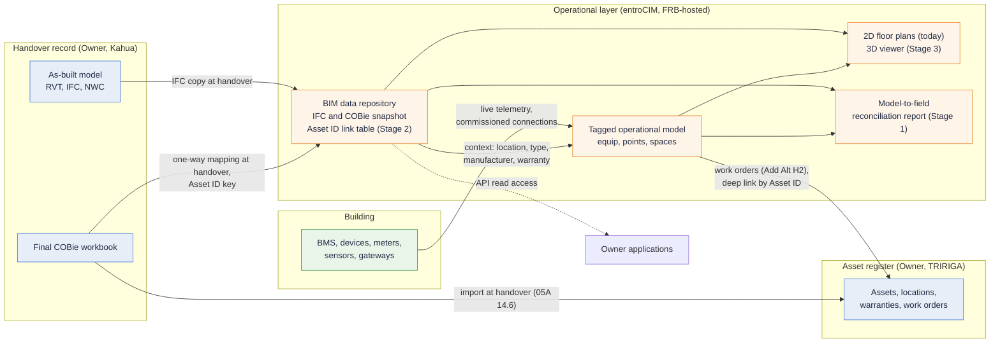

# FRB CSC BIM Response Draft

## Purpose and status

Draft for team review, not sent. It answers two inputs received 2026-11-02: the revised B37 language in Turner's bid supplement, and Raj's clarification relayed by Nate (the Owner wants the Smart Building Platform to house BIM data, and eventually graphics, for holistic 3D asset management rather than BAS operation; not a deal breaker today; they want a price and a roughly two-year roadmap).

It extends Wesco's 2026-10-29 BIM and COBie reply to Turner. Nothing in that reply changes: no 3D capability today, COBie mapping carried as a priced item, 2D floor plans built from the model's plan exports, deviation 2.03 D stands. This draft adds what the Owner has now asked for: the roadmap and the price.

Bracketed text is a placeholder or a point to confirm before the response leaves Wesco. Owners for each are in the open items section.

## What the revised B37 asks for

| # | Requirement (B37 as revised) | What it means for Wesco | Position today | How the response handles it |
|---|---|---|---|---|
| 1 | Fully participate in the Project's BIM process; reference the BIM Implementation Plan in the Subcontractor Manual | A process obligation: coordination meetings, naming and exchange conventions, handover data. The modeling, LOD 400/500, clash-detection and Revit authoring sentences are struck | Supportable. The BIM Implementation Plan has not been read; any modeling or LOD obligation that survives inside it is unknown | Accept, with an explicit exclusion that Wesco does not author, coordinate or maintain models |
| 2 | Provide all associated COBie data for facility management: equipment attributes (dimensions, material, manufacturer, model, install date, warranty, location, system association) and linked O&M data (shop drawings, cut sheets, test results) | Wesco produces a COBie-structured handover record for the equipment Wesco itself furnishes (servers, network appliances, H1 gateways if elected, and possibly the C51 laptops). This is a delivery deliverable, not a product capability | Doable as a handover spreadsheet. Not something the delivery team has produced on this scale before [confirm with Chad Steger]. Pressure, compaction and infiltration tests are civil and mechanical trade items that do not apply to Wesco-furnished equipment | Accept for Wesco-furnished equipment, list the applicable attributes, exclude the trade tests |
| 3 | Receive Autodesk Revit 2026 BIM models and COBie data from the trades, to be incorporated into the Smart Building Platform per the specifications and C1.1 | The new requirement, and the one Raj's clarification is about. "Incorporated" now means housed in the platform for asset management, with graphics over time | COBie mapping: priced placeholder, one-way at handover, feasibility with Ron Snyder (open since 10-29). Model files: can be linked as documents from an asset [confirm whether the platform can store the files or only link to them]. Model data storage, version tracking and 3D: not supported | Split into three stages: COBie mapping and file custody delivered in the Project; a BIM data repository on the roadmap; 3D graphics on the roadmap. Each stage priced or dated |
| 4 | (Raj, via Nate) A price to accommodate, and a roughly two-year roadmap | The Owner has said a perfect answer is not needed; they want money, time and development scope | No estimate exists yet for the roadmap stages | The "What it will take" section below, with placeholders for the team to fill |

Reading of the three green and struck passages: Turner has removed the obligation to create models and kept the obligation to consume them. That is consistent with Turner's 2026-10-29 statement that BIM was never removed from the base bid. The exposure has moved from authoring (which Wesco never did) to housing and presenting model data (which entroCIM does not do today).

## Where the BIM requirements live, by section

The BIM obligation has moved twice. The sequence matters because the team has read B37 as "struck" since 2026-10-20, and it is not.

**Bid Supplement 01 (per Turner's answer of 2026-10-20, Dayana Sayritupac, Procurement).** B37 was struck in full and marked "n"; the BIM modeling and LOD 400/500 deliverables under B37 were not included in BP #43. C1.1 was not struck and "remains applicable": incorporate COBie asset information provided by other trades into the unified user interface, "including 3D model navigation for asset and space visualization," per specification 25 00 00, section 2.03, items G and H. H5 (post-occupancy BIM model updates and maintenance, RFI 0353 Question 5) became an Add Alternate subject to FRBNY's decision.

**Turner, 2026-10-29 (email "FRBNY - Smart Building Bid Supplement 01 - BIM Modeling").** "The BIM portion of the Smart Building scope was never removed from the project requirements. BIM has always been a requirement for a base bid."

**Revised B37 (received 2026-11-02).** B37 is reinstated with the authoring obligations struck and a consumption obligation added.

| Passage | Status | Text |
|---|---|---|
| Opening sentence | Retained | "This subcontractor shall fully participate in the Project's Building Information Modeling (BIM) process." |
| Authoring, sentence 1 | Struck | "This subcontractor to model their work to the required Level of Development (LOD), coordinated through clash detection, and delivered as part of the federated model maintained by Turner." |
| Authoring, sentence 2 | Struck | "This subcontractor shall prepare all models in Autodesk Revit 2026 with LOD 400 through Construction and LOD 500 at As Built." |
| BIM Implementation Plan | Retained | "Please reference the BIM Implementation Plan in the Subcontractor Manual." |
| COBie deliverable | Retained | "This subcontractor to provide all associated COBie data as required to support facility management," with the Equipment attribute list (dimensions, material, manufacturer, model, install date, warranty, location (grid/GPS), system association) and Linked O&M Data (shop drawings, cut sheets, test results: pressure tests, compaction, infiltration tests). |
| Consumption | Added | "This subcontractor shall receive Autodesk Revit 2026 BIM models from the applicable trades along with COBie data to be incorporated into the Smart Building Platform per the specifications and C1.1." |

**Where 3D is required, by section.** The 3D requirement is written, not only verbal:

- Specification 25 00 00, 2.03 H: 3D model navigation for asset and space visualization (as cited by Turner; the spec text itself is not in the EOS record and should be quoted from the spec before the response is finalized).
- Specification 25 00 00, 2.03 G: COBie asset information in the unified user interface.
- C1.1: the bid-form item that invokes 2.03 G and H for the Smart Building subcontractor.
- Revised B37, added sentence: "per the specifications and C1.1," which points back to 2.03 G and H.
- Wesco's standing deviation, 2.03 D: "3D functionality depends on the supplied BIM/COBie model, LOD, file size, update process and approved implementation; material model remediation excluded." Shown as pending Turner/Owner review since 2026-10-20.

Raj's clarification (verbal, via Nate, 2026-11-02) adds the intent (holistic 3D asset management, not BAS operation), the tolerance (not a deal breaker today), and the request for a price and roadmap. Nothing in writing yet reflects that tolerance. The response therefore keeps the 2.03 D deviation explicit and offers the staged roadmap as how it is resolved over time, rather than treating the verbal comment as a relaxation of 2.03 H.

## Turner BIM documents reviewed (2026-11-02)

Three Turner documents were received the same afternoon and are filed in `Evidence/` (Turner_05A, 05B, 05C). They settle several points the draft had left to confirm, and they add obligations the draft did not cover.

**05A, FRBNY BIM Requirements, 2026-02-27, Version 04 (40 pages, Turner).** The binding trade-contractor BIM standard. What matters for Wesco:

- It binds "all Trade Contractors" and states that "the costs of BIM participation are included in the contract unless otherwise explicitly excluded" (3.1). Sections 2 (LOD 300 to 500), 3.3 (author in Revit), 3.14 (five-year BIM personnel), 5.1 (dedicated BIM Manager), 7 and 8 (modeling content), 14.3 (3D as-built models in native Revit and IFC) and 16.4 (solid models) are all modeling obligations. Wesco's exclusion from them rests only on the struck B37 sentences; 05A itself does not exclude anyone. The Smart Building subcontractor is not among the 32 trades listed in section 8 (the nearest are 8.16 Low Voltage, 8.18 and 8.20 BMS, 8.21 Telecommunications and Security). **The response must state the exclusion explicitly** rather than rely on the strikeout.
- The Owner's facility management system is named: COBie data "must be structured for seamless integration with the Owner's facility management system (e.g., IBM Tririga)" (14.4.5), with automated transfer by API where possible (14.7.2). The Owner's system of record for turnover models and the final COBie workbook is Kahua (14.3.3). So entroCIM is neither the FM asset register nor the model repository of record; it consumes the same handover data TRIRIGA receives. This links the COBie mapping to the H2 TRIRIGA work-order alternate.
- IFC is already a required turnover format (3.3; 14.3.1 b: "IFC format of all latest as-built 3D models"), so Stage 2's IFC basis asks nothing new of the trades. Each maintainable asset carries a unique, stable FRBNY Asset ID (14.7.4), which is the natural key for linking model elements to entroCIM assets.
- COBie is not a single handover file. Workbooks are due at Design, Construction and Handover (14.4.2), at Turner's data drops (14.7.4), with continuous update during construction (14.7.3); a COBie Responsibility Matrix assigns fields to parties (14.4.3) and data is validated against the project's Asset Information Requirements (14.4.4). Wesco's own COBie deliverable for furnished equipment therefore recurs at each data drop, and must use the project's shared parameters and Asset IDs. Since Wesco authors no model, its contribution is a workbook, which 14.4.1 ("populate COBie data fields within their BIM models") does not contemplate; agree that form in the Responsibility Matrix.
- The LOD 500 as-built model is due within 30 days of construction completion (2.3), which sets the earliest date the Stage 1 handover mapping can run.
- Intellectual property and security: Turner "retains the sole and exclusive right to use the BIM models and all submissions, during and after construction" (3.6); receipt of models does not waive the Owner's, Turner's or HLW's IP (3.8); model data must be handled with access controls, audits and encryption under FRBNY protocols (3.7). Housing the models in entroCIM (Stages 1 and 2) is a use of the models that needs Turner's and the Owner's permission in writing, and the platform's handling of model data must meet 3.7.
- Order of precedence: FRBNY Exhibit H and Owner directives govern over 05A (section 1). Exhibit H is not in the record.

**05B, BIM Lead Services for Trade Coordination (4 pages, Turner template).** The scope for Turner's BIM Lead (coordination, clash detection, ACC administration, as-built and FM handover). It is not Wesco's scope and should not be accepted as such. Two useful points: it states the Owner's FM intent in Turner's own words ("creating as-builts or a digital twin of the building that can be used for facilities management after construction," 1.f), and it names the BIM Lead as the counterpart Wesco coordinates with for model and COBie exchange. Confirm with Sarah that Wesco is not being asked to provide BIM Lead services.

**05C, HLW Electronic File Disclaimer and Agreement (2 pages).** Wesco must sign it to receive any BIM or CAD files from the architect, which Stage 1 already needs (2D plan exports). Terms: the files may be used only for this Project and Site; no release to any other party without HLW's written consent; no warranty of accuracy; Wesco indemnifies HLW for changes to, or reuse of, the files. Three consequences: Brandon reviews before anyone signs; Wesco must not use Project model files for product development or testing of Stages 2 and 3 (use other data); and any Wesco hosting or support personnel who can reach stored model data count as recipients under the no-release clause, so the deployment and support model for model data at FRB has to be stated.

## Project schedule (September 2026 update, data date 2026-10-01)

Received 2026-11-02 and filed as `Evidence/Turner_FRB_CSC_Schedule_September_2026_Update.pdf`. The dates that govern this response:

| Milestone | Activity | Date |
|---|---|---|
| Smart Building final leveling | B40-1060 | ends 2026-11-03 |
| Execute Smart Building award | EXC-40%CD-1260 | 2026-12-01 to 12-07 |
| Smart Building submittal, approval, fab and deliver | SUB-6250, APPROVE-6250, FAB&DEL-7250 | 2026-12-08 to 2027-06-03 |
| Energize permanent power | Mile-2070 | 2028-04-20 |
| BMS start-up and point-to-point tests | START/TEST-2520 | 2028-08-08 to 10-03 |
| Smart Building system start-up and testing | START/TEST-2510 | 2028-12-08 to 2029-01-08 |
| Smart Building Cx, pre-functional and functional | A13620, A13720 | 2029-01-09 to 03-05 |
| Substantial Completion | Mile-3000 | 2029-02-28 |
| LOD 500 as-built model and final COBie (05A 2.3, within 30 days of completion) | derived | about 2029-03-30 |

What this changes:

- **The handover data does not exist until Q1 2029.** Stage 1 (COBie mapping, floor plans from the as-built set) runs in 2029, not 2027. Construction-phase floor plans for the C51 temporary portal come from the coordinated model's 2D exports during 2027 and 2028, and are rebuilt once from the as-built set.
- **The roadmap is stated against project milestones, not calendar years.** Stage 2 (BIM data repository) in place before Smart Building start-up (2028-12-08); Stage 3 (3D viewing) in place before Smart Building Cx functional testing (2029-02-06). Both sit inside Darryl's 2028 roadmap position and give development a year of margin over a literal "two years from today."
- **Scope and acceptance for Stages 2 and 3 can be agreed in the Smart Building submittal window** (2026-12-08 to 2027-03-10), which is where the stage-gate text now points.
- **The Smart Building subcontractor has no "Model Populated" activity** in the BIM Coordination and Shop Drawings block (every modeled trade does), which supports the exclusion requested under 05A 3.1.
- **Timing of this response.** Final leveling ends 2026-11-03 and award execution starts 2026-12-01. The response should reach Turner this week.

## Does entroCIM need to read 3D models? (Darryl's question, 2026-11-02)

Two different things are asked for, and only one needs geometry.

- **Housing BIM data (Stage 2, Raj's primary ask) needs no geometry.** Element identity, type, space containment, system membership and attributes come from the COBie workbook and the non-geometric part of the IFC file, keyed on the FRBNY Asset ID (05A 14.7.4). entroCIM parses IFC metadata to build the element-to-asset link table and never interprets geometry. Native .rvt files are held as documents, not read.
- **3D navigation (2.03 H, Stage 3) needs geometry, but not a native 3D engine.** The bounded build is an embedded, self-hosted IFC viewer component inside the entroCIM UI that loads the stored IFC and exchanges selection with entroCIM by Asset ID. entroCIM hosts the viewer and syncs IDs; it does not parse or render the model. Deep links out to Kahua, ACC or Navisworks, or static rendered views per asset (today's capability), do not meet "in the unified user interface" in 2.03 H.
- **Position for the response:** Stage 2 reads IFC metadata; Stage 3 embeds a viewer. No viewer technology is named, and the viewer is assumed to run self-hosted in the FRB environment. Ron Snyder's estimate should be scoped on that basis.

## Roles and systems of record (Darryl's questions, 2026-11-02)

There is no single source of truth for "FRB models and data." There are three systems of record, one per kind of data, joined by the FRBNY Asset ID (05A 14.7.4).

| Data | System of record | Changes how |
|---|---|---|
| As-built model and final COBie workbook, as delivered | Kahua (05A 14.3.3); the BIM/VDC provider authors it | Only when the Owner commissions a model revision (Add Alternate H5; Wesco does not offer it) |
| Asset register, locations, warranties, maintenance history, work orders | IBM TRIRIGA (05A 14.4.5) | As the Owner replaces or re-tags assets over the life of the building |
| Live operational state: points, alarms, faults, analytics history, and the tagged semantic model of what is actually connected | entroCIM | Continuously, from telemetry |

::: {custom-style="Image Caption"}
FRB CSC data roles: Kahua holds the handover record, TRIRIGA the asset register, entroCIM the live operational layer; the Asset ID joins them. No data flows from entroCIM back to the model or the COBie set.
:::

Assumptions: Kahua remains the Owner's post-occupancy repository for the model (the Owner may move it; the role, not the product, is the point); TRIRIGA is the FM system (05A says "e.g."); the FRBNY Asset ID is populated on every maintainable asset in both COBie and the IFC.

**entroCIM's role.** The operational layer that joins the live building to the static handover record. The BIM data in entroCIM is a reference snapshot taken at handover: location, type, manufacturer, model, warranty, space and system membership for the assets entroCIM operates. entroCIM is never the master of that data; TRIRIGA is. entroCIM is the master of what no other system holds: the live state and the operational meaning of each connected point.

**What the 3D viewer connects to.** The IFC held in entroCIM's Stage 2 repository (a copy of the Kahua turnover deliverable) and entroCIM's own equip records, by Asset ID. The viewer renders the stored model and exchanges selections with entroCIM: select an element, see its live points; select an alarm, see where it is; deep-link to the TRIRIGA record by the same ID. It does not connect to Kahua, ACC or TRIRIGA live. It is the 2D floor-plan pattern entroCIM uses today, in three dimensions: a static picture of the building with live data on it.

**Reality governs, not the model.** entroCIM's truth is the installed, connected, commissioned device. A model element with no telemetry is a reference record. Model changes do not propagate into entroCIM and should not: the operational model is built at commissioning from what is actually connected and verified, and the COBie and IFC import is a one-time seed for context. Where the import and the field disagree, the field wins, and the list of disagreements (assets in the model never commissioned, devices commissioned that the model lacks, locations that moved) is a handover deliverable in its own right. Post-occupancy, an asset replacement is recorded in TRIRIGA, and in entroCIM when the new device is connected; the model lags unless the Owner pays to revise it. entroCIM keeps the operational record current and reports where the building has diverged from the model; it does not keep the model current.

This changes the draft in two places: Stage 2 no longer implies that revised models flow in (reloading is a service on the Owner's request), and Stage 1 gains the reconciliation report.

## Draft response to Turner and the Owner

The text below is written to go into the bid response in Wesco's voice. The 2026-10-29 reply remains the detailed statement of the COBie mapping and the floor-plan method; this text references it rather than repeating it.

### BIM process participation

In response to B37 as revised in Bid Supplement 01, Wesco will participate fully in the Project's BIM process as described in the BIM Implementation Plan in the Subcontractor Manual, including coordination meetings, file naming and exchange conventions, and delivery of handover data for Wesco-furnished equipment. Consistent with the struck modeling and LOD 400/500 provisions of B37 and Turner's clarification of 2026-10-20, Wesco does not author, model, clash-detect, or maintain BIM models (Add Alternate H5 is not offered). Model authoring and the federated model remain with the design team, the trades, and Turner.

Wesco's obligations under the FRBNY BIM Requirements (Version 04, 2026-02-27) are accordingly limited to BIM participation and coordination meetings (3.1, 3.4, 3.13), information security for any model data Wesco receives (3.7), and COBie data for Wesco-furnished equipment (14.4 to 14.7) as assigned in the COBie Responsibility Matrix. The modeling, LOD, BIM Manager, 3D as-built and solid-model provisions (sections 2, 3.3, 3.14, 5.1, 7, 8, 14.3 and 16.4) do not apply to the Smart Building subcontractor, which is not among the trades listed in section 8. Wesco requests Turner's written confirmation of this exclusion under 3.1. Wesco is not providing BIM Lead services.

### COBie data for Wesco-furnished equipment (B37)

Wesco will deliver COBie data for the equipment it furnishes under this scope (servers, network appliances, and gateways furnished under Add Alternate H1 if elected), covering dimensions, material, manufacturer, model, install date, warranty, location by grid, and system association, with cut sheets, shop drawings, and applicable test results linked. The data is delivered as a COBie workbook, using the project's shared parameters and FRBNY Asset IDs (14.7.4), at the data drops assigned to Wesco in the COBie Responsibility Matrix (14.4.3), and is submitted through Turner for review and upload to Kahua. Because Wesco authors no BIM model, the workbook is Wesco's form of COBie contribution; Wesco requests that the Responsibility Matrix record it that way. Pressure, compaction, and infiltration tests do not apply to Wesco-furnished equipment and are excluded.

### Incorporating the Project's BIM and COBie data into the Smart Building Platform (B37, C1.1, 25 00 00 2.03 G and H)

Wesco understands the Owner's objective: the Smart Building Platform should house the Project's BIM data, with 3D graphics over time, to support asset management across the facility rather than BAS operation. Wesco proposes to meet this in three stages. The first is delivered within the Project. The second and third are on the entroCIM product roadmap, and the Owner would be among the first facilities to use them.

Roles. Kahua holds the Project's turnover model and final COBie workbook as the Owner's record (BIM Requirements 14.3.3), and the Owner's facility management system holds the asset register (14.4.5). The Smart Building Platform is the operational layer: it holds the live state of the connected building and, under this proposal, a reference copy of the handover model and asset data for the assets it operates, joined to the live data by the FRBNY Asset ID (14.7.4). The platform does not become the system of record for the model or the asset register, and no data flows from the platform back to either.

**Stage 1, Project delivery (priced in this bid at [line reference]; performed at closeout from the as-built set and the validated final COBie workbook, 2029)**

- COBie mapping (2.03 G): one-way mapping of the Project's validated handover COBie workbook (14.6.1) into the platform's asset and location hierarchy, as described in Wesco's response of 2026-10-29, keyed on the FRBNY Asset ID. The Owner's facility management system (IBM TRIRIGA, 14.4.5) remains the asset register of record; the platform holds the operational view of the same assets. Work-order integration with TRIRIGA is priced separately under Add Alternate H2.
- 2D floor-plan graphics built from the model's 2D plan exports, with live system data and asset information shown in context on each level. This is the spatial navigation offered today in place of 2.03 H, under deviation 2.03 D.
- Handover reconciliation: a report of differences between the handover record and the commissioned building (assets in the model or COBie set that were not commissioned, connected devices absent from the record, locations that differ), issued at the end of Smart Building commissioning for the Owner's use in correcting the record.
- Model file reference: the turnover models and final COBie workbook reside in Kahua as the Owner's record (14.3.3). The platform links each asset and level to its turnover record [and holds a reference copy of the IFC and COBie files within the FRBNY-hosted platform environment, subject to Turner's and the Owner's written permission under 3.6 and 3.7], so the handover record is reachable from the asset it describes. Kahua remains the system of record.

**Stage 2, BIM data repository (roadmap; in place before Smart Building system start-up, December 2028)**

- Storage and version tracking of the Project's model data within the platform, received as IFC (already a required turnover format under 14.3.1) together with COBie, with each model element linked to its platform asset by the FRBNY Asset ID (14.7.4).
- API access so the Owner's other applications (asset management, CMMS, BIM tools) can read model and asset data held in the platform.
- Reloading of the repository from a revised model and COBie set when the Owner issues one and requests it, as a priced service. The platform does not detect or absorb model changes on its own; its operational data continues to come from the connected building.

**Stage 3, 3D graphics (roadmap; in place before Smart Building commissioning, January 2029; resolves 2.03 H)**

- Viewing the stored as-built model in 3D within the platform's user interface, with asset data, live points, alarms and faults shown in context, for asset management use. The model is displayed from the IFC turnover deliverable; the platform does not author or edit it.

### What it will take

Stage 1 is priced in this bid at [line reference].

Stages 2 and 3 are new capability outside the base entroCIM platform. Wesco proposes to deliver them for this Project on the following basis:

- **Development.** A development charge of $[X] for Stage 2 and $[Y] for Stage 3, carried as Add Alternates, which fund the design and build of the BIM data repository and the 3D viewing capability and secure the Owner's place as a launch facility for both. Each stage is delivered against a written scope and acceptance criteria agreed with the Owner before work begins, with Stage 3 proceeding only after Stage 2 is accepted.
- **Access.** Once released, the BIM data and 3D capability is licensed as an advanced entroCIM feature at $[Z] per year, in addition to the base platform licensing and support in this bid. The feature license covers use of the capability, its updates, and support.
- **Project services.** Loading and configuration of the Project's model data when Stage 2 is released, at $[W], and a 3D configuration service at Stage 3, at $[V].

Development timing is set against the Project schedule (September 2026 update): Stage 2 before Smart Building system start-up (START/TEST-2510, December 2028) and Stage 3 before Smart Building commissioning functional testing (A13720, February 2029), so both are available when the LOD 500 as-built model and final COBie workbook are delivered at closeout. The detailed scope and acceptance criteria for each stage are agreed during the Smart Building submittal period (December 2026 to March 2027). Wesco would review progress with the Owner [quarterly]. Stage 1 and the base platform are not dependent on Stages 2 or 3 being elected.

### Model data, security and intellectual property

Model and COBie data held in the platform under Stages 1 to 3 is handled under the FRBNY information security requirements (3.7): the platform is deployed in the Owner's environment, access is limited to authorized personnel, and access is auditable. Turner's and the Owner's rights in the models (3.6, 3.8) and the terms of the HLW Electronic File Agreement are acknowledged; the Project's model files are used only for this Project and Site and are not used by Wesco for product development. Wesco requests Turner's and the Owner's written permission to hold the turnover models and COBie data in the platform for the Owner's use.

### What entroCIM is and is not

entroCIM is an operations and asset data platform. It is not a BIM authoring, modeling, or coordination tool, and it will not replace Revit, the federated model, or the BIM/VDC provider as the system of record for the model. The roadmap above houses a reference copy of the model data and makes it available for operations and asset management; creation, coordination, and maintenance of the models remain with the Project's BIM process. The platform's operational data comes from the installed and connected building, not from the model; where the two differ after commissioning, the platform reflects the building and reports the difference. Wesco's deviation at 2.03 D describes the capability available today against 2.03 H and stands until Stage 3 is released.

## Commercial structure (decided by Darryl, 2026-11-02)

Wesco charges for the development of the capability and charges for access to it as an advanced feature outside base entroCIM. The draft text above implements that as three price lines: a development charge per stage (Add Alternates), an annual advanced-feature license once released, and project services to load and configure the Project's data at each release.

Why it is structured this way, so the team prices it consistently:

- **Development charge as Add Alternates, per stage.** Keeps the base bid and Stage 1 clean, lets FRB elect the roadmap without forcing it, and ties each payment to a stage with its own agreed scope and acceptance. Stage 3 does not start until Stage 2 is accepted, which bounds the exposure if the 3D stage proves harder than planned.
- **Scope and acceptance agreed before each stage starts.** This is what keeps a priced development line from becoming an open-ended obligation. The bid commits the price and the planned timing; the detailed scope is written with the Owner at stage start, which is also where the MVP boundary gets defined. Do not define the full capability in the bid.
- **Development charge as a contribution, not a sole-funded build.** Wesco retains all IP and the right to sell the feature to other customers; the charge is for priority delivery, launch-facility status, and project-specific work, not for exclusive ownership. This needs stating in the terms, because a customer who pays for development will otherwise assume it owns the result. Brandon (Senior Counsel) should see the IP wording.
- **Annual advanced-feature license.** Recurring, in addition to base licensing and support. If FRB elects Deduct Alternate H3 and buys licensing direct, the feature license follows the same path as the base license; price both identically so H3 does not strip it by accident.
- **Project services at each release.** Loading the Project's IFC and COBie data and configuring the 3D views is work on FRB's data, priced separately from development so the development charge stays a product number.

What this changes from the first draft: Option B (roadmap-funded, services only) is withdrawn. The risk that a priced development line becomes a dated contractual obligation is handled by the stage-gated scope and acceptance mechanism rather than by not charging.

## Open items before this goes out

| Item | Owner | Needed by |
|---|---|---|
| Feasibility of COBie-to-Haystack mapping (open since 2026-10-29), and a rough effort and timing estimate for Stage 2 (IFC and COBie repository, element-to-asset linking, versioning, API) and Stage 3 (3D viewer) | Ron Snyder | Before the response is priced |
| Whether entroCIM can store model files in its document store today, or only link to an external repository (decides the Stage 1 custody wording) | Ron Snyder | Same |
| Confirmation that the delivery team can produce a COBie handover record for Wesco-furnished equipment, and that the four-step 2D floor-plan method in the 2026-10-29 reply is how the team actually works | Chad Steger | Same |
| Obtain the BIM Execution Plan (distinct from the BIM Requirements, 05A), the COBie Responsibility Matrix, the Asset Information Requirements and FRBNY Exhibit H; pull the exact text of 25 00 00, 2.03 D, G and H so the response quotes it; confirm Wesco is not being asked for BIM Lead services (05B) | Sarah Monteleone | Before the response is finalized |
| Review the HLW Electronic File Agreement (05C) and 05A sections 3.6 to 3.9 before anyone signs; advise on the indemnity, the no-release clause as it applies to Wesco hosting and support staff, and the IP wording for the development charge | Brandon | Before signature and before the response is finalized |
| Confirm the deployment model for model data at FRB (Owner-hosted, air-gapped or Wesco-hosted) so the 3.7 security statement and the 05C no-release clause are answered consistently | Chad Steger, Ron Snyder | Before the response is finalized |
| Confirm with Raj that TRIRIGA is the FM system the COBie data targets (05A 14.4.5 says "e.g."), and whether the Owner expects the platform to receive COBie from TRIRIGA or from the handover workbook | Nate | Before the response is finalized |
| Which equipment counts as Wesco-furnished for the COBie deliverable (servers still unconfirmed under `C57`; H1 gateways; C51 laptops) | Sarah Monteleone, Leanne Gordon | Same |
| Price lines: Stage 1 COBie mapping, custody and floor plans; Stage 2 and Stage 3 development charges (Add Alternates); annual advanced-feature license; Stage 2 and 3 project services; H3 treatment of the feature license | Leanne Gordon, Valli Poornakumar, with Ron Snyder's effort estimate | Submission |
| Roadmap placement of Stages 2 and 3 against the reconciled 2027 roadmap and the 2028 plan; the dates that go in writing | Darryl Benson, with Ron Snyder and David Blondel | Before the response is finalized |
| Development charge basis (contribution with Wesco IP retained) and the stage-gate acceptance wording; IP language reviewed | Darryl Benson; Brandon for the IP terms | Same |
| Advanced-feature license price and what it includes (updates, support), and how it is positioned in the entroCIM price list for other customers | Darryl Benson, David Blondel | Before the response is finalized |
| Confirm with Raj whether "price" means a Project price or visibility of Wesco's development investment, and whether the Owner accepts IFC as the model exchange format alongside the native Revit files | Nate | Before the response is finalized |

## Risks and consistency notes

- **A priced roadmap will be enforced.** Once Stages 2 and 3 carry a development charge, Turner and FRB will treat the timing as a contractual commitment, and a Turner subcontract may attach schedule remedies to it. The protection is the stage-gate: price and planned timing in the bid, detailed scope and acceptance agreed at stage start, Stage 3 contingent on Stage 2 acceptance. Keep dates no narrower than a half-year and do not add features beyond the three stages. Check whether Turner's subcontract terms would apply liquidated damages to Add Alternate development work; if they would, the development charges need their own terms.
- **IP and exclusivity.** A customer paying for development will assume ownership or exclusivity unless the terms say otherwise. State that Wesco retains the IP and will offer the feature to other customers.
- **Capacity and timing.** 2027 development capacity is materially reduced (Weekly Sync 2026-10-30) and the 2027 roadmap reconciliation with CDA (`A64`) is open. Tying Stages 2 and 3 to the December 2028 and February 2029 milestones keeps both inside the 2028 roadmap with margin; do not pull them earlier to look responsive. The development charges are paid against stage acceptance, which falls in 2028, so the money arrives before the Project uses the capability; state that in the terms.
- **Revit is a proprietary format.** entroCIM cannot read .rvt files. IFC export and COBie are the interoperable path, which is why Stage 2 is written around IFC. Native Revit files can be held as documents. Do not promise to read Revit directly.
- **3D viewer design for a Federal Reserve facility.** Most 3D model viewers are cloud services. Assume Stage 3 must run self-hosted or on-premises before a viewer component is chosen; do not name a viewer technology in the response.
- **Consistency with 2026-10-29.** That reply said no 3D capability is proposed. This draft keeps that for today and adds a roadmap; the two read together only if the Stage 2 and 3 text stays clearly future tense. The 2.03 D deviation remains in force.
- **05A binds all Trade Contractors and includes BIM costs by default (3.1).** If the response does not state the exclusion by section, Turner can read sections 2, 5.1, 7, 8, 14.3 and 16.4 as applying to Wesco, and the struck B37 sentences will not protect against it. The written confirmation request in the customer text is the control.
- **COBie recurs; the mapping is one-time.** 05A requires COBie workbooks at Design, Construction and Handover with continuous update (14.4.2, 14.7.3). Wesco's own deliverable recurs at each data drop and must be priced that way. The Stage 1 mapping into the platform stays one-time at handover, from the validated final workbook (14.6.1), which the text now says.
- **HLW waiver restricts reuse.** Project files cannot be used to build or test Stages 2 and 3; development needs its own IFC and COBie test data. The waiver also makes Wesco responsible for changes to the files, so the platform must never write back (the text already says it does not).
- **COBie feasibility is still open.** Stage 1 depends on Ron Snyder's answer. If the mapping proves infeasible as a connector, Stage 1 becomes a project loader service and the wording changes; the price placeholder stays.

## Competitive note (reported, not researched)

Nate reports that only one evaluated platform does this today: e-Magic Inc. (TwinWorX, built on Azure Digital Twins), a Canadian startup Raj described as not mainstream. Raj also pointed to NV5, which the Boston Fed likes. NV5 is, as far as the team's knowledge goes, an engineering and consulting firm with BIM, VDC and geospatial services rather than a software platform; what Raj means by "BIM platform" should be confirmed with him. Neither needs to appear in the response. A short look at both is worth 30 minutes if Sales wants positioning for the final conversation, and the fact that the only platform that does it today is a startup on a cloud-native twin service supports the staged, self-hosted approach above.

## Sources

- Turner bid supplement, B37 as revised (screenshot, 2026-11-02).
- Evidence/Turner_05A_FRBNY_BIM_Requirements_2026-02-27_V04.pdf; Turner_05B_BIM_Lead_Services.pdf; Turner_05C_FRBNY_BIM_and_CAD_Waiver_HLW.pdf (received 2026-11-02).
- Evidence/Turner_FRB_CSC_Schedule_September_2026_Update.pdf (P6 schedule, data date 2026-10-01, received 2026-11-02).
- Nate's note on the Raj and Kenny Trowers conversations, 2026-11-02.
- Deliverables/entroCIM/2026-10-29_FRB_BIM_COBie_Response.docx (reference wording).
- Deliverables/entroCIM/2026-10-20_FRB_BP43_Turner_Bid_Answers_Review.md.
- Products/entroCIM/entroCIM.md, BIM and COBie position (2026-10-20, 2026-10-29).
- Registers: W026, A64, C57, W003.
