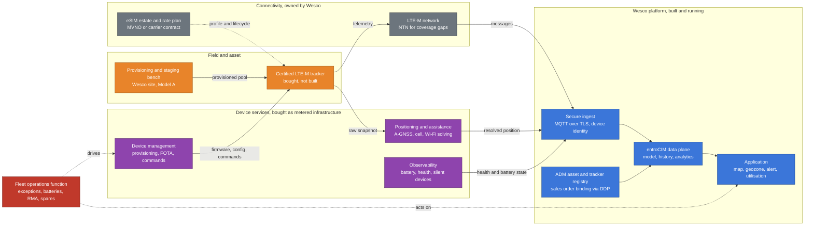

# Connected Asset Tracking: Layers 1 to 3, What Independent Execution Requires
As of: 2026-09-17. Owner: Darryl Benson. Status: analysis for review. Not a recommendation and not a business case. Every figure in the cost section is illustrative and carries a stated assumption; none of it is a Wesco quote.

Companion to `03_Architecture/CAT_Five_Layer_Model_2026-09-16.md`, which remains the standing frame. That file establishes that layers 4 and 5 are built and layers 1 to 3 are entirely vendor supplied. This file asks the next question: if Wesco intends to execute layers 1 to 3 without a partner, what specifically has to exist, who sells the parts, what is missing today, what would it cost, and how long would it take.

## Bottom line

**Independent execution is achievable, but not as a build. It is an assembly plus an operation.** There is no credible path in which Wesco engineers layers 1 to 3 from first principles. The credible path buys certified hardware, buys connectivity, buys positioning and device management as metered infrastructure, and builds the integration, the data model and the operating function around them. That distinction matters because it changes what "without a partner" means.

**Separate a partner from a supplier.** A partner owns a layer of the capability and the relationship that goes with it, which is what the declined Sensolus model does. A supplier sells a component into a capability Wesco owns and can be replaced without replacing the product. Wesco can execute this without a partner. It cannot execute it without suppliers, and pretending otherwise produces an estimate that will not survive contact with a certification lab or a carrier.

**The gap is not software.** The three gaps that matter are embedded and RF competence with device certification at layer 1, connectivity lifecycle administration at layer 2, and a standing fleet operations function with 24 hour responsibility for device health at layer 3. The first can be avoided by buying certified devices. The second is small and closable. The third is permanent, it is staffed rather than coded, and it does not appear in any application estimate.

**On the illustrative model in this file, the decision turns almost entirely on whether internal labor is counted.** At the inferred fleet of roughly 8,300 assets, a self-assembled stack costs approximately $1.4M over five years if internal labor is treated as already paid for, and approximately $4.6M if the sustaining engineering and fleet operations it requires are costed honestly. The declined subscription sits between them at approximately $2.5M. That is the whole argument, stated as a number.

**The break-even fleet size, on the same model, is roughly 18,000 assets.** Below that, owning layers 1 to 3 costs more than renting them, because the fixed cost of the device services operation is spread over too few assets. The inferred fleet is less than half of that. This raises the stakes on gate G1: the asset baseline is not a denominator for the model, it is the decision.

**The decision rule that would settle this fastest is commercial, not technical.** If Sensolus will sell data access with layers 1 to 3 retained at roughly $3.50 per tracker per month or less, no self-build option in this file competes with it on cost, risk or time, and the remaining question is contractual rather than architectural. That price does not exist in writing yet. Gate G2 is therefore the highest value next action in the area, ahead of any further technology work.

## What each layer actually contains

The five layer model names the layers. This section inventories them, because the build estimate lives in the inventory rather than in the names.

### Layer 1: Device

**What must exist.** A tracker that survives the asset, which for cable reels and reel stands means outdoor storage, pressure washing, steel mounting surfaces, impact, and years of unattended operation on a sealed battery. Behind that sit the module and radio, the GNSS receiver and antenna, the power system, the enclosure and mounting, regulatory approval, carrier approval, firmware, and a supply chain that can deliver units in volume and replace them for years.

**What can be bought.** Almost all of it. The merchant market for battery powered LTE-M asset trackers is mature. Devices exist today that are certified for North American carriers, rated for outdoor industrial use, and shipped with multi-year battery life at low report rates. Public single unit retail sits at roughly $175 to $200 for comparable devices (source 9, source 22), with enterprise volume pricing materially lower and not published.

**What would have to be built.** Nothing, in the recommended reading. Custom hardware should be rejected unless a specific requirement forces it, and none has been identified. The cost of forcing it is concrete: published industry figures put North American cellular certification at $1,500 to $4,500 in filing fees, $16,000 to $40,000 in lab testing, and a further $5,000 to $15,000 per carrier, for a total in the $20,000 to $30,000 range per device variant and six to eight weeks minimum, with a mechanical change that touches the antenna environment capable of triggering the whole cycle again (source 21). That is before industrial design, tooling, firmware, qualification and a first production run, and before the organisational question of who owns a hardware product line inside Wesco for the next seven years.

**Skills required if bought:** device selection, mechanical mounting design and field durability testing, supplier qualification, inbound quality control, spares planning. These are closer to Wesco's existing competence than anything else in layers 1 to 3.

**Skills required if built:** embedded firmware, RF and antenna engineering, hardware qualification, regulatory and carrier certification programme management, contract manufacturing. Wesco does not have these in CSS Platforms. Whether the IoT team holds any of them is an open question and should be confirmed rather than assumed.

**The economics are driven by loss, not by unit price.** In the subscription model a lost or broken tracker is a warranty event. In an owned model it is a purchase order plus a field visit. A five point swing in the annual loss rate moves the model more than a twenty dollar swing in unit price.

### Layer 2: Connectivity

**What must exist.** A cellular subscription on a network that covers where the assets actually go, SIM or eSIM provisioning, activation and suspension, rate plan management, usage monitoring, and an owner for the carrier relationship.

**The North American technology answer is now settled, and it is LTE-M.** AT&T stopped certifying new NB-IoT devices and selling NB-IoT data plans and moved to decommission its NB-IoT network, migrating customers to LTE-M (source 12). Verizon and T-Mobile have said they are keeping NB-IoT for now (source 12), but a technology that one of the three national carriers has already exited is not the basis for a ten year fleet decision on assets that travel. LTE-M also handles mobility properly, which NB-IoT does not. For assets that leave Wesco sites, LTE-M is the default and the alternatives are complements rather than substitutes.

**What can be bought, and cheaply.** This is the least expensive layer to own and the easiest to leave. 1NCE publishes $14 per SIM for ten years including 500 MB and 250 SMS, covering LTE-M and NB-IoT across 170 countries, with industrial chip form factors at a small premium (source 14). That is approximately $1.40 per device per year, or about $0.12 per month, which is the benchmark already carried in the area. Enterprise alternatives with heavier management tooling include Soracom, KORE, Aeris, EMnify, Wireless Logic, Eseye, Pelion, Hologram and Monogoto, and direct carrier contracts with AT&T, Verizon and T-Mobile. Satellite NTN from Skylo now covers North America commercially for narrowband IoT (source 24) and is a coverage gap filler rather than a primary bearer.

**Timing note that favors owning this layer now.** SGP.32, the GSMA remote SIM provisioning standard built for IoT, reached commercial availability with at least one major provider in July 2026 (source 20). It allows a single hardware SKU to change carrier profile in the field without a physical SIM swap. The practical breadth still depends on which operators have integrated their profiles, so it is not a finished capability, but it materially reduces the lock-in that used to make owning connectivity unattractive. Owning layer 2 is a better proposition in 2026 than it was two years ago.

**What would have to be built.** Very little in technology terms. What has to exist is administrative: someone who owns activation and suspension states, reconciles the monthly bill against the fleet, watches for runaway usage caused by firmware behaviour, and handles the SIM lifecycle when devices are provisioned, retired or lost. Today no one at Wesco does this for a device fleet.

### Layer 3: Positioning and device services

This is the layer the decision turns on, and it decomposes into four functions that are usually discussed as one.

**Positioning assistance and location solving.** Multi-year battery life on this device class is achieved by not solving position on the device. The tracker captures a short GNSS snapshot or a list of nearby cell towers and Wi-Fi access points, and a cloud service resolves it into a position. That service also supplies assistance data, which is the almanac and ephemeris hint that lets a tracker get a fix in seconds rather than minutes. Removing it changes the power budget, not just the feature list. Digital Matter states plainly that without current GNSS almanac and ephemeris data "you will not get optimal performance and battery life" (source 6).

This function can be bought as metered infrastructure. Nordic's nRF Cloud publishes assisted GNSS, predictive GNSS, single cell, multi cell, Wi-Fi and combined ground fix services with stated accuracy bands from under 10 m for assisted GNSS to under 1000 m for single cell (source 18). AWS IoT Core includes a Device Location feature with solvers for GNSS, Wi-Fi and cellular (source 16). Golioth meters a location API at $0.005 per request (source 15). Skyhook, Combain, HERE, Google and Unwired Labs sell Wi-Fi and cell positioning independently. The capability is purchasable. Building it is not sensible and no one credible does.

**Device management and firmware.** Provisioning, credential installation, configuration profiles, staged firmware rollout, rollback, and remote commands for thousands of sealed devices that will never be physically touched again. Buyable from AWS IoT Device Management, which publishes bulk registration at $0.10 per 1,000 things, fleet indexing at $2.25 per million index updates, and remote actions at $0.003 each for the first 250,000 per month (source 17); from Azure IoT Hub with Device Provisioning Service and Device Update; from LwM2M platforms including AVSystem Coiote and IoTerop; and from developer platforms including Golioth at $0.25 per active device per month with over the air updates metered at $0.0095 per MB (source 15).

**Device observability and health.** The daily answer to why a device stopped reporting, plus battery estimation, crash and fault analytics, and fleet level trend detection before failures become truck rolls. This market consolidated in June 2025 when Nordic Semiconductor acquired Memfault and folded device observability and over the air update into nRF Cloud (source 19). Observability is the function most often forgotten in a build estimate and most visible in operation, because it is what produces the connector fields Wesco already consumes.

**Support and the operating obligation.** The part that is not software. Someone has to work the exception list every day, dispatch battery replacements and repairs, manage RMA and spares, and escalate when a customer site goes dark. In the subscription this is inside the fee. In a self-built option it is a named team, a budget line and a service level.

**What would actually have to be built at layer 3.** Assuming the four functions above are bought rather than written, the remaining build is real but bounded: a secure ingest endpoint and device identity model, the mapping from device services events into the entroCIM and ADM data model, the provisioning and commissioning tooling described in the provisioning models file, alerting and exception workflow, and the operational runbooks. If the devices are taken fully direct, with no vendor device services in the path at all, the build grows to include a scalable socket or MQTT service with its own encryption and key management, device key installation and storage procedures, debug log collection and analysis, and sourcing and distributing GNSS aiding data. Digital Matter names each of those explicitly as customer responsibilities in the direct to third party model, along with the loss of asynchronous command queueing, remote debug access, installer status tools and priority support (source 6). That configuration is not recommended by the manufacturer and should not be recommended here.

## Reference architecture for the independent path

Assumptions in the diagram: devices are certified merchant hardware rather than custom; positioning and device management are bought as services rather than written; provisioning is central at a Wesco site with field commissioning only, per the provisioning models recommendation; the fleet operations function is drawn separately because it is staffed rather than deployed, and it is the element with no owner today.

## Who plays in the space

Organised by layer, because most of these companies describe themselves as end to end and only two or three of them are.

| Layer | Category | Who sells it | What they actually give you | What they do not |
|---|---|---|---|---|
| 1 | Full solution vendors | Sensolus, Alesea, Samsara, Tive, Roambee, Ubiqweus class providers | Device, connectivity, services and application for one fee | Unbundled economics, control of the data model, a path to owning the capability |
| 1 | Merchant tracker OEMs | Digital Matter, Queclink, Teltonika, Abeeway (Actility), Lansitec, Minew, MOKO | Certified devices, optional device management and location engine, data routed to your platform | The application, the asset model, the operating function |
| 1 | Developer hardware platforms | Particle, Blues | Device plus bundled connectivity and cloud, fast integration | Industrial ruggedisation for this asset class, enterprise volume economics at scale |
| 1 | Modules and silicon | Nordic, Quectel, Sequans, Murata, Telit Cinterion, Semtech | The radio and the reference design for a custom device | A finished, certified, mounted product |
| 2 | IoT MVNO and eSIM | 1NCE, Soracom, KORE, Aeris, EMnify, Wireless Logic, Eseye, Pelion, Hologram, Monogoto | SIM estate, rate plans, management console, increasingly SGP.32 | Device services, positioning, anything above the bearer |
| 2 | Carriers direct | AT&T, Verizon, T-Mobile | Coverage and enterprise terms | Multi-carrier flexibility without eSIM tooling |
| 2 | Satellite NTN | Skylo, Viasat, Iridium | Narrowband coverage beyond terrestrial networks | Primary coverage economics for a fleet of this profile |
| 3 | Positioning services | Nordic nRF Cloud, AWS IoT Core Device Location, Skyhook, Combain, HERE, Google, Unwired Labs | Assistance data and cloud resolution of GNSS, cell and Wi-Fi | Device management, firmware, the operating function |
| 3 | Device management and FOTA | AWS IoT Device Management, Azure IoT Hub and Device Update, AVSystem Coiote, IoTerop, Golioth, Izuma, Mender | Provisioning, configuration, staged firmware, remote commands | Positioning, and the people who use the tooling |
| 3 | Device observability | Nordic nRF Cloud powered by Memfault, Golioth, vendor consoles | Battery and health analytics, fault detection, silent device detection | The exception handling process itself |
| 3 | OEM-integrated services | Digital Matter Device Manager, Teltonika FOTA WEB, Particle, Blues Notehub | Layer 3 bundled with the device you already bought | Independence from that OEM's hardware |
| 4, 5 | Platform and application | Wesco: entroCIM, SkySpark, ADM, DDP | Built, running, integrated | Nothing missing that this decision depends on |

The practical reading of this table: the only column where Wesco is genuinely absent is layer 3, and layer 3 is purchasable in pieces from at least four credible categories of supplier. That is the strongest technical argument for the independent path. The weakest is that none of those suppliers sells the operating function, and that is the part Wesco does not have.

## The gap, stated as capability rather than technology

| Capability | Wesco position today | Required for independent execution | How to close | Lead time |
|---|---|---|---|---|
| Device selection, mounting, field durability | None for this asset class. Pilot evidence exists but is unrecovered | Device qualified on real reels, in real yards, through a winter | Buy candidates, mount, test. Recover pilot data first | 2 to 4 months |
| Embedded firmware and RF engineering | Not in CSS Platforms. Unconfirmed in the IoT team | Only if hardware is customised | Avoid by buying certified devices | Not applicable if avoided |
| Regulatory and carrier certification | None | Only if hardware is customised | Avoid. Otherwise $20k to $30k per variant and 6 to 8 weeks (source 21) | Avoid |
| Connectivity contract and SIM lifecycle | None owned | Contract, activation and suspension process, billing reconciliation, usage alarms | Contract with an IoT MVNO. Assign an administrator | 4 to 8 weeks |
| Positioning and assistance services | None. Entirely vendor supplied today | Metered service contract plus integration | Buy. Nordic, AWS, or the device OEM's location engine | 4 to 8 weeks to integrate |
| Device management and FOTA | None for battery devices. entroCIM manages servers and gateways, not sealed field devices | Registry, staged firmware, configuration profiles, command queueing | Buy platform, build the operating procedures around it | 2 to 4 months |
| Device observability and silent device detection | None. The connector consumes these fields, it does not produce them | Battery estimation, health trend, daily exception list | Buy, then staff the exception list | 2 to 4 months |
| Secure ingest and device identity | Strong. MQTT ingest in production; air-gapped deployment experience is directly relevant to key handling discipline | mTLS ingest, per-device credentials, key custody, rotation | Extend existing capability | 1 to 3 months |
| Mobile geolocated asset modelling in SkySpark and Haystack | Open technical question. The platform was built for building points | Asset, position, journey and geozone semantics that hold at fleet scale | Design spike before commitment | 4 to 6 weeks |
| Provisioning and staging operation | None. No physical location designated | Bench, tooling, tested pool, inventory control | Stand up at an existing VAS or kitting site, per Model A | 2 to 3 months after site agreement |
| Field commissioning process | None defined. Pilot practice unknown | Two scan binding, device states, unbind on return, one system of record | Build into ADM and the mobile step | 2 to 4 months |
| Fleet operations function | None. Unowned and unfunded | Named team, daily exception handling, batteries, RMA, spares, escalation, service level | Staff it. This is the permanent gap | 3 to 6 months to stand up, then forever |
| Reverse logistics and spares | Adjacent competence exists in the business, not applied here | Spare stock, repair or replace decision, depot | Design with supply chain | 3 months |
| Governance, funding and decision rights | Not established. Supply chain, IoT, CSS Platforms and DDP each hold a piece | One owner, one funding route | Executive action, not a technical task | Immediate and blocking |

## Cost, on a stated model

Everything in this section is illustrative. The parameters are assumptions, they are listed so they can be argued with, and the model should be rebuilt on quotes and on the G1 asset baseline before it informs a decision.

**Parameters.**

| Parameter | Value used | Basis |
|---|---|---|
| Fleet size | 8,300 assets | Inferred from $500,000 per year at $5 per tracker per month. Not counted. Gate G1 |
| Vendor all-in cost | $60 per asset per year | Reported $5 per tracker per month, includes hardware, connectivity, services, support, replacement |
| Device unit cost at volume | $90 | Assumption. Public single unit retail is $175 to $200 (sources 9, 22); volume pricing is not published |
| Device service life | 5 years | Assumption, battery limited at low report rates |
| Annual loss and damage | 8 percent | Assumption. Pilot data should set this. Gate G4 |
| Connectivity | $1.40 per device per year | 1NCE published $14 per SIM per 10 years (source 14) |
| Device services platform | $6.00 per device per year | Assembled from published rates: Golioth connect at $0.25 per active device per month, location API at $0.005 per request at roughly 1.5 requests per day (source 15), AWS messaging and device management at published rates (sources 16, 17) |
| Fully loaded engineering cost | $175,000 per FTE per year | Assumption. Published base salary data varies widely by source and geography (source 25) |
| Fully loaded operations cost | $120,000 per FTE per year | Assumption |
| Initial build | 4 FTE for 12 months | Assumption, integration and tooling only, no hardware development |
| Sustaining engineering | 1.5 FTE | Assumption |
| Fleet operations | 2.0 FTE | Assumption, excludes field labor absorbed elsewhere |

**Result.**

| Configuration | Five year total | What it assumes |
|---|---|---|
| Option 0, vendor full stack, the declined baseline | $2.49M | $60 per asset per year, all in, replacement included |
| Option 3, self-assembled, internal labor treated as free | $1.41M | Devices, connectivity and platform fees only. This is the implicit basis of the build thesis |
| Option 3, self-assembled, labor costed | $4.62M | Adds $700k initial build, $262k per year sustaining engineering, $240k per year fleet operations |

**Break-even.** Variable cost per asset per year in the self-assembled model is approximately $32.60, against $60 for the vendor, leaving approximately $27 per asset per year to cover fixed cost. At a fixed cost of roughly $500,000 per year for sustaining engineering and fleet operations, break-even is approximately **18,000 assets**. If sustaining engineering is genuinely absorbed and only the operations staff are counted, fixed cost falls to $240,000 per year and break-even falls to approximately **8,800 assets**, which is the inferred fleet size. In other words, even under the most generous labor assumption that still counts the people who run the fleet, the self-assembled option lands at parity rather than at a saving.

**One modelling caveat to carry forward.** Connectivity is charged once per asset at the ten year prepaid rate while devices are modelled on a five year life, so the model understates connectivity by roughly one SIM per replacement device. The effect is small at $1.40 per device per year, and it is the reason R15 exists.

**Sensitivity, in order of impact.** Fleet size first, because the whole model is fixed cost spread over assets. Then whether sustaining engineering is counted. Then the loss and damage rate, which is both a device cost and a field labor cost. Then device unit price at volume, which is the parameter most likely to improve with a real quote and the one that moves the answer least.

**What this does not say.** It does not say the build direction is wrong. It says the build direction is not a saving at the inferred fleet size, and that the two numbers most likely to change that conclusion, the asset count and the unbundled vendor price, are both outstanding at gates G1 and G2.

## Timing

**Internal sequencing, if the independent path were pursued.** A realistic first production deployment on bought devices with bought device services is nine to fifteen months from a funded decision: four to eight weeks to contract connectivity and device services, four to six weeks for the SkySpark and Haystack modelling spike, two to four months to integrate and build provisioning and commissioning tooling, two to three months to stand up the staging bench, two to four months of field durability testing in parallel, and three to six months to recruit and stand up the fleet operations function, which is the longest pole and the one that cannot be compressed by adding engineers. Custom hardware would add twelve to eighteen months and is not recommended.

Option 1, taking vendor data into the existing connector, is live now. Option 2, buying devices from a merchant OEM and keeping that OEM's device management and location engine while owning connectivity and the platform, is four to seven months, because it removes the layer 3 build and most of the layer 3 risk while still moving the capability inside Wesco.

**External market timing, and it currently favors waiting rather than hurrying.** Three things have changed in the last eighteen months. AT&T exited NB-IoT and moved to LTE-M, which settles the radio question for North America and removes a technology risk (source 12). SGP.32 reached commercial availability in July 2026, which makes owning connectivity without carrier lock-in a real option rather than a roadmap item (source 20). And the device services market consolidated and became purchasable as metered infrastructure, illustrated by Nordic acquiring Memfault in June 2025 and folding observability and over the air update into its cloud (source 19). The net effect is that the components of an independent stack are cheaper, better standardised and more available than they were, which strengthens the case for owning the capability and simultaneously weakens any case for building the components.

**The timing risk that matters is internal.** The G6 recommendation date sits at the end of October and the FY27 planning cycle is closing on this portfolio. A recommendation that lands after the funding route closes leaves an approved direction with no money, which is risk R8 in the area log. If the independent path is chosen, the funding request has to name the fleet operations function explicitly, because that is the line item most likely to be cut and the one most likely to cause the programme to fail quietly if it is.

## Risks specific to independent execution

Candidates for the risk log, additional to R1 through R10.

| ID | Risk | Assessment |
|---|---|---|
| R11 | Self-build is scoped as an assembly of purchased services but funded as an application project, leaving positioning, device management and observability unbought and unfunded | High likelihood, high impact. This is R1 repeating one layer down |
| R12 | Device services suppliers are treated as replaceable when they are not. Positioning, device management and observability are usually easiest to buy from the device OEM, which reintroduces hardware lock-in through the back door | Medium likelihood, medium impact. Mitigated by choosing a standards-based device management path where the device supports it |
| R13 | The SkySpark and Haystack data model does not hold mobile geolocated assets at fleet scale, discovered after commitment | Medium likelihood, high impact. A four to six week spike retires it cheaply |
| R14 | Fleet operations is approved in principle and not staffed in practice, so exception handling falls to the development team and silently consumes engineering capacity | High likelihood, medium impact. This is how these programmes degrade rather than fail |
| R15 | Connectivity cost is modelled at the prepaid ten year rate while the operating reality is activation, suspension, replacement and reconciliation across a churning fleet | Medium likelihood, low impact on cost, medium on credibility |

## What would have to be true

Independent execution of layers 1 to 3 is the right answer if, and only if, most of the following hold. Each is testable and none is currently established.

The counted fleet is materially larger than the inferred 8,300 assets, or has a credible path to it through additional asset classes. Device unit pricing at Wesco volume is at or below the assumed range. The pilot shows a low loss and damage rate. Sensolus will not price data access at a level that makes Option 1 obviously cheaper. A fleet operations owner exists and is funded. The SkySpark and Haystack modelling question comes back clean. And the capability has a strategic purpose beyond internal savings, such as becoming a sellable service with Wesco as customer zero, which would change the investment test from cost avoidance to product investment.

That last point deserves to be said plainly to the sponsor. On internal savings alone, at the fleet size currently assumed, this does not pay back. If it is worth doing, it is more likely to be worth doing as a product decision than as a cost decision, and it should be argued that way rather than defended on a saving the model does not support.

## Sources

Continuing the numbering in `05_Operating_Record/Source_Index.md`. Sources 1 through 11 are listed there.

12. AT&T NB-IoT discontinuation and migration to LTE-M; Verizon and T-Mobile positions. https://www.lightreading.com/iot/at-t-to-discontinue-nb-iot-but-t-mobile-and-verizon-keep-the-faith and https://rcrwireless.com/20241120/internet-of-things-4/att-quits-nb-iot
13. Digital Matter, Device Manager. https://support.digitalmatter.com/en_US/oem-server
14. 1NCE published pricing, $14 per SIM for 10 years, 500 MB, 250 SMS, LTE-M and NB-IoT. https://www.1nce.com/en-us/1nce-connect/pricing
15. Golioth published pricing: $0.25 per active device per month, OTA at $0.0095 per MB, location API at $0.005 per request. https://golioth.io/pricing
16. AWS IoT Core pricing, including Device Location. https://aws.amazon.com/iot-core/pricing/
17. AWS IoT Device Management pricing: bulk registration, fleet indexing, jobs and remote actions. https://aws.amazon.com/iot-device-management/pricing/
18. Nordic nRF Cloud Location Services: A-GNSS, P-GNSS, single cell, multi cell, Wi-Fi, ground fix, with accuracy bands. https://docs.nrfcloud.com/docs/platform/location-services
19. Nordic Semiconductor acquires Memfault, June 2025, chip to cloud lifecycle management. https://www.nordicsemi.com/Nordic-news/2025/06/Nordic-Semiconductor-acquires-Memfault
20. Soracom brings SGP.32 IoT eSIM orchestration to commercial availability, July 2026. https://iotbusinessnews.com/2026/07/09/soracom-brings-sgp-32-iot-esim-orchestration-to-commercial-availability/
21. Cellular IoT certification cost components: PTCRB filing, lab testing, per carrier approval, timelines. https://hubble.com/community/comparisons/the-true-cost-of-cellular-iot/
22. Particle Tracker One LTE-M North America, published unit price $199.98, and Particle platform pricing. https://store.particle.io/products/tracker-one-with-ethersim and https://www.particle.io/pricing/
23. Blues pricing and bundled connectivity model, 500 MB and 10 years included per Notecard. https://blues.com/pricing/
24. Skylo direct to device NTN service launched in the US and Canada. https://www.skylo.tech/newsroom/skylo-launches-its-direct-to-device-service-in-the-us-canada
25. Embedded firmware engineer compensation reference, United States, 2026. https://www.salary.com/research/salary/hiring/embedded-firmware-engineer-salary

Nothing in this file is a Wesco quote or a measured Wesco figure. The public benchmarks shape the model; they do not populate it.
