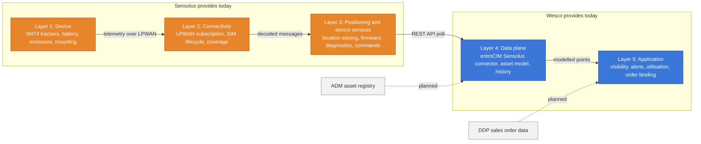
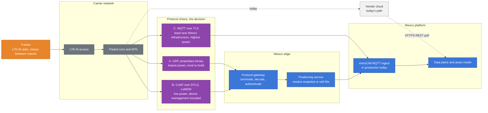

# Connected Asset Tracking: The Five Layer Model
As of: 2026-09-16. Owner: Darryl Benson. Status: standing analytical frame for this area. Every option, cost estimate, and vendor conversation in CAT gets mapped to these five layers before it is discussed as a number.

## Why this is the standing frame

The build-or-partner question keeps collapsing into "can we write the application," which is the one part of the problem this team can do quickly and cheaply. Separating the solution into five layers keeps the comparison honest, because the cost, the risk, and the operating burden do not sit where the conversation naturally goes.

## The layers

Assumptions in the diagram: the Sensolus stack is drawn as it operates today under the current subscription; ADM and DDP connections are drawn as planned because no sales order binding exists yet.

## Layer by layer

### Layer 1: Device

What it is: the tracker itself. Radio, GNSS, battery, enclosure, mounting, certification, and the physical durability that decides how long it survives on a reel.

Third-party today: Sensolus SNT4 family devices, supplied inside the monthly fee with no upfront hardware cost and, on the published model, a lifetime hardware warranty with replacements.

To stand up our own: a capital purchase, which Wesco is structurally good at, plus device selection, certification, mounting design, and an owned replacement stock. The economics turn on annual loss and damage rate, because in the subscription model a lost tracker is a warranty event and in an owned model it is a purchase order.

Test question: what does a tracker cost at our volume, and what percentage of the fleet do we lose or break per year?

### Layer 2: Connectivity

What it is: the cellular or LPWAN subscription, SIM or eSIM lifecycle, activation and suspension, coverage and roaming.

Third-party today: bundled into the Sensolus fee. The `sigfoxActivationStatus` attribute in the connector indicates Sigfox lineage in the fleet or the API; the North America device line is marketed on NB-IoT and LTE-M. Which radios our fleet actually uses is not established.

To stand up our own: a connectivity contract and a SIM management process. This layer is the cheapest to replace. Public benchmarks put low-duty-cycle IoT connectivity near USD 0.12 per device per month. Connectivity is not the reason the subscription costs what it costs.

Test question: which radio technology does our installed fleet use, and does the device firmware allow a different network profile?

### Layer 3: Positioning and device services

What it is: location solving and assistance data, over-the-air firmware and configuration management, device health diagnostics, command queueing, and the support tier behind all of it.

Third-party today: entirely Sensolus, and the connector documents exactly what that layer produces. Every one of these points exists in entroCIM only because a vendor service generates it: `currentFirmwareSha`, `lastDeviceFirmwareUpdate`, `lastDeviceConfigUpdate`, `batteryLevelPercentage`, `batteryEstimationCalibrated`, `estimatedRemainingBatteryLife`, `lastSeenAlive`, `lastLocationSource`, `lastLocationAccuracy`, `sigfoxActivationStatus`. That list is the specification for what a self-built option would have to replace.

To stand up our own: this is the layer that carries the cost and the risk, and it is the one that does not appear in an application estimate. Device manufacturer documentation reviewed for this area states plainly that sending device data directly to a third-party server forfeits positioning assistance, over-the-air firmware management, diagnostics, and command queueing, and that the loss of assistance data degrades positioning accuracy and reduces battery life. Multi-year battery life on this device class is achieved partly by solving position in the vendor cloud rather than on the device, so removing the vendor cloud changes the physics, not just the feature list.

Test question: how much of the quoted battery life and positioning accuracy depends on vendor cloud services, and what would Wesco have to build or license to replace it?

### Layer 4: Data plane

What it is: ingest, decode, storage, historization, and the asset and order data model.

Wesco today, and this is no longer theoretical. The entroCIM team has built and is syncing a Sensolus connector (`ItwSensolus Conn`), learning an Organisations to Assets hierarchy and binding device attributes, subscription, firmware, battery, device tags, last geozones, active alerts, and current process state. Detail in `Products/entroCIM/Connectors/entroCIM_Sensolus_Connector_2026-09-16.md`. entroCIM also runs MQTT ingest in production for other data, so a direct device path is not foreign infrastructure.

Important distinction: what exists today reads from the vendor application, not from devices. Direct device ingest is a different build and belongs to Layer 3's problem set, not this one.

To stand up our own further: sales order binding through ADM and DDP, history retention strategy, and a data model that holds mobile geolocated assets properly rather than approximately.

Test question: does the existing connector plus ADM cover the data plane requirement, and what does modelling mobile assets in SkySpark and Haystack actually require?

### Layer 5: Application

What it is: maps, geozones, alerts, utilisation views, reports, user access, and the operational workflows around them.

Wesco today: partially delivered. The connector documentation lists ten supported use cases with sample KPIs, which is an application specification in all but name.

> **Correction, 2026-09-18 (Darryl).** The specification exists; the application does not. The connector pulls data in. The operations interface requires new entroCIM PODs, at an effort similar to CDA's FY27 development plan, and a team retained to maintain and enhance them. The two paragraphs below understated this layer and are left as written for the record.

To stand up our own: the remaining work is the cheapest and fastest part of this programme, which is precisely why it should not be used as the proxy for the whole decision.

Test question: what does the application need to do on day one, as opposed to everything the vendor application does today?

## Where this leaves the decision

| Layer | Cost character | Risk if self-built | Wesco position today |
|---|---|---|---|
| 1 Device | Capital, negotiable, recurring through loss | Medium, driven by loss rate | Buying nothing today, renting inside the fee |
| 2 Connectivity | Low recurring | Low | None owned |
| 3 Positioning and device services | Recurring and operational | High, degrades the product itself | None owned, fully vendor supplied |
| 4 Data plane | Mostly sunk, existing team | Low | Built and syncing |
| 5 Application | Build plus a standing product team (corrected 2026-09-18; was "mostly sunk") | Low technically; material in cost | Specification exists; operations interface not built |

The shape of the answer, before any modelling: Wesco already owns the two layers that are cheap to own, and owns none of the three that are expensive to own. An option that keeps Layers 1 to 3 with a vendor and Layers 4 and 5 with Wesco is not a compromise position, it is the position the completed connector has already put us in. That is Option 1 in the charter, and the commercial question it needs answered is what Sensolus charges for the hardware layers without the application.

> **2026-09-18 qualification.** "Wesco already owns the two layers that are cheap to own" holds for layer 4 only. Layer 5 carries a POD build (about seven India FTE for eight months) and a retained half team afterwards, about $145,000 a year on the 2026-09-21 basis, roughly 29% of the declined subscription. On that model, Option 1 beats Option 0 at the inferred fleet if data-only access is priced below about $3.07 per tracker per month.

The counter-case deserves to be tested rather than assumed away. If the fleet is large, if device unit pricing at Wesco volume is genuinely low, if loss rates are low, and if the devices can be pointed at a Wesco endpoint without material loss of battery and accuracy, then Option 3 becomes credible. All four of those are unknowns today, and the third one is the one most likely to come back negative.

## How to use this file

Apply it in three places. In vendor conversations, ask for pricing by layer rather than a single figure. In the TCO model, build a column per layer per option so the comparison cannot hide the device services layer. In any executive material, lead with the layer map, because the framing is the finding: the question was never whether we can build an application.

---

# Addendum, 2026-09-17: the data path and the protocol question

Added as an addendum rather than an edit, so the 2026-09-16 frame stands as written. Prompted by the question of how LTE-M data actually reaches Wesco and over what protocol. This sits between Layer 3 and Layer 4 and it is the mechanical detail that the layer boundary hides.

## The first correction: LTE-M is a bearer, not a protocol

LTE-M is radio access. It gives the device an IP session on the carrier's network and carries whatever is put on top of it. The application protocol is a separate design choice, it is made by whoever owns the device firmware, and it determines battery life, whether the device can be commanded, and how much of the device services layer comes along for free.

## What happens today, confirmed

No device traffic reaches Wesco. The tracker talks LTE-M to the carrier, the carrier delivers IP to Sensolus, and the device session terminates in the Sensolus cloud. entroCIM never sees a device packet. The `ItwSensolus Conn` connector polls the Sensolus REST API over HTTPS on a schedule and writes current values into the point tree, carrying positions the vendor has already solved.

Two consequences that matter for the decision. The freshness of Wesco data is set by a polling interval and by the vendor's own processing, not by the device report rate. And the integration Wesco owns today is an ordinary cloud-to-cloud API integration, which is why it was fast to build and why it says nothing about the difficulty of the layers below it.

## The three realistic direct paths

If Wesco terminates device sessions itself, the choice is between three patterns. They are not interchangeable.

| Pattern | What it is | Power cost | What Wesco has to run | Device management implication |
|---|---|---|---|---|
| UDP with proprietary binary payload | What most battery trackers do natively, including the Digital Matter family | Lowest. No connection setup, no acknowledgement overhead beyond what the application adds | A scalable listener, the vendor codec, retry and duplicate handling, device identity, encryption and key custody | None included. Everything at Layer 3 has to be bought or built separately |
| CoAP over UDP with DTLS, carrying LwM2M | The standards-based path. Registry, configuration, firmware, diagnostics and command queueing share one session model | Low. DTLS session resumption and connection ID keep handshake cost down, which is what makes it viable on a sealed battery | A LwM2M server, bought rather than written, plus the mapping into entroCIM | Device management arrives with the protocol. This is the main reason to prefer it |
| MQTT over TCP with TLS | What entroCIM already speaks in production | Highest of the three. TCP setup plus a TLS handshake costs radio on-time and bytes every wake cycle, and keepalives work against power saving mode | Broker and ingest already exist. Least new Wesco infrastructure | Nothing included. Publish and subscribe is transport, not device management |

A common compromise is worth naming because it resolves most of the tension: terminate CoAP or UDP from the devices at a protocol gateway, then republish internally over MQTT. entroCIM's ingest stays unchanged, and the devices keep the cheap protocol.

Assumptions in the diagram: the three protocol paths are drawn as alternatives rather than as a deployed design, and only one would be chosen; the dotted path is the current Sensolus route and is the only one operating today; the positioning service is drawn at the Wesco edge because a bought service is called from there, not because it runs there.

## Three things that decide the protocol, none of them preference

**Power.** Every handshake is battery, and battery is field labor at several thousand assets. This is the same argument as the battery page in the review deck, one level down.

**Reachability.** A device in power saving mode is not reachable until it wakes. Anything sent to it has to be queued and delivered on its next contact, which is a platform capability rather than a configuration setting. If Wesco wants to change a report rate or trigger a location on demand, something has to hold that instruction until the device appears.

**Payload.** Device traffic is compact binary, not JSON, and what arrives may be a GNSS snapshot or a list of cell towers rather than a latitude and longitude. A decoder is required, and a positioning service may be required before the message means anything.

## The network path is a second, separate decision

Public internet with TLS and per-device credentials is the default and is adequate. The alternatives are a private APN with an IPsec tunnel into Wesco, or a carrier or MVNO cloud interconnect that lands traffic inside a Wesco cloud VPC without traversing the public internet. Both cost more and buy a cleaner security posture, which matters if this capability is ever pointed at customer sites commercially. It should be scoped now, because it is expensive to retrofit and it belongs in the Layer 2 contract rather than in the application design.

## What this changes in the vendor session

Section 4 of the technical question set already asks the right things. Two answers govern the rest. Whether the device endpoint is configurable by the device owner at all, and whether the protocol and payload specification is available to customers. If the endpoint is fixed to vendor infrastructure, every direct ingest pattern above is unavailable regardless of price, and the decision reduces to Option 1 or to buying different hardware. That makes it a gating question rather than a detail, and it should be asked early in the session rather than at the end.
