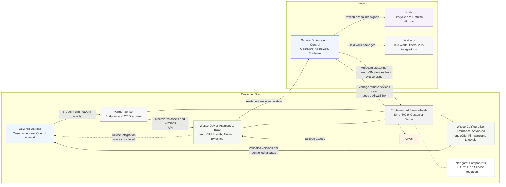

# Connected Device Assurance — Solution Structure (Executive View)
Overhauled 2026-07-27 to the product decomposition (partner sensor + Base/Advanced Wesco tools) and rulings of that date.

## What this diagram shows — and what it deliberately does not

**This is a solution structure / deployment responsibility view.** It answers: what are the pieces, who provides them (partner vs. Wesco), where do they run, and how do they reach the customer's devices. It is the view for an endorsement audience.

It is **not** a workflow or a dataflow. Companions:
- The **data-fidelity ladder** (discovered → validated → managed) is a three-chip slide graphic on the offer slide, not an architecture diagram.
- The **controlled-action workflow** (approve → execute → validate → evidence) is the sequence diagram in `Phase_2_Review_Timeline_and_Architecture.md` §3.2 — engineering/appendix material for security and legal audiences.

## Intent

Show the two Wesco tools and the partner sensor, their placement at the customer site (or remote), the Airwall path, and the WAM and Navigator integrations. Readable in under a minute.

## Assumptions

- The service node grouping (small PC or customer server) hosts all three components; in the fully remote mode the two Wesco tools run in Wesco Azure and reach the site over the same Airwall link. One diagram covers both by construction; the remote variant is stated in slide text, not drawn separately.
- The dashed base-tool-to-devices arrow is deliberate: base-tier device integration exists only where completed; otherwise the base tool carries partner-sourced data.
- Advanced tool reaches devices through direct device integration (verified models, validated versions).

## Validation Items

- Arcbeam shown per Darryl 07-27 as the second secure connection (semantics: Airwall link = manage the remote devices; Arcbeam = run entroCIM devices from the Wesco cloud). Clustering readiness still to validate with Ron Snyder.
- Partner sensor unnamed per 07-27 ruling.
- Navigator node components marked future (supports Navigator's 2027 integrations).

## Exclusions

- Credential handling, multi-tenancy, fleet management, container packaging: engineering detail, dossier §7 and §9.
