# CSS Platforms 2027 — Phase 2 Deep Dive
## Connected Device Assurance as a Service

**Date:** 2026-07-23  
**Owner:** Darryl Benson  
**Status:** Phase 2 complete; MVP-composition decision required  
**AOP input due:** 2026-08-31  

---

# Executive Decision

## Recommended MVP composition

Proceed to Phase 3 with **Connected Device Assurance as a Service** as the lead concept and **Connected Camera Assurance** as the first market offer.

The MVP should combine all three surviving modules, but at different depths:

1. **Cyber-Hygiene and Compliance Visibility — base tier**
   - Included for every technically eligible covered device.
   - Device identity, firmware and support posture, vulnerability correlation, default/shared-credential indicators, certificate status where available, insecure-service observations, read-only configuration findings, evidence, and exception tracking.
   - Credential rotation, certificate lifecycle, autonomous hardening, and MDR remain later capabilities.

2. **Device Health and Recovery — primary operational module**
   - Functional health checks, prioritized service work, diagnosis, approved low-risk recovery, validation, field escalation, and service evidence.
   - This is the strongest initial recurring-service outcome because it can reduce response time, outages, and truck rolls.

3. **Firmware and Configuration Assurance — controlled-action module**
   - Firmware posture for eligible devices.
   - Active firmware execution begins with qualified Axis products and expands manufacturer by manufacturer.
   - Hanwha participates in visibility, health, and vendor qualification immediately; active Hanwha firmware execution begins after supported methods and commercial qualification are documented.
   - Configuration starts read-only. Automated configuration remediation follows after action controls and liability boundaries are proven.

## Deployment sequence

### Land — Deployment Mode 3: Azure container over Airwall

Start with an Azure-hosted container reaching known site devices through an Airwall Layer 3 path. The customer installs no on-premises compute other than the Airwall component.

Best initial uses:

- Known-IP unicast APIs
- Firmware/version collection
- Device health queries
- Vulnerability and lifecycle correlation
- Selected restart/recovery actions
- Axis firmware actions where file transfer and customer controls are acceptable
- Cloud API integrations, including Cisco Meraki and Catalyst Center

### Expand — Deployment Mode 1: Wesco Ubuntu appliance

Graduate to a Wesco-supplied Ubuntu appliance when the customer needs:

- Broadcast or multicast discovery
- Local-only protocols
- Higher device counts
- Larger firmware transfers
- Local VMS, recorder, controller, or network validation
- Offline buffering
- Lower latency
- Local execution required by security policy

### Enterprise alternative — Deployment Mode 2: customer server

Deploy the same container set on customer-owned infrastructure when local execution is required but the customer will not accept a Wesco appliance.

## Manufacturer sequence

1. **Axis cameras** — first active health and firmware implementation
2. **Hanwha cameras** — simultaneous visibility/health qualification; second active firmware implementation
3. **Cisco** — API-led expansion through Meraki and Catalyst Center
4. **HID** — partner-led access-control expansion through Reader Manager, Linq, Origo, and certified channels
5. **dormakaba** — qualify by product family; firmware and remote-control paths vary
6. **Open telemetry/API devices** — health and visibility where protocols are open; firmware only through a qualified update interface

## Build / partner / buy conclusion

### Build or extend

- Deploy-anywhere container product
- Arcbeam-based application-estate clustering and control
- Shared service enablement
- Approval, scheduling, job control, validation, evidence, exception management, metering, and reporting
- WAM integration and commercial-signal loop
- Navigator/FSM escalation
- entroCIM connectors and module pods where they provide differentiated operational depth
- AI-assisted matching, triage, release-note interpretation, and operator guidance under deterministic controls

### Partner or license

- Broad multi-vendor physical-security hygiene and remediation
- Password rotation and certificate lifecycle
- OT/IoT network and endpoint visibility
- Threat and vulnerability content
- Manufacturer-specific management engines when partnership is faster and more economical than rebuilding

### Do not build

- Another asset-lifecycle platform
- Another work-order platform
- A generic fleet/container-management product
- A Nozomi replacement
- Full feature parity with SecuriThings or Viakoo
- A new generic portal unless Strev cannot support the specific service experience

---

# 1. Evidence Discipline

Labels used throughout:

- **FACT — Internal:** settled CSS Platforms context supplied by Darryl
- **FACT — External:** verified in an official public source
- **EVIDENCE:** supports the conclusion but does not prove Wesco-specific demand
- **ASSUMPTION:** planning choice or range requiring validation
- **HYPOTHESIS:** proposition to test with customers, partners, data, or pilot
- **UNVERIFIED:** material item not confirmed through sufficient public evidence

---

# 2. Settled Product Boundary

## 2.1 Customer proposition

**Connected Device Assurance as a Service** is a recurring service in which Wesco assumes accountability for defined aspects of the operational, software, security, and support condition of covered connected devices.

The customer buys:

- Defined coverage
- A managed-service owner
- Prioritized work
- Approved remote action
- Verified outcomes
- Audit evidence
- Exception handling
- Field escalation
- Lifecycle and refresh signals
- Recurring accountability

The customer does not buy a tool it must staff.

## 2.2 Product packaging

**The container is the product.**

Deployment modes:

1. Wesco-supplied small-form-factor Ubuntu PC
2. Customer-owned on-premises server
3. Azure-hosted container over Airwall Layer 3 connectivity

Arcbeam coordinates the distributed instances. entroCIM pods are internal capability modules inside the product; they are not the commercial packaging.

## 2.3 Platform boundaries

| Capability | Primary role |
|---|---|
| Device protocols, APIs, telemetry, rules, and controlled actions | entroCIM connectors and pods |
| Distributed application-instance coordination | Arcbeam |
| Asset identity, warranty, entitlement, support, EOL, renewal, refresh | ADM / WAM / Strev |
| Secure Layer 3 customer-network access | Airwall |
| Central service control and remote execution | Azure |
| Field work and closure | Navigator or replaceable FSM/ITSM integration |
| OT/IoT visibility and threat detection | Nozomi or equivalent partner |
| Broad physical-security remediation | SecuriThings, Viakoo, OEM tools, or hybrid |
| Approval, evidence, service queue, metering, WAM loop | Net-new shared enablement layer |
| Customer SLA and daily operation | Managed-services delivery |

---

# 3. Commercial Backdrop

CSS needs recurring service revenue and stronger installed-base monetization. The funding case must show:

- Annual recurring contract value
- Service-delivery margin
- Customer land-and-expand
- Airwall, WAM, partner, software, warranty, field-service, and hardware attachment
- Reuse of approved entroCIM containerization and existing platforms
- Avoidance of overlapping platform development

External market evidence indicates that OEM and specialist products already use subscriptions, device-count pricing, and MSSP/reseller models. Axis offers a free on-premises manager and a subscription remote-management product; Hanwha HealthPro is subscription licensed; SecuriThings prices by device count; Viakoo markets MSSP and reseller programs. The implication is that Wesco must monetize service accountability and integration rather than basic device-management features.

---

# 4. Module A — Firmware and Configuration Assurance

## 4.1 Problem and buyer

### Exact problem

Customers operate devices with inconsistent or unsupported firmware and configuration because inventory, OEM tools, access, compatibility, change control, validation, recovery, and ownership are fragmented.

### Current workaround

- OEM utilities
- Browser-based manual updates
- Integrator projects
- Customer scripts
- Deferred updates
- Emergency vulnerability response
- Site visits
- Spreadsheets and informal maintenance windows

### Buyer and budget

- **Buyer:** Physical Security Director, CISO, OT/IoT Security, IT Operations
- **Budget:** Security remediation, maintenance, managed services, compliance
- **Commercial sponsor:** Account leadership and supplier/OEM team

### Ideal initial customer

- 500–5,000 cameras or connected devices
- Multi-site Axis and Hanwha estate
- Central security owner
- Known firmware backlog
- Existing Wesco relationship
- Cybersecurity governance
- Ability to authorize Airwall and privileged device access
- 2027 modernization or refresh need

### Willingness-to-pay assessment

- **EVIDENCE:** Axis, Hanwha, SecuriThings, and Viakoo provide firmware/configuration capabilities through free, subscription, or partner-delivered offerings.
- **HYPOTHESIS:** Customers will pay Wesco above OEM-tool cost for cross-vendor accountability, execution, evidence, WAM integration, and field recovery.
- **UNVERIFIED:** Comparable public managed-service per-device rates were not found.

## 4.2 Service definition

### Service promise

> Wesco maintains covered devices against an agreed firmware and configuration policy, performs supported and approved changes, validates the device and dependent systems, preserves evidence, and coordinates recovery or field service when remote completion is not possible.

### In scope

- Covered-device confirmation
- Firmware and software version collection
- Support and EOL correlation
- Approved target-version policy
- Release-note and advisory review
- Compatibility and prerequisite review
- Read-only configuration baseline
- Approval and change-window scheduling
- Test-group and staged deployment
- OEM-supported rollback
- Defined recovery, isolation, replacement, or field remediation
- Post-change validation
- Evidence and reporting
- WAM update and refresh signal

### Out of scope for MVP

- Universal automatic updating
- Unsupported/custom firmware
- Broad configuration writes
- Password rotation
- Certificate lifecycle
- Full VMS/platform upgrades
- Universal rollback guarantee
- More than two active firmware manufacturers
- General 24x7 response
- Compliance certification

### Customer workflow

1. Confirm covered sites and devices.
2. Approve access and credential method.
3. Establish baseline.
4. Agree approved-version policy.
5. Review change package.
6. Approve device batch and maintenance window.
7. Wesco executes test group.
8. Wesco validates device and dependent application.
9. Wesco expands, commits, rolls back, or escalates.
10. Customer receives evidence; WAM receives results.

### Operator workflow

1. Review prioritized firmware/configuration queue.
2. Verify device identity and vendor qualification.
3. Obtain approved firmware from an authorized source.
4. Check signature/checksum, model, prerequisite, and compatibility.
5. Confirm approval and maintenance window.
6. Execute through the selected container, connector, and pod.
7. Validate firmware, connectivity, stream, recording, access function, or network service.
8. Commit or perform OEM-supported rollback.
9. Generate field/recovery package for exceptions.
10. Update evidence, WAM, and metrics.

### Approval model

- Read-only assessment: standing authorization
- Production firmware: explicit batch approval during MVP
- Configuration writes: separate approval
- Critical devices: two-person Wesco control plus customer approval
- Emergency action: contractually defined path
- Approval expires when target, device list, prerequisite, or window changes

### Service levels — assumption

- Posture refresh: daily to weekly by device class
- Critical advisory assessment: one business day after reliable content becomes available
- Recommendation: two business days after assessment
- Execution: agreed maintenance window
- Failed-change triage: within one hour during active change
- Evidence: next business day
- 24x7: future premium tier

### Reporting and evidence

Reports include coverage, firmware/configuration posture, unsupported devices, completed/deferred/failed actions, recovery, time to completion, refresh signals, and SLA performance.

Evidence includes device/WAM identity, before state, firmware source and integrity, compatibility decision, approval, execution identity, timestamps, action logs, validation, recovery, final state, field work, and WAM update.

## 4.3 Platform contribution

| Component | Classification | Contribution |
|---|---|---|
| entroCIM | Existing + extension | Connectors, API/protocol access, state, action, validation |
| Firmware/configuration pods | Net-new on existing framework | Compatibility, update state machine, staging, validation, recovery |
| Arcbeam | Existing + extension | Instance selection, cluster coordination, estate status |
| Airwall | Existing partner | Secure Layer 3 path and on-prem instance management |
| Azure | Existing + extension | Remote container, control, evidence, integration |
| WAM/ADM | Existing + extension | Identity, support/EOL, entitlement, refresh; receives results |
| Strev | Optional extension | Approval and lifecycle reporting if fit |
| Navigator | Optional integration | Recovery, replacement, field work |
| Nozomi | Optional partner | OT posture evidence; not primary firmware engine |
| SecuriThings/Viakoo | Partner candidate | Broad firmware/configuration/hygiene coverage |
| Container packaging | Existing investment + extension | Consistent delivery in all three modes |
| Fleet management | Extension/partner | Provision, update, monitor, roll back product instances |
| Spanr | Unnecessary for MVP | Future safety-device use |

## 4.4 Commercial model

### Zero-touch Firmware Posture

- Mode 3 over Airwall
- Firmware inventory, support/EOL, vulnerability correlation, recommendations
- No active firmware unless vendor-qualified
- **Assumption:** $2–$4/device/month; $25,000–$40,000 minimum ACV; $10,000–$30,000 implementation

### Managed Firmware Assurance

- Approval, scheduling, staged execution, validation, exception management
- **Assumption:** $6–$12/device/month; $50,000–$75,000 minimum ACV

### Managed Response

- Expedited advisory response, premium windows, recovery, selected configuration remediation
- **Assumption:** $10–$18/device/month; $75,000–$125,000 minimum ACV

Expansion moves from Mode 3 posture to active Axis, on-premises deployment, Hanwha qualification, Cisco APIs, access-control devices, configuration remediation, and partner-enabled credential/certificate functions.

Pull-through includes Airwall, appliance, WAM, OEM subscriptions, warranty/support, replacement hardware, field service, network/power remediation, deployment, and commissioning.

## 4.5 Dependency gates

| Gate | Owner | Due | Consequence |
|---|---|---:|---|
| Axis managed-service qualification | Supplier Relations + Legal + Axis technical | 2026-08-07 | Active Axis updates excluded; posture remains |
| Hanwha qualification and rights | Supplier Relations + Legal + Hanwha technical | 2026-08-14 | Hanwha remains visibility/health only |
| SecuriThings/Viakoo RFI | Product + Procurement + Legal | 2026-08-14 | Use limited build scope; broad remediation deferred |
| Credential architecture | Cybersecurity + Managed Services | 2026-08-14 | No write actions |
| Airwall architecture approval | Cybersecurity + Airwall owner | 2026-08-14 | Use on-premises mode or another customer |
| Firmware source/integrity model | Product Security + OEMs | 2026-08-14 | No production firmware execution |
| Liability and insurance | Legal + Risk | 2026-08-21 | Active remediation cannot be sold |
| Pilot customer | Sales + Managed Services | 2026-08-21 | Remove module from committed 2027 pilot |
| Unit economics | Finance + Managed Services | 2026-08-28 | Limit AOP request to discovery/pilot |

## 4.6 Top risks

1. **Update outage:** narrow support matrix, test groups, prechecks, validation, OEM rollback, field recovery.
2. **Vendor fragmentation:** qualify profitable device families; partner for breadth.
3. **Free OEM tools:** sell accountability, evidence, WAM, cross-vendor workflow, and recovery.
4. **Approval delays:** standing policies, recurring windows, aging and SLA exclusions.
5. **Labor erosion:** reusable rules, AI-assisted analysis, batch execution, premium pricing for exceptions.

### Liability boundary

Wesco commits to supported devices, approved process, source validation, evidence, validation, and defined escalation. It does not guarantee defect-free OEM firmware, universal rollback, universal remote recovery, compatibility with undocumented modifications, or remediation of unsupported/customer-delayed devices.

---

# 5. Module B — Device Health and Recovery

## 5.1 Problem and buyer

### Exact problem

A connected device may be reachable but not operationally effective. Cameras may stop recording, analytics may fail, clocks may drift, access-control components may become unavailable, network devices may degrade, and devices may repeatedly restart. Existing tools generate alarms, but no accountable owner consistently diagnoses, resolves, validates, and closes the lifecycle record.

### Current workaround

- Ping, SNMP, VMS, and OEM alerts
- User complaints
- Manual camera checks
- Service-desk tickets
- Remote desktop
- Integrator or technician dispatch
- Separate asset and field-service systems

### Buyer and budget

- **Buyer:** Physical Security Operations, Facilities Operations, Service Management
- **Budget:** Maintenance, operations, managed services, service contracts
- **Secondary:** IT/OT operations and cybersecurity resilience

### Ideal initial customer

- 500+ cameras or connected devices
- Multiple sites
- Documented incidents and truck rolls
- Existing VMS and field workflow
- Existing Wesco relationship
- Customer will pre-authorize low-risk recovery
- High consequence of device downtime

### Willingness-to-pay assessment

- **EVIDENCE:** Specialist platforms and Hanwha HealthPro combine monitoring, operational state, reboot/power-cycle, and remediation capabilities.
- **HYPOTHESIS:** Avoided visits, faster restoration, and accountable service support a recurring fee above OEM-tool cost.
- **UNVERIFIED:** Wesco's current remotely diagnosable and resolvable incident rate.

## 5.2 Service definition

### Service promise

> Wesco continuously verifies the functional state of covered devices, diagnoses degradation, performs approved remote recovery, validates restoration, and coordinates a complete field response when remote resolution is not possible.

### In scope

- Reachability and device state
- Device/VMS/controller relationship
- Stream, recording, time, storage, service, and application checks where APIs permit
- Repeated offline/reboot conditions
- Prioritized incident queue
- Root-cause hypothesis
- Approved restart, service restart, PoE cycle, or reconnect
- Validation
- Field-work package
- WAM condition/failure history
- SLA and service-value reporting

### Out of scope for MVP

- Continuous-availability guarantee
- Full VMS or network managed service
- Broad predictive maintenance
- Unlimited remote actions
- 24x7 human response
- Physical repair in base fee
- Cyber incident response
- All manufacturers/device classes

### Customer workflow

1. Select sites, covered devices, criticality, and functional tests.
2. Approve read-only monitoring.
3. Pre-authorize low-risk actions.
4. Define critical notifications and escalation.
5. Receive service and value reports.
6. Approve higher-risk work.
7. Receive field work and lifecycle recommendations.

### Operator workflow

1. Receive a correlated, prioritized incident.
2. Verify identity and criticality.
3. Execute diagnostic pod.
4. Review recent changes, support status, and incident history.
5. Execute pre-approved recovery or request approval.
6. Validate intended function.
7. Close with evidence or create field package.
8. Update WAM condition and service metrics.

### Approval model

- Monitoring: standing authorization
- Restart/service restart/PoE cycle: customer policy by device class and criticality
- Firmware/configuration change: separate approval
- Critical site: two-person control
- Field dispatch: contractual rule or customer approval
- Replacement: customer commercial authorization

### Service levels — assumption

- Continuous or periodic monitoring by API/device capability
- Critical-device acknowledgement: 30 minutes during service hours
- Remote diagnosis: 60-minute target
- Pre-approved recovery: immediately after confirmed diagnosis
- Field package: same business day
- Monthly service report
- 24x7: premium tier after economics and staffing are proven

### Reporting and evidence

Metrics include coverage, functional availability, incidents, MTTD, diagnosis time, MTTR, remote-resolution rate, field escalations, repeat incidents, avoided truck rolls, refresh candidates, and SLA performance.

Evidence includes device/WAM ID, trigger, health state, diagnostics, approval, action, validation, resolution, operator, work order, parts/replacement, and lifecycle update.

## 5.3 Platform contribution

| Component | Classification | Contribution |
|---|---|---|
| entroCIM | Existing + extension | Telemetry, protocols, rules, connectors, actions |
| Health/recovery pods | Net-new on existing framework | Functional tests, diagnosis, playbooks, validation |
| Arcbeam | Existing + extension | Cluster status, site routing, estate health |
| Airwall | Existing partner | Remote diagnostics and recovery |
| Azure | Existing + extension | Remote container, incident correlation, evidence |
| WAM/ADM | Existing + extension | Identity, criticality, support/EOL, history |
| Strev | Optional extension | Customer service/lifecycle reporting |
| Navigator | Important optional integration | Dispatch, parts, field closure |
| Nozomi | Optional partner | OT network/endpoint and anomaly context |
| SecuriThings/Viakoo | Partner option | Physical-security operations and remediation |
| Container packaging | Existing investment + extension | Local and remote execution |
| Fleet management | Extension/partner | Product-instance lifecycle |
| Spanr | Future optional | Safety-device assurance |

## 5.4 Commercial model

### Zero-touch Health Visibility

- Mode 3 over Airwall
- Known-device health, selected functional checks, prioritized alerts, monthly reporting
- **Assumption:** $2–$5/device/month; $25,000–$50,000 minimum ACV; $15,000–$40,000 implementation

### Managed Diagnosis and Recovery

- Service queue, diagnosis, pre-approved action, validation, field escalation
- **Assumption:** $7–$14/device/month; $60,000–$100,000 minimum ACV

### Full Service Assurance

- Higher response, field coordination, parts/replacement workflow, extended hours
- **Assumption:** $12–$25/device/month; $100,000+ minimum ACV

Expansion includes on-premises execution, richer application validation, more device classes/sites, premium response, firmware, and cyber remediation.

Pull-through includes Airwall, appliance, WAM, field service, replacement devices, PoE/network/UPS products, warranty/support, VMS software, and commissioning.

## 5.5 Dependency gates

| Gate | Owner | Due | Consequence |
|---|---|---:|---|
| 6–12 months incident data | Managed Services + Support | 2026-08-07 | Economics remain assumptions |
| Remote-resolution analysis | Product + Managed Services | 2026-08-14 | Launch visibility; defer recovery tier |
| Axis/Hanwha functional-test catalog | Product + OEM technical | 2026-08-14 | Narrow supported health scope |
| VMS/API access | Product + Customer Security | 2026-08-14 | Device-only checks |
| Airwall path/action control | Cybersecurity + Airwall owner | 2026-08-14 | Mode 3 read-only or delayed |
| Navigator/field interface | Navigator owner + Service Operations | 2026-08-21 | Manual ticket handoff in pilot |
| Field coverage and parts | Service Operations + Commercial | 2026-08-21 | Exclude field coordination |
| SLA and liability | Legal + Risk | 2026-08-21 | Sell response, not availability commitment |
| Pilot customer | Sales + Managed Services | 2026-08-21 | Exclude from launch claim |
| Gross-margin model | Finance + Managed Services | 2026-08-28 | Pilot-only AOP request |

## 5.6 Top risks

1. **Alert noise:** functional checks, correlation, suppression, criticality, and pilot tuning.
2. **Recovery causes disruption:** narrow action catalog, pre-authorization, two-person control, validation.
3. **SLA exceeds Wesco control:** define covered function and separate monitoring, response, and restoration.
4. **Field handoff fails:** standard work package and Navigator/ITSM integration.
5. **Overlap with current maintenance provider:** define integration, subcontract, or replacement model.

### Liability boundary

Wesco commits to the contracted monitoring and response for covered devices/functions. It does not guarantee detection of every fault, remote resolution of every incident, continuous device/network/application availability, or preservation of video/evidence unless explicitly contracted.

---

# 6. Module D — Cyber-Hygiene and Compliance

## 6.1 Problem and buyer

### Exact problem

OT, IoT, physical-security, building, access-control, and network devices are deployed and supported by multiple vendors without one accountable owner for identity, firmware, vulnerabilities, default/shared credentials, certificates, insecure services, configuration hardening, support status, evidence, and remediation.

### Current workaround

- Periodic assessments
- Enterprise vulnerability scanners
- OEM tools
- CMDBs/spreadsheets
- SIEM/SOC
- Integrator audits
- OT/IoT visibility platforms
- SecuriThings/Viakoo
- Manual remediation by operational owners

### Buyer and budget

- **Buyer:** CISO, OT Security, Cyber Risk, Compliance
- **Budget:** Cybersecurity, risk, compliance, managed security
- **Secondary:** Physical security and facilities

### Ideal initial customer

- Multi-site with significant OT/IoT or physical-security estate
- Fragmented ownership
- Audit, regulatory, or insurance pressure
- Existing security framework
- No unified remediation owner
- Meaningful Wesco installed base
- Potential Nozomi, SecuriThings, or Viakoo fit
- Willingness to fund recurring evidence and closure

### Willingness-to-pay assessment

- **FACT — External:** NIST and CISA identify inventory, configuration, access, update, state awareness, default credentials, remote access, and EOL visibility as foundational control areas.
- **FACT — External:** EU Cyber Resilience Act reporting obligations for actively exploited vulnerabilities and severe incidents begin 2026-09-11; broader application begins 2027-12-11.
- **EVIDENCE:** SecuriThings, Viakoo, and Nozomi sell device posture, remediation, or OT visibility through enterprise and partner models.
- **HYPOTHESIS:** Hygiene visibility belongs in the base tier even when the operating budget is health or firmware.
- **UNVERIFIED:** Do not claim cyber-insurance premium savings without broker/customer evidence.

## 6.2 Service definition

### Service promise

> Wesco continuously evaluates the hygiene and supportability of covered devices, produces evidence-based findings and exceptions, and coordinates or performs supported remediation under customer-approved controls.

### Visibility scope — MVP

- Device identity
- Manufacturer/model/version
- Firmware posture
- Vulnerability correlation
- Support/EOL
- Default/shared-credential risk indicators
- Local-account observations
- Certificate status and expiry where available
- Insecure protocol/service observations
- Read-only configuration-policy findings
- Unsupported/unmanaged devices
- Evidence and exception register
- Practical control-framework mapping

### Remediation scope — later

- Firmware update
- Configuration hardening
- Password rotation
- Account cleanup
- Certificate issuance/renewal
- Insecure service changes
- Isolation/network control
- Replacement

### Out of scope for MVP

- Full SOC/MDR
- Threat hunting
- Penetration testing
- Compliance guarantee/certification
- Autonomous remediation
- Credential/certificate writes
- Replacement of Nozomi or enterprise vulnerability management
- 24x7 incident response

### Customer workflow

1. Select covered environment and policy scope.
2. Approve read-only collection.
3. Reconcile devices with WAM.
4. Review baseline and exceptions.
5. Assign owner, remediation, or risk acceptance.
6. Approve active modules.
7. Receive validated closure and recurring evidence.
8. Use WAM for support and refresh action.

### Operator workflow

1. Bind device identity to WAM.
2. Apply manufacturer/customer policy.
3. Correlate software, advisories, and support dates.
4. Generate finding and confidence.
5. Validate high-impact findings.
6. Assign remediation, acceptance, or refresh.
7. Coordinate approval and action.
8. Validate closure.
9. Maintain exception aging/evidence.
10. Update WAM and report.

### Approval model

- Read-only: standing authorization
- Low-confidence findings: operator validation before customer reporting
- Remediation: policy or batch approval
- Password/certificate action: dedicated later-tier security approval
- Risk acceptance: customer-owned
- Compliance claim: limited to observed evidence and contracted controls

### Service levels — assumption

- Baseline: four to six weeks after access/data readiness
- New critical advisory correlation: one business day after reliable content
- Critical notification: four business hours premium; next business day standard
- Monthly posture report
- Quarterly risk/lifecycle review
- Remediation SLA depends on approval/vendor/module

### Reporting and evidence

Reports cover coverage, firmware/vulnerability/support posture, credential/certificate observations, insecure services, configuration findings, exceptions and aging, remediation, risk acceptance, refresh candidates, control mapping, and service performance.

Evidence includes source, timestamp, device/WAM identity, observed state, policy rule, finding, confidence, human validation, customer disposition, remediation, final state, exception owner, and commercial signal.

## 6.3 Platform contribution

| Component | Classification | Contribution |
|---|---|---|
| entroCIM | Existing + extension | Device interrogation, state, protocols, selected remediation |
| Hygiene/compliance pods | Net-new on existing framework | Checks, evidence, supported hardening |
| Arcbeam | Existing + extension | Distributed collection and estate view |
| Airwall | Existing partner | Site access and remote management |
| Azure | Existing + extension | Correlation, policy, reporting, partner integration |
| WAM/ADM/Strev | Existing + extension | Identity, support/EOL, lifecycle, visibility, refresh |
| Navigator | Optional integration | Remediation and field work |
| Nozomi | Partner-supplied | OT/IoT endpoint/network visibility and threat context |
| SecuriThings | Partner candidate | Physical-security hygiene and remediation |
| Viakoo | Partner candidate | Agentless discovery and active remediation |
| Container packaging | Existing investment + extension | Deploy partner and Wesco components |
| Fleet management | Extension/partner | Manage product and partner containers |
| Spanr | Future optional | Safety-device hygiene |

## 6.4 Commercial model

### Zero-touch Hygiene Visibility

- Mode 3 over Airwall
- Identity, firmware, vulnerability, support/EOL, credential/certificate indicators, insecure services, configuration observations
- **Assumption:** $2–$5/device/month; $30,000–$60,000 minimum ACV; $20,000–$50,000 implementation

### Compliance Assurance

- Policy mapping, exception register, monthly/quarterly review, remediation planning
- **Assumption:** $5–$10/device/month; $60,000–$125,000 minimum ACV

### Managed Hygiene Remediation

- Firmware/configuration plus partner-enabled password/certificate capabilities
- **Assumption:** $10–$20/device/month plus partner cost; $100,000+ minimum ACV

### OT Security Integration

- Nozomi-backed visibility and threat context
- Pricing should be developed with Nozomi on a site/sensor/license basis; no verified public dollar benchmark

Expansion moves from remote visibility to on-premises sensor/container, partner remediation, Nozomi OT integration, credentials/certificates, more device classes, and more sites.

Pull-through includes partner/OEM licenses, Airwall, WAM, Cisco/network segmentation, replacement hardware, field remediation, warranty/support, and cyber professional services.

## 6.5 Dependency gates

| Gate | Owner | Due | Consequence |
|---|---|---:|---|
| Claim and assurance language | Legal + Cybersecurity | 2026-08-07 | Market posture/evidence only |
| SecuriThings/Viakoo RFI | Product + Procurement + Legal | 2026-08-14 | Remediation deferred |
| Nozomi partner positioning | Partner team + Cybersecurity | 2026-08-14 | OT expansion remains roadmap |
| Partner API/data proof | Product Architecture | 2026-08-14 | Partner UI remains separate |
| Finding-accuracy validation | Cybersecurity + Product | 2026-08-21 | Report verified findings only |
| Credential/certificate architecture | Cybersecurity + Legal | 2026-08-21 | Defer active remediation |
| Cyber-skilled service owner | Managed Services | 2026-08-21 | Limit compliance review or partner-deliver |
| Pilot cyber buyer | Sales | 2026-08-21 | Keep D embedded, not standalone tier |
| Partner/labor economics | Finance + Procurement | 2026-08-28 | Visibility/pilot only |

## 6.6 Top risks

1. **Overstated compliance:** report observed evidence; customer owns risk acceptance.
2. **False findings:** confidence, source lineage, human validation, support matrix.
3. **Credential/certificate liability:** defer; partner first; vault and dependency testing.
4. **Partner lock-in/margin:** API/export rights, dual-vendor evaluation, Wesco-owned evidence.
5. **MDR confusion:** explicit scope and exclusions.

### Liability boundary

The service provides evidence-based posture assessment and contracted remediation. It does not certify compliance, guarantee absence of vulnerabilities, replace customer governance, or assume customer risk decisions.

---

# 7. Cross-Module Architecture

## 7.1 One deploy-anywhere container architecture

```mermaid
flowchart TB
    subgraph CENTRAL["Wesco Azure Service Plane"]
        TENANT["Tenant, Site and Service Registry"]
        ARCBEAM["Arcbeam Estate Control<br/>Clustering and Instance Routing"]
        POLICY["Policy, Approval and Change Windows"]
        JOBS["Job Orchestration<br/>Precheck, Execute, Validate, Recover"]
        QUEUE["Managed Services Work Queue"]
        EVID["Evidence Ledger<br/>SLA, Metering and Reporting"]
        AI["AI Assistance<br/>Match, Summarize, Prioritize"]
        PARTNERAPI["Partner Abstraction APIs"]
        WAMAPI["WAM / ADM / Strev Integration"]
        NAVAPI["Navigator / FSM / ITSM Integration"]
        FLEET["Container Fleet Control<br/>Images, Config, Health, Updates"]
    end

    subgraph MODE3["Mode 3 — Azure-Hosted Execution"]
        AZCONT["Customer Execution Container Set<br/>entroCIM + Module Pods"]
    end

    subgraph SITE1["Mode 1 — Wesco Ubuntu Appliance"]
        K3S1["K3s / Container Runtime"]
        CONT1["Connected Device Assurance Container Set"]
        PART1["Optional Partner Containers / Sensors"]
        CACHE1["Local Cache, Vault Adapter and Evidence Buffer"]
    end

    subgraph SITE2["Mode 2 — Customer Server"]
        K3S2["K3s / Approved Container Runtime"]
        CONT2["Connected Device Assurance Container Set"]
        PART2["Optional Partner Containers / Sensors"]
        CACHE2["Local Cache, Vault Adapter and Evidence Buffer"]
    end

    subgraph DEVICES["Customer Device and System Layer"]
        CAM["Axis / Hanwha Cameras"]
        ACCESS["dormakaba / HID Access Control"]
        CISCO["Cisco IT Equipment"]
        OPEN["Open Telemetry / API Devices"]
        VMS["VMS / ACS / Network Controllers"]
        VAULT["Customer Vault / PKI / Identity"]
    end

    AIRWALL["Airwall Layer 3 Path<br/>Scoped Remote Access"]

    TENANT --> ARCBEAM
    ARCBEAM --> AZCONT
    ARCBEAM --> CONT1
    ARCBEAM --> CONT2
    POLICY --> JOBS
    JOBS --> ARCBEAM
    ARCBEAM --> QUEUE
    ARCBEAM --> EVID
    AI --> QUEUE
    AI --> POLICY
    PARTNERAPI <--> PART1
    PARTNERAPI <--> PART2
    PARTNERAPI <--> AZCONT
    WAMAPI <--> ARCBEAM
    NAVAPI <--> QUEUE
    FLEET --> K3S1
    FLEET --> K3S2
    FLEET --> AZCONT

    K3S1 --> CONT1
    K3S2 --> CONT2
    CONT1 <--> PART1
    CONT2 <--> PART2
    CONT1 <--> CACHE1
    CONT2 <--> CACHE2

    AZCONT <--> AIRWALL
    AIRWALL <--> CAM
    AIRWALL <--> ACCESS
    AIRWALL <--> CISCO
    AIRWALL <--> OPEN
    AIRWALL <--> VMS

    CONT1 <--> CAM
    CONT1 <--> ACCESS
    CONT1 <--> CISCO
    CONT1 <--> OPEN
    CONT1 <--> VMS
    CONT1 <--> VAULT

    CONT2 <--> CAM
    CONT2 <--> ACCESS
    CONT2 <--> CISCO
    CONT2 <--> OPEN
    CONT2 <--> VMS
    CONT2 <--> VAULT
```

## 7.2 Logical product containers

Recommended logical services:

1. Arcbeam/estate agent
2. entroCIM runtime
3. Connector services
4. Module pods
5. Local API gateway
6. Credential/vault adapter
7. Job executor
8. Validation service
9. Evidence/cache agent
10. Observability agent
11. Optional partner sensor/integration container
12. Optional Navigator local component

Not every logical service must be separately containerized in the MVP. Packaging should favor signed, versioned, supportable release units and low operational complexity.

## 7.3 Command and control

1. The service control plane creates a tenant-scoped job.
2. Arcbeam selects the approved execution instance.
3. Policy verifies device entitlement, service tier, action, approval, time window, connector/pod version, and credential route.
4. The execution instance retrieves a short-lived credential or authorized token.
5. Connector and pod perform a deterministic action.
6. Validation occurs as a separate job state.
7. Evidence buffers locally during temporary disconnection.
8. The control plane commits, safely retries, executes supported rollback/recovery, or creates an exception.
9. WAM and Navigator are updated through supported interfaces.

## 7.4 Credentials

Preferred order:

1. Customer-owned vault
2. Dedicated tenant vault operated under contract
3. OEM/cloud OAuth or service account
4. Break-glass credential with two-person control

Credentials must not be stored in WAM, embedded in images, or exposed to routine operators. Each credential use must be associated with tenant, site, device, action, and operator/process identity.

## 7.5 Multi-tenancy

- Central services: logically multi-tenant with strict tenant partitioning and authorization.
- Execution containers: dedicated per customer or site.
- Partner tools: separate organization/tenant where supported.
- Evidence: immutable tenant-scoped records.
- WAM: explicit source lineage and conflict handling.
- Remote support: RBAC, MFA, and just-in-time access.

## 7.6 Mode 3 constraints

Remote-over-Airwall is the commercial land motion but has technical limits:

- Layer 2 discovery protocols may not traverse a Layer 3 link.
- ONVIF WS-Discovery, SSDP, mDNS, and vendor broadcast discovery may require known IPs, unicast alternatives, or local execution.
- Video validation and large firmware transfers may be bandwidth/latency sensitive.
- Serial, USB, BLE, OSDP, and proprietary local interfaces cannot be reached remotely.
- There is no local buffer if the Azure-to-site path is unavailable.
- Customer security may prohibit privileged actions from a remote Azure execution point.
- Local VMS/controller validation may require additional firewall rules and credentials.

Mode 3 should begin with known devices and supported unicast APIs. Mode 1 or 2 is the expansion path when scale, local protocols, resilience, or security require it.

## 7.7 Failure modes

| Failure | Required behavior |
|---|---|
| Airwall/WAN unavailable | Pause writes, preserve queue, report degraded coverage, revalidate before resuming |
| Container unhealthy | Arcbeam isolates; fleet service recovers; no unsafe job reassignment |
| Identity uncertain | Block write action; create WAM reconciliation exception |
| Invalid firmware | Reject before transfer |
| Device fails after action | Execute supported rollback/recovery; create field package |
| Approval expires | Cancel and require new authorization |
| OEM/partner API unavailable | Defer; never bypass with unsupported mechanism |
| Credential fails | Limited retries; avoid account lockout; route security exception |
| WAM unavailable | Buffer result; do not create duplicate records |
| Navigator unavailable | Preserve structured work package; manual handoff |
| AI confidence low | Human review; AI cannot authorize privileged action |
| Cloud loss in local mode | Continue only pre-authorized safe operations; buffer evidence |

---

# 8. Shared Enablement Layer — Funding Object

## 8.1 Build once and reuse

| Shared capability | Responsibility | Strategic value |
|---|---|---|
| Tenant/site/service registry | Customer, site, mode, devices, modules, tier, criticality | Converts functions into contracted coverage |
| Asset identity binding | Maps runtime identity to WAM with confidence and lineage | Connects operations to lifecycle and commerce |
| Connector/pod registry | Manufacturer/model/API/action/version support matrix | Controls quality, scope, and margin |
| Policy and entitlement engine | Determines allowed observation/action by contract | Enables tiering and prevents unsupported service |
| Credential-broker abstraction | Customer vault, OEM OAuth, tenant vault, break glass | Scalable and governed operations |
| Approval/change workflow | Devices, action, target, risk, window, approver, expiry | Core liability and accountability control |
| Job state machine | Plan, precheck, execute, validate, commit, recover, close | Shared across all modules |
| Validation framework | Separates technical completion from functional outcome | Core assurance differentiation |
| Recovery/exception framework | Rollback, isolation, replacement, field work | Turns failures into an operated service |
| Evidence ledger | Source, approval, before/after, action, result, retention | Auditability and customer trust |
| Managed-services queue | Priority, SLA, assignment, escalation | Delivers outcomes to service operators |
| Partner abstraction | Normalizes SecuriThings, Viakoo, Nozomi, and OEM results | Preserves Wesco service and portability |
| WAM integration | Reads lifecycle; writes health, firmware, failure, support, refresh | Hardware and renewal pull-through |
| Navigator/FSM integration | Field package and closure | Remote-to-physical resolution |
| Observability/metering | Instance, connector, action, device count, SLA, cost | Operations, billing, and margin |
| Fleet interface | Provision, configure, update, monitor, roll back estate | Required because container is product |
| Guardrailed AI | Matching, summaries, correlation, recommendations, technician guidance | Operator productivity without autonomous risk |

## 8.2 Module-specific capabilities

### Firmware and Configuration

- Firmware/release catalog
- Compatibility/prerequisite rules
- Transfer
- Commit/rollback
- Configuration schemas
- Change validation

### Health and Recovery

- Functional tests
- Incident correlation
- Recovery playbooks
- Availability/SLA metrics
- Remote-resolution analytics

### Cyber Hygiene

- Advisory/vulnerability mapping
- Credential/certificate observations
- Insecure-service policy
- Control mapping
- Exception/risk register
- Partner-findings normalization

## 8.3 Partner-supplied capabilities

- Multi-vendor device coverage and remediation
- Password/certificate lifecycle
- OT/IoT visibility and threat detection
- OEM firmware repositories and proprietary logic
- Threat/vulnerability content
- OEM cloud management

## 8.4 Funding scope

Fund:

1. Production container packaging for all three modes
2. Arcbeam estate-control extensions
3. Shared enablement layer
4. Axis and Hanwha MVP connectors/pods
5. Health/recovery functional tests
6. Axis firmware workflow
7. Cyber-hygiene visibility
8. WAM and Navigator integration
9. Fleet-management production design
10. Partner integrations and qualification

Do not fund complete feature parity with OEM or specialist platforms.

---

# 9. Estate and Fleet Management

## 9.1 Requirements

- Low-touch provisioning
- Per-customer/site identity
- Signed images and controlled registry
- Configuration/secrets
- Health and heartbeat
- Logs and metrics
- Staged rollout
- Update and rollback
- Degraded/offline operation
- Restricted-network/air-gap pattern
- RBAC
- Version inventory
- Partner-container lifecycle
- Certificate rotation
- Remote support
- Audit evidence

## 9.2 Recommendation

### Production target: K3s + Azure Arc-enabled Kubernetes + Flux GitOps

Official documentation positions K3s as a lightweight Kubernetes distribution for edge, IoT, embedded, and air-gapped environments. Azure Arc-enabled Kubernetes supports remote management and Flux v2 GitOps for declarative deployment and configuration.

Recommended pattern:

- Single-node K3s on Wesco Ubuntu appliance and supported customer Ubuntu servers
- Azure Arc connection where permitted
- Flux v2 for desired-state application/configuration
- Azure Container Registry for signed/versioned images
- Azure Monitor/approved observability stack
- Azure Key Vault or customer-vault adapter
- Arcbeam for application-level clustering, device-service routing, and assurance state
- Staged rings: lab, internal, pilot, early adopter, production
- Separate product-container release lifecycle from customer device-action jobs

### Pilot accelerator: Portainer-class tooling

Portainer Edge supports grouped edge-stack deployment and remote agent update/rollback. It can be evaluated as:

- A pilot operations accelerator
- A fallback for customers that reject Azure Arc
- A restricted-network management option

Do not build a Portainer equivalent. Validate security, registry, and known-product limitations before adoption.

### Azure IoT Operations

Evaluate later for industrial/MQTT/OPC UA use cases. Do not make it a dependency for the camera MVP. Use Azure Arc/Flux directly for initial fleet management.

## 9.3 Mode-specific pattern

| Mode | Runtime | Fleet pattern |
|---|---|---|
| Wesco Ubuntu appliance | Single-node K3s | Azure Arc + Flux; Arcbeam application state; Portainer contingency |
| Customer server | K3s or approved runtime | Azure Arc + Flux if allowed; explicit infrastructure RACI |
| Azure hosted | AKS namespace, Azure container host, or dedicated VM/K3s for pilot | Native Azure controls plus Arcbeam |

## 9.4 Product self-assurance

The container estate should monitor its own:

- Image/container version
- SBOM and vulnerability posture
- Certificates
- Heartbeat
- Arcbeam state
- Connector/pod health
- Partner sensors
- Configuration drift
- Failed deployment
- Update approval
- Staged rollout
- Rollback and evidence

This is an operational necessity and a demonstration of the service proposition.

---

# 10. Build / Partner / Buy Decisions

| Capability | Recommendation | Rationale |
|---|---|---|
| Service orchestration, approval, evidence, WAM loop | Build | Core differentiation |
| Arcbeam estate control | Extend | Existing IP |
| Axis firmware/health | Build selected pods; partner commercially | Direct API supports differentiated action |
| Hanwha health/firmware | Hybrid; qualify partnership | Strong capabilities but third-party path requires confirmation |
| Cisco firmware/health | Integrate Catalyst Center/Meraki | Do not rebuild Cisco control planes |
| HID reader management | Integrate HID tools/APIs and certified route | Firmware is platform/controller/technician specific |
| dormakaba | Product-family partner qualification | Heterogeneous products and update paths |
| Broad physical-security hygiene | Partner first | SecuriThings/Viakoo breadth is expensive to reproduce |
| Password/certificate remediation | Partner first | High trust and dependency complexity |
| OT visibility/threat detection | Nozomi partner | Not differentiating to build |
| Threat/advisory content | License/integrate | Continuous content burden |
| Fleet/container management | Assemble K3s/Arc/Flux; evaluate Portainer | Commodity capability |
| AI operator support | Build thin layer with approved AI services | Wesco/WAM context differentiates |

## 10.1 SecuriThings

Publicly confirmed:

- Device-count pricing
- Device hardening, firmware, passwords, certificates, vulnerabilities, lifecycle, and operations
- APIs for device, vulnerability, password metadata, certificate, and site data
- Partner/integrator ecosystem

Important qualification:

- Validate task/action APIs, white-label/MSSP terms, tenant administration, evidence export, data portability, and partner economics.
- Do not assume public data APIs provide the full action orchestration Wesco requires.

## 10.2 Viakoo

Publicly confirmed:

- Agentless discovery/remediation
- Firmware, password, certificate, and configuration capabilities
- MSSP and reseller programs

Recommendation:

- Strongest immediate candidate for partner-enabled active remediation.
- Compare with SecuriThings on device coverage, APIs, multi-tenancy, branding, margin, data rights, and integration.

## 10.3 Nozomi

Publicly confirmed:

- Arc endpoint sensor and network-sensor functions
- Guardian/Vantage upstream analytics
- MSSP/partner model

Recommendation:

- OT/IoT posture and threat-context partner.
- Arc is a useful low-footprint deployment analog, but it is not a universal camera firmware agent.
- Normalize Nozomi findings into Wesco evidence, WAM, and service workflow.

---

# 11. Manufacturer Qualification

| Manufacturer | Verified management path | Qualification conclusion |
|---|---|---|
| Axis | VAPIX firmware API; Device Manager/Extend | First active firmware and health implementation |
| Hanwha | Wisenet Device Manager, HealthPro/Bridge, ConfigPro, SUNAPI | Visibility/health at launch; active firmware after commercial/technical qualification |
| Cisco | Catalyst Center SWIM; Meraki Dashboard firmware APIs | Early API-led expansion; orchestrate existing control planes |
| HID | Reader Manager, Linq, Origo partner APIs, OSDP/controller path | Partner-led access-control expansion |
| dormakaba | Product-specific APIs/tools and certified channels | Qualify by product family |
| Open API/telemetry devices | SNMP, REST, MQTT, OPC UA, ONVIF or vendor API | Health/hygiene only until update path is qualified |

## 11.1 Axis

Official VAPIX documentation confirms firmware status, upgrade, timed rollback, commit, explicit rollback, reboot, model/signature validation, and error handling. Rollback is limited to the most recent upgrade and does not roll back applications/application data.

**Decision:** strongest first direct firmware pod.

## 11.2 Hanwha

Official Hanwha documentation confirms:

- Bulk updates through Wisenet Device Manager
- HealthPro firmware and health management
- HealthPro Bridge on Ubuntu
- SUNAPI CGI read/write commands
- Remote firmware update and failure-recovery workflows

**Limitation:** public evidence confirms capability but not Wesco's supported third-party managed-service API and commercial rights.

**Decision:** health/posture at launch; active firmware after OEM qualification.

## 11.3 Cisco

Official Cisco APIs support:

- Catalyst Center image import, distribution, and activation
- Meraki firmware status, scheduling, staged upgrades, and rollback workflows

**Decision:** integrate existing Cisco management platforms rather than create direct device-image logic.

## 11.4 HID

HID provides Reader Manager, Linq, and Origo capabilities for reader configuration, firmware, cloud management, and partner integration.

**Decision:** orchestrate HID's qualified mechanisms; do not promise universal remote reader firmware.

## 11.5 dormakaba

dormakaba's API and firmware mechanisms vary substantially by product family and may require dedicated software, hardware, network paths, or certified technicians.

**Decision:** qualify product by product; lead with identity, health, evidence, and managed field workflow.

---

# 12. Service Operating Model

## 12.1 Product and Platform Team

Owns:

- Roadmap
- Container release
- Arcbeam/shared enablement
- Connectors/pods
- Supported-device matrix
- Partner integration
- WAM/Navigator integration
- Product security and availability
- Tier 3
- Technical documentation and product metrics

Does not own daily service delivery or customer SLA.

## 12.2 Managed-Services Delivery

Owns:

- Onboarding and coverage activation
- Daily work queue
- Finding/incident validation
- Approval coordination
- Remote execution
- Evidence
- Customer communication
- Change/incident management
- Tier 1 and Tier 2
- OEM/field escalation
- Service report
- SLA and service-margin accountability

## 12.3 Commercial Execution

Owns:

- Target accounts
- Pipeline and contracting
- Pricing/tiering
- Supported-device schedule
- OEM/partner commercial alignment
- Airwall/WAM/hardware/software/service attachment
- Renewal, expansion, and refresh conversion

## 12.4 Support tiers

| Tier | Scope |
|---|---|
| Tier 1 | Coverage, connectivity, approvals, routine alerts, reports, evidence |
| Tier 2 | Device/application diagnosis, firmware eligibility, recovery, finding validation |
| Tier 3 | Connector/pod/platform/partner integration and complex OEM issues |
| OEM/partner | Proprietary firmware, product defect, recovery, partner-platform issue |
| Field | Power, cabling, local network, physical reset, replacement |
| Cyber specialist | Policy, vulnerability, risk, credentials/certificates |

## 12.5 Pilot staffing — assumption

- 0.5 product manager
- 1 architect
- 2–3 engineers
- 0.5 cybersecurity architect
- 1–2 service operators/device specialists
- 0.25 WAM/data engineer
- 0.25 Navigator/FSM integration resource
- Part-time OEM/partner manager
- Part-time legal/risk
- Named commercial lead

## 12.6 Service hours

MVP:

- Continuous automated collection
- Business-hours human operation
- Scheduled after-hours change support
- On-call coverage during active firmware changes
- No general 24x7 restoration commitment

24x7 becomes a premium tier only after volume, automation, field coverage, OEM escalation, ACV, and liability are proven.

---

# 13. Competitive and Evidence Conclusions

## 13.1 Competitive categories

### OEM tools

**Strengths**

- Deep device support
- Firmware/configuration authority
- Best recovery knowledge
- Low or free software cost

**Weaknesses**

- Single-vendor
- Customer-operated
- Separate from WAM, field service, and cross-vendor workflow
- Inconsistent evidence and commercial lifecycle integration

### Specialist platforms

SecuriThings and Viakoo cover major portions of the proposed scope. They are:

- Competitors
- Build-versus-partner benchmarks
- Potential licensed engines
- Evidence that integrators and MSSPs can sell the service

### OT/IoT cyber platforms

Nozomi and similar platforms provide stronger network, endpoint, asset, and threat visibility than Wesco should build. They do not replace device-specific operational remediation, WAM, or field fulfillment.

## 13.2 Wesco right to win

Wesco's differentiation must be the combined operating model:

- Device and supplier relationships
- CSS installed base
- Deploy-anywhere container
- Arcbeam estate coordination
- Airwall
- entroCIM connector/action depth
- WAM lifecycle and refresh context
- Partner breadth
- Managed-service accountability
- Remote-to-field execution
- Hardware, software, support, and service fulfillment

## 13.3 Pricing indicators

Verified public indicators:

- SecuriThings: device-count pricing; no public dollar rate
- Axis Device Manager: free on-premises tool
- Axis Device Manager Extend: annual subscription
- Hanwha HealthPro: subscription licensing
- Viakoo: MSSP/reseller model; no public end-customer dollar rate
- Nozomi Arc: endpoint/sensor licensing; no public dollar rate

All numerical pricing ranges in this dossier are **assumptions**, not market benchmarks.

## 13.4 Regulatory and insurance drivers

- NIST's IoT capability catalog supports the service domains of identity, configuration, access, software update, state awareness, and audit.
- CISA guidance supports asset/firmware inventory, default-credential removal, controlled remote access, and EOL visibility.
- EU CRA reporting obligations begin 2026-09-11, with broader application in 2027.
- Cyber-insurance influence is plausible but **unverified**. Do not claim premium reduction without customer/broker evidence.

---

# 14. Recommended MVP

## 14.1 Name

**Connected Camera Assurance Pilot**

## 14.2 Customer promise

> Wesco will establish the operational and cyber-hygiene state of covered cameras, operate a prioritized service queue, remotely resolve approved faults, execute controlled firmware updates for qualified devices, document every outcome, and identify devices requiring field service or replacement.

## 14.3 Composition

### Cyber-Hygiene Visibility — included

- WAM identity binding
- Firmware posture
- Vulnerability correlation
- Support/EOL
- Default/shared-credential risk indicators
- Certificate status where available
- Insecure services
- Read-only configuration observations
- Evidence and exception register

### Device Health and Recovery — primary

- Reachability
- Stream/recording checks where accessible
- Time synchronization
- Device/VMS relationship
- Repeated failure
- Diagnosis
- Restart/PoE cycle where supported
- Validation
- Field package
- WAM failure history

### Firmware Assurance — controlled action

- Axis posture and staged active update
- Hanwha posture and qualification
- Hanwha active update only after qualification
- Evidence
- OEM-supported rollback or defined recovery

## 14.4 Deployment plan

- Start with **Mode 3** where technically viable to prove low-friction entry.
- Add **Mode 1** at one site during the pilot to prove:
  - Local discovery
  - Richer validation
  - Local buffering
  - Container fleet lifecycle
  - Larger firmware transfer
  - Loss-of-cloud behavior
  - Arcbeam clustering of remote and local instances
- Test Mode 2 after the container baseline stabilizes.

## 14.5 Manufacturer scope

- Axis: active firmware and health
- Hanwha: health, posture, qualification, and possibly active firmware
- Cisco Meraki or Catalyst Center: lab/API proof
- HID and dormakaba: qualification dossier
- Open telemetry/API device: optional health/visibility demonstration

## 14.6 Pilot profile

- One strategic enterprise customer
- Two to five sites
- 250–1,000 cameras
- Axis and Hanwha
- Existing Wesco relationship
- Physical-security and cybersecurity sponsors
- Historical tickets/truck rolls
- Airwall approval
- Paid-production design intent

## 14.7 Duration

**16 weeks**

1. Weeks 1–4: access, deployment, identity, baseline
2. Weeks 5–8: hygiene visibility and health operation
3. Weeks 9–12: low-risk recovery and Axis staged firmware
4. Weeks 13–16: economics, partner comparison, customer value, production recommendation

## 14.8 Partner evaluation

Evaluate in bounded trials:

- SecuriThings
- Viakoo
- Nozomi Arc/Guardian/Vantage for OT expansion
- OEM management tools

Score:

- Manufacturer coverage
- Data and action APIs
- Multi-tenancy
- MSSP/white-label terms
- Evidence
- Integration effort
- Operator labor
- License cost
- Gross-margin impact
- Data portability
- Channel conflict
- Customer experience

## 14.9 Success criteria

### Customer value

- Baseline/evidence accepted
- Material previously unmanaged issues identified
- Remote recovery produces measurable avoided time or visits
- Firmware workflow accepted by customer governance
- Customer confirms paid-production intent

### Technical

- At least 95% authoritative identity match for eligible devices
- At least 90% firmware/support posture coverage
- At least 95% successful eligible Axis firmware actions
- 100% of write actions linked to approval and evidence
- No service-caused Severity 1 or 2 outage
- Mixed remote/local Arcbeam estate operates successfully
- Container update and rollback demonstrated
- WAM/work-order updates are traceable

### Operational

- At least 80% of service events receive a probable cause or next action
- At least 25% of eligible incidents resolved remotely, or customer-specific economics justify a lower threshold
- At least 15% reduction in avoidable field visits or equivalent validated opportunity
- Credible mature-state gross-margin path above 50%
- T1/T2/T3/OEM/field boundaries tested

### Commercial

- Production ACV hypothesis of at least $50,000, with a credible path over $100,000 through modules/expansion
- At least one attached Airwall, WAM, partner, field-service, support, or refresh opportunity
- Three additional qualified accounts
- Named Managed Services owner
- Named commercial owner
- Partner/OEM routes characterized

## 14.10 Stop conditions

- No buyer or paid conversion intent
- No named service owner
- Remote access rejected without a viable local alternative
- Axis qualification fails and no equivalent first manufacturer exists
- Partner terms prevent data integration or margin
- Remote-resolution economics fail
- Device diversity creates excessive custom engineering
- No differentiation from free OEM tools or simple partner resale
- WAM cannot support reliable asset/commercial loop
- Fleet-management complexity exceeds pilot capacity

---

# 15. Advancement-Gate Summary

| Gate | Current status | Required before Phase 3 package is approved |
|---|---|---|
| Named service-owner function | Open | Named Managed Services owner and P&L/margin responsibility |
| Pricing/packaging | Hypotheses defined | Customer and Finance validation |
| Measurable benefits/baselines | Defined | Pilot customer's historical baseline |
| Dependencies/owners/dates | Defined | Gate actions completed or explicitly carried as pilot conditions |
| Manufacturer qualification | Axis technically credible; others open | Written commercial/technical qualification |
| Access/security | Architecture defined | Customer and Wesco Cyber approval |
| Build/partner/buy | Direction defined | RFI economics and API proof |
| Field model | Direction defined | Named field owner and handoff |
| Fleet management | Recommendation defined | Product architecture decision |
| Commercial sponsorship | Open | Named Sales/BU sponsor and pilot account |

No make-or-break dependency is **unexamined**. Several remain unresolved and should be treated as Phase 3 conditions, not assumptions presented as facts.

---

# 16. Open Questions

## Customer and commercial

1. Which current customer combines firmware backlog, truck-roll history, cyber pressure, and refresh potential?
2. Which buyer owns the combined contract?
3. Will the service be funded separately from maintenance?
4. What minimum ACV makes the service worthwhile?
5. Is device, site, platform, or blended pricing best?
6. Can the modules be sold together without confusing the buyer?

## Product and architecture

7. What Arcbeam capabilities exist today for provisioning, health, update, and clustering?
8. Which fleet functions belong in Arcbeam versus Azure Arc/Flux?
9. Can Mode 3 perform required camera and VMS functions over Airwall?
10. Which discovery/validation functions require local execution?
11. What is the minimum Ubuntu appliance specification?
12. Does the current container pass K3s and security requirements?
13. Can Strev support approval and service reporting?

## Manufacturers

14. What Axis MSP/firmware-use terms apply?
15. Which installed Axis products support the required VAPIX API?
16. What Hanwha partner/SUNAPI path supports managed firmware?
17. Can HealthPro or Bridge be licensed/integrated?
18. Which Cisco control planes dominate target accounts?
19. Which HID partner APIs are available?
20. Which dormakaba families have network-manageable health/firmware?

## Partners

21. What private action APIs does SecuriThings expose?
22. What MSSP/white-label/data terms are available?
23. What is Viakoo's device coverage and API depth for launch manufacturers?
24. What are partner minimums and economics?
25. What is Wesco's current Nozomi relationship?
26. Can Nozomi findings flow into WAM and Wesco's queue?

## Operations and risk

27. What percentage of current incidents can be resolved remotely?
28. What is the average truck-roll cost?
29. Who owns extended-hours or 24x7 service?
30. What liability/insurance changes are required?
31. How will vault integration work?
32. What evidence-retention period is required?
33. Which actions require two-person control?
34. How do partner/OEM outages affect SLA?

---

# 17. Decision Requested

Select the MVP composition for Phase 3.

## Recommended

**Connected Camera Assurance**

- Cyber-Hygiene Visibility as base tier
- Device Health and Recovery as primary operational module
- Axis Firmware Assurance as first controlled action
- Hanwha in health, posture, and qualification
- Mode 3 as zero-touch land motion
- Mode 1 added for local scale/capability
- SecuriThings and Viakoo evaluated as physical-security engines
- Nozomi evaluated as OT expansion partner
- HID, dormakaba, and Cisco included in expansion qualification
- Refresh/EOL embedded through WAM

## Alternatives

1. Firmware and Configuration Assurance as primary service
2. Device Health and Recovery without active firmware
3. Cyber-Hygiene and Compliance through a partner engine
4. More evidence before MVP selection

---

# 18. Official Source Register

## Standards and regulatory

1. [NIST Technical Device Cybersecurity Capabilities Catalog](https://pages.nist.gov/IoT-Device-Cybersecurity-Requirement-Catalogs/technical/)
2. [NIST Software Update Capability](https://pages.nist.gov/IoT-Device-Cybersecurity-Requirement-Catalogs/technical/update/)
3. [CISA Foundations for OT Cybersecurity: Asset Inventory Guidance](https://www.cisa.gov/resources-tools/resources/foundations-ot-cybersecurity-asset-inventory-guidance)
4. [CISA Cross-Sector Cybersecurity Performance Goals](https://www.cisa.gov/cross-sector-cybersecurity-performance-goals)
5. [EU Cyber Resilience Act summary](https://eur-lex.europa.eu/legal-content/EN/TXT/?uri=legissum%3A4797302)

## Axis and Hanwha

6. [Axis VAPIX Firmware Management API](https://developer.axis.com/vapix/network-video/firmware-management-api/)
7. [Axis Device Manager](https://www.axis.com/support/tools/axis-device-manager)
8. [Axis Device Manager Extend](https://www.axis.com/products/axis-device-manager-extend)
9. [Hanwha — How do I update my firmware?](https://support.hanwhavision.com/hc/en-us/articles/47782328499219-How-do-I-update-my-Firmware)
10. [Hanwha — What is HealthPro?](https://support.hanwhavision.com/hc/en-001/articles/47256903747219-HealthPro-General-What-is-HealthPro)
11. [Hanwha — SUNAPI CGI commands from HealthPro](https://support.hanwhavision.com/hc/en-001/articles/47256995793555-HealthPro-Sending-SUNAPI-CGI-Commands-from-HealthPro)
12. [Hanwha — HealthPro Bridge system requirements](https://support.hanwhavision.com/hc/en-001/articles/47256958730899-HealthPro-Bridge-General-What-are-the-system-requirements-for-HealthPro-Bridge)

## Cisco, HID, and dormakaba

13. [Cisco Catalyst Center Software Image Management APIs](https://developer.cisco.com/docs/catalyst-center/swim/)
14. [Cisco Meraki Dashboard API](https://developer.cisco.com/meraki/api-v1/)
15. [HID Reader Manager](https://www.hidglobal.com/products/reader-manager)
16. [HID Origo Developer Portal](https://developer.origo.hidglobal.com/)
17. [dormakaba E-Plex 7900 API integration](https://www.dormakaba.com/us-en/offering/products/electronic-access-data/electronic-door-locks/e-plex-7900--ka_206524)

## Partner candidates

18. [SecuriThings Pricing and Packaging](https://securithings.com/pricing/)
19. [SecuriThings API Documentation](https://developer.securithings.com/api)
20. [SecuriThings Cyber Protection](https://securithings.com/cyber-protection)
21. [Viakoo Action Platform](https://www.viakoo.com/products/viakoo-action-platform/)
22. [Viakoo MSSP Partner Program](https://www.viakoo.com/iot-security-mssp-partner-program/)
23. [Viakoo Partner Program](https://www.viakoo.com/partner-program/)
24. [Nozomi Arc documentation](https://technicaldocs.nozominetworks.com/products/arc/)
25. [Nozomi Partners](https://www.nozominetworks.com/partners)

## Container and fleet

26. [K3s Documentation](https://docs.k3s.io/)
27. [K3s Air-Gap Install](https://docs.k3s.io/installation/airgap)
28. [K3s Automated Upgrades](https://docs.k3s.io/upgrades/automated)
29. [Azure Arc-enabled Kubernetes](https://learn.microsoft.com/en-us/azure/azure-arc/kubernetes/)
30. [Azure Arc GitOps with Flux v2](https://learn.microsoft.com/en-us/azure/azure-arc/kubernetes/tutorial-use-gitops-flux2)
31. [Portainer Edge Stacks](https://docs.portainer.io/user/edge/stacks)
32. [Portainer Edge Agent Update and Rollback](https://docs.portainer.io/sts/admin/environments/update)

---

# Phase 2 Stop

This dossier intentionally does not include:

- AOP funding scenarios
- Detailed staffing investment
- Three-year financial model
- Executive pitch materials
- Formal AOP package

Those belong in Phase 3 after Darryl selects the MVP composition.
