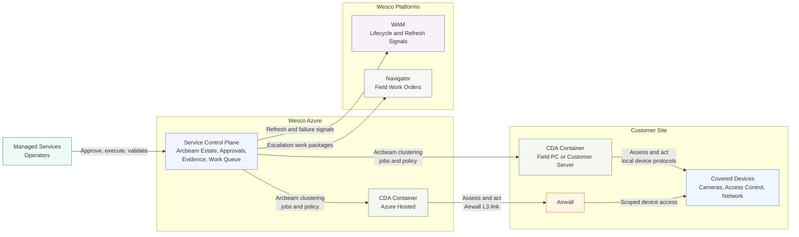
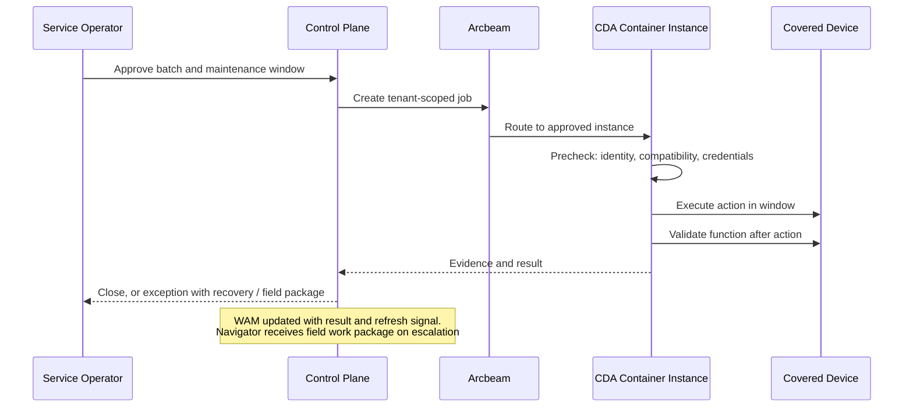

# Phase 2 Review — Corrections to Timeline and Architecture
Date: 2026-07-23 | Reviews: `CSS_Platforms_2027_Phase_2_Updated_Deep_Dive.md` (ChatGPT) | Author: Claude

## 1. Content Assessment — concur, with notes

The dossier is strong: evidence labels used honestly, pricing marked as assumption not benchmark, manufacturer qualification grounded in official sources, partner-first where breadth is expensive (Viakoo strongest for active remediation), K3s + Azure Arc + Flux for fleet management, and a well-reasoned MVP: **Connected Camera Assurance** — hygiene visibility as base tier, health/recovery as primary module, Axis-first controlled firmware, Hanwha qualifying in parallel, Mode 3 land / Mode 1 expand.

Verification status: the cited technical claims (Axis VAPIX firmware API with timed rollback, Hanwha HealthPro/SUNAPI, Cisco Catalyst Center SWIM and Meraki firmware APIs, K3s/Arc/Flux) are consistent with Claude's independent knowledge; the full citation-check pass is still pending in the Claude research track and should complete before the Sean brief cites any of them.

Challenges worth carrying forward:
1. The operational success thresholds (≥25% remote resolution, ≥15% truck-roll reduction) are assumptions presented with precision — keep them as *pilot hypotheses to calibrate*, not commitments.
2. The gate table implies formal Supplier Relations/Legal OEM outreach in early August — that conflicts with Darryl's 07-23 decision to defer formal outreach. Corrected below.
3. Naming: keep **Connected Device Assurance** as the umbrella brand; "Connected Camera Assurance" is the pilot scope name, not a new product name.

## 2. Timeline Correction (the dossier's dates are not realistic)

The dossier compresses OEM legal/technical qualification, two partner RFIs, credential architecture, liability review, security approval, pilot selection, and unit economics into 2026-08-07 → 08-28 — five weeks that also contain the pilot review (08-12), the Sean endorsement window (week of 08-17), the AOP deadline (08-31), the entroCIM Quest migration (09-01), and a key leader on leave through 08-11.

**The structural fix, not just a date fix: those gate actions are not pre-AOP homework — they are the content of the 90-day validation plan the AOP funds.** Presenting them as August deliverables would weaken the ask (if all of it can be done unfunded, why fund it?). The dossier's own §15 concedes this ("treated as Phase 3 conditions"). Corrected two-lane plan:

### Lane 1 — Pre-AOP (now → 08-31, unfunded, thin by design)
| Action | Owner | Target |
|---|---|---|
| Internal incident/truck-roll data pull (Module B economics) | Darryl sponsors; service/support teams | ~08-15 |
| Arcbeam capability conversation (clustering, provisioning readiness) | Darryl + Ron Snyder | ~08-08 |
| Pilot-candidate shortlist (names, not commitments) | Darryl + Sales | ~08-21 |
| Informal Axis sounding via account team (conversation, not qualification) | Darryl / product | Optional, ~08-21 |
| Partner RFI text drafted (SecuriThings, Viakoo) — sent post-funding or as exploratory early Sept | Claude drafts | ~08-21 |
| Claude research track: citation verification, partner terms scan, pricing comparables | Claude | ~08-05 |
| Checkpoint 2: MVP composition freeze | Darryl | ~08-14 |
| Sean brief + endorsement | Darryl | Week of 08-17 |
| AOP input submitted | Darryl | 08-31 |

### Lane 2 — Funded plan (what the AOP buys)
| Window | Content |
|---|---|
| Oct–Dec 2026 (90-day validation) | The dossier's gate actions: Axis/Hanwha formal qualification, partner RFIs and bounded trials, credential architecture, Airwall security approval, liability/insurance review, pilot contract, unit-economics validation |
| Q1 2027 | MVP build increment (container packaging, shared enablement core, Axis pods, hygiene visibility); pilot start |
| Q1–Q2 2027 | 16-week pilot (dossier's week structure is sound) |
| H2 2027 | Production decision, first paid production customers, second manufacturer activation, partner integration |

The dossier's 16-week pilot structure and stop conditions are kept unchanged; only their calendar position moves.

## 3. Architecture Diagrams (replacing dossier §7.1)

> **Superseded 2026-07-27:** the diagrams below predate the product decomposition (partner sensor + Base/Advanced Wesco tools, data-fidelity ladder) and the repositioning of containerization as deployment strategy. Current diagram: `CDA_Architecture_Executive.md` (solution structure view, overhauled 07-27). Retained here for record.

The dossier's single diagram has ~30 nodes, three duplicated site subgraphs, and unlabeled bidirectional arrows throughout — it violates the readability, directionality, and split thresholds of the Mermaid standard. Replaced with two companion diagrams per the standard's split rule.

### 3.1 Executive Overview — Connected Device Assurance

#### Intent
Show the product (one container, deploy-anywhere), the three delivery modes, the control plane, and the two enterprise integrations — readable in under a minute by a leadership audience.

#### Assumptions
- One CDA container node represents Modes 1 and 2 (Wesco field PC or customer server); the distinction is a hosting responsibility, not an architectural difference.
- Airwall also carries the management path to on-premises containers; omitted as a separate arrow for executive readability.
- Evidence/results flow back from containers to the control plane; shown one-directionally (control direction) for readability.

#### Validation Items
- Arcbeam clustering readiness for this pattern (Ron Snyder).
- Whether Mode 3 covers required camera/VMS functions over the Airwall link per dossier §7.6.

#### Exclusions
- Credential brokering, multi-tenancy, partner containers, fleet tooling — engineering detail, see dossier §7 and §9.

### 3.2 Controlled Action Flow (sequence)

#### Intent
Show how a single controlled action (e.g., a firmware update) flows through approval, execution, validation, and evidence — the liability-control story.

#### Assumptions
- Approval expiry, two-person control, and rollback branches omitted for readability; they exist in the dossier's approval model and failure-mode table.

## 4. Checkpoint 2 Status

Dossier recommendation: **Connected Camera Assurance** (hygiene visibility base + health/recovery primary + Axis firmware controlled action; Mode 3 land, Mode 1 expand; Hanwha qualifying). Claude concurs with the recommendation, conditional on the pre-AOP Lane 1 items above — none of which block the decision itself. Decision is Darryl's; record in `03_Decision_Log.md` when made.
