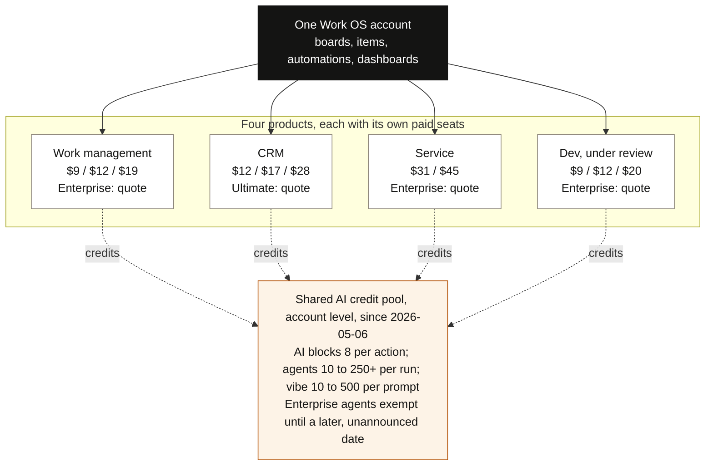

# Monday.com Company and Product Brief

::: {custom-style="Bottom Line"}
**Bottom line:** Monday.com is a financially sound vendor in the middle of the most disruptive year in its history, and the Wesco deployment Darryl Benson is inheriting sits on top of a platform whose commercial model, product focus and leadership bench are all changing at once. Wesco is on a three-year Enterprise contract, has already hardened the tenant, and has stopped native Monday.com AI on AI Council guidance. The practical risks are a renewal at which the vendor will push the account toward consumption pricing, a governance model that leadership itself says has not kept pace with growth from 144 to about 1,000 licenses in a year, and a DDP and USD/CRM integration path that has to be engineered around the vendor's API limits and Wesco's MuleSoft and WAB requirements.
:::

Prepared 2026-10-29 for Darryl Benson. Research basis: public sources as of 2026-10-29, the August 2026 Wesco deck, and a Microsoft 365 Copilot deep dive over the 24 months to 2026-10-29; the Elevate '26 items are secondhand reporting pending a vendor release.

## Summary

The vendor is healthy, the year has been turbulent, and the owner's job is strategic rather than administrative.

Financial and market standing:

- Revenue runs at a $1.4B annual rate and grew 22% in Q2 2026.
- Cash and securities total $1.07B with no disclosed debt.
- Named a Leader in Gartner's 2026 Collaborative Work Management Magic Quadrant for the fourth year running, positioned highest on both axes.

Disruption in the same twelve months:

- Cut 20% of its workforce.
- Withdrew its 2027 revenue target.
- Fell more than 80% below its peak by July before recovering; still roughly 70% below its 2025 high.
- Drew a securities class action.
- Replaced pure per-seat pricing with a seats-plus-AI-credits model that existing customers are being encouraged to opt into over "a couple of years."

What this means for Wesco:

- Wesco is on a three-year Monday.com Enterprise contract (TrackIt WAB deck, 2026). The executed agreement, renewal date and annual value were not found in Microsoft 365.
- Licenses grew from 144 at the start of 2026 to "850 or so" (Sean McCloskey) or "just over 1,000" (Chris Gazdic) by September 1, 2026; the August deck itemizes 962, half of them in Darryl's own CSS unit.
- The tenant is already hardened: tenant-level encryption, BYOK, file uploads disabled except for EECOL, two security risk assessments in 2026 for the TrackIt add-on.
- Native Monday.com AI is stopped: "Following AI Council guidance, we are no longer moving forward with Monday.com AI"; the pivot is a Copilot API integration.
- The platform is not at risk of disappearing.
- The incoming owner's job is less about keeping boards tidy and more about three decisions:
  - What Monday.com is the system of record for at Wesco. The stated architecture is USD/CRM as the sales front door and Monday.com as the services workflow and project execution layer.
  - Locking the commercial terms, with Procurement, before the vendor's transition narrows the room to negotiate.
  - Building the governance Sean McCloskey named as unfinished on September 1, 2026: use-case approval, adoption measurement, training, security, DDP migration.

## Company

### Financial Position

The numbers say Monday.com is healthy, with growth concentrated in the enterprise cohort.

| Measure | Value | Note |
|---|---|---|
| Revenue, Q2 2026 | $364.6M | Up 22% year over year |
| Non-GAAP operating margin, Q2 2026 | 17% | GAAP operating results roughly at break-even |
| Adjusted free cash flow, Q2 2026 | $52.3M | |
| Remaining performance obligations, Q2 2026 | $937M | Up 34%; customers are signing multi-year commitments faster than revenue is growing |
| Revenue, FY2025 | $1,232M | Up 27% |
| Revenue guidance, FY2026 | $1,466M to $1,474M | 19% to 20% growth |
| Revenue growth guidance, Q3 2026 | 16% to 17% | |
| Cash and securities | $853M cash plus $219M securities | $735M spent on buybacks in the first half of 2026; authorization now exhausted |

::: {custom-style="Source Note"}
**Source:** [monday.com IR, Q2 2026 release]; [monday.com IR, Q4/FY2025 release]; [SEC 6-K Exhibit 99.2]
:::

The enterprise cohort is the growth engine, while overall retention is sliding.

| Cohort or measure | Value | Change or guidance |
|---|---|---|
| Customers above $100K ARR, Q2 2026 | 2,019 | Up 37% |
| Customers above $500K ARR, Q2 2026 | 114 | Up 68% |
| Net dollar retention, enterprise cohorts | 115% | |
| Total customer base above ten users | | Up 6% |
| Overall net dollar retention, Q3 2025 | 111% | |
| Overall net dollar retention, Q2 2026 | 109% | Guided to about 108% by year-end |

::: {custom-style="Source Note"}
**Source:** [monday.com IR, Q2 2026 release]; [Q1 2026 call transcript]; the 108% year-end guide from [MarketBeat, Q2 2026 call summary]
:::

The deceleration is real and management now says so. Roughly 12% of NDR had come from 2024 price increases that have now lapped [Q1 2026 call transcript].

### Restructuring Timeline

Management is restructuring from strength rather than distress, but the transition brings turnover.

| Date | Event | Detail |
|---|---|---|
| 2026-02-09 | CFO withdrew the $1.8B 2027 revenue target set only six months earlier | Blamed market changes and AI; stock fell 21% in a day |
| 2026-07-22 | Co-CEOs cut about 620 to 630 employees, roughly 20% of the workforce | About 350 in Israel; annualized savings of about $100M |
| 2026-08-03 | Amended complaint filed in securities class action | Potter v. monday.com Ltd., Southern District of New York |
| October 2026 | Israeli press reported five senior managers leaving | VP of the AI Work Platform, two VPs of R&D and the VP of Product |
| 2026-10-28 | Stock closed at $97.82 | Up roughly 70% from its 52-week low of $57.50; still less than half its 52-week high of $210.49 and well below the $317 high of 2025 |
| 2026-11-09 | Q3 2026 results due | |

::: {custom-style="Source Note"}
**Source:** [CTech, 2026-02-10]; [Globes, 2026-07-22]; [MarketBeat, Q2 2026 call summary]; [Kessler Topaz case page]; [CTech, 2026-10-19]; [Gotrade MNDY page]
:::

- Executives said the SMB channel acquired through Google performance marketing would not recover soon because AI-generated search had damaged it, so the company would pivot to large enterprises [CTech, 2026-02-10].
- The co-CEOs called the layoff "the most painful decision we have made since the founding" [Globes, 2026-07-22]. They also said "the organization we built previously is not the organization that is suitable for the new AI era."
- The savings were mostly redirected to AI products. Margin guidance went up from 11% to 12% in February to about 16% in August, so 2026 profitability improvement is cost-driven rather than revenue-driven [MarketBeat, Q2 2026 call summary].
- The class action alleges that the no-touch channel erosion was misdescribed as stabilized and that the 2027 target lacked a reasonable basis; the company calls the claims without merit [Kessler Topaz case page].
- The October departures come as the company removes a management layer and encourages managers to resign rather than run another formal layoff [CTech, 2026-10-19].
- An independent analyst's read that the restructuring is "not a distress signal, it is a deliberate reset" is consistent with the cash position and enterprise growth [UC Today, 2026-07-29]. The practical consequence for a customer is account-team and product-management turnover during the transition.

### Corporate Profile

- Led by co-founders and co-CEOs Roy Mann and Eran Zinman, with CFO Eliran Glazer and Chief Product and Technology Officer Daniel Lereya [FY2025 Form 20-F].
- Headquartered in Tel Aviv; 3,155 employees at year-end 2025; refreshed its CRO, CMO and Chief Customer Officer in 2025 [FY2025 Form 20-F].
- The product began as an internal tool at Wix under the name dapulse, and the company went public on Nasdaq in June 2021 at a valuation above $8B [Entrée Capital].
- Growth has been almost entirely organic: goodwill was zero at year-end 2025 [SEC 6-K Exhibit 99.2].
- The only disclosed acquisition since is the $14.1M cash purchase of OneAI in May 2026, which became the Harmony voice-sales product launched October 19, 2026 [SEC 6-K Exhibit 99.2].

## Product and Pricing

### Products and Seat Model

Monday.com sells four separately priced products on one shared platform, and seats are licensed per product.

::: {custom-style="Image Caption"}
How the license model is built: one account, four separately seated products (list prices per seat per month, annual billing, observed 2026-10-29), and a shared AI credit pool underneath all of them.
:::

- The four products are work management, CRM, dev and service; they can run under the same account with connectivity between them [monday.com support, Introduction to products].
- The product non-member definition implies that a user who needs edit rights in two products consumes two paid seats [monday.com support, User types].

| Seat type | Cost | Rights and limits |
|---|---|---|
| Member | Paid seat | Edit rights |
| Viewer | Free and unlimited on every plan | Cannot post updates, own boards or use the API |
| Guest (external domain) | Free and unlimited on Pro and Enterprise | |
| Product non-member | Included | Viewer-level access in products the user is not licensed for |

::: {custom-style="Source Note"}
**Source:** [monday.com support, User types]
:::

- Converting occasional contributors to viewers is the main cost lever for a 962-license estate.
- Reviewers complain that viewers cannot comment, which pushes teams to over-license; the three-seat minimum and bucketed billing are a recurring source of frustration [Capterra reviews].

### List Pricing

Work management list prices observed on October 29, 2026, on annual billing:

| Plan | Per seat per month | Note |
|---|---|---|
| Basic | $9 | Plans start at three users |
| Standard | $12 | |
| Pro | $19 | |
| Enterprise | Quote only | Quotes are offered above 40 users; Enterprise is quote only |

::: {custom-style="Source Note"}
**Source:** [monday.com pricing page]
:::

- Third-party contract data puts the average Monday.com enterprise contract for companies above 1,000 employees at roughly $203K per year. That is higher than Smartsheet, Atlassian, Wrike or Asana in the same sample, which likely reflects broader deployments rather than higher unit prices [SpendHound].

### Enterprise Tier and Guardian

Enterprise is the tier that matters for Wesco because it is the only tier with the controls a large US company needs.

- Enterprise includes SAML SSO, SCIM provisioning, the audit log and Audit Log API, session controls, IP allowlisting, panic mode, HIPAA mode, account-wide permissions, custom roles and a 99.9% uptime SLA [monday.com support, Enterprise security and permissions].
- Tenant-level encryption, BYOK, DLP scanning and multiple SSO providers sit in a separately purchased Guardian add-on on top of Enterprise [HowToHarden guide].
- Wesco has implemented tenant-level encryption and BYOK on AWS, which a third-party hardening guide places in the Guardian add-on, so the account is probably on Enterprise plus Guardian for at least the managed tenant. Neither the contract nor the Microsoft 365 search confirms Guardian.
- Enterprise is the only tier where additional automation and integration actions can be purchased at all [monday.com support, Automation and integration actions].

| Capability | Pro | Enterprise |
|---|---|---|
| List price (annual, per seat per month) | $19 | Quote only |
| Items per board | 10,000 | 100,000 |
| Automation and integration actions per month | 25,000 each | 250,000 each, extra purchasable |
| API calls per day | 10,000 | 25,000 |
| Boards per dashboard | 20 | 50 |
| SAML SSO, SCIM, audit log, session and IP controls | No | Yes |
| Tenant encryption, BYOK, DLP, multi-SSO | No | Guardian add-on |
| AI credits included per month | 3,000 | Custom |
| Uptime SLA | None | 99.9% |

::: {custom-style="Source Note"}
**Source:** [monday.com pricing page]; [developer.monday.com, rate limits]; [monday.com support, Administration]; [monday.com support, Automation and integration actions]
:::

### Security, Residency and Certifications

Wesco's account sits in the US and the vendor's certification set is broad, with one notable gap.

- Data residency is fixed at account creation and cannot be moved; a US account lives in AWS Northern Virginia with account metadata always in the US [monday.com support, Data residency].
- Certifications include ISO 27001, 27017, 27018, 27701, SOC 1 and SOC 2 Type II, SOC 3, GDPR, CCPA and HIPAA; not PCI-DSS, since billing runs through a certified third-party processor [monday.com Trust Center FAQs].
- The vendor states customer data is not used to train AI models [monday.com Trust Center privacy overview].
- No FedRAMP authorization was found; the Trust Center makes no government-authorization statement [monday.com Trust Center FAQs].

### Known Weaknesses

The weaknesses an owner will hear about are structural rather than bugs.

- Across more than 6,000 Capterra reviews rating the product 4.6 of 5, the recurring complaints are [Capterra reviews]:
  - Seat minimums and cost at scale.
  - Reporting across multiple boards that "still takes more workarounds than it should."
  - Restrictive automation limits.
  - Slow dashboards.
  - Notification overload.
  - A steep learning curve for advanced setup.
- These map to the board-centric data model, action metering and item caps, so they recur regardless of tier. Enterprise relieves the caps but not the cross-board reporting model.
- Account-level usage reporting is thin, limited to a "Usage stats" view, AI credit downloads and audit log exports [monday.com support, Administration]. Adoption analytics across 962 licenses will require Audit Log API extraction or a SaaS-management tool.

## AI and the Credit Model

### The AI Work Platform Pivot

On May 6, 2026 Monday.com repositioned itself from a "work management platform" to an "AI Work Platform."

| Date | Announcement |
|---|---|
| May 2026 | Acquired OneAI for $14.1M in cash |
| 2026-05-06 | AI Work Platform repositioning: native agents shipped to all customers, one-click connectors to Claude, ChatGPT and Microsoft 365 Copilot, and an AI Platform Gateway for access to multiple LLMs |
| 2026-05-06 | Seats-plus-AI-credits pricing takes effect for customers joining on or after this date |
| 2026-09-29 | Elevate '26 program announced: every attendee builds an agent; first Done Awards |
| 2026-10-19 | Harmony voice-sales product launched, built from OneAI |
| 2026-10-28 | "monday Frontier" managed-services offering announced at Elevate '26 |
| January 2027 (proposed) | API change that would limit activity-log queries to 90 days |

::: {custom-style="Source Note"}
**Source:** [SEC 6-K Exhibit 99.2]; [monday.com IR, 2026-05-06]; [monday.com support, AI pricing model]; [monday.com IR, 2026-09-29]; [MarketBeat, 2026-10-28]; [UC Today, Oct 2026]
:::

- The four AI capabilities are [monday.com IR, Q4/FY2025 release]:
  - Sidekick, an assistant with context across boards and docs.
  - Vibe, a prompt-driven no-code app builder.
  - Agents, configurable workers that monitor boards and act within set permissions.
  - AI workflows.
- AI product ARR doubled from Q1 to Q2 2026 and represented 17% of net new ARR [monday.com IR, Q2 2026 release].
- Management says enterprise agent adoption is running about three times SMB on a relative basis [MarketBeat, 2026-10-28].

### Credit Pricing

The commercial change is the part that lands on Darryl's desk.

- Customers who joined on or after May 6, 2026 must buy seats plus a monthly pool of AI credits [monday.com support, AI pricing model].
- Earlier customers are not auto-migrated and opt in through their account team; management says existing customers will move "over a couple of years" with incentives [monday.com support, AI pricing model; Q1 2026 call transcript].

| AI action | Credits consumed |
|---|---|
| AI block action or AI workflow run | 8 |
| AI Notetaker | 120 per hour |
| Agent run | Roughly 10 to 250+, depending on the model chosen |
| Vibe message | 10 to 500, depending on the model chosen |
| Sidekick | Free today, "but will be monetized in the future" |
| Enterprise agent usage | Exempt now; "will transition to credit-based usage at a later date" that has not been announced |

::: {custom-style="Source Note"}
**Source:** [monday.com support, AI pricing model]
:::

- Enterprise credit volumes and the price per additional bucket are not published; one trade analysis cites roughly $0.01 per credit on annual billing [UC Today, Oct 2026].
- Pricing trackers recorded Monday.com folding an AI-credit line item into list price in Q2 2026 and discounting it back out as a "special offer" [PricingSaaS, 2026Q2]. That is the kind of item that disappears at renewal.

### Vibe and Agents

Vibe deserves specific attention because of what it is and is not.

- Vibe generates board views, item views, dashboard widgets and full-page apps over up to 5 boards (20 on the Growth add-on) from a plain-language prompt, and runs on Monday's infrastructure [monday.com support, Get started with vibe].
- It charges credits per build prompt and 8 credits per runtime AI call [Till Freitag, vibe pricing].

| Vibe app allotment | Live apps | Price |
|---|---|---|
| Included on Enterprise | 5 | Included |
| Add-on pack | 10 | $100 per month |
| Add-on pack | 25 | $250 per month |

::: {custom-style="Source Note"}
**Source:** [monday.com support, Get started with vibe]; [Till Freitag, vibe pricing]
:::

- There is no documented code export, no external-user access and no path from a vibe app to a self-hosted product. Vibe is a departmental tool builder bound to the account's boards, not a productization path.
- Agents are built in a no-code builder, scoped to specific boards with read or read-write access, cannot delete data, log their actions and reasoning, and require admin permission to create [monday.com support, AI Agents].
- The Agents API is still in the unstable "dev" channel [developer.monday.com, Agents API].

::: {custom-style="Risk"}
**Risk:** Agents and vibe apps turn every licensed user into a potential application builder. Analysts ahead of Elevate warned that decentralized app and agent creation produces inconsistent security and accountability without central governance [SiliconANGLE, 2026-10-20]. A proposed January 2027 API change would limit activity-log queries to 90 days, complicating audits of older agent decisions [UC Today, Oct 2026]. The governance tools exist, but only if someone owns them.
:::

### Elevate '26

Elevate '26, which Brittany Pearce and John Magee are attending at the Javits Center on October 28 and 29, is built around this shift.

- Every attendee "will have the opportunity to build" an agent [monday.com IR, 2026-09-29], and there are repeated sessions on AI governance and AI cost management [Elevate 2026 agenda].
- The first Done Awards judge customer-built workflows, agents and vibe apps on time saved, errors reduced and output scaled [Elevate 2026 agenda].
- The one substantive announcement reported from the event so far is "monday Frontier," a managed-services offering that pairs deployment engineers with customers to implement the platform and its AI [MarketBeat, 2026-10-28]. It is to scale through 2027 with a focus on mid-market and enterprise.
- Co-CEO Zinman also said "it's no longer just a seats model, it's a hybrid model" and that packaging may evolve toward outcome-based pricing [MarketBeat, 2026-10-28].
- This is secondhand reporting of an investor Q&A. Monday.com had published no press release from the event as of October 29, and fuller coverage will land in the following days.

## Competitive Position

### Analyst Standing

Monday.com is a Gartner Leader for cross-functional work, not a PPM or Jira replacement.

- Leader in the 2026 Gartner Magic Quadrant for Collaborative Work Management for the fourth consecutive year, positioned furthest on Completeness of Vision and highest on Ability to Execute [monday.com IR, 2026-10-08].
- In the companion Critical Capabilities report it claims the top score in Work Planning and Execution, Intake, Triage and Service Operations, and Product Management Operations [monday.com IR, 2026-10-08]. It claims top-three placement in all seven use cases.
- Also a Leader in Gartner's 2025 Marketing Work Management quadrant, which is relevant given Marketing holds 30% of Wesco's licenses [monday.com analyst recognitions].
- Forrester's Q2 2025 Wave concluded that collaborative work management tools "are not yet full replacements for traditional PPM systems" [Forrester blog, Q2 2025 Wave]. That applies particularly where enterprise planning needs stronger data models, governance and scalability.
- Monday.com publishes its Gartner placements but not its Forrester placement, which suggests it was not a Leader in that Wave [monday.com analyst recognitions].

### Stack Position at Wesco

The boundaries of that strength line up almost exactly with the stack position Wesco has already assigned it.

| Vendor | Analyst standing | Where it wins | Wesco role |
|---|---|---|---|
| Monday.com | Leader, 2026 Gartner Collaborative Work Management (fourth year); Leader, 2025 Gartner Marketing Work Management; only "recognized" in 2026 Gartner Adaptive Project Management and Reporting | Visual management, ease of use, marketing and creative workflows | Task and workflow management |
| Planview | Leader, 2026 Gartner Adaptive Project Management and Reporting, highest score in all four use cases | Portfolio | Portfolio |
| Jira (Atlassian) | Leader, 2026 Gartner Collaborative Work Management | Agile, granular issue tracking, developer reporting | IT software development |
| Smartsheet, Wrike | Leaders, 2026 Gartner Collaborative Work Management | | Not assigned |

::: {custom-style="Source Note"}
**Source:** [monday.com IR, 2026-10-08]; [Smartsheet press release]; [Planview newsroom]; [monday.com analyst recognitions]; [The Digital Project Manager]
:::

- Wesco's June 2025 evaluation landed on Planview for portfolio, Jira for IT software development and Monday.com for task and workflow management, which is the configuration the analyst evidence supports.
- The owner's challenge is holding that line as Monday.com pushes adjacent products. Management has given CRM and Service dedicated roadmaps while openly reconsidering monday dev, so adjacent products should not be adopted without direct roadmap confirmation [MarketBeat, Q2 2026 call summary].

### Microsoft Planner

The Microsoft question will come up because Wesco is standardized on Microsoft 365, and the honest comparison is not "Planner is free."

| Microsoft option | Per user per month | Note |
|---|---|---|
| Planner basic | Included with M365 | Can absorb simple team task lists |
| Planner Plan 1 | $10 | |
| Planner and Project Plan 3 | $30 | |
| Copilot license | $30 on top | Required for all AI features |

::: {custom-style="Source Note"}
**Source:** [PPM Express]
:::

- Premium portfolios are a monitoring view rather than governance, reporting stops at the individual plan, and portfolios cannot connect to Jira or Azure DevOps [PPM Express].
- Microsoft was not among the eleven vendors in the Forrester Wave [Forrester blog, Q2 2025 Wave], and no independent case of a large enterprise replacing Monday.com or Asana with Planner was found in this research.
- Monday.com's own posture is to interoperate with Copilot rather than compete with it. It offers a Copilot connector and a hosted MCP server that lists Microsoft Copilot Agent and Copilot Studio as native integrations [developer.monday.com, MCP overview].
- The exposure for Wesco is segmented. Any pocket of the 962 licenses used only for team-level task tracking is replaceable by free Planner; intake, cross-functional workflow, dashboards and governed automation are where Planner premium still falls short.

### Consolidation Pressure

Consolidation pressure is the broader backdrop, and vendor momentum favors Monday.com.

| Vendor | Revenue growth | Net dollar retention |
|---|---|---|
| Monday.com | 22% (Q2 2026) | 115% (enterprise cohorts) |
| Asana | 10% | 97% |

::: {custom-style="Source Note"}
**Source:** [monday.com IR, Q2 2026 release]; [Asana Q2 FY27 results]
:::

- Enterprises average 9.9 project-management applications each, making the category one of the most redundant in the SaaS estate. The keep-or-cut criteria that matter are adoption, integration with core systems and non-duplicated business fit [Zylo].
- Asana's 97% net retention means its installed base is contracting [Asana Q2 FY27 results].
- The AI seat-compression thesis that has hit software stocks is so far a pricing-model story more than an observed retention story at Monday.com. A Bain survey of more than 30 vendors found 65% have adopted hybrid seat-plus-usage pricing and none have moved off seats entirely [UC Today, 2026-05-12].

## Extensibility and Microsoft 365

### API and Hosting

For a product executive whose team builds and integrates software, the developer surface is adequate for integration but not for hosting anything substantial.

| Capability | Enterprise limit |
|---|---|
| API calls per day | 25,000; all requests count, including failures |
| Queries per minute | 5,000 |
| Concurrent requests | 250 |
| Webhook event types | 21, with 30 minutes of retries |
| monday code hosting, per instance | 1 vCPU, 512 MiB, 300-second timeout |
| monday code instances | Up to 10 |
| Private apps per account | 10 |

::: {custom-style="Source Note"}
**Source:** [developer.monday.com, rate limits]; [developer.monday.com, webhooks]; [developer.monday.com, quotas and limits]
:::

- The GraphQL API is versioned quarterly with three versions live in parallel. Each is stable for at least six months and deprecated on six months' notice, so an owner must bump the version header at least twice a year [developer.monday.com, API versioning].
- The monday code limits size it for webhook handlers and column transforms rather than core services [developer.monday.com, quotas and limits]. A team that runs its own backend would use Monday.com as the front end and keep compute elsewhere.
- Monday.com also runs a hosted MCP server at no extra cost that lets Claude, Copilot, ChatGPT and other clients act on boards within the user's own permissions [monday.com blog, monday and Claude].

### Microsoft Identity and Power Platform

Microsoft identity integration is mature; the gap is on the Power Platform side.

- Entra ID handles SAML SSO and SCIM provisioning of users and teams, with an Entra group mapping to a Monday team [monday.com support, SCIM with Azure AD].
- Teams, Outlook and OneDrive integrations are native [BusinessWire, 2023-05-24].
- Power BI and Power Automate connectivity comes through third-party connectors such as Tempo, CData and Coupler rather than a Monday-published native connector.
- The Tempo connector documentation warns that exports are subject to Monday's API limits [Tempo help, API rate limits]. It cites a risk of incomplete data, failed refreshes and timeouts on large boards with mirrored and connected columns.
- The third-party connector category also reinforces that no Monday-native account-level export or warehouse sync feature surfaced in this research. Data portability depends on per-board Excel export, the API and third-party backup products.

### DDP Integration

The Power Platform gap and the API cap bear directly on Wesco's planned integration with DDP for customer requests needing professional services.

::: {custom-style="Risk"}
**Risk:** The 25,000 daily API call cap must be shared between DDP sync, any Power BI refreshes and every marketplace app, since those all draw on the same account budget. Power BI reaches Monday.com only through third-party connectors subject to those limits. The practical pattern is scheduled extraction through a connector or a self-written API job into the warehouse, then reporting on the warehouse, rather than Power BI querying Monday.com directly.
:::

## What Wesco's Own Records Show

A one-time Copilot deep dive over Microsoft 365 (email, Teams, transcripts, SharePoint, intranet, Viva Engage; October 2024 to October 2026) adds the internal facts the public research could not. Planner, To Do and OneNote could not be searched as complete repositories.

### Contract

- Wesco is leveraging an existing "Monday.com Enterprise investment" and is "currently on a 3-year contract" [TrackIt WAB deck, Graham Russ, 2026].
- A capacity-planning add-on (TrackIt, also written Tracket) was quoted at "$3.25/user x 12 months x 250 users = $9,750 annually," prorated to "about $26,812.50 total" for the contract remainder [TrackIt WAB deck].
- Inference, not a found date: $26,812.50 divided by $9,750 is 2.75 years, so about 2.75 years remained when the deck was written in May or June 2026. That places the contract start around the first quarter of 2026 and the renewal around early 2029. Confirm against the order form.
- Not found: the executed agreement, order form, renewal date, notice period, annual value, per-seat rate, Guardian, AI credits, discounts, the Wesco contract owner, or the vendor CSM.

### Licenses and Access

| Count | Source | Date |
|---|---|---|
| 144 "at the beginning of the year" | Sean McCloskey, Agile Staff transcript | 2026-09-01 |
| "850 or so" | Sean McCloskey, same meeting | 2026-09-01 |
| "Just over 1000" | Chris Gazdic, correcting Sean, same meeting | 2026-09-01 |
| 962 (CSS 485, Marketing 279, EES 168, EECOL 30) | August Deep Dive deck | August 2026 |

::: {custom-style="Source Note"}
**Source:** Copilot deep dive, 2026-10-29. The three verbal counts are reported, not reconciled; 962 is the sum of the deck's four figures. No member, viewer, guest or admin census was found.
:::

- Access runs through an SOP written by Brittany Pearce (2025-12-17): requests through AssistMe, SSO, 24 to 48 hours to provision, a Monday.com_Viewer role for read-only access, and a "Business Use Case for approving Monday.com for your team" before a new group gets seats [Monday.com SOP for Access].

### Ownership

- The August deck names Christopher Gazdic as Product Executive for Monday.com, with all SBUs impacted [August Deep Dive deck].
- Sean McCloskey, 2026-09-01: "Brittany has been the lead there, historically reporting to Chris." He discussed moving her into Sridhar Loke's commercialization organization and tied the role to use cases, adoption, governance, training and security [Agile Staff transcript, 2026-09-01].
- John Magee: "part project manager, but part developer" for CSS implementations, CSS-only and CSS-funded [Agile Staff transcript, 2026-09-01]. The TrackIt WAB deck names Brittany as Product/Application owner and both as IT/technical owners.
- Sean's own list of what has not matured with the platform: governance for approving use cases, adoption measurement, training, security, DDP migration [Agile Staff transcript, 2026-09-01].
- No Microsoft 365 artifact records the handoff to Darryl.

### Security Already Done

- Tenant-level encryption and BYOK on AWS: WAB approved September 2025, implemented October 2025; transition to Wesco-managed keys targeted for end of August 2026, completion not evidenced [August Deep Dive deck].
- File uploads disabled 2026-08-17 for all teams except EECOL; CSS documents moved to SharePoint; browser isolation under evaluation; Learning and Development licenses to consolidate into the managed tenant with MFA, completion not evidenced [August Deep Dive deck].
- TrackIt: Vendor Security Risk Assessment 2026-05-29, Cyber Solution SRA 2026-06-22; Risk 703 (customer guest accounts and local IDs, LOW, MFA, no exception needed) and Risk 285 (authentication for ClockShark, Zapier and Google Drive) [TrackIt WAB deck].
- Data on the platform is classified Confidential: customer identifiers, sales and margin, project descriptions, milestones, status [TrackIt WAB deck].
- Not found: SCIM configuration, Entra detail, SIEM export, DLP enforcement, data-residency region.

### AI: Already Decided

- "Following AI Council guidance, we are no longer moving forward with Monday.com AI," tied to Monday.com's inability at the time to disable file upload. The pivot is a "Copilot API integration" so sales teams reach project updates through Wesco Copilot without additional Monday.com licenses [August Deep Dive deck].
- This sets the governance risk the public research raised to one side for now. The AI Council position is a decision, not a technical control: whether native AI is disabled in the tenant has not been evidenced, and the reason given for the decision (file upload could not be disabled) was addressed on 2026-08-17, so the position may be revisited. What remains live is the vendor's credit model at renewal, and whether the Copilot route is built.

### Integrations

- As of February 2026 the only API connection, by Kayla Steward's account, was SharePoint file storage [Kayla Steward, email, 2026-02-09].
- A USD/CRM opportunity push-pull needs solution architecture, requirements with CRM and Solution Architects, the MuleSoft integration pattern, and DEV and production WAB approval [Dhiraj Ranasaria, email, 2026-02-11].
- Sean McCloskey, 2026-02-12: "No DDP release planned" for Monday.com in 2026; absent a compelling case, wait until 2027. The August deck then states DDP integration as the direction, so the intent moved during the year [email, 2026-02-12; August Deep Dive deck].
- Nothing found for Power BI, Power Automate, Jira, Planview or ServiceNow integrations, other than AssistMe for access requests.

### How It Is Used

- Use-case catalog: resource and capacity planning, automated workflow and status, task and work management, service-intake forms, Marketing (Wrike replacement), sales-pipeline management, project management [August Deep Dive deck].
- Marketing: "All Marketing Production requests must be submitted via monday.com forms"; email and Teams requests are not accepted [Corpmarketing intranet, Marketing-Communications page].
- The Marketing intranet page links a Marketing Production Workspace, a SharePoint library of Monday.com platform tutorials, login instructions, forms for campaigns and deliverables, images and supplier logos (Brandfolder), technical publications, Canva templates and external-communications approval, and a Report Issues form [Corpmarketing intranet, Marketing-Communications page]. Marketing is the most mature, process-enforced use found.
- Technical Services: TrackIt for time and capacity visibility across "140+ globally distributed engineers" [TrackIt WAB deck].
- Strategic framing: a "Foundational workflow platform supporting Technical Services and Supply Chain Services"; USD/CRM is the sales front door and Monday.com the "services workflow and project execution layer" [CSS Digital Products Strategic Update].

### History

Wesco's own record of the platform runs from the June 2025 evaluation to the September 2026 leadership discussion.

- 2025-06: nine-platform evaluation; Monday.com assigned task and workflow management.
- 2025-09 to 2025-10: WAB approves tenant-level encryption and BYOK; both implemented in October.
- 2025-12-17: access SOP (AssistMe, SSO, business use case for new teams).
- 2026-02: USD/CRM integration request; Solution Design requires the MuleSoft pattern and WAB; no 2026 DDP release planned.
- 2026-05 to 2026-06: TrackIt security risk assessments; the WAB deck references the three-year Enterprise contract.
- 2026-08-17: file uploads disabled except EECOL; AI Council stops Monday.com AI; DDP integration stated as the direction.
- 2026-09-01: Sean McCloskey: licenses 144 to about 1,000; governance, adoption, training and security unfinished.
- 2026-10-29: Sean adds Monday.com to Darryl's portfolio, verbally.

### What the Deep Dive Could Not Find

| Gap | Where it should be | Who can close it |
|---|---|---|
| Executed contract, order form, amendments; renewal date, notice period, annual value, per-seat rate, Guardian, AI credits | Procurement or the vendor account team | Procurement; Brittany Pearce |
| Authoritative license census versus purchased seats; member, viewer, guest and admin counts | Monday.com admin console | Brittany Pearce; John Magee |
| Vendor account executive or CSM | Vendor | Brittany Pearce |
| Completion of the Wesco-managed BYOK transition and the L and D tenant consolidation | Security; the admin team | Brittany Pearce; Security |
| SCIM and Entra configuration; SIEM or audit-log architecture; DLP; data residency | Identity and Security | Security |
| Inventory of boards, workspaces, automations and integrations by business unit | Monday.com admin console | Brittany Pearce; John Magee |
| A decision record of the product-executive handoff | Sean McCloskey | Sean McCloskey; Chris Gazdic |

::: {custom-style="Source Note"}
**Source:** Copilot deep dive, 2026-10-29, "Material diligence gaps." Planner, To Do and OneNote could not be searched as complete repositories; Viva Engage returned no substantive content.
:::

## Ownership at Wesco

### Governance Model

Monday.com's own guidance frames governance as an account-admin job with five actions, and Wesco's security program is already ahead of most of it.

- Governance "is usually managed by account admins, typically IT or teams central to the organization" [monday.com, Governing your account]. The five actions are structure, permissions, user management, housekeeping and communication, with a dedicated CSM behind an Enterprise account.
- The secure-configuration checklist adds [monday.com support, secure configuration checklist]:
  - SAML, SCIM, required 2FA, session duration and IP allow-listing.
  - Keeping admins to "the absolute minimum."
  - Restricting who can set up integrations.
  - Feeding the Audit Log API to a SIEM.
- For AI, the checklist recommends disabling AI at the workspace level for sensitive data rather than at the account level [monday.com support, secure configuration checklist].
- Wesco already has tenant-level encryption, BYOK, file uploads disabled for every group except EECOL, and the Learning and Development licenses being consolidated into the managed tenant. The owner inherits a hardened account rather than a greenfield one.
- Wesco has stopped native Monday.com AI on AI Council guidance, so the application-governance function the vendor's 2026 shift would otherwise require (who may build agents and vibe apps, approval points, log retention, credit budgets with the 80% and 100% alerts Monday provides [monday.com support, AI pricing model]) is needed only if that position changes. The governance Sean McCloskey named as unfinished on 2026-09-01 is the live list: use-case approval, adoption measurement, training, security, DDP migration.

### Implementation Lessons

The failure mode to prevent is well documented by implementation partners.

- Typical decay is accumulation of unused and duplicate boards, inconsistent naming that breaks cross-board reporting, automations that cause notification storms, and data silos between departments [Xtivia blog].
- The remedy is a process-to-board audit, naming conventions, standard templates and permission protocols [Xtivia blog].
- Hitachi Construction Machinery's rollout to 3,500 users saves a reported 23,300 hours a year. It ran old and new tools in parallel for about two years because some staff resisted, which is the cautionary data point on forced migration [monday.com customer story, Hitachi].
- No published Monday.com customer story exists for an electrical or industrial distributor at Wesco's scale. The closest analogs on the Elevate '26 agenda are Dorman Products in aftermarket parts, Mister Car Wash's centralized field maintenance hub, and contractor Black & McDonald [Elevate 2026 agenda].
- No public trace of Wesco's deployment was found, which is consistent with an internal departmental rollout.

### Commercial Terms

On commercial terms, the renewal is where the next twelve months are decided.

- Enterprise pricing is quote-only, and multi-year terms earn larger discounts [Vertice].
- Buying guides advise removing auto-renewal, negotiating notice periods, timing talks to quarter-end and asking for implementation fees to be waived [Vertice; Costbench].
- With NDR sliding and management openly dependent on enterprise expansion, a large customer negotiating a multi-year deal in late 2026 likely holds a favorable position. Vendors mid-transition tend to offer credit caps and consumption guarantees that narrow once the model stabilizes [UC Today, 2026-05-12].
- Monday.com's stated push to scale Frontier and partner services through 2027 suggests implementation help is a negotiable inclusion rather than a separate purchase.

::: {custom-style="Risk"}
**Risk:** The 2026-specific renewal pitfalls are being migrated to seats-plus-credits at renewal without a cap, guarantee or rollover; losing the Enterprise agent-credit exemption at an unannounced date; Sidekick monetization arriving as a new line; and the "special offer" discount on the AI line expiring. The contract will be moved to consumption pricing at some point, and the timing and terms of that move should be Wesco's choice, not the vendor's default.
:::

### Implications for the Incoming Owner

The platform is a safe asset to own; vendor viability is not the concern. The concern is drift in three places.

- Commercial drift: the move to consumption pricing is coming, and Wesco should set its timing and terms. With a three-year contract that appears to run to about early 2029, the near-term exposure is the add-on and expansion quotes (TrackIt, further seats) rather than the base renewal; confirm the dates.
- Scope drift: Monday.com's analyst standing supports it as the system of record for cross-functional intake, workflow and departmental execution, and nothing more. Wesco's own architecture statement agrees: USD/CRM is the sales front door, Monday.com the services execution layer. Defend that against Planner from below and CRM, Service and portfolio ambitions from the side.
- Governance drift: licenses grew from 144 to about 1,000 in 2026 on the counts reported and Sean McCloskey has said governance, adoption measurement, training and security did not keep pace. The native AI question is closed for now by the AI Council; the open ones are use-case approval and measurement.

Ownership of a 962-license platform where half the seats sit in CSS also gives Darryl a direct line of sight into how his own business unit works. That is an opportunity for the DDP integration and for CSS process standardization that a platform owner outside the unit would not have.

## First 90 Days

First-90-day questions:

1. What is the commercial agreement: the order form behind the three-year Enterprise contract, its start and renewal dates, notice period, annual cost, whether Guardian is included, and whether the account is on legacy seat pricing or has opted into the May 2026 seats-plus-credits model. Microsoft 365 holds references to the contract but not the contract.
2. Which products are licensed (work management only, or CRM, dev or service as well), and what is the member, viewer and guest mix across the licenses by group, reconciling the deck's 962 with the "just over 1,000" stated on September 1.
3. What does actual usage look like: active users by group, boards, automation and integration action consumption against the monthly ceiling, API calls per day, and whether any group is near a hard limit.
4. Whether the AI Council position ("no longer moving forward with Monday.com AI") still holds, what the Copilot API integration design is and who owns it, and whether any Sidekick, agent or vibe usage exists in the tenant despite the position.
5. Who are the account admins, how many are there, which custom roles exist, is the Audit Log API feeding a SIEM, and is SCIM live against Entra ID.
6. What is the status of the BYOK transition to Wesco-managed keys that was targeted for the end of August 2026, and of the browser-isolation evaluation.
7. What is the DDP and USD/CRM integration design: direction of sync, volume, the MuleSoft pattern and WAB path Solution Design required in February 2026, and whether it has been sized against the 25,000 daily API call cap shared with every other integration and app.
8. Where does each of the four groups use the platform in a way that Planner basic could not replace, and where is it only a task list.
9. What is EECOL's path off file uploads for customer document management, and who owns that decision.
10. What did monday.com's account team say about Frontier, the AI Transformation Package promotional rate, and the date Enterprise agent usage begins consuming credits.
11. Whether Brittany Pearce and John Magee move into the organization or into Sridhar Loke's commercialization organization as Sean McCloskey discussed on September 1, what their current time allocation to the platform is, and who is the CSM on the account.
12. What the Q3 results on November 9 say about NDR, enterprise net adds and the dev product's future, since those shape renewal leverage and roadmap risk.

## Questions for the Owners

Questions for Brittany Pearce and John Magee when they return from Elevate:

1. What was announced on the main stage beyond Frontier, and did anything change on pricing, packaging, Enterprise credit allotments or the agent-credit exemption.
2. Which governance sessions did they attend, and what AI governance and cost management practices did monday.com and peer customers recommend.
3. What did they build in the agent-building session offered to every attendee, and is anything live in the Wesco tenant given the AI Council position.
4. Did they meet the Wesco account team or CSM, and what was said about the renewal, Frontier and the AI Transformation Package.
5. Which customer sessions were closest to Wesco's situation (Dorman, Mister Car Wash, Black & McDonald, Iron Mountain PMO, Plante Moran's enterprise scaling) and what was transferable.
6. What is their view of where each of the four groups genuinely depends on the platform, and where adoption is thin.
7. Did anything at the event bear on the DDP integration, the Power BI reporting path, or the EECOL file-upload question.
8. What were the Done Awards winners doing, as a benchmark for what monday.com considers best-in-class use.

## Conclusion

The research reframes the assignment. On the surface, Darryl is taking over a departmental task tool with about a thousand seats. In practice he is taking over a platform that grew from 144 to about 1,000 licenses in a year, on a three-year Enterprise contract, whose vendor is turning it into a consumption-priced AI application platform. Its vendor is restructuring its business, its pricing and its leadership bench in the same year, and can be expected to use Wesco's renewal to move the account onto its new model. The asymmetry runs in Wesco's favor for the moment. The vendor needs enterprise expansion more than Wesco needs any single feature. The November 9 results and December quarter-end create a natural window for the add-on and expansion quotes that are live now, and for any early restructuring of the base agreement, if the contract dates confirm what the WAB quote implies. Wesco's largely executed security program removes the usual reason an enterprise owner spends the first year on hygiene instead of strategy.

The decision that matters most is not whether to keep Monday.com but what it is allowed to be the system of record for. Held to intake, cross-functional workflow and departmental execution, with Planview and Jira untouched and the DDP integration engineered around API limits, it is a defensible, analyst-backed position. That position also gives the CSS organization a window into its own work. Allowed to sprawl into adjacent products, or into agents and apps if the AI Council position changes, without a governance function and a credit budget, it becomes a cost line that grows with usage nobody controls. The first 90 days should settle the contract facts, the usage facts and the governance owner, in that order, before any new capability is switched on.

## Sources

Internal (Microsoft 365, via the Copilot deep dive of 2026-10-29): August Deep Dive deck for John Engel (aug_deep-dive_engel-deck_digital-products-portfolio.pptx); Monday.com - Tracket Integration - v0.3.pptx (Graham Russ, WAB, 2026); Monday.com SOP for Access.docx (Brittany Pearce, 2025-12-17); CSS_Digital_Products_Strategic_Update.pptx; email thread "Re: Monday.com API Connection Inquiry with USD/CRM" (February 2026); Digital Products / Agile Staff Meeting transcript, 2026-09-01; Corpmarketing intranet, Marketing-Communications page.

Public:

1. monday.com IR, Q2 2026 release, https://ir.monday.com/news-and-events/news-releases/news-details/2026/monday-com-Announces-Second-Quarter-2026-Results/default.aspx
2. monday.com IR, Q4/FY2025 release, https://ir.monday.com/news-and-events/news-releases/news-details/2026/monday-com-Announces-Fourth-Quarter-and-Fiscal-Year-2025-Results/
3. SEC 6-K Exhibit 99.2, https://www.sec.gov/Archives/edgar/data/0001845338/000117891326003971/exhibit_99-2.htm
4. Q1 2026 call transcript, https://s29.q4cdn.com/881027206/files/doc_financials/2026/q1/MNDY-USQ_Transcript_2026-05-11.pdf
5. CTech, 2026-02-10, https://www.calcalistech.com/ctechnews/article/hjsciw00d11l
6. Globes, 2026-07-22, https://en.globes.co.il/en/article-1001550113
7. MarketBeat, Q2 2026 call summary, https://www.marketbeat.com/instant-alerts/mondaycom-q2-earnings-call-highlights-2026-08-10/
8. Kessler Topaz case page, https://www.ktmc.com/mndy-mondaycom-ltd-class-action-lawsuit?mktm=PR
9. CTech, 2026-10-19, https://www.calcalistech.com/ctechnews/article/2e65xnxbe
10. UC Today, 2026-07-29, https://www.uctoday.com/project-management/monday-com-cuts-20-of-its-workforce-as-its-ai-work-platform-bet-deepens/
11. Gotrade MNDY page, https://www.heygotrade.com/en/us-stock/mndy/
12. FY2025 Form 20-F, https://www.sec.gov/Archives/edgar/data/0001845338/000117891326000870/zk2634436.htm
13. Entrée Capital, https://entreecap.com/founder/roy-mann-eran-zinman
14. monday.com support, Introduction to products, https://support.monday.com/hc/en-us/articles/4409505489554-Introduction-to-monday-com-s-products
15. monday.com support, User types, https://support.monday.com/hc/en-us/articles/360002144900
16. monday.com pricing page, https://monday.com/pricing
17. SpendHound, https://www.spendhound.com/marketplace/mondaycom-pricing
18. Capterra reviews, https://www.capterra.com/p/147657/monday-com/reviews?page=2%5C
19. monday.com support, Enterprise security and permissions, https://support.monday.com/hc/en-us/articles/360019453660-Security-and-Permissions-for-Your-Enterprise-Account
20. HowToHarden guide, https://howtoharden.com/guides/monday/
21. monday.com support, Automation and integration actions, https://support.monday.com/hc/en-us/articles/360017556179
22. developer.monday.com, rate limits, https://developer.monday.com/api-reference/docs/rate-limits
23. monday.com support, Data residency, https://support.monday.com/hc/en-us/articles/4404392703250-Data-residency
24. monday.com Trust Center FAQs, https://monday.com/trustcenter/faqs/
25. monday.com Trust Center privacy overview, https://monday.com/trustcenter/privacy/overview
26. monday.com support, Administration, https://support.monday.com/hc/en-us/articles/115005321509-All-things-Admin
27. monday.com IR, 2026-05-06, https://ir.monday.com/news-and-events/news-releases/news-details/2026/monday-com-Goes-All-In-on-AI-From-Work-Management-Platform-to-AI-Work-Platform/default.aspx
28. MarketBeat, 2026-10-28, https://marketbeat.com/instant-alerts/event-mondaycom-unveils-frontier-to-drive-enterprise-ai-deployment-and-consumption-growth-2026-10-28/?amp=
29. monday.com support, AI pricing model, https://support.monday.com/hc/en-us/articles/35277848309394-The-pricing-model-for-monday-AI-portfolio
30. UC Today, Oct 2026, https://uctoday.com/monday-com-ai-agents-face-their-biggest-test-at-elevate-nyc
31. PricingSaaS, 2026Q2, https://pricingsaas.com/companies/monday/diffs/2026Q2
32. monday.com support, Get started with vibe, https://support.monday.com/hc/en-us/articles/28451758349842
33. Till Freitag, vibe pricing, https://till-freitag.com/en/blog/monday-vibe-pricing-en
34. monday.com support, AI Agents, https://support.monday.com/hc/en-us/articles/33347027353746-AI-Agents-on-monday-com
35. developer.monday.com, Agents API, https://developer.monday.com/api-reference/reference/agents
36. SiliconANGLE, 2026-10-20, https://siliconangle.com/2026/10/20/enterprise-work-management-mondayelevate/
37. monday.com IR, 2026-09-29, https://ir.monday.com/news-and-events/news-releases/news-details/2026/monday-com-Elevate-26-Puts-AI-Agents-to-Work-Every-Attendee-Gets-to-Build-an-Agent/default.aspx
38. Elevate 2026 agenda, https://monday.com/elevate/location/flagship/agenda/
39. monday.com IR, 2026-10-08, https://ir.monday.com/news-and-events/news-releases/news-details/2026/monday-com-Named-a-Leader-in-the-2026-Gartner-Magic-Quadrant-for-Collaborative-Work-Management-for-the-Fourth-Consecutive-Year/default.aspx
40. Smartsheet press release, https://www.smartsheet.com/content-center/news/smartsheet-named-leader-fourth-consecutive-year-2026-gartner-magic-quadrant
41. monday.com analyst recognitions, https://monday.com/w/analyst-recognitions
42. Planview newsroom, https://newsroom.planview.com/planview-recognized-by-gartner-as-a-leader-in-adaptive-project-management-and-reporting-2/
43. Forrester blog, Q2 2025 Wave, https://www.forrester.com/blogs/announcing-the-forrester-wave-collaborative-work-management-tools-q2-2025
44. The Digital Project Manager, https://thedigitalprojectmanager.com/tools/monday-vs-jira/
45. PPM Express, https://www.ppm.express/microsoft-planner-licensing-pricing
46. developer.monday.com, MCP overview, https://developer.monday.com/api-reference/docs/monday-mcp-overview
47. Zylo, https://zylo.com/blog/saas-consolidation/
48. Asana Q2 FY27 results, https://www.01net.it/asana-announces-second-quarter-fiscal-2027-results/
49. UC Today, 2026-05-12, https://www.uctoday.com/project-management/is-per-seat-saas-pricing-dead-monday-coms-consumption-based-pricing-pivot/
50. developer.monday.com, API versioning, https://developer.monday.com/api-reference/docs/api-versioning
51. developer.monday.com, webhooks, https://developer.monday.com/api-reference/docs/webhooks
52. developer.monday.com, quotas and limits, https://developer.monday.com/apps/docs/quotas-and-limits
53. monday.com blog, monday and Claude, https://monday.com/blog/ai-agents/monday-and-claude/
54. monday.com support, SCIM with Azure AD, https://support.monday.com/hc/en-us/articles/360018360819-SCIM-Provisioning-of-Users-and-Teams-with-Azure-AD
55. BusinessWire, 2023-05-24, https://www.businesswire.com/news/home/20230524005127/en/monday.com-Announces-New-Integration-with-Microsoft-Teams-to-Increase-Customer-Facing-Teams-Efficiency
56. Tempo help, API rate limits, https://help.tempo.io/powerbiconnector-monday/latest/api-rate-limits-on-data-export
57. monday.com, Governing your account, https://monday.com/w/csm/ownership
58. monday.com support, secure configuration checklist, https://support.monday.com/hc/en-us/articles/34336185460498-monday-com-secure-configuration-checklist
59. Xtivia blog, https://www.xtivia.com/blog/is-your-monday-com-a-mess-why-your-diy-setup-is-costing-efficiency-how-to-fix-it/
60. monday.com customer story, Hitachi, https://monday.com/w/customer-stories/hitachi-construction-machinery
61. Vertice, https://www.vertice.one/inside-saas/monday-pricing
62. Costbench, https://costbench.com/software/project-management/monday/negotiation/
