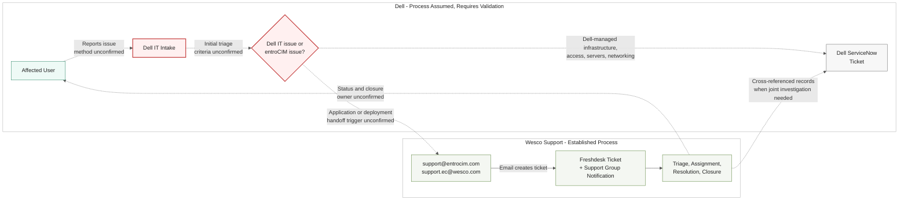
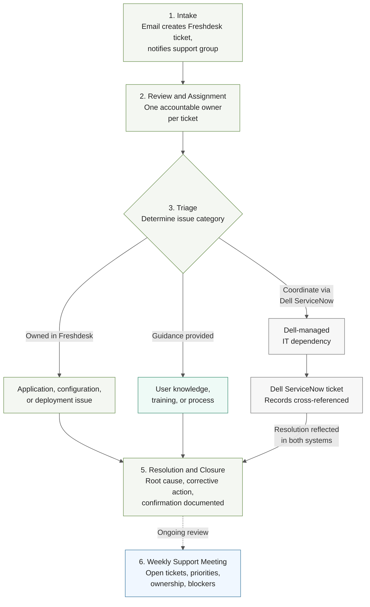

# entroCIM Support Process: Dell to Wesco

Two companion diagrams. Diagram 1 shows the end-to-end issue path across both organizations, including the unvalidated Dell-side process and the handoff. Diagram 2 shows the established Wesco Freshdesk lifecycle in detail.

---

## Diagram 1: End-to-End Issue Flow and Organizational Handoff

### Intent

Show how an issue travels from an affected user through Dell IT to Wesco support, where the handoff occurs, and which parts of the process are assumed rather than confirmed. Intended for the process agreement discussion with Dell.

Dashed arrows and red-bordered nodes mark assumed behavior. Solid arrows mark the confirmed Wesco process. The record cross-referencing between Freshdesk and ServiceNow is mutual; shown as a single arrow for renderer compatibility.

> Renderer note (2026-07-24): Miro's Mermaid plugin rejects both YAML frontmatter and the `%%{init}%%` directive. These blocks are plain Mermaid (classDefs only) so they paste cleanly into Miro.

### Assumptions

- Dell IT receives issues first and performs initial routing. This is Wesco's current understanding, not a confirmed process.
- The two Wesco support addresses are the only intended intake path into Freshdesk.

### Validation Items (to be confirmed in the process agreement)

- How users report issues to Dell
- Who performs the initial triage
- Criteria distinguishing a Dell IT issue from an entroCIM issue
- When and how an issue is submitted to Wesco support
- Who owns the issue while its source is still being determined
- When a Dell ServiceNow ticket is required
- How Freshdesk and ServiceNow records are coordinated
- Who communicates status and closure to affected users

### Exclusions

- Wesco internal lifecycle detail (see Diagram 2)
- Technical infrastructure and connectivity detail

---

## Diagram 2: Wesco Freshdesk Lifecycle

### Intent

Show the established Wesco support process from ticket creation through closure, including the triage determination and the ServiceNow coordination path.

### Assumptions

- Owner responsibilities (symptom review, impact confirmation, technical triage coordination, resource engagement, status communication, driving to closure) sit within step 2 and are documented in the process narrative rather than the diagram.
- Dell environment access is coordinated through a team member with a Dell-managed laptop; excluded from the diagram as operational detail.

### Validation Items

- Ownership and handoff responsibilities when an investigation identifies a Dell-managed dependency (to be defined in the process agreement)
- Accountable owner on each side for joint investigations

### Exclusions

- Prioritization criteria and SLA detail
- Combined-cause issues requiring joint investigation (follow the ServiceNow coordination path)
