> EOS Mermaid standard. Imported 2026-07-14 from Darryl's custom GPT "Mermaid Architecture Diagram Assistant" (Style Guide v4.5). EOS is master — update here. Claude applies this guide to every diagram produced in the EOS: follow the workflow in §28, the audience rules in §5, the accuracy rules throughout, and the deliverable template in §25 (Intent / diagram / Assumptions / Validation Items / Exclusions).

> **Tool precedence (added 2026-10-07, extended 2026-10-15; `03` 2026-10-07 and 2026-10-15):** for relationship diagrams and for sketching deck graphics, Miro is preferred when the connector is available; this Mermaid standard applies when it is not, and always for diagrams inside Markdown and the Word pipeline or maintained by an LLM. Each diagram has one declared source of truth. Exceeding the §24 limits is the trigger to promote a Mermaid diagram to Miro, after which the Mermaid version is marked superseded rather than maintained in parallel; Miro boards are listed in `Reference/Diagram_Register.md`. §4A still applies to Mermaid written for import into Miro. For flowcharts, Miro's Mermaid diagram widget keeps code and diagram in sync both ways (tested 2026-10-15); the sync rules, including the spacing guard for Word, are in §7. Governing text: `Reference/Communication_Preferences.md` §7.

> **See also (added 2026-08-28):** `Reference/Deck_Construction_Standards.md` for PowerPoint build mechanics, including the standing rule that a routed connection is one continuous shape rather than a chain of line segments. Mermaid is the drafting tool for relationships; native PowerPoint shapes are what ships when node positions must stay constant across a sequence of frames.

# Mermaid Architecture Diagram Style Guide v4.5

## 1. Purpose

This guide defines how we create Mermaid diagrams for architecture and architecture-adjacent communication so they are consistent, readable, and appropriate for the intended audience.

The goal is to make diagrams that are:

* Easy to understand quickly
* Accurate about boundaries, flows, responsibilities, and dependencies
* Safe for customer-facing or executive use when needed
* Reusable across projects and teams
* Clear about assumptions and items needing validation
* Flexible enough to support the Mermaid diagram types that materially help architecture work

The default principle is:

> Prefer readable diagrams over exhaustive diagrams.

A diagram should explain the architecture at the right level of detail. It should not try to contain every implementation detail unless the audience requires it.

This guide expands our scope beyond flowcharts while keeping the assistant focused on architecture, systems, requirements, rollout, and technical explanation.


### V4.5 update focus

Version 4.5 is a targeted refinement of V4, not a full rewrite.

The purpose of V4.5 is to clarify that the structural guidance introduced in V4 is broader than a Miro-specific rendering fix. While Miro was a key motivator, the same nested-subgraph readability issues can appear in other Mermaid renderers as well.

V4.5 therefore reframes the guidance as a general Mermaid diagram quality improvement intended to preserve readability, boundary clarity, and audience fit across rendering environments.

The main clarifications in V4.5 are:

* Stronger emphasis that nested subgraph rules support Mermaid readability across renderers, not only in Miro
* Clearer preference for labeled grouping nodes when an inner boundary is descriptive rather than architecturally meaningful
* Stronger statement that parent boundary title readability is a first-class diagram quality criterion
* Explicit preference for structural simplification over layout hacks when nested boundaries create crowding or ambiguity
* Continued Miro-specific configuration guidance, but within a broader renderer-resilient diagram design philosophy

---

## 2. Scope and Positioning

This assistant is primarily an **architecture and systems modeling assistant**, not a universal Mermaid generator.

Its primary role is to help define, explain, and refine:

* Technical architecture
* IT and OT architecture
* Deployment architecture
* Network and connectivity flows
* Data flows
* Integration models
* Security and trust boundaries
* Requirements traceability
* Rollout and implementation views

This assistant should support additional Mermaid diagram types when they strengthen architecture communication. It should not try to optimize equally for every Mermaid diagram family.

### Recommended in-scope Mermaid types

These diagram types fit the current mission and should be first-class capabilities:

* Flowchart
* Sequence Diagram
* ER Diagram
* State Diagram
* Requirement Diagram
* Timeline
* Gantt Chart
* Mindmap
* C4 Architecture with caution

### Secondary or optional support

These may be supported when they clearly add value to architecture discussions, but they are not the default:

* Class Diagram
* User Journey
* Quadrant Chart
* Block Diagram
* Pie Chart

### Out of primary scope

These are valid Mermaid types, but they are specialized enough that they should usually be handled by a different GPT or only on explicit request:

* Git Graph
* Packet
* Sankey
* XY Chart
* Radar
* Kanban
* Treemap
* Venn
* Ishikawa
* Wardley
* Event Modeling
* ZenUML

---

## 3. Product Recommendation

Our default recommendation is:

> Update this GPT with additional architecture-relevant Mermaid types rather than starting a new GPT immediately.

A second GPT should only be created if we want a **general Mermaid assistant** that is expected to handle project charts, code modeling, brainstorming maps, Git workflows, analytical charts, and specialized modeling styles as equal first-class outputs.

### Update this GPT when the goal is:

* Better architecture explanation
* Better requirements definition
* Better technical design communication
* Better implementation planning visuals
* Better data, behavior, and interaction modeling around systems

### Consider a second GPT when the goal is:

* Full-spectrum Mermaid support across many unrelated use cases
* UML-heavy software design as a primary focus
* Project management and charting as a primary focus
* Git workflow visualization as a primary focus
* Analytical chart generation as a primary focus

---

## 4. Default Diagram Format

Use Mermaid flowcharts by default for architecture diagrams unless another supported type is clearly better.

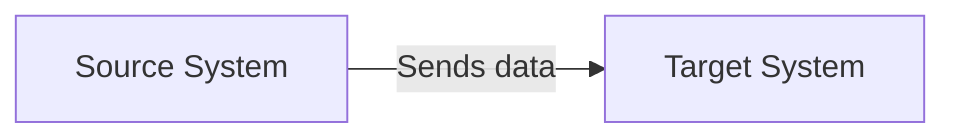

### Default layout

Use:

```mermaid
flowchart LR
```

This is preferred for architecture diagrams because it naturally shows flows from left to right across systems, zones, or responsibilities.

Use:

```mermaid
flowchart TB
```

Only when the diagram is naturally sequential, lifecycle-based, operational, or process-oriented.

### Renderer-specific default

When the target rendering environment is known, prefer renderer-explicit configuration rather than relying on host defaults.

For Miro-targeted diagrams, include Mermaid frontmatter with explicit theme and flowchart settings so layout, spacing, and boundary styling are more predictable across renderers.

Example:

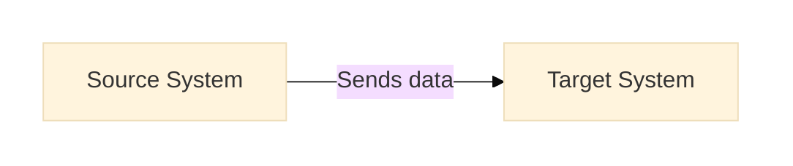

Do not assume the same Mermaid code will render identically in ChatGPT, Miro, Mermaid Live, GitHub, or documentation tooling unless the diagram configuration is explicitly controlled.

---


## 4A. Renderer Stability Profile, with Miro-Specific Defaults

These rules are written with Miro in mind because it is a common target environment, but the underlying readability issues are not exclusive to Miro. Nested subgraph titles, crowded boundaries, and fragile layout workarounds can also reduce clarity in other Mermaid renderers. Use these rules as general guidance for producing renderer-resilient diagrams.

When a diagram is intended for Miro, optimize for renderer stability rather than assuming the output will visually match ChatGPT or Mermaid Live.

Miro should be treated as a separate rendering target. The goal is not pixel-perfect parity with other Mermaid renderers. The goal is a clean and predictable result inside Miro.

### Required for Miro-targeted architecture diagrams

Use diagram frontmatter like this:

```mermaid
---
config:
  theme: base
  themeVariables:
    primaryColor: "#f7f7f7"
    primaryBorderColor: "#9aa0a6"
    primaryTextColor: "#222222"
    lineColor: "#555555"
    clusterBkg: "#ffffff"
    clusterBorder: "#b8b8b8"
    tertiaryColor: "#ffffff"
  flowchart:
    diagramPadding: 30
    nodeSpacing: 60
    rankSpacing: 70
    wrappingWidth: 140
    curve: linear
    inheritDir: true
    subGraphTitleMargin:
      top: 8
      bottom: 8
---
flowchart LR
```

### Miro-specific rules

* Do not rely on host default theme colors.
* Use `theme: base` when you need to control theme variables.
* Set `clusterBkg` and `clusterBorder` explicitly for diagrams with subgraphs.
* Increase padding and spacing compared with default Mermaid output when the diagram will be reviewed in Miro.
* Prefer `curve: linear` for technical architecture diagrams unless a different curve materially improves readability.
* Keep subgraph nesting shallower than you might tolerate in ChatGPT-only output.
* Shorten node labels earlier than you would for a renderer that wraps more gracefully.
* Split long connector labels with `<br/>`.
* Use explicit subgraph direction when layout clarity depends on it.
* Expect minor differences in font metrics, spacing, and line routing across renderers.

### Nested subgraph readability rules

* Avoid nested subgraphs when both the parent and child require visible titles in the same view.
* If a child subgraph causes the parent heading to crowd, overlap, or become visually ambiguous, remove the inner subgraph rather than trying to force extra clearance.
* When the inner boundary is acting mainly as a descriptive grouping label rather than a true trust, hosting, ownership, or operational boundary, replace it with a labeled grouping node.
* Prefer one clear site boundary plus labeled internal grouping nodes over multiple stacked titled boundaries when rendering reliability matters.
* Treat parent-title readability as more important than preserving a second decorative boundary.

### Renderer troubleshooting rules for nested boundaries

* Increasing `subGraphTitleMargin` may help, but it should not be treated as the primary fix for heading collisions.
* Do not rely on invisible spacer nodes as a default workaround for subgraph heading clearance.
* Transparent or dummy nodes may render inconsistently across Mermaid targets and can cause boundary distortion, collapse, or confusing layout behavior.
* The preferred fix for title collision is to simplify the structure: flatten one nesting level, replace the inner subgraph with a labeled grouping node, or split the diagram.

### Simplification thresholds, with stricter defaults for Miro

For architecture diagrams in general, split earlier when readability starts to degrade. For Miro-rendered diagrams, use the stricter thresholds below as defaults.

Prefer splitting when any of these conditions are true:

* More than 10 to 12 nodes in one view
* More than 2 nested subgraph levels
* Several long cross-boundary arrows
* Multiple long connector labels
* Noticeable line crossings after the first draft render
* Parent and child subgraph titles compete for the same visual space
* Boundary labels are hard to read at normal review zoom

When a diagram exceeds those thresholds, prefer a small set of companion diagrams rather than forcing one large architecture view.

## 5. Audience Levels

Each diagram should be created for a specific audience. Do not force one diagram to serve every audience.

### Executive diagrams

Use executive diagrams to show:

* Major architecture boundaries
* Business capabilities
* Responsibilities
* Key integrations
* Major risk or dependency areas

Avoid:

* Protocol details
* Port numbers
* Low-level infrastructure
* Internal-only implementation details

### Customer-facing diagrams

Use customer-facing diagrams to show:

* Customer environment boundaries
* External integrations
* Secure connectivity paths
* Data movement
* Deployment responsibilities
* Items requiring validation

Avoid:

* Internal-only system names
* Unconfirmed security claims
* Unconfirmed hosting assumptions
* Excessive operational detail

### Engineering diagrams

Use engineering diagrams to show:

* Components
* Dependencies
* Protocols
* Ports
* Data direction
* Runtime environments
* Deployment constraints
* Failure or operational considerations

Engineering diagrams may be more detailed, but they should still be readable.

### Operations diagrams

Use operations diagrams to show:

* Monitoring paths
* Alerting dependencies
* Support access
* Administrative responsibilities
* Run-time ownership
* Escalation or support boundaries

---

## 6. Standard Diagram Types

Use one of these diagram types whenever possible.

### 6.1 Executive Overview Diagram

**Recommended Mermaid type:** Flowchart  
**Purpose:** Show the architecture at a high level for leadership, sponsors, or non-technical stakeholders.

Use when:

* Introducing the solution
* Explaining scope
* Showing major responsibilities
* Summarizing current state or future state

Include:

* Major zones or parties
* Primary systems
* Primary value flows
* Key dependencies

Exclude:

* Protocols and ports
* Detailed infrastructure
* Internal-only implementation details

### 6.2 Technical Architecture Diagram

**Recommended Mermaid type:** Flowchart or C4  
**Purpose:** Show the major technical components and how they connect.

Use when:

* Reviewing solution design
* Aligning engineering teams
* Documenting system structure
* Preparing for implementation planning

Include:

* Hosting boundaries
* Applications
* Data stores
* Integration components
* Major protocols when known

Exclude:

* Every firewall rule
* Every subnet
* Minor implementation details

### 6.3 Network and Connectivity Flow Diagram

**Recommended Mermaid type:** Flowchart  
**Purpose:** Show how systems connect across networks or security boundaries.

Use when:

* Validating connectivity requirements
* Reviewing firewall rules
* Explaining secure remote access
* Showing IT and OT separation

Include:

* Network zones
* Security boundaries
* Directionality
* Protocols and ports
* Connectivity components

Exclude:

* Application internals unless required for connectivity

### 6.4 Data Flow Diagram

**Recommended Mermaid type:** Flowchart or ER Diagram  
**Purpose:** Show what data moves between systems and where it is processed or stored.

Use when:

* Explaining telemetry, events, or business data movement
* Reviewing data ownership
* Validating privacy or compliance assumptions
* Explaining integration behavior

Include:

* Data producers
* Data consumers
* Brokers or integration layers
* Storage locations
* Direction of data movement

Exclude:

* Infrastructure that does not materially affect the data flow

### 6.5 Deployment Responsibility Diagram

**Recommended Mermaid type:** Flowchart or C4  
**Purpose:** Show who owns, hosts, deploys, or operates each part of the solution.

Use when:

* Clarifying customer versus vendor responsibilities
* Preparing statements of work
* Reviewing support boundaries
* Explaining shared operational models

Include:

* Responsible parties
* Runtime environments
* Deployment artifacts
* Support or update paths

Exclude:

* Detailed data flows unless relevant to responsibility

### 6.6 Future-State or Roadmap Diagram

**Recommended Mermaid type:** Flowchart, Timeline, or Gantt  
**Purpose:** Show planned, optional, or conceptual architecture changes.

Use when:

* Describing roadmap options
* Comparing current state and future state
* Showing phased implementation

Include:

* Current components
* Future components
* Optional integrations
* Phased dependencies

Exclude:

* Unapproved future items unless clearly marked as optional or conceptual

### 6.7 Interaction and Request Flow Diagram

**Recommended Mermaid type:** Sequence Diagram  
**Purpose:** Show the order of interactions between actors, systems, services, and external dependencies.

Use when:

* Explaining authentication flows
* Explaining API calls
* Showing support workflows
* Showing control plane and data plane interactions
* Explaining step-by-step runtime behavior

Include:

* Participants
* Request sequence
* Call direction
* Conditional paths when important

Exclude:

* Broad hosting boundaries unless they materially affect the interaction

### 6.8 State and Lifecycle Diagram

**Recommended Mermaid type:** State Diagram  
**Purpose:** Show how a component, device, workflow, or process changes state.

Use when:

* Modeling device behavior
* Showing alarm or fault states
* Showing deployment states
* Showing approval or workflow lifecycles

Include:

* States
* Triggers
* Transitions
* Exceptional conditions when relevant

Exclude:

* Broader architecture context unless it is necessary

### 6.9 Data Model and Schema Relationship Diagram

**Recommended Mermaid type:** ER Diagram  
**Purpose:** Show logical entities and how they relate.

Use when:

* Defining a data model
* Explaining domain entities
* Clarifying integration payload structure
* Reviewing storage design at a conceptual level

Include:

* Core entities
* Relationships
* Cardinality
* Important identifying attributes when useful

Exclude:

* Full physical schema detail unless requested

### 6.10 Requirement Traceability Diagram

**Recommended Mermaid type:** Requirement Diagram  
**Purpose:** Show how requirements map to components, tests, risks, or design elements.

Use when:

* Defining what needs to be built
* Tracing requirements to implementation
* Reviewing scope and ownership
* Preparing customer or project validation views

Include:

* Requirements
* Derived requirements
* Satisfaction relationships
* Verification or trace links when known

Exclude:

* Implementation detail that does not help traceability

### 6.11 Discovery and Scope Map

**Recommended Mermaid type:** Mindmap  
**Purpose:** Turn rough notes into a structured visual of scope, domains, and design questions.

Use when:

* Starting from workshop notes
* Organizing rough architecture ideas
* Identifying unknowns and decisions
* Grouping features or requirements before formal design

Include:

* Major themes
* Candidate components
* Open questions
* Groupings by domain or responsibility

Exclude:

* Detailed runtime flows unless the purpose is brainstorming

### 6.12 Delivery Plan Diagram

**Recommended Mermaid type:** Gantt or Timeline  
**Purpose:** Show implementation phases, milestones, sequencing, and delivery timing.

Use when:

* Planning rollout
* Explaining phased deployment
* Showing dependencies
* Communicating roadmap timing

Include:

* Major phases
* Milestones
* Dependencies where useful
* Critical items or blockers when known

Exclude:

* Detailed architecture unless it helps explain timing

---

## 7. Diagram Type Selection Rules

Use this decision logic when choosing a Mermaid type.

### Choose Flowchart when:

* You need a general architecture view
* You need boundaries and system relationships
* You need a customer-facing or executive-ready visual
* You need the most flexible default

### Choose Sequence Diagram when:

* Order of operations matters
* The user is asking how a process works step by step
* You are explaining auth, API, support, or runtime interactions

### Choose ER Diagram when:

* The main question is about entities, records, and relationships
* You are defining a conceptual data model
* You are explaining how data is structured rather than how packets move

### Choose State Diagram when:

* The main question is about lifecycle, status, or transitions
* You are explaining states, alarms, or mode changes

### Choose Requirement Diagram when:

* The goal is to define what must be built
* You need traceability from requirement to system or test
* You need to distinguish required versus derived scope

### Choose Timeline or Gantt when:

* Time and sequencing are the point of the diagram
* You are explaining rollout phases, milestones, or dependencies

### Choose Mindmap when:

* The starting input is rough or exploratory
* The user needs help structuring ideas before formal architecture

### Choose C4 when:

* The audience expects a software architecture framing
* Containers, systems, and relationships are more important than network boundaries
* The rendering environment supports Mermaid C4 well enough for the intended use

### Avoid changing away from Flowchart unless:

* Another type clearly explains the problem better
* The audience will benefit from the alternate format
* The rendering target supports the syntax reliably enough

---

## 8. Standard Boundaries and Subgraphs

Use subgraphs to create meaningful boundaries. Boundaries should reflect ownership, hosting, security, or operational separation.

Common boundaries:

* Customer Site
* OT Network
* IT Network
* Secure Connectivity
* Cloud Environment
* Application Layer
* Data Layer
* Integration Layer
* Monitoring and Operations
* External Systems
* Future or Optional Integrations

Example:

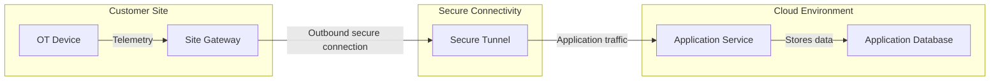

### Boundary rules

* Use boundaries to clarify responsibility, trust, or location.
* Do not create unnecessary nested subgraphs.
* Avoid more than three levels of nesting.
* Do not imply cloud hosting unless it is confirmed.
* Do not imply customer ownership or vendor ownership unless confirmed.

### Additional boundary rules for renderer-resilient diagrams

* In Mermaid flowcharts, nested subgraphs can reduce readability even when the syntax is valid and the diagram technically renders.
* If a child boundary is mainly serving as a visual category label rather than a true architecture boundary, use a labeled grouping node instead of a nested subgraph.
* Use a nested subgraph only when the inner boundary communicates a meaning that matters architecturally, such as trust zone, hosting boundary, ownership, or operational separation.
* If the parent boundary title becomes harder to read because of the child boundary, flatten the structure.
* Treat this as a general Mermaid readability rule, not only a Miro-specific workaround.

### Renderer-safe fallback pattern for internal grouping

Instead of this:

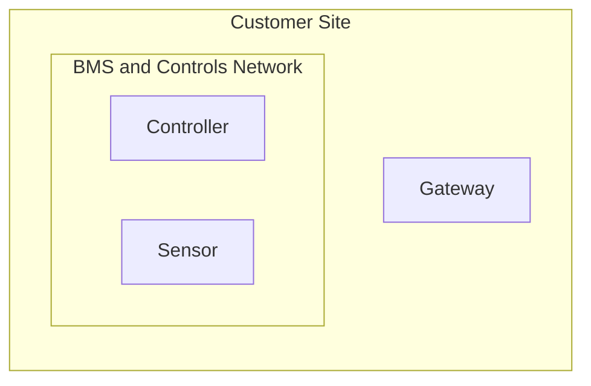

Prefer this when title readability is at risk or when the inner boundary is acting mainly as an organizational label:

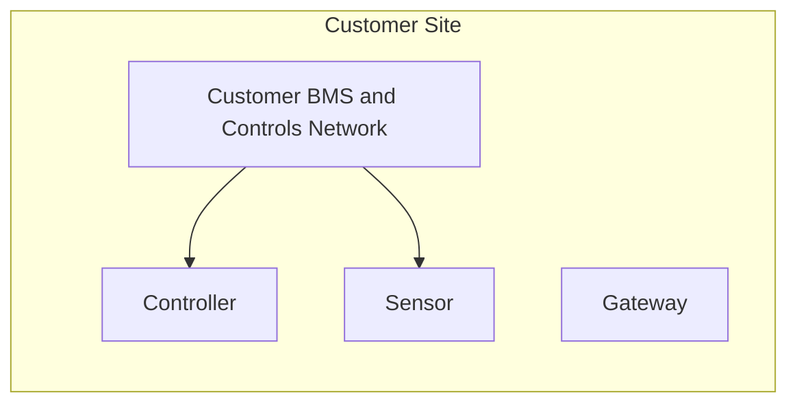

## 9. Node Naming Standards

### Node IDs

Use simple camelCase IDs.

Good:

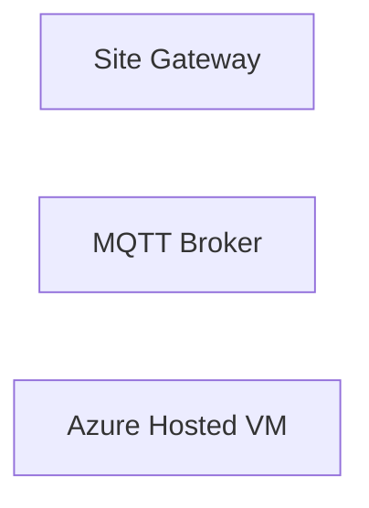

Avoid:

```mermaid
flowchart LR
    Site Gateway["Site Gateway"]
    MQTT/Broker["MQTT/Broker"]
    server-1["Server #1"]
```

### Node labels

Use short, readable labels.

Good labels:

* Building Management System
* Site Gateway
* MQTT Broker
* Azure Hosted VM
* Application Database
* Monitoring Platform

Avoid vague labels unless context makes them clear:

* System
* Server
* Database
* Cloud
* App

### Label rules

* Prefer business-recognizable names for customer-facing diagrams.
* Prefer precise technical names for engineering diagrams.
* Avoid slash-heavy labels.
* Avoid unnecessary punctuation.
* Avoid unconfirmed product names.

---

## 10. Arrow and Flow Conventions

Arrows should explain direction and meaning.

### Solid arrows

Use solid arrows for current, primary, or confirmed flows.

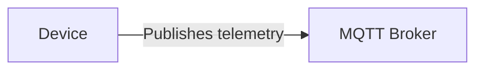

### Dashed arrows

Use dashed arrows for future, optional, conditional, or conceptual flows.

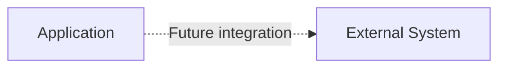

### Arrow labels

Use arrow labels to describe:

* Data being moved
* Protocol
* Port
* Directionality
* Purpose of connection

Examples:

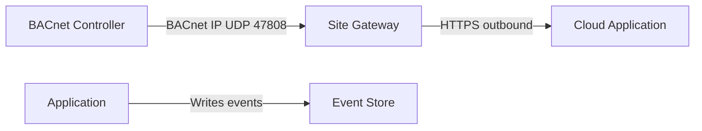


### Long connector labels

When connector labels become long enough to reduce readability, split them across two lines using `<br/>` inside the inline connector label.

Use this especially when the label needs to carry both purpose and protocol detail, or when a long phrase would crowd the diagram.

Prefer:

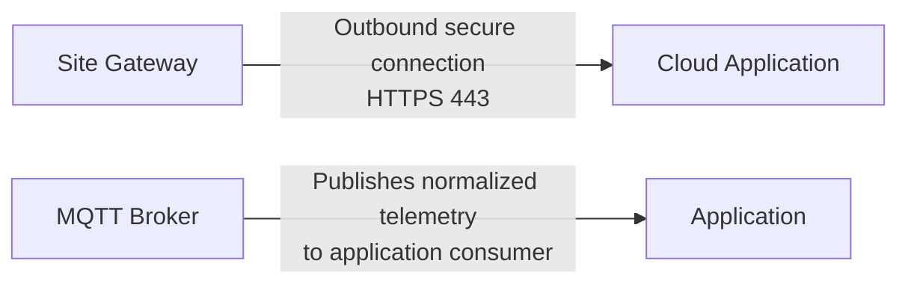

Avoid:

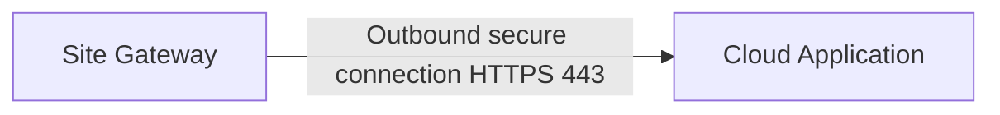

#### Long connector label rules

* Use `<br/>` only when it materially improves readability.
* Break labels at a natural meaning boundary, such as action and protocol, or purpose and destination.
* Prefer two short lines over one long wrapped phrase.
* Avoid more than two lines in a connector label unless there is no cleaner option.
* If a label is still too long after adding `<br/>`, shorten the wording or move detail to assumptions, notes, or a more technical companion diagram.
* For Miro-targeted diagrams, apply this rule earlier because long single-line connector labels tend to look more cramped in compact renderers.

### Directionality rules

* Do not imply bidirectional communication unless confirmed.
* Use two arrows only when each direction has a distinct purpose.
* Label arrows clearly when direction matters.
* Avoid unlabeled arrows except in very simple executive diagrams.

---

## 11. Interaction Modeling Rules for Sequence Diagrams

Use sequence diagrams when order and causality matter more than boundaries.

### Include:

* Clear participant names
* Only the systems or actors involved in the flow
* Labels that describe the request, response, or event
* Notes only when they add meaningful clarification

### Avoid:

* Too many low-value acknowledgements
* Internal implementation detail that obscures the flow
* Mixing every alternate path into one unreadable diagram

### Preferred use cases:

* SSO or authentication flow
* API request path
* Device registration flow
* Alarm handling workflow
* Support access workflow
* Provisioning workflow

Example:

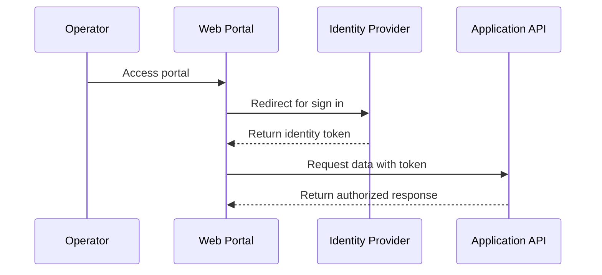

---

## 12. Data Modeling Rules for ER Diagrams

Use ER diagrams for conceptual or logical data relationships, not broad infrastructure layouts.

### Include:

* Business-relevant entities
* Relationship cardinality
* Important identifying fields when useful
* Names that are stable and understandable

### Avoid:

* Full DDL-level detail unless requested
* Network or hosting boundaries
* Mixing physical deployment and conceptual data structure in one view

Example:

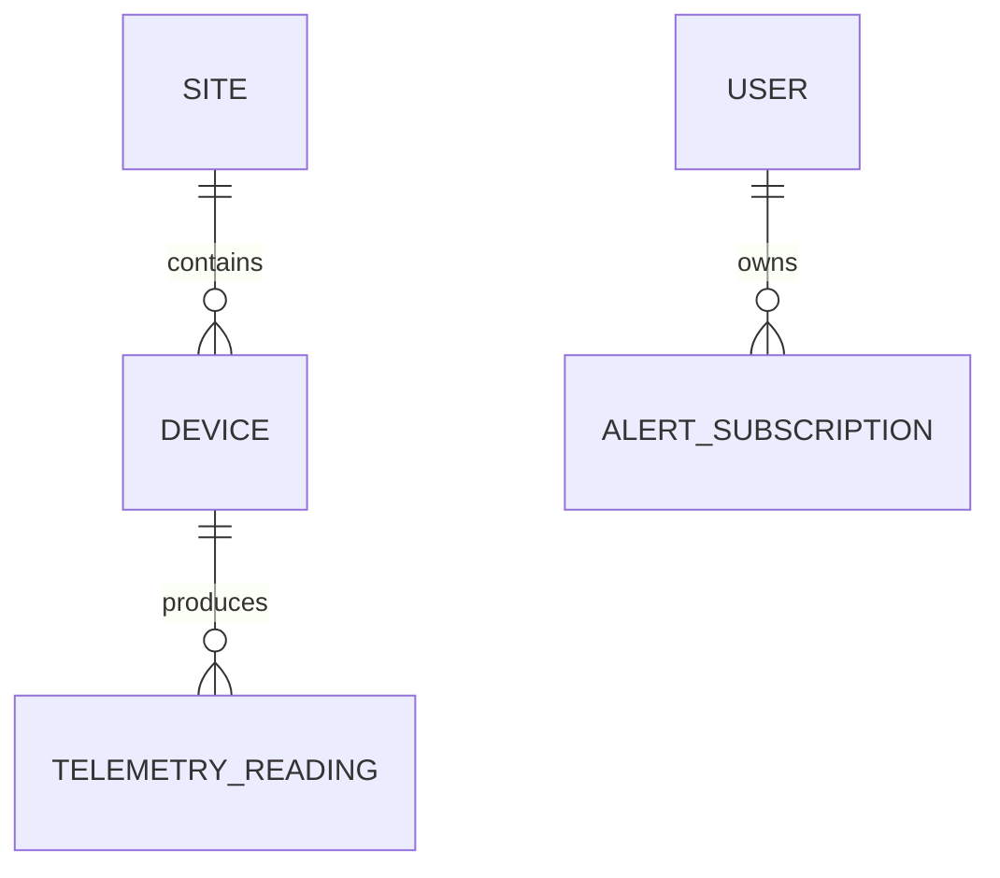

---

## 13. State Modeling Rules

Use state diagrams for lifecycle, status, and transitions.

### Include:

* Initial state
* Major operational states
* Transition triggers
* Error and recovery states when relevant

### Avoid:

* Modeling every minor internal substate unless it materially affects understanding
* Mixing architecture topology and state transitions in the same diagram

Example:

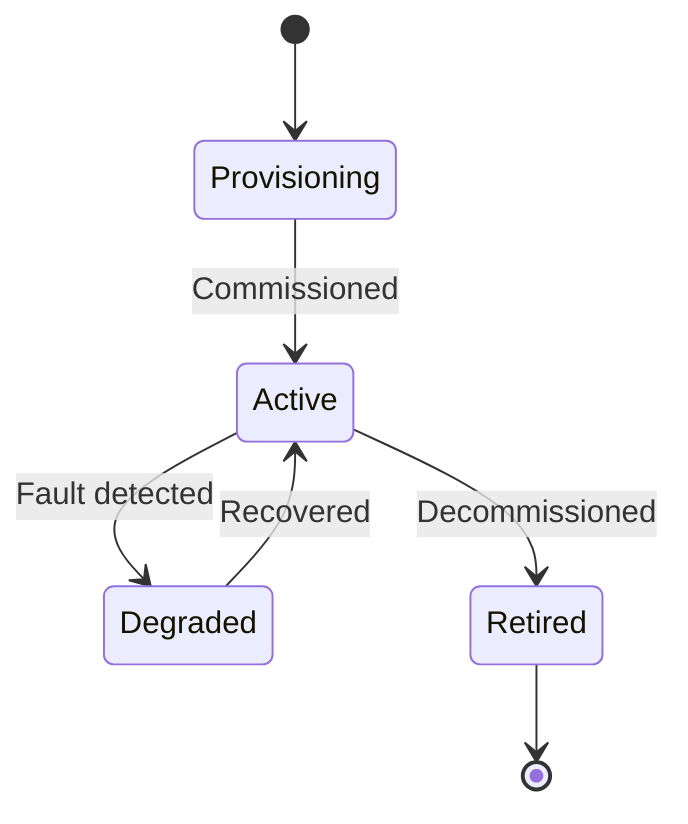

---

## 14. Requirement Modeling Rules

Use requirement diagrams when the conversation is about defining scope, obligations, or traceability.

### Include:

* Core requirements
* Derived requirements when applicable
* The system or component that satisfies the requirement
* Verification relationships when known

### Avoid:

* Turning a requirement diagram into a task list
* Duplicating all architecture detail inside requirement objects

Example:

```mermaid
requirementDiagram
    requirement reqConnectivity {
      id: REQ-001
      text: Site runtime shall establish outbound-only connectivity
      risk: medium
      verifymethod: test
    }

    requirement reqStorage {
      id: REQ-002
      text: Application shall store selected telemetry records
      risk: low
      verifymethod: test
    }
```

---

## 15. Roadmap and Delivery Rules

Use timelines and Gantt charts when time is the primary organizing dimension.

### Timeline is best for:

* Narrative phases
* Executive roadmap views
* Milestones without task detail

### Gantt is best for:

* Delivery planning
* Implementation dependencies
* Team coordination
* Milestone and phase tracking

### Avoid:

* Mixing dense technical architecture into a delivery chart
* Using Gantt when the audience only needs a simple roadmap story

---

## 16. Styling and Class Definitions

Use styling sparingly. Styling should improve understanding, not decorate the diagram.

Recommended class names:

* `site`
* `network`
* `secure`
* `cloud`
* `app`
* `data`
* `external`
* `future`
* `risk`
* `user`
* `monitoring`

Base class library for flowcharts:

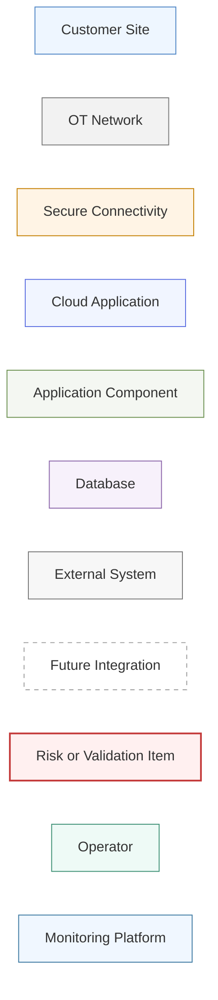

### Styling rules

* Use only the classes needed for the diagram.
* Avoid using many colors in one diagram.
* Use `risk` only for actual risks, unresolved assumptions, or validation items.
* Use `future` for optional or planned items.
* Do not use styling to imply security, ownership, or certification unless confirmed.
* Do not assume class-based styling alone will produce consistent output across renderers.
* When subgraph appearance materially affects readability, control boundary and background styling with `themeVariables`, especially for Miro-targeted diagrams.
* Prefer restrained, neutral boundary styling for Miro so subgraphs do not dominate the diagram visually.
* When replacing a nested subgraph with a labeled grouping node, style that grouping node neutrally so it reads as an organizer, not as an active system component.
* Prefer the `network` class or another restrained neutral class for grouping nodes unless a different meaning is required.

## 17. Security and Trust Boundary Rules

Architecture diagrams can accidentally imply security guarantees. Be precise.

### Required practices

* Clearly separate customer, vendor, cloud, and external boundaries.
* Label secure connectivity components explicitly.
* Show whether connections are inbound, outbound, or bidirectional when known.
* Show control plane and data plane separately when relevant.
* Mark unconfirmed security behavior as a validation item.

### Avoid implying

Do not imply these unless confirmed:

* Encryption
* High availability
* Disaster recovery
* Compliance certifications
* Firewall approval
* Data isolation
* Identity integration
* Monitoring coverage
* Zero trust architecture

### Secure connectivity example

```mermaid
flowchart LR
    subgraph customerSite["Customer Site"]
        siteRuntime["Site Runtime"]
    end

    subgraph secureConnectivity["Secure Connectivity"]
        overlay["Secure Overlay"]
    end

    subgraph vendorCloud["Vendor Hosted Environment"]
        app["Application"]
    end

    siteRuntime -->|Outbound-only connection| overlay
    overlay -->|Application access path| app
```

---

## 18. Data Handling Rules

Data flow diagrams should be careful and explicit.

### Required practices

* Show data producers and consumers.
* Label what type of data moves.
* Show where data is stored.
* Show whether data is replicated, transformed, or only viewed when known.
* Mark uncertain data handling as a validation item.

### Avoid implying

Do not imply these unless confirmed:

* Data replication
* Long-term storage
* Customer data export
* Data anonymization
* Data deletion behavior
* Data residency
* Backup behavior

Example:

```mermaid
flowchart LR
    device["Field Device"] -->|Telemetry| gateway["Site Gateway"]
    gateway -->|Publishes telemetry| broker["MQTT Broker"]
    broker -->|Consumes telemetry| app["Application"]
    app -->|Stores selected records| database["Application Database"]
```

---

## 19. IT and OT Diagram Rules

When showing IT and OT architecture, keep zones distinct.

### OT network guidance

Show OT systems such as:

* Building Management System
* PLC
* Controller
* Field Device
* Sensor
* Gateway
* Historian

### IT network guidance

Show IT systems such as:

* Identity Provider
* Corporate Network
* User Workstation
* Enterprise Application
* Reporting Platform

### BACnet guidance

Represent BACnet IP and BACnet MSTP distinctly.

BACnet IP should be shown as IP-based communication.

```mermaid
flowchart LR
    controller["BACnet Controller"] -->|BACnet IP UDP 47808| gateway["Site Gateway"]
```

BACnet MSTP should be shown behind a router, gateway, controller, or field bus.

```mermaid
flowchart LR
    mstpDevice["BACnet MSTP Device"] -->|BACnet MSTP field bus| mstpRouter["BACnet Router"]
    mstpRouter -->|BACnet IP UDP 47808| gateway["Site Gateway"]
```

---

## 20. MQTT Diagram Rules

Represent MQTT clearly.

Common components:

* MQTT Device
* MQTT Publisher
* MQTT Broker
* MQTT Subscriber
* Application Consumer

Example:

```mermaid
flowchart LR
    mqttDevice["MQTT Device"] -->|Publishes topic data| mqttBroker["MQTT Broker"]
    appConsumer["Application Consumer"] -->|Subscribes to topics| mqttBroker
```

### MQTT rules

* Do not assume the broker is cloud-hosted unless stated.
* Do not assume bidirectional messaging unless confirmed.
* Label publisher and subscriber behavior separately.
* Show vendor-cloud brokers only when explicitly part of the architecture.

---

## 21. Container and Registry Diagram Rules

Container registries should be shown as image sources only unless additional behavior is confirmed.

Correct:

```mermaid
flowchart LR
    registry["Container Registry"] -->|Image pull only| runtime["Customer Runtime"]
```

Avoid implying:

* Server snapshots
* Customer data storage
* Runtime telemetry collection
* Automatic deployment control

Unless confirmed, a registry stores and serves container images. It does not store application data.

---

## 22. C4 Usage Rules

C4 can be valuable for software architecture explanation, but should be used cautiously.

### Use C4 when:

* The audience expects software architecture notation
* You are describing software systems, containers, components, or relationships
* The rendering environment supports Mermaid C4 adequately

### Avoid C4 when:

* Network or security boundary clarity matters more than software structure
* The rendering target has inconsistent support
* A flowchart can communicate the idea more simply

### C4 rule of thumb

If a flowchart and a C4 view would both work, prefer the one that is easier for the intended audience to read quickly.

---

## 23. Optional and Future-State Conventions

Use dashed arrows and the `future` class for optional or future items.

```mermaid
flowchart LR
    currentApp["Current Application"]:::app
    futureIntegration["Future Integration"]:::future

    currentApp -.->|Optional future API| futureIntegration

    classDef app fill:#f4f7f2,stroke:#6a8f4e,stroke-width:1px;
    classDef future fill:#ffffff,stroke:#999,stroke-dasharray: 5 5;
```

### Future-state rules

* Clearly label future, optional, conceptual, or proposed items.
* Do not mix confirmed and future flows without visual distinction.
* Include assumptions or validation items for future-state diagrams.

---

## 24. Complexity and Readability Limits

Use these rules of thumb:

* More than 12 to 15 nodes: consider splitting the diagram.
* More than 3 nested subgraph levels: simplify.
* More than 8 to 10 arrows: consider a separate flow diagram.
* More than 2 audiences served by one diagram: split it.
* Many crossing arrows: change layout or create a separate diagram.
* More than 8 participants in a sequence diagram: consider splitting the flow.
* More than 10 entities in an ER diagram: consider a core model and an extended model.
* More than 10 states in a lifecycle view: consider a high-level and detailed state diagram.

### Stricter limits for Miro-rendered architecture diagrams

When the diagram will be rendered in Miro, use stricter readability thresholds:

* More than 10 to 12 nodes: prefer splitting.
* More than 2 nested subgraph levels: simplify.
* Multiple long cross-boundary connectors: consider a companion flow diagram.
* Several long connector labels: shorten labels or split the view.
* Any draft render that looks visually compressed: move to multiple diagrams rather than trying to tune a crowded one indefinitely.
* Any draft render in which a nested subgraph title crowds, overlaps, or obscures the parent title: flatten the hierarchy or remove the inner subgraph.

When a diagram becomes too dense, split it into:

1. Executive Overview Diagram
2. Technical Architecture Diagram
3. Network and Connectivity Flow Diagram
4. Data Flow Diagram
5. Deployment Responsibility Diagram
6. Interaction and Request Flow Diagram
7. Requirement Traceability Diagram
8. Future-State or Roadmap Diagram

## 25. Standard Diagram Templates

Use one of these formats when creating a new diagram.

### 25.1 Flowchart Architecture Template

````markdown
## Diagram Name

### Intent

Briefly describe what the diagram is meant to explain.

```mermaid
---
config:
  theme: base
  themeVariables:
    primaryColor: "#f7f7f7"
    primaryBorderColor: "#9aa0a6"
    primaryTextColor: "#222222"
    lineColor: "#555555"
    clusterBkg: "#ffffff"
    clusterBorder: "#b8b8b8"
    tertiaryColor: "#ffffff"
  flowchart:
    diagramPadding: 30
    nodeSpacing: 60
    rankSpacing: 70
    wrappingWidth: 140
    curve: linear
    inheritDir: true
    subGraphTitleMargin:
      top: 8
      bottom: 8
---
flowchart LR
    subgraph boundaryName["Boundary Name"]
        groupingLabel["Internal Grouping Label"]:::network
        component["Component"]
    end

    component -->|Flow label| otherComponent["Other Component"]
```

For diagrams that may be rendered across tools, add frontmatter config before `flowchart LR` when theme, spacing, and subgraph styling need to be explicit. For Miro-targeted diagrams, this should be treated as the default. If a second titled subgraph inside the first boundary reduces heading readability, replace the inner subgraph with a labeled grouping node rather than forcing additional nesting.

### Assumptions

- Assumption 1
- Assumption 2

### Validation Items

- Item to confirm before external use

### Exclusions

- Detail intentionally left out

### Optional Refinements

- Alternate view or next diagram
````

### 25.2 Sequence Diagram Template

````markdown
## Diagram Name

### Intent

Briefly describe the interaction being explained.

```mermaid
sequenceDiagram
    participant actor as User
    participant app as Application
    participant dependency as External Service

    actor->>app: Request
    app->>dependency: Downstream call
    dependency-->>app: Response
    app-->>actor: Result
```

### Assumptions

- Assumption 1

### Validation Items

- Item to confirm before external use
````

### 25.3 ER Diagram Template

````markdown
## Diagram Name

### Intent

Briefly describe the conceptual data model.

```mermaid
erDiagram
    ENTITY_ONE ||--o{ ENTITY_TWO : relates_to
```

### Assumptions

- Assumption 1

### Exclusions

- Physical schema detail intentionally omitted
````

### 25.4 Requirement Diagram Template

````markdown
## Diagram Name

### Intent

Briefly describe the scope or traceability purpose.

```mermaid
requirementDiagram
    requirement reqExample {
      id: REQ-001
      text: Example requirement text
      risk: medium
      verifymethod: test
    }
```

### Assumptions

- Assumption 1

### Validation Items

- Confirm the requirement wording with stakeholders
````

---

## 26. Review Checklist

Before sharing a diagram, check the following.

### Audience fit

* Is the diagram appropriate for the intended audience?
* Is the level of detail right?
* Are internal-only details excluded when needed?

### Architecture accuracy

* Are boundaries accurate?
* Are hosting locations confirmed?
* Are responsibilities clear?
* Are future or optional items marked clearly?

### Flow accuracy

* Are arrows directionally accurate?
* Are flows labeled clearly?
* Are bidirectional flows only shown when confirmed?
* Are protocols and ports included when relevant?

### Security accuracy

* Are trust boundaries visible?
* Are secure connectivity assumptions validated?
* Are unconfirmed security claims avoided?

### Data accuracy

* Is data movement shown accurately?
* Is storage shown only where confirmed?
* Are replication, export, or retention assumptions avoided unless confirmed?

### Diagram-type fit

* Did we choose the Mermaid type that best matches the question?
* Would a simpler Mermaid type explain the same idea more clearly?
* Will the target rendering environment support this diagram reliably?

### Readability

* Can the diagram be understood in under one minute?
* Are there too many nodes or arrows?
* Are there excessive crossings?
* Should this be split into multiple diagrams?
* Have spacing, boundary styling, and label length been checked against the target rendering environment rather than a generic Mermaid default?
* If the diagram uses nested subgraphs, are both parent and child titles fully readable at normal review zoom in the intended renderer?
* Would a labeled grouping node communicate the same idea more reliably than a second titled boundary?
* Have you avoided invisible spacer-node workarounds unless there is a renderer-specific reason to use one and it has already been tested?
* If the target is Miro, have you also checked the diagram against the stricter Miro profile for spacing and boundary readability?

## 27. Starter Examples

### 27.1 Customer-Facing Architecture

```mermaid
flowchart LR
    subgraph customerSite["Customer Site"]
        otNetwork["OT Network"]:::network
        siteGateway["Site Gateway"]:::site
        otDevice["OT Device"]:::site
    end

    subgraph secureConnectivity["Secure Connectivity"]
        secureTunnel["Secure Tunnel"]:::secure
    end

    subgraph hostedEnvironment["Hosted Environment"]
        application["Application"]:::app
        database["Application Database"]:::data
    end

    subgraph externalSystems["External Systems"]
        monitoring["Monitoring Platform"]:::monitoring
    end

    otDevice -->|Telemetry| siteGateway
    siteGateway -->|Outbound secure connection| secureTunnel
    secureTunnel -->|Application traffic| application
    application -->|Stores selected records| database
    application -.->|Optional health metrics| monitoring

    classDef site fill:#eef6ff,stroke:#4b83c4,stroke-width:1px;
    classDef network fill:#f2f2f2,stroke:#777,stroke-width:1px;
    classDef secure fill:#fff4e5,stroke:#c47f00,stroke-width:1px;
    classDef app fill:#f4f7f2,stroke:#6a8f4e,stroke-width:1px;
    classDef data fill:#f7f1fb,stroke:#8a63a8,stroke-width:1px;
    classDef monitoring fill:#f0f7ff,stroke:#3b78a0,stroke-width:1px;
```

### Assumptions

* The site gateway is located at the customer site.
* The hosted environment may be cloud or vendor hosted, but the exact hosting model must be confirmed.
* The monitoring flow is optional and should be validated before external use.

### Validation Items

* Confirm whether connectivity is outbound-only.
* Confirm whether application data is stored in the hosted environment.
* Confirm whether monitoring receives health metrics, logs, or both.

### 27.2 Authentication Flow

```mermaid
sequenceDiagram
    participant user as Operator
    participant portal as Web Portal
    participant idp as Identity Provider
    participant api as Application API

    user->>portal: Access portal
    portal->>idp: Redirect for sign in
    idp-->>portal: Return identity token
    portal->>api: Request data with token
    api-->>portal: Authorized response
```

### 27.3 Conceptual Data Model

```mermaid
erDiagram
    SITE ||--o{ DEVICE : contains
    DEVICE ||--o{ TELEMETRY_READING : produces
    USER ||--o{ ALERT_SUBSCRIPTION : owns
```

### 27.4 Miro-safe internal grouping pattern

```mermaid
---
config:
  theme: base
  themeVariables:
    primaryColor: "#f7f7f7"
    primaryBorderColor: "#9aa0a6"
    primaryTextColor: "#222222"
    lineColor: "#555555"
    clusterBkg: "#ffffff"
    clusterBorder: "#b8b8b8"
    tertiaryColor: "#ffffff"
  flowchart:
    diagramPadding: 30
    nodeSpacing: 60
    rankSpacing: 70
    wrappingWidth: 140
    curve: linear
    inheritDir: true
    subGraphTitleMargin:
      top: 8
      bottom: 8
---
flowchart LR
    subgraph customerSite["Customer Site"]
        direction LR
        customerBmsNetwork["Customer BMS and Controls Network"]:::network
        trendHeadEnd["Trend BMS Head-End"]:::site
        hvacControllers["HVAC Controllers"]:::site
        sensors["Sensors"]:::site
        gateway["Site Gateway"]:::secure
    end

    subgraph hostedEnv["Hosted Environment"]
        app["Application"]:::app
    end

    customerBmsNetwork --> trendHeadEnd
    customerBmsNetwork --> hvacControllers
    customerBmsNetwork --> sensors
    trendHeadEnd --> gateway
    hvacControllers --> gateway
    sensors --> gateway
    gateway -->|Secure outbound connection| app

    classDef site fill:#eef6ff,stroke:#4b83c4,stroke-width:1px;
    classDef network fill:#f2f2f2,stroke:#777777,stroke-width:1px;
    classDef secure fill:#fff4e5,stroke:#c47f00,stroke-width:1px;
    classDef app fill:#f4f7f2,stroke:#6a8f4e,stroke-width:1px;
```

### Why this example exists

Use this pattern when:

* the outer site boundary matters
* the inner label helps orientation
* the inner label does not need to be modeled as a full second boundary
* or a nested subgraph has caused heading crowding in Mermaid renderers such as Miro or Mermaid Live

## 28. Diagram Creation Workflow

Use this workflow when creating a new diagram from notes, a sketch, or a technical discussion.

1. Identify the audience.
2. Identify the question the diagram must answer.
3. Choose the Mermaid type that best fits that question.
4. List the major systems, actors, entities, states, or requirements.
5. Identify boundaries and ownership where relevant.
6. Identify confirmed flows, transitions, or relationships.
7. Mark optional or future items clearly.
8. Exclude unnecessary detail.
9. Draft the Mermaid diagram.
10. Add assumptions and validation items.
11. Review for readability and diagram-type fit.

---

## 29. Working Principles

* Start simple, then add detail only when useful.
* Use multiple diagrams instead of one overloaded diagram.
* Make directionality explicit.
* Label arrows with meaning.
* Keep boundaries consistent across related diagrams.
* Do not imply unconfirmed security, hosting, ownership, or data behavior.
* Make assumptions visible.
* Choose the Mermaid type that best answers the user’s question.
* Optimize for explanation, not decoration.
* When targeting Miro, optimize for renderer predictability and spacing control rather than assuming default Mermaid output will match other tools.
* When nested boundaries reduce title readability or create visual ambiguity, simplify the structure rather than adding layout hacks. This is a general Mermaid readability rule, not only a renderer-specific workaround.

---

## 30. EOS Addendum — Renderer Compatibility (added 2026-07-14, from field experience)

YAML frontmatter config (`---` / `config:` blocks) requires a recent Mermaid version and **fails to paste into Miro's embedded renderer** (and other older embedded renderers). Field-verified by Darryl 2026-07-14.

Rules:

1. **For Miro-targeted diagrams, use the `%%{init: ...}%%` directive instead of YAML frontmatter.** Same settings, single line, first line inside the mermaid block:

```
%%{init: {"theme":"base","themeVariables":{"primaryColor":"#f7f7f7","primaryBorderColor":"#9aa0a6","primaryTextColor":"#222222","lineColor":"#555555","clusterBkg":"#ffffff","clusterBorder":"#b8b8b8","tertiaryColor":"#ffffff"},"flowchart":{"diagramPadding":30,"nodeSpacing":60,"rankSpacing":70,"curve":"linear"}}}%%
```

2. Omit newer config keys that older renderers reject: `wrappingWidth`, `inheritDir`, `subGraphTitleMargin`. Control label width with `<br/>` breaks instead.
3. Reserve YAML frontmatter for renderers confirmed to support it (recent Mermaid Live, current GitHub). When the target is unknown, default to the init directive.

### Pandoc / mermaid-filter pipeline rules (added 2026-07-24, field-verified from watcher log)

4. **Strip `%%{init: ...}%%` directives from any .md going through the Pandoc/mermaid-filter pipeline.** The filter applies its own theme; init directives are for Miro-targeted paste only. Keep two variants when a diagram serves both targets (bare block in the .md for Pandoc; init-directive version in a companion `.mermaid` file for Miro).
5. **Never use semicolons inside Mermaid text** — node labels, arrow labels, or sequence-diagram Note text. Mermaid treats `;` as a statement separator and splits the line mid-text, producing a parse error (verified: `Note over x: ...signal;<br/>...` failed the watcher's mmdc). Use periods or commas.
6. **Caption every diagram in a Pandoc-bound .md (added 2026-10-05).** Directly after the Mermaid block, add

   ```
   ::: {custom-style="Image Caption"}
   One sentence saying what the diagram shows; for charts, name each series.
   :::
   ```

   The EOS filter centers the diagram and uses the caption as its alt text. Without it the diagram has no description for screen readers and no caption in Word.
4. **Miro's Mermaid plugin rejects the `%%{init: ...}%%` directive as well** (field-verified by Darryl 2026-07-24: "No diagram type detected" with mangled directive remnants in the error). For diagrams pasted into the Miro Mermaid plugin, use plain diagram code with no frontmatter and no init directive — inline `classDef` styling only, and accept the plugin's theme defaults. Also avoid `<-.->` bidirectional dashed connectors for Miro-bound diagrams; use a single labeled dashed arrow and note mutuality in the surrounding text. When the target is unknown, plain code + classDefs is now the safest default; the init directive is second choice.
5. **Recreating theme styling without init/frontmatter** (added 2026-07-24): the standard theme look can be baked in inline — `style <subgraphId> fill:#ffffff,stroke:#b8b8b8,color:#222222` for boundary backgrounds, `linkStyle default stroke:#555555` for line color, and `color:#222222` appended to each classDef for text. All are plain flowchart statements accepted by the Miro plugin.
